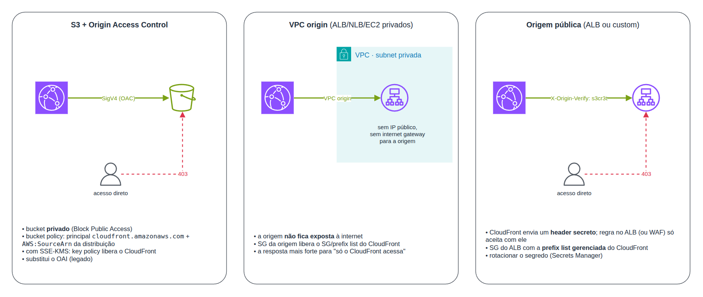
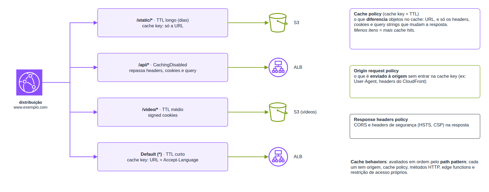
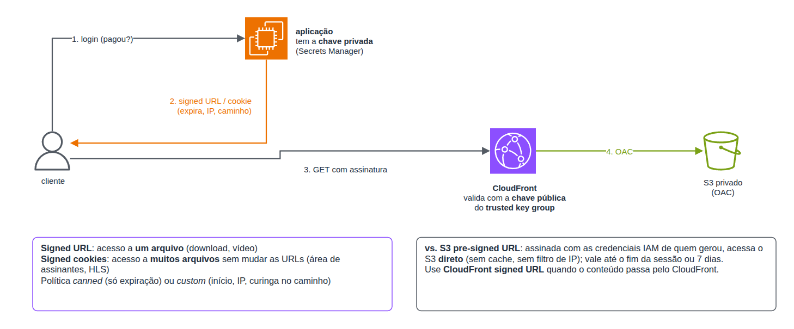
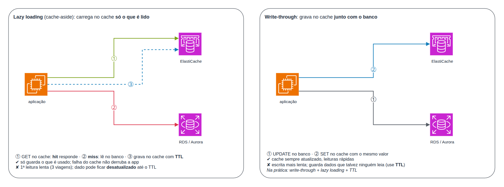
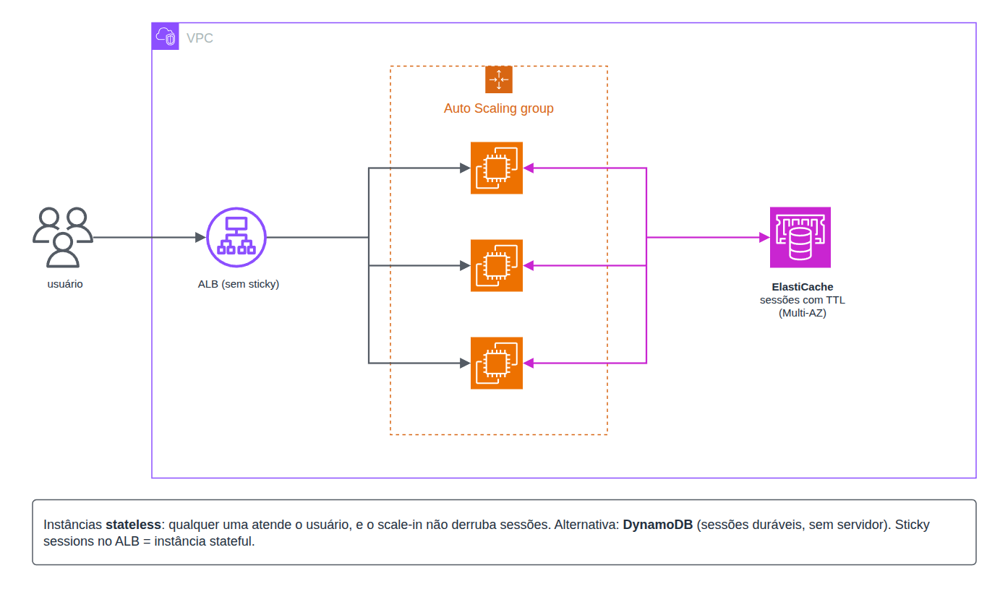
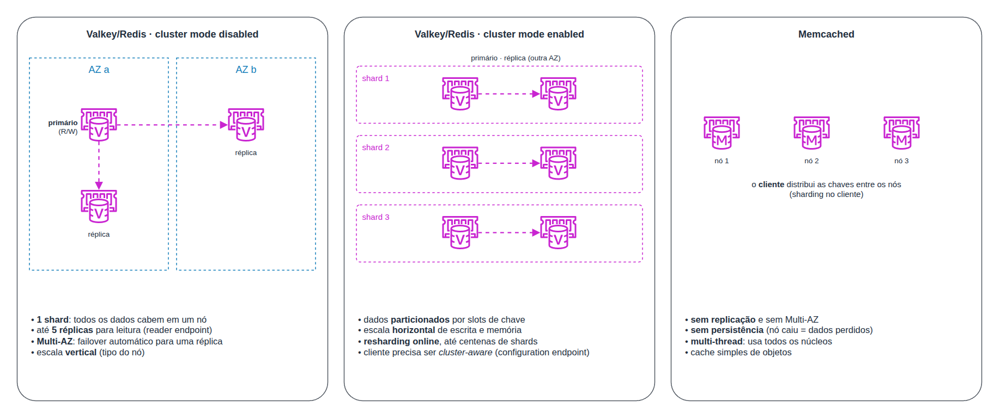
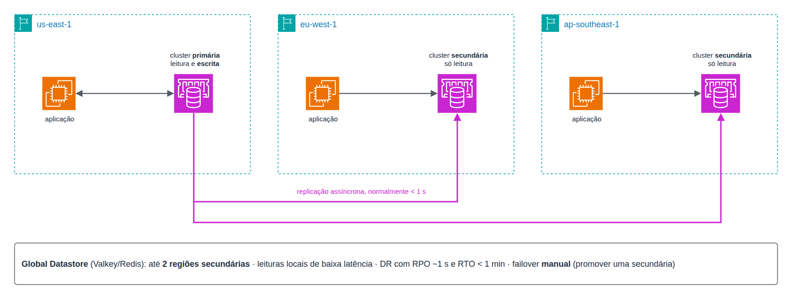
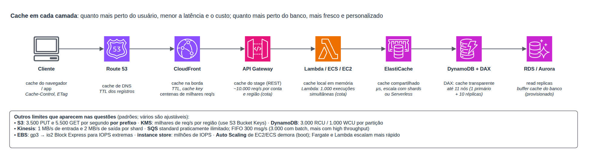

# Caching

> **Escopo:** cache na borda com o Amazon CloudFront (origens, cache key, segurança, edge functions) e cache em memória com o Amazon ElastiCache (Valkey, Redis OSS, Memcached), além de uma visão de onde cachear em cada camada de uma arquitetura e dos limites que exigem cache.
>
> **Por que cai na prova:** a SAP-C02 cobra arquiteturas que aguentam **picos e escala global** com **baixa latência** e **menor custo**: colocar o cache na **camada certa**, **proteger a origem** para que só o CloudFront a acesse, escolher entre **CloudFront Functions e Lambda@Edge**, reduzir a **carga do banco** com ElastiCache, DAX ou read replicas, e reconhecer quando um **limite de serviço** (API Gateway, Lambda, S3, KMS, DynamoDB) pede cache ou outra arquitetura.

## Índice

- **Cache na borda (CDN):** [Amazon CloudFront](#amazon-cloudfront)
- **Cache em memória:** [Amazon ElastiCache](#amazon-elasticache)
- **Revisão:** [Qual serviço usar](#revisão-qual-serviço-usar) · [Lidando com taxas extremas](#lidando-com-taxas-extremas)

## Amazon CloudFront

### Contexto: por que cache na borda

Uma aplicação hospedada em **uma região** (ex: `us-east-1`) atende bem quem está perto dela. Um usuário em São Paulo ou Tóquio, porém, paga a **latência** da distância: cada requisição atravessa continentes, e cada conexão TLS precisa de várias idas e voltas. Além disso, se milhões de usuários pedem **o mesmo arquivo** (uma imagem, um vídeo, o JavaScript do site), a origem processa e transfere esse arquivo milhões de vezes, o que gera **custo** e **carga** desnecessários.

**Cache** é guardar uma cópia de um dado **perto de quem o usa**, para não buscá-lo de novo na origem. Uma **CDN** (*Content Delivery Network*) aplica essa ideia em escala global: uma rede de servidores espalhados pelo mundo guarda cópias do conteúdo e responde aos usuários **do ponto mais próximo**. Os ganhos são três:

- **latência menor** para o usuário;
- **menos carga e custo** na origem;
- **proteção**: a CDN fica na frente da aplicação e absorve ataques e picos de tráfego.

O **Amazon CloudFront** é a CDN da AWS. Na prova, ele aparece em quase todo cenário de **conteúdo global**, **site estático**, **streaming**, **proteção da origem** e **DDoS**.

[↑ Índice](#índice)

### O que é o CloudFront

- **Distribuição:** a configuração do CloudFront, com um nome DNS (`d111111abcdef8.cloudfront.net`) ou um **domínio próprio** (CNAME/alias no Route 53, com certificado do **ACM em `us-east-1`**). Ela define as **origens**, os **cache behaviors** e as regras de segurança.
- **Conteúdo estático e dinâmico:**
  - **estático** (imagens, CSS, JS, vídeos) é guardado em cache pelo **TTL**;
  - **dinâmico** (APIs, páginas personalizadas) também ganha com o CloudFront mesmo **sem cache**, porque a conexão TLS termina perto do usuário e o tráfego até a origem segue pela **rede privada da AWS**, com conexões reaproveitadas.
- **Leitura e escrita:** além de `GET`, aceita `PUT`, `POST`, `PATCH` e `DELETE`. Por exemplo, para uploads ao S3 ou chamadas de API pela borda.
- **Protocolos:** HTTP/1.1, **HTTP/2**, **HTTP/3** (QUIC), **WebSocket** e **gRPC**. A **viewer protocol policy** pode **redirecionar HTTP para HTTPS** ou exigir HTTPS.
- **Segurança integrada:** **Shield Standard** automático, **AWS WAF**, **geo restriction**, conteúdo privado com **signed URLs/cookies** e **field-level encryption**.
- **Escopo global:** o CloudFront é um serviço **global**, gerenciado a partir de **`us-east-1`**: certificados ACM, web ACLs do WAF, métricas no CloudWatch e funções Lambda@Edge ficam nessa região.

[↑ Índice](#índice)

### Arquitetura: edge locations, regional edge caches e Origin Shield

- **Edge locations (PoPs):** centenas de pontos de presença no mundo. Recebem a requisição do usuário (o DNS do CloudFront responde com a edge mais próxima), terminam o TLS e respondem do cache quando há **cache hit**.
- **Regional edge caches:** uma camada intermediária, com cache **maior**, entre as edge locations e a origem. Guardam objetos **menos populares**, que já saíram do cache das edges, e evitam que a origem seja consultada de novo.
- **Origin Shield** (opcional, cobrado à parte): uma camada **única** de cache, em uma região escolhida perto da origem, por onde passam **todas** as requisições que não encontraram o objeto no cache. Ele aumenta o **cache hit ratio** e **reduz a carga na origem**. É útil quando a origem é cara ou frágil (ex: um servidor on-premises ou de empacotamento de vídeo) ou quando há **várias camadas de CDN**.

> **Obs:** em uma **cache miss**, só a primeira requisição de um objeto vai até a origem. Requisições simultâneas pelo mesmo objeto são agrupadas (*request collapsing*), o que protege a origem em picos.

[↑ Índice](#índice)

### Origens

- **Amazon S3:**
  - **bucket** (endpoint REST), privado, com **Origin Access Control (OAC)**: o caso mais comum, para distribuir arquivos e sites estáticos;
  - **endpoint de website** do S3: tratado como **custom origin**, porque o OAC não funciona com ele. É usado quando o site depende de **redirects** e **documentos de índice** do website hosting;
  - também é possível **enviar arquivos** ao S3 pelo CloudFront, usando a borda como entrada.
- **VPC origins:** **ALB, NLB ou instâncias EC2 em subnets privadas**, sem exposição à internet. O CloudFront alcança a origem pela rede da AWS.
- **Custom origins (HTTP/HTTPS):** qualquer servidor acessível pela internet: ALB ou EC2 públicos, **API Gateway**, **Lambda function URLs**, servidores on-premises ou de outra nuvem.
- **Mídia:** **MediaPackage** e **MediaStore**, para vídeo sob demanda e ao vivo.
- **Várias origens na mesma distribuição:** cada **cache behavior** aponta para uma origem (ex: `/static/*` → S3, `/api/*` → ALB).

> **Obs:** o CloudFront **não é** uma solução de replicação. Comparado com a **S3 Cross-Region Replication**, o CloudFront guarda **cópias temporárias** (pelo TTL) em centenas de locais, ideal para conteúdo **estático lido no mundo todo**. A **CRR** mantém **cópias completas e atualizadas** em poucas regiões escolhidas, ideal para dados **dinâmicos** com baixa latência em regiões específicas, ou para DR. Ver [Replicação (CRR e SRR)](storage.md#replicação-crr-e-srr).

[↑ Índice](#índice)

### Proteger a origem

O objetivo é que os usuários **só** acessem o conteúdo **pelo CloudFront**, sem contornar o cache, o WAF e as restrições:

- **S3 → Origin Access Control (OAC):** o bucket fica **privado**. O CloudFront assina as requisições com **SigV4**, e a **bucket policy** só aceita o principal `cloudfront.amazonaws.com` com a condição `AWS:SourceArn` igual ao ARN da distribuição. Com **SSE-KMS**, a key policy também precisa liberar o CloudFront. O **OAI** (*Origin Access Identity*) é o mecanismo **legado**. Detalhes em [CloudFront com OAC](security.md#cloudfront-com-origin-access-control-oac).
- **ALB, NLB e EC2 → VPC origins:** a origem fica em **subnet privada**, sem IP público. É a forma mais forte de garantir que **só o CloudFront** a alcance.
- **Origem pública (ALB ou custom):**
  - o CloudFront envia um **header customizado secreto** (ex: `X-Origin-Verify`), e uma regra no listener do ALB ou no **WAF regional** só aceita requisições com esse header. O segredo deve ser **rotacionado** (Secrets Manager + Lambda);
  - o **security group** da origem libera apenas a **managed prefix list** do CloudFront (`com.amazonaws.global.cloudfront.origin-facing`), em vez de manter a lista de IPs à mão.
- **HTTPS até a origem:** a **origin protocol policy** pode exigir HTTPS entre o CloudFront e a origem, com certificado válido na origem.

[↑ Índice](#índice)

### Cache behaviors, cache key e TTL

- **Cache behaviors:** regras por **caminho** (*path pattern*, como `/images/*` ou `*.jpg`), avaliadas **em ordem**, com um **default (`*`)** no fim. Cada behavior define:
  - a **origem**;
  - os **métodos HTTP** permitidos;
  - a **viewer protocol policy** (HTTP/HTTPS);
  - as **policies** de cache, de requisição e de resposta;
  - as **edge functions**;
  - a restrição a **signed URLs/cookies**.
- **Cache key:** o que diferencia um objeto de outro no cache. Por padrão, só o **domínio e o caminho** da URL. Incluir **headers, cookies ou query strings** na cache key faz o CloudFront guardar **versões diferentes** do objeto. Quanto **mais** itens, **menor** o cache hit ratio. Inclua só o que **realmente muda a resposta** (ex: `Accept-Language` para páginas traduzidas).
- **Policies:**
  - **cache policy:** define a **cache key** e os **TTLs** (mínimo, padrão e máximo). Há policies gerenciadas, como `CachingOptimized` e `CachingDisabled` (para APIs);
  - **origin request policy:** define o que é **enviado à origem** **sem** entrar na cache key (ex: `User-Agent`, cookies de sessão, headers de geolocalização do CloudFront);
  - **response headers policy:** adiciona headers na resposta, como **CORS** e headers de segurança (**HSTS**, CSP, X-Frame-Options).
- **TTL:** por padrão **24 horas**. A origem pode controlar o tempo com os headers `Cache-Control` e `Expires`, dentro dos limites mínimo e máximo da cache policy.
- **Atualizar conteúdo antes do TTL:**
  - **invalidation:** remove objetos do cache por caminho (`/index.html`, `/images/*`). As primeiras **1.000 paths por mês** são gratuitas, e o restante é cobrado;
  - **versionamento de arquivos** (`app.v2.js`, `logo-3f9a.png`): a **prática recomendada**. A nova versão tem outra URL, então não depende de invalidação, permite rollback e evita servir versões misturadas.

> **Obs:** um **cache hit ratio baixo** quase sempre vem de uma **cache key grande demais**, por exemplo encaminhando **todos** os headers, cookies ou query strings. A correção é enxugar a cache key e mover para a **origin request policy** o que a origem precisa receber, mas que não muda a resposta. Uma CloudFront Function também pode **normalizar** a requisição (ex: ordenar query strings, padronizar maiúsculas).

[↑ Índice](#índice)

### Alta disponibilidade: origin failover

- **Origin group:** uma origem **primária** e uma **secundária**. Se a primária responder com um dos **códigos de erro configurados** (ex: 500, 502, 503, 504, 403, 404) ou não responder a tempo, o CloudFront **repete a mesma requisição** na secundária.
- O failover é **por requisição**, sem esperar propagação de DNS, e vale só para **`GET`, `HEAD` e `OPTIONS`**.
- As origens podem estar em **regiões diferentes**. O padrão clássico é **S3 em duas regiões com CRR**, ou **ALBs em duas regiões**, para **alta disponibilidade regional** de conteúdo estático.
- Para **escritas** e failover de toda a aplicação entre regiões, o CloudFront não basta: use **Route 53** (failover, latência) ou **Global Accelerator**.

> **Obs:** páginas de erro personalizadas (**custom error pages**) devolvem um objeto próprio (ex: `/erros/503.html` no S3) quando a origem responde **4xx ou 5xx**. O **Error Caching Minimum TTL** define por quanto tempo o CloudFront guarda o erro em cache antes de tentar a origem de novo (padrão de 10 segundos).

[↑ Índice](#índice)

### Restringir o acesso ao conteúdo

- **Signed URLs e signed cookies:** liberam conteúdo **privado** só para quem a aplicação autorizar (ex: assinantes de um serviço de vídeo, cursos pagos):
  1. o usuário se autentica na **aplicação**;
  2. a aplicação gera uma **URL** ou um **cookie assinado** com a **chave privada**, definindo **expiração** e, opcionalmente, **início**, **IP de origem** e **caminho** (com curinga);
  3. o CloudFront valida a assinatura com a **chave pública**, cadastrada em um **trusted key group**.
- **Signed URL vs. signed cookies:**
  - **signed URL:** um **arquivo** específico (download de um instalador, um vídeo). Funciona com clientes que não aceitam cookies;
  - **signed cookies:** **muitos arquivos** sem mudar as URLs (toda a área de assinantes, segmentos de vídeo HLS/DASH).
- **Políticas:**
  - **canned:** só a expiração;
  - **custom:** data de início, IP e caminhos com curinga.
- **Key groups vs. key pairs:** use **trusted key groups**, gerenciados por IAM. Os **CloudFront key pairs** são **legados** e exigem o usuário **root**.

| | **CloudFront signed URL** | **S3 pre-signed URL** |
|---|---|---|
| Acesso | Pelo **CloudFront** (com cache), a qualquer origem | **Direto no S3**, sem CloudFront |
| Assinatura | Par de chaves do **key group** | **Credenciais IAM** de quem gerou a URL |
| Restrições | Expiração, início, **IP**, caminho com curinga | Só expiração (até 7 dias, ou o fim da sessão da role) |
| Quando usar | Conteúdo **distribuído pelo CloudFront** | Upload ou download pontual **direto no bucket** |

- **Geo restriction:** **allow list** ou **block list** de **países**, por distribuição (ex: **direitos autorais** que só permitem exibir um filme em certos países). O país é identificado pelo IP. Para regras mais ricas (país **e** caminho, ou país **e** taxa), use o **geo match do WAF**. Ver [AWS WAF](security.md#aws-web-application-firewall-waf).
- **Field-level encryption:** o CloudFront **criptografa campos específicos** de um `POST` (ex: número de cartão, CPF) com uma **chave pública**, **na borda**. Só o componente da aplicação que tem a **chave privada** consegue ler o campo, mesmo que outras camadas (logs, proxies, microsserviços) vejam a requisição.
- **Segurança na borda:**
  - **AWS WAF** associado à distribuição (web ACL criada em `us-east-1`), que bloqueia os ataques **na borda**, antes da região;
  - **Shield Standard** automático, e **Shield Advanced** para proteção e suporte avançados. Ver [AWS Shield](security.md#aws-shield);
  - **TLS:** certificado do **ACM em `us-east-1`**. Ver [ACM](security.md#aws-certificate-manager-acm). Uma **security policy** define a versão mínima de TLS, e o **SNI** é o padrão (sem custo).

[↑ Índice](#índice)

### Customização na borda: CloudFront Functions e Lambda@Edge

Às vezes é preciso **rodar código** na requisição ou na resposta, perto do usuário: reescrever URLs, validar tokens, adicionar headers, escolher a origem. O CloudFront oferece dois tipos de **edge function**, que **não guardam cache**: só alteram requisições e respostas.

- **Quatro pontos de execução:**
  - **viewer request:** quando o CloudFront **recebe** a requisição do usuário, antes de olhar o cache;
  - **origin request:** antes de **enviar à origem**, só em **cache miss**;
  - **origin response:** quando **recebe a resposta** da origem, antes de guardar em cache;
  - **viewer response:** antes de **devolver** a resposta ao usuário.
- **CloudFront Functions:**
  - **JavaScript leve**, executado nas **edge locations**, só nos eventos **viewer**;
  - tempo **abaixo de 1 ms**, 2 MB de memória, código de até 10 KB, **milhões de requisições por segundo**, custo muito menor;
  - pode ler dados de configuração no **CloudFront KeyValueStore** (ex: tabela de redirects ou flags de A/B).
- **Lambda@Edge:**
  - **Node.js ou Python**, executado nos **regional edge caches**, nos **quatro eventos**;
  - mais tempo (segundos), mais memória (até **10 GB** nos eventos de origem), **acesso à rede**, ao **body** da requisição e ao **SDK da AWS**;
  - a função é criada em **`us-east-1`** e replicada pelo CloudFront.
- As duas podem ser **combinadas** (ex: CloudFront Function no viewer request e Lambda@Edge no origin request), mas **não no mesmo evento**.

| Caso de uso | Use |
|---|---|
| Normalizar a **cache key**, manipular **headers**, **redirects** e **rewrites** de URL | **CloudFront Functions** |
| Validar um **token JWT** sem chamar serviços externos | **CloudFront Functions** |
| Teste **A/B** ou entregar conteúdo por **dispositivo** (`User-Agent`) | **CloudFront Functions** |
| Autenticar consultando o **Cognito** ou um provedor **OIDC**, ou qualquer chamada de rede | **Lambda@Edge** |
| **Escolher a origem** dinamicamente (ex: bucket da região mais próxima do usuário) | **Lambda@Edge** (origin request) |
| Ler ou alterar o **body**, gerar respostas com bibliotecas, processar imagens | **Lambda@Edge** |

> **Obs:** para cenários de **aplicação global**, o Lambda@Edge pode responder APIs dinâmicas consultando, por exemplo, uma **DynamoDB Global Table** na região mais próxima. Assim, a lógica roda perto do usuário, e só os dados ficam replicados.

[↑ Índice](#índice)

### Monitoramento e implantação

- **Métricas no CloudWatch** (em `us-east-1`): requisições, bytes, **taxas de erro 4xx/5xx** e, com métricas adicionais habilitadas, **cache hit rate** e latência da origem.
- **Standard logs** (access logs): cada requisição registrada no **S3**, no **CloudWatch Logs** ou no **Data Firehose**, com alguns minutos de atraso. São usados para análise com **Athena**.
- **Real-time logs:** enviados em **segundos** para o **Kinesis Data Streams**, com amostragem configurável. São usados para monitoramento e detecção em tempo real.
- **Continuous deployment:** uma **staging distribution** recebe uma **porcentagem do tráfego** ou as requisições com um **header** específico, para testar mudanças de configuração antes de **promovê-las** à distribuição de produção.
- **IPs anycast estáticos:** uma lista fixa de IPs para a distribuição, usada quando clientes ou operadoras precisam liberar **IPs fixos** (ex: *zero-rating* de operadoras móveis).

[↑ Índice](#índice)

### Custo do CloudFront

- **Pay-as-you-go:**
  - **transferência de dados para a internet** (varia por região do mundo; mais barata nos EUA e na Europa);
  - **requisições** HTTP/HTTPS;
  - recursos opcionais: Origin Shield, invalidações além da cota gratuita, real-time logs, edge functions, field-level encryption.
- **Transferência da origem AWS para o CloudFront é gratuita** (S3, ALB, EC2). Servir pelo CloudFront costuma ser **mais barato** que servir direto do S3 ou do EC2 para a internet.
- **Price classes:** limitam as edge locations usadas para **reduzir custo**:
  - **All:** todas, melhor desempenho;
  - **200:** exclui as regiões mais caras;
  - **100:** só as mais baratas (América do Norte e Europa).

  Usuários de regiões fora da classe são atendidos pela edge mais próxima **dentro** da classe, com mais latência.
- **Planos de preço fixo (flat-rate):** desde o fim de 2025, a AWS também oferece planos mensais por distribuição (Free, Pro, Business, Premium), **sem cobrança por excedente**. Eles incluem CloudFront, **WAF**, proteção DDoS, DNS no Route 53 e créditos de S3, com recursos que variam por plano.
- **Reduzir custo:**
  - aumentar o **cache hit ratio** (cache key enxuta, TTLs maiores, **Origin Shield**);
  - comprimir conteúdo (**gzip/Brotli** automático);
  - escolher a **price class** certa;
  - usar o **CloudFront Security Savings Bundle**, que dá desconto em troca de compromisso de uso e inclui créditos de WAF.

[↑ Índice](#índice)

### CloudFront vs. outras opções

| Necessidade | Solução |
|---|---|
| Conteúdo **HTTP(S)**, estático ou dinâmico, para usuários **globais**, com **cache** | **CloudFront** |
| Tráfego **TCP/UDP** (jogos, VoIP, IoT), **IPs estáticos** e failover regional rápido, **sem cache** | **Global Accelerator**. Ver [Global Accelerator, CloudFront ou Route 53?](compute-and-load-balancing.md#global-accelerator-cloudfront-ou-route-53) |
| Cópias **completas e atualizadas** dos objetos em outras regiões | **S3 Cross-Region Replication** |
| **Uploads** rápidos de usuários distantes **direto para um bucket** | **S3 Transfer Acceleration** (usa as edge locations, mas sem cache) |
| Direcionar usuários para a **região** certa (latência, geolocalização, failover) | **Route 53** |
| Latência de **um dígito de milissegundo** para usuários em uma cidade ou rede 5G | **Local Zones / Wavelength** |
| Site estático com HTTPS e domínio próprio | **S3 + CloudFront + OAC** (+ Route 53 e ACM). Ver [Site estático](storage.md#site-estático-e-requester-pays) |

[↑ Índice](#índice)

### Dicas para a prova

- "Reduzir **latência** para usuários **globais** e **carga na origem**" → **CloudFront**. Para conteúdo **dinâmico**, o CloudFront também ajuda (TLS na borda + rede da AWS), mesmo com `CachingDisabled`.
- "Bucket acessível **somente pelo CloudFront**" → **OAC** + bucket policy com `AWS:SourceArn`. Com SSE-KMS → liberar o CloudFront na **key policy**.
- "ALB/EC2 **sem exposição à internet**, só acessível pelo CloudFront" → **VPC origins**. "ALB público aceitar **só tráfego do CloudFront**" → **header secreto** + regra no ALB/WAF e **prefix list** do CloudFront no security group.
- "**Cache hit ratio** baixo" / "origem sobrecarregada" → enxugar a **cache key** (só os headers, cookies e query strings necessários), aumentar TTLs, **Origin Shield**.
- "Publicar uma nova versão sem esperar o TTL" → **versionar os nomes dos arquivos** (preferível) ou **invalidation**.
- "Alta disponibilidade do conteúdo estático entre **regiões**" → **origin group** (primária + secundária) com **S3 CRR**.
- "Conteúdo pago ou privado só para usuários autorizados" → **signed URLs** (um arquivo) ou **signed cookies** (muitos arquivos), com **trusted key groups**.
- "Restringir por **país** por direitos autorais" → **geo restriction**. "País **e** outras condições" → **WAF geo match**.
- "Proteger dados sensíveis de um formulário **desde a borda** até um serviço específico" → **field-level encryption**.
- "Certificado para domínio próprio no CloudFront" → **ACM em `us-east-1`**. "Web ACL para o CloudFront" → escopo global, **`us-east-1`**.
- "Reescrever URLs, headers, redirects, validar JWT, A/B **com latência mínima e alto volume**" → **CloudFront Functions**. "Chamar outros serviços, acessar o body, usar SDK ou escolher a origem" → **Lambda@Edge**.
- "**Reduzir custo** do CloudFront sem atender o mundo todo" → **price class 100/200**.
- "Testar uma mudança de configuração com parte do tráfego" → **continuous deployment** (staging distribution).
- "Monitorar requisições **em tempo real**" → **real-time logs** para Kinesis Data Streams. "Analisar acessos depois" → **standard logs** no S3 + Athena.
- "Aplicação **TCP/UDP** ou que precisa de **IPs estáticos** e failover em segundos" → **Global Accelerator**, não CloudFront.
- "Mostrar uma página amigável quando a origem falha" → **custom error pages** + **Error Caching Minimum TTL**.

[↑ Índice](#índice)

## Amazon ElastiCache

### Contexto: por que um cache em memória

O CloudFront guarda conteúdo **na borda**, perto do usuário. Mas boa parte do custo de uma aplicação está **dentro** dela: consultas ao banco de dados que se repetem milhares de vezes por segundo, cálculos caros, chamadas a APIs lentas. Um banco relacional lê do **disco** e responde em **milissegundos**. Quando a carga de leitura cresce, a solução tradicional é aumentar a instância ou criar réplicas, o que é **caro** e tem limite.

Um **cache em memória** guarda os resultados mais usados na **RAM**, que responde em **microssegundos**, e evita repetir o trabalho. Ele também resolve outro problema: aplicações com várias instâncias precisam de um lugar **compartilhado** para guardar o estado do usuário (sessão, carrinho), para que qualquer instância possa atendê-lo. Assim, a aplicação fica **stateless**.

O **Amazon ElastiCache** é o cache em memória **gerenciado** da AWS, compatível com **Valkey**, **Redis OSS** e **Memcached**. Ele está para os caches como o RDS está para os bancos relacionais: a AWS cuida de instalação, patches, monitoramento, failover e backups. Na prova, ele é a resposta para **reduzir a carga de leitura** do banco, **guardar sessões** e **baixar a latência** com dados em memória.

[↑ Índice](#índice)

### O que é o ElastiCache

- **Armazenamento chave-valor em memória**, com latência de **microssegundos** e centenas de milhares de operações por segundo por nó.
- **Gerenciado:** provisionamento, patches, substituição de nós com falha, failover Multi-AZ, backups e métricas.
- **Fica na VPC:** a aplicação acessa por um **endpoint** privado, protegido por **security groups**. Não há acesso público direto.
- **Exige mudança no código:** a aplicação precisa **decidir** o que guardar, quando ler do cache e quando invalidar. Não é transparente como o CloudFront ou o DAX.
- **Duas formas de uso:**
  - **ElastiCache Serverless:** sem gerenciar nós; escala automaticamente e cobra por **dados armazenados** e por **ECPUs** (unidades de processamento) consumidas;
  - **clusters baseados em nós:** você escolhe o **tipo e a quantidade de nós**, com mais controle e custo previsível (inclusive com **reserved nodes**).

[↑ Índice](#índice)

### Engines: Valkey, Redis OSS e Memcached

| | **Valkey / Redis OSS** | **Memcached** |
|---|---|---|
| Estruturas de dados | Ricas: strings, hashes, listas, sets, **sorted sets**, streams, geoespacial, JSON | Só **strings** (chave-valor simples) |
| Replicação e Multi-AZ | **Sim**: até 5 réplicas por shard, **failover automático** | **Não** |
| Sharding | **Cluster mode enabled** (gerenciado pelo serviço) | Pelo **cliente** (cada nó é independente) |
| Persistência e backup | **Snapshots** (backup e restore) | Não nos clusters de nós (só no Serverless) |
| Recursos extras | **Pub/Sub**, transações, scripts Lua, TTL por chave, **Global Datastore** | **Multi-thread**, simples |
| Quando usar | A **maioria** dos casos: alta disponibilidade, sessões, rankings, dados que não podem sumir | Cache **simples** e descartável, que precisa usar vários núcleos por nó |

- **Valkey** é o fork **open source** do Redis, mantido pela Linux Foundation depois que o Redis mudou de licença. É compatível com o Redis OSS e é a **opção recomendada** pela AWS: custa **até 33% menos** no Serverless e **20% menos** em nós.
- Na prova, ainda aparece só "**Redis vs. Memcached**". A regra é: precisa de **alta disponibilidade, replicação, persistência ou estruturas de dados** → **Redis/Valkey**. Precisa de um cache **simples, multi-thread e descartável** → **Memcached**.

[↑ Índice](#índice)

### Estratégias de cache

O cache só ajuda se a aplicação souber **o que guardar** e **por quanto tempo**. As estratégias clássicas:

- **Lazy loading (cache-aside):**
  1. a aplicação procura no cache;
  2. se **encontrar** (*cache hit*), responde;
  3. se **não encontrar** (*cache miss*), lê no banco e **grava no cache** para as próximas leituras.

  O cache só guarda o que é **realmente lido**, e uma falha do cache não derruba a aplicação, que volta a ler do banco. Em compensação, a primeira leitura é **mais lenta** (três viagens) e o dado pode ficar **desatualizado** se o banco mudar.
- **Write-through:** a cada **escrita** no banco, a aplicação também atualiza o cache. O cache fica **sempre atualizado**, mas cada escrita fica mais lenta, e o cache pode guardar dados que ninguém vai ler.
- **TTL (time to live):** cada chave **expira** depois de um tempo. Limita quanto um dado pode ficar desatualizado e libera memória. É usado **junto** com as duas estratégias anteriores.
- **Na prática:** **lazy loading + TTL** para quase tudo, e **write-through** para os dados que **não podem ficar desatualizados**.

**Cuidados que caem em questões:**

- **Memória cheia:** quando a memória acaba, o ElastiCache **expulsa** chaves (*eviction*), normalmente as menos usadas (LRU). Muitas evictions indicam que é preciso **mais memória** (nó maior ou mais shards) ou TTLs menores.
- **Thundering herd:** quando uma chave muito acessada expira, muitas requisições dão miss ao mesmo tempo e todas vão ao banco. Use TTLs com **variação aleatória** (*jitter*), **pré-aquecimento** do cache ou um **lock** para que só uma requisição recarregue a chave.
- **O que não cachear:** dados que mudam a cada leitura, que precisam de **consistência forte** ou que quase nunca se repetem.

[↑ Índice](#índice)

### Casos de uso

- **Cache de banco de dados:** resultados de consultas caras ao RDS, Aurora ou DynamoDB. Reduz a **carga de leitura** e o **custo** do banco, que pode ficar menor.
- **Session store:** guardar a **sessão** do usuário fora das instâncias. Qualquer instância atende qualquer usuário, o **Auto Scaling** pode remover instâncias sem derrubar sessões, e o ALB não precisa de **sticky sessions**.
- **Rankings (leaderboards):** os **sorted sets** mantêm a ordem automaticamente (top 10 de um jogo, produtos mais vendidos) com operações em tempo constante ou logarítmico.
- **Rate limiting e contadores:** incrementos atômicos (`INCR`) com TTL, para limitar requisições por usuário ou contar visualizações.
- **Pub/Sub e filas leves:** mensagens em tempo real (chat, notificações) com Pub/Sub ou Streams.
- **Dados geoespaciais:** "restaurantes a menos de 2 km" com os comandos geo.
- **Cache de respostas de APIs** ou de cálculos caros (ex: preços, recomendações).

> **Obs:** para sessões, a alternativa ao ElastiCache é o **DynamoDB** (serverless, durável, com TTL nativo). O ElastiCache tem **latência menor**. O DynamoDB tem **durabilidade** e não precisa de nós nem VPC.

[↑ Índice](#índice)

### Topologia, alta disponibilidade e escala

- **Cluster mode disabled (Valkey/Redis):**
  - **um shard**: um nó **primário** (leitura e escrita) e até **5 réplicas** (só leitura);
  - todos os dados precisam caber na memória **de um nó**;
  - endpoints: **primary endpoint** (escritas) e **reader endpoint** (distribui as leituras entre as réplicas);
  - escala **vertical** (tipo do nó) para memória e escrita, e **réplicas** para leitura.
- **Cluster mode enabled (Valkey/Redis):**
  - os dados são **particionados** em vários **shards**, cada um com seu primário e suas réplicas;
  - escala **horizontal** de **memória** e de **escrita**;
  - **resharding online**: adicionar ou remover shards sem parar;
  - o cliente usa o **configuration endpoint** e precisa ser *cluster-aware*.
- **Memcached:** vários nós **independentes**, sem réplicas. O **cliente** distribui as chaves entre os nós. Se um nó cai, os dados dele são **perdidos**, e o cache precisa ser recarregado do banco.
- **Multi-AZ com failover automático** (Valkey/Redis): as réplicas ficam em **outras AZs**. Se o primário falhar, uma réplica é **promovida** automaticamente, e o **endpoint DNS não muda**. É a resposta para **alta disponibilidade** do cache.
- **Auto scaling:** nos clusters com **cluster mode enabled**, o número de **shards** e de **réplicas** pode escalar automaticamente por métricas. O **Serverless** escala sozinho.
- **Data tiering:** nos nós **r6gd**, os itens **menos usados** vão da RAM para **SSD NVMe** local. Isso aumenta a capacidade por um custo bem menor, com alguns **centésimos de milissegundo** a mais de latência nos itens que estão no SSD. Serve para datasets grandes em que só uma parte (até ~20%) é acessada com frequência.

[↑ Índice](#índice)

### Global Datastore

- Replica um cluster Valkey/Redis para **até 2 regiões secundárias**.
- **Uma região primária** recebe as **escritas**. As secundárias são **só leitura** e atendem as aplicações locais com **baixa latência**.
- A replicação é **assíncrona**, normalmente **abaixo de 1 segundo**.
- Em um desastre, você **promove** uma secundária a primária (failover **manual**), com **RTO** normalmente abaixo de 1 minuto.
- Casos de uso:
  - **leituras locais** em aplicações globais;
  - **DR entre regiões** do cache. Combina com **Aurora Global Database** ou **DynamoDB Global Tables** na camada de dados.

[↑ Índice](#índice)

### Segurança do ElastiCache

- **Rede:** o cluster fica em **subnets privadas** da VPC, com **security groups** liberando só a aplicação na porta do engine (6379 para Valkey/Redis, 11211 para Memcached).
- **Criptografia:**
  - **em trânsito:** **TLS** entre os clientes e o cache, e entre os nós;
  - **em repouso:** discos, snapshots e swap criptografados, com chave gerenciada pela AWS ou **customer managed key** do KMS.
- **Autenticação** (Valkey/Redis):
  - **AUTH token:** uma senha única para o cluster (modelo antigo);
  - **RBAC (Role-Based Access Control):** **usuários** com senha e **permissões por comando e por chave** (ex: um serviço só pode ler chaves `sessao:*`);
  - **autenticação IAM:** o cliente se conecta com um **token IAM temporário**, sem senha guardada na aplicação. É a resposta de **menor esforço** para eliminar senhas.
- **Credenciais** de RBAC podem ficar no **Secrets Manager**, com rotação.

[↑ Índice](#índice)

### Backup e persistência

- **Snapshots** (Valkey/Redis e Memcached Serverless): **automáticos** (com retenção configurável) ou **manuais**. Servem para **restaurar** um novo cluster, **migrar** entre tipos de nó ou **copiar** para outra região ou conta, exportando para o **S3**.
- O ElastiCache é um **cache**: os dados vivem na **memória**. Réplicas Multi-AZ e snapshots reduzem a perda, mas **não garantem durabilidade total** (escritas recentes podem se perder em uma falha). O banco de dados continua sendo a **fonte da verdade**.
- **Precisa de um banco em memória durável** (o Redis como banco **principal**, sem outro banco por trás)? → **Amazon MemoryDB**, que grava cada escrita em um **log transacional Multi-AZ**.

> **Obs:** os slides citam o **AOF** (*Append Only File*) como forma de persistência do Redis. Nas versões recentes do ElastiCache, o AOF não está disponível. A AWS recomenda **Multi-AZ com réplicas** para disponibilidade e o **MemoryDB** para durabilidade.

[↑ Índice](#índice)

### Monitoramento e custo do ElastiCache

- **Métricas no CloudWatch:**
  - **CPU** (no Valkey/Redis, a `EngineCPUUtilization`, porque o processamento de comandos é principalmente single-thread);
  - **memória** (`DatabaseMemoryUsagePercentage`) e **`Evictions`**: evictions altas indicam que falta memória;
  - **`CacheHits` / `CacheMisses`** (taxa de acerto): poucos hits indicam TTL curto ou estratégia ruim;
  - **conexões** (`CurrConnections`) e **lag de replicação**.
- **Custo:**
  - **nós:** por hora do tipo de nó. **Reserved nodes** de 1 ou 3 anos dão desconto, e o **data tiering** reduz o custo por GB;
  - **Serverless:** por GB armazenado e por ECPU;
  - **Valkey** é mais barato que Redis OSS e Memcached;
  - transferência entre AZs e regiões (Global Datastore), e armazenamento de snapshots além do gratuito.
- O ElastiCache costuma **reduzir o custo total**, porque permite usar um **banco menor** e menos réplicas de leitura.

[↑ Índice](#índice)

### ElastiCache vs. outras opções

| Necessidade | Solução |
|---|---|
| Cache de consultas a **RDS/Aurora** ou de qualquer dado da aplicação, com controle total | **ElastiCache** |
| Cache **transparente** para o **DynamoDB**, sem mudar a lógica de acesso (mesma API) | **DynamoDB Accelerator (DAX)** |
| Banco **principal** em memória, compatível com Redis/Valkey, **durável** | **Amazon MemoryDB** |
| Escalar leituras do banco **sem mudar o código** de cache, com dados sempre atualizados | **Read replicas** do RDS/Aurora |
| Muitas **conexões** de Lambda ou aplicações ao RDS | **RDS Proxy** (pool de conexões, não cache) |
| Cache de **conteúdo HTTP** perto do usuário | **CloudFront** |
| Cache de respostas de uma **API REST** sem código | **Cache do API Gateway** (stage cache) |
| Sessões **duráveis** e serverless | **DynamoDB** com TTL |

[↑ Índice](#índice)

### Dicas para a prova

- "Reduzir a **carga de leitura** do RDS/Aurora" e "a mesma consulta se repete muito" → **ElastiCache** (lazy loading). Se o cenário exige **não mudar o código** → **read replicas**.
- "Aplicação **stateless**", "usuários perdem a sessão quando o Auto Scaling remove instâncias" → sessões no **ElastiCache** (ou DynamoDB), em vez de **sticky sessions**.
- "**Ranking** em tempo real de um jogo" → **Valkey/Redis sorted sets**.
- "Cache com **alta disponibilidade**, **replicação** e **backup**" → **Valkey/Redis** com **Multi-AZ**. "Cache simples, **multi-thread**, sem replicação" → **Memcached**.
- "Dado no cache **desatualizado**" → **write-through** e/ou **TTL** menor. "Cache enche de dados que ninguém lê" → **lazy loading** + **TTL**.
- "Muitas **evictions**" → aumentar a memória (nó maior ou mais **shards**). "Dataset maior que a memória de um nó" → **cluster mode enabled**.
- "Dataset grande com poucos itens quentes, reduzir custo" → **data tiering** (r6gd).
- "Cache com leituras locais em **várias regiões**" ou "DR do cache entre regiões" → **Global Datastore**.
- "Capacidade imprevisível, **sem gerenciar nós**" → **ElastiCache Serverless**.
- "Eliminar senhas da aplicação para acessar o Redis" → **autenticação IAM**. "Permissões por comando e por chave" → **RBAC**.
- "Criptografar o cache" → **TLS** em trânsito + **KMS** em repouso.
- "Banco principal compatível com Redis, **sem perder dados**" → **MemoryDB**, não ElastiCache.
- "Cache para o **DynamoDB** sem mudar o código" → **DAX**, não ElastiCache.
- "Reduzir custo do ElastiCache com uso estável" → **reserved nodes** e engine **Valkey**.

[↑ Índice](#índice)

## Revisão: qual serviço usar

Resumo das comparações que mais aparecem nas questões. Os detalhes estão nas seções de cada serviço.

### Visão geral: onde cachear

Uma requisição pode encontrar cache em várias camadas. Quanto **mais perto do usuário**, menor a latência e o custo, e mais requisições deixam de chegar ao backend. Quanto **mais perto do banco**, mais **atualizado** e **personalizado** é o dado guardado.

| Camada | Cache | Quando usar |
|---|---|---|
| Cliente | Navegador ou app, controlado por `Cache-Control` e `ETag` | Arquivos estáticos que o próprio usuário repete |
| DNS | TTL dos registros no **Route 53** | TTL alto reduz consultas; TTL baixo acelera failover |
| Borda | **CloudFront** | Conteúdo estático e respostas de API iguais para muitos usuários |
| API | **Cache do stage do API Gateway** (REST) | Respostas de API repetidas, sem escrever código |
| Aplicação | Memória local da instância ou da função | Dados pequenos e quase fixos (configurações); cada instância tem sua cópia |
| Cache compartilhado | **ElastiCache** | Consultas ao banco, sessões, rankings, contadores |
| Banco | **DAX** (DynamoDB), **read replicas** (RDS/Aurora) | Escalar leituras sem lógica de cache na aplicação (DAX) ou com dados sempre atualizados (réplicas) |

[↑ Índice](#índice)

[↑ Índice](#índice)

### Cache na borda (CloudFront)

| Pergunta do cenário | Solução |
|---|---|
| Conteúdo global com baixa latência e menos carga na origem | [CloudFront](#o-que-é-o-cloudfront) |
| Origem cara ou frágil, muitas requisições chegando nela | [Origin Shield](#arquitetura-edge-locations-regional-edge-caches-e-origin-shield) |
| Só o CloudFront acessa o S3 / o ALB | [OAC / VPC origins / header secreto](#proteger-a-origem) |
| Cache hit ratio baixo / publicar nova versão | [Cache key enxuta / versionamento ou invalidation](#cache-behaviors-cache-key-e-ttl) |
| Conteúdo estático disponível mesmo com a região fora | [Origin group + S3 CRR](#alta-disponibilidade-origin-failover) |
| Conteúdo pago / bloquear países / proteger campos de formulário | [Signed URLs/cookies / geo restriction / field-level encryption](#restringir-o-acesso-ao-conteúdo) |
| Código leve na borda vs. código com rede e SDK | [CloudFront Functions vs. Lambda@Edge](#customização-na-borda-cloudfront-functions-e-lambdaedge) |
| Logs em tempo real / testar mudança com parte do tráfego | [Real-time logs / continuous deployment](#monitoramento-e-implantação) |
| Reduzir custo | [Price classes, cache hit ratio, flat-rate](#custo-do-cloudfront) |
| CloudFront, Global Accelerator, CRR ou Transfer Acceleration? | [Comparação](#cloudfront-vs-outras-opções) |

[↑ Índice](#índice)

### Cache em memória (ElastiCache)

| Pergunta do cenário | Solução |
|---|---|
| Reduzir a carga de leitura do banco / guardar sessões | [ElastiCache](#casos-de-uso) |
| Redis/Valkey ou Memcached? | [Engines](#engines-valkey-redis-oss-e-memcached) |
| Dado desatualizado / cache cheio de dados inúteis | [Write-through, lazy loading e TTL](#estratégias-de-cache) |
| Alta disponibilidade / dataset maior que um nó / dados frios mais baratos | [Multi-AZ / cluster mode enabled / data tiering](#topologia-alta-disponibilidade-e-escala) |
| Leituras locais e DR em várias regiões | [Global Datastore](#global-datastore) |
| Acesso sem senha / permissões por comando | [IAM / RBAC](#segurança-do-elasticache) |
| Banco em memória durável | [MemoryDB](#backup-e-persistência) |
| ElastiCache, DAX, MemoryDB, read replicas ou RDS Proxy? | [Comparação](#elasticache-vs-outras-opções) |

[↑ Índice](#índice)

### Lidando com taxas extremas

Quando o cenário fala em **milhões de usuários**, **picos repentinos** ou **centenas de milhares de requisições por segundo**, a pergunta é qual camada vai **saturar primeiro**. Cache e serviços que escalam sozinhos aliviam as camadas com limites.

| Camada | Limite ou comportamento (padrões, muitos ajustáveis) | Como aliviar |
|---|---|---|
| **CloudFront** | Centenas de milhares de requisições por segundo por distribuição | Já é a camada de maior capacidade: coloque-a na frente de tudo |
| **API Gateway** | ~**10.000 req/s** por conta e região (burst de 5.000) | Cache do stage, CloudFront na frente, aumento de cota |
| **Lambda** | **1.000 execuções simultâneas** por região | Aumento de cota, **reserved/provisioned concurrency**, fila (SQS) para absorver picos |
| **EC2 / ECS com Auto Scaling** | Escala em **minutos** (boot e bootstrap) | Escalonamento preditivo ou agendado, warm pools, **Fargate** ou **Lambda** para picos rápidos |
| **ElastiCache** | Escala com nós, réplicas e **shards** (ou Serverless) | Cluster mode enabled, réplicas de leitura |
| **DAX** | Até **11 nós** (1 primário + 10 réplicas) | Nós maiores, mais réplicas |
| **RDS / Aurora** | Capacidade **provisionada** (instância) | ElastiCache, read replicas, RDS Proxy para conexões, Aurora Serverless v2 |
| **DynamoDB** | On-demand escala sozinho; **3.000 RCU / 1.000 WCU por partição** | Chaves de partição bem distribuídas, DAX para leituras quentes |
| **S3** | **3.500 PUT** e **5.500 GET** por segundo **por prefixo** | Distribuir em vários prefixos, CloudFront para leituras |
| **KMS** | Milhares de req/s por região (cota compartilhada) | **S3 Bucket Keys**, data key caching, aumento de cota |
| **SQS** | Standard praticamente ilimitado; FIFO **300 msg/s** (3.000 com batch; mais no modo high throughput) | Standard quando a ordem não importa, batch, high throughput FIFO |
| **Kinesis Data Streams** | **1 MB/s** (ou 1.000 registros/s) de entrada e **2 MB/s** de saída **por shard** | Mais shards, modo on-demand, enhanced fan-out |
| **EBS / instance store** | gp3 com IOPS provisionadas; **io2 Block Express** para IOPS extremas; instance store com **milhões de IOPS** | Tipo de volume certo, RAID 0, instance store para dados temporários |

> **Obs:** os números acima são **cotas padrão** e mudam com o tempo. Na prova, o que importa é reconhecer **qual camada é o gargalo** e a solução típica: **cache** (CloudFront, API Gateway, ElastiCache, DAX), **desacoplamento com filas** (SQS, Kinesis) ou um serviço que **escala sozinho** (Lambda, Fargate, DynamoDB on-demand).

[↑ Índice](#índice)
