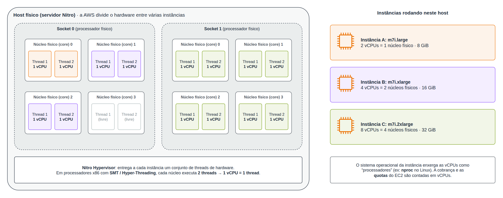
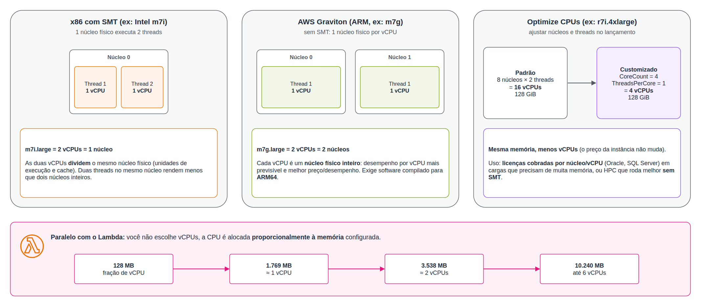
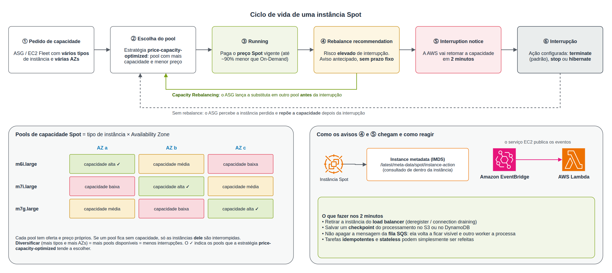
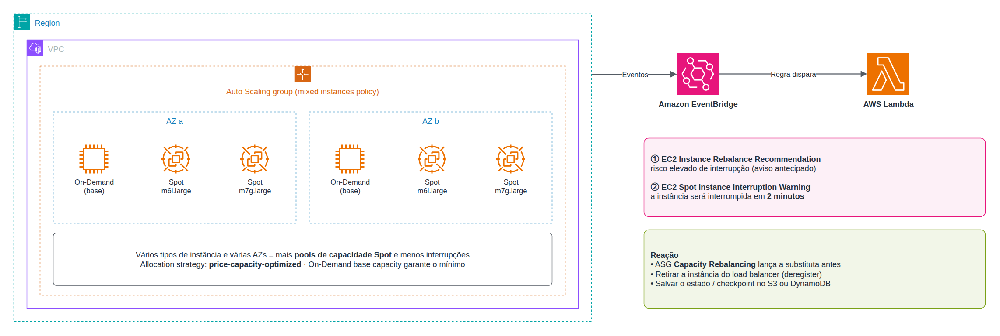
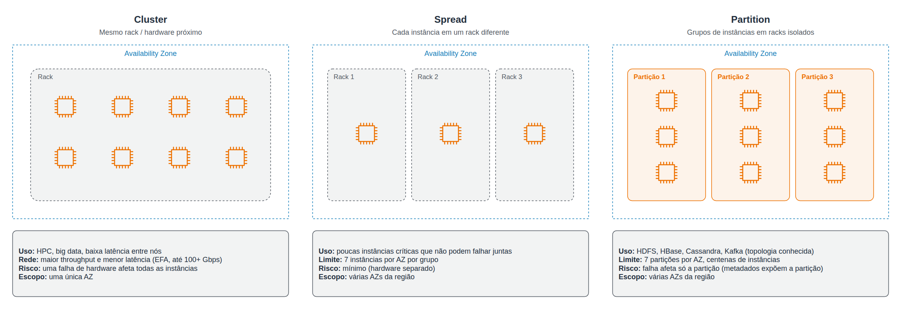
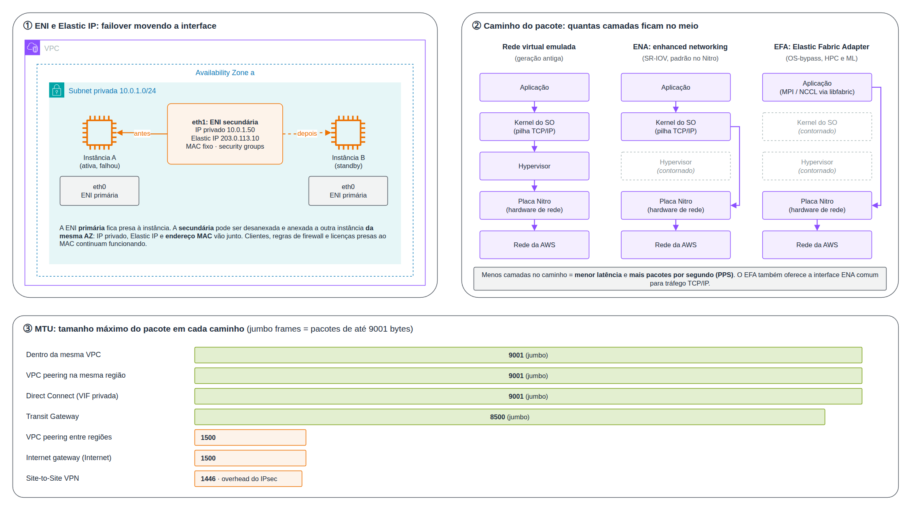
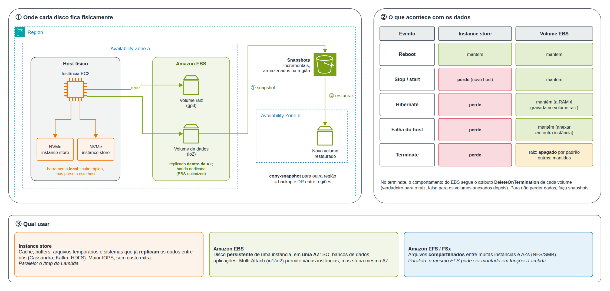
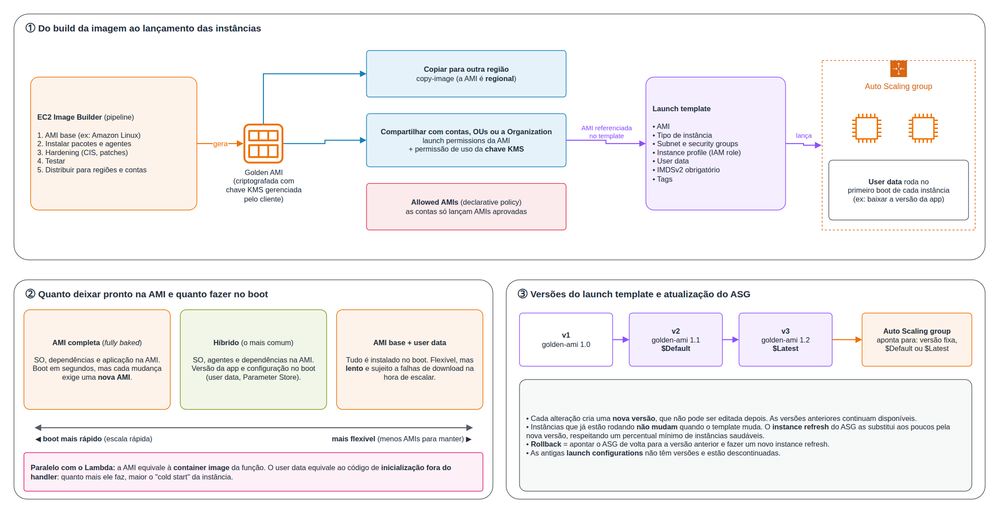
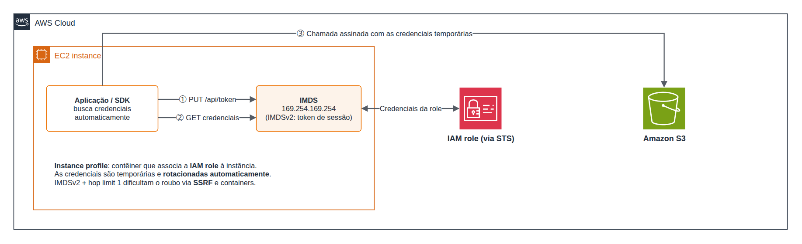

# Compute and Load Balancing

> **Escopo:** _(em uma frase, o que este arquivo cobre)_
>
> **Por que cai na prova:** _(o ângulo que a SAP-C02 costuma explorar)_

## Índice

- **Compute:** [Amazon EC2](#amazon-elastic-compute-cloud-ec2)
- **Revisão:** [Qual serviço usar](#revisão-qual-serviço-usar)

## Amazon Elastic Compute Cloud (EC2)

O Amazon EC2 oferece **servidores virtuais** (instâncias) sob demanda na AWS. Em vez de comprar um servidor físico, você escolhe uma "configuração" de CPU, memória, rede e disco, liga a máquina em minutos e paga apenas pelo tempo de uso. Por baixo, a AWS mantém data centers com milhares de servidores físicos (**hosts**). Cada host é dividido em várias máquinas virtuais por um **hypervisor**, e cada uma delas é uma **instância** que você controla como se fosse um computador seu: escolhe o sistema operacional, instala software, define quem acessa.

**Vindo do Lambda:** a melhor forma de entender o EC2 é pensar em tudo o que o Lambda faz por você e que, no EC2, passa a ser **sua responsabilidade**. No Lambda, você entrega o código e a AWS cuida do servidor, da escala, dos patches e da disponibilidade. No EC2, você recebe o **servidor** e decide todo o resto. Em troca, ganha controle total: sem limite de 15 minutos de execução, escolha de SO, GPU, disco local, processos que ficam rodando o tempo todo e licenças de software tradicionais.

| No Lambda... | No EC2... |
|---|---|
| Você configura a **memória** e a CPU vem proporcional | Você escolhe o **tipo de instância** (combinação fixa de vCPU, memória, rede e disco) |
| Escala automática por requisição, **até zero** | Escala com um **Auto Scaling group**, em instâncias inteiras, e normalmente com um mínimo de instâncias sempre ligadas |
| Paga por **invocação e duração** (ms) | Paga por **segundo de instância ligada**, mesmo ociosa |
| Alta disponibilidade **multi-AZ automática** | Você distribui as instâncias em **várias AZs** e coloca um **load balancer** na frente |
| **Execution role** entrega credenciais à função | **Instance profile** entrega credenciais à instância (via IMDS) |
| Pacote de deploy / **container image** | **AMI** (imagem do disco) + **user data** (script de boot) |
| Configuração da função (memória, timeout, VPC, variáveis) | **Launch template** |
| Ambiente efêmero, `/tmp` descartável | Instância **persistente**: o disco EBS sobrevive a reinícios. O **instance store** se comporta como o `/tmp` |
| **Cold start** | **Tempo de boot** (de dezenas de segundos a minutos) |
| Concorrência reservada / limite de concorrência | **Capacity Reservations** / **quotas de vCPU** |
| Logs e métricas no CloudWatch automaticamente | Métricas básicas automáticas; **logs, memória e disco** exigem o **CloudWatch agent** |
| A AWS aplica os patches do runtime | **Você** aplica os patches do SO (ex: **SSM Patch Manager**) |

Na SAP-C02, o foco não é como criar uma instância, e sim **escolher** o tipo de instância, a **opção de compra**, o **posicionamento** e a estratégia de **resiliência** certos para cada cenário, com o menor custo e esforço operacional.

- As instâncias rodam no **AWS Nitro System**: hardware dedicado para rede, armazenamento e segurança, que entrega desempenho próximo ao bare metal e isola a instância até mesmo dos operadores da AWS.
- Cada instância roda em uma **Availability Zone**. A alta disponibilidade vem de distribuir instâncias em **várias AZs** (normalmente com **Auto Scaling** e **load balancer**).
- O **modelo de responsabilidade compartilhada** coloca o sistema operacional, os patches, as aplicações e os security groups sob responsabilidade do **cliente**.

### Tipos de instância

Um **tipo de instância** é o "tamanho e formato" da máquina virtual: quantas **vCPUs** (CPUs virtuais, explicadas a seguir), quanta **memória RAM**, quanta **largura de banda de rede** e se ela tem **disco local**. As aplicações têm gargalos diferentes: um servidor web precisa de equilíbrio, um banco em memória precisa de muita RAM, um treinamento de ML precisa de GPU. Por isso, a AWS agrupa os tipos em **famílias**, cada uma otimizada para um recurso. Escolher a família certa é a primeira alavanca de custo: pagar por memória que a aplicação não usa é desperdício.

> **Paralelo com o Lambda:** no Lambda, só há um controle, a **memória**, e a CPU acompanha. No EC2, você escolhe a **proporção** entre CPU e memória pela família. As famílias **C** têm mais CPU por GB, as **R** têm mais memória por vCPU. A arquitetura **arm64 (Graviton)** do Lambda é o mesmo processador das instâncias com `g` no nome, com a mesma vantagem de preço.

#### O que é uma vCPU

A **vCPU** (*virtual CPU*) é a unidade de processamento que a AWS entrega para uma instância. Ela é o que o sistema operacional enxerga como um "processador": o comando `nproc` no Linux ou o Gerenciador de Tarefas no Windows mostram uma CPU para cada vCPU. Para entender o que existe por trás dela, é preciso olhar o hardware em camadas:

1. **Host:** o servidor físico no data center da AWS.
2. **Socket:** cada chip de processador encaixado na placa-mãe. Um host costuma ter 1 ou 2.
3. **Núcleo (core):** cada processador tem vários núcleos, e cada núcleo é uma unidade independente capaz de executar instruções.
4. **Thread de hardware:** em processadores **x86** (Intel e AMD), a tecnologia **SMT** (*Simultaneous Multithreading*, chamada de **Hyper-Threading** pela Intel) faz cada núcleo executar **2 threads** ao mesmo tempo. Elas compartilham as unidades de execução e o cache do núcleo, aproveitando os momentos em que uma delas fica esperando dados da memória.

Na maioria das instâncias x86, **1 vCPU = 1 thread de hardware**, ou seja, **meio núcleo físico**. O **Nitro Hypervisor** reparte as threads do host entre as instâncias. Uma `m7i.large` (2 vCPUs) recebe as duas threads de **um** núcleo, e uma `m7i.2xlarge` (8 vCPUs) recebe **quatro** núcleos.

**Por que isso importa:**

- **x86 vs. Graviton:** os processadores **Graviton** não usam SMT, então **1 vCPU = 1 núcleo físico inteiro**. Duas vCPUs de uma `m7g.large` não disputam o mesmo núcleo como as de uma `m7i.large`, o que deixa o desempenho por vCPU mais previsível. Algumas famílias AMD recentes (ex: `m7a`) também entregam 1 núcleo por vCPU.
- **Licenciamento:** softwares como **Oracle** e **SQL Server** podem ser licenciados por **núcleo** ou **vCPU**. A opção **Optimize CPUs** permite lançar a instância com **menos núcleos** (`CoreCount`) e/ou **sem SMT** (`ThreadsPerCore = 1`), mantendo a mesma memória. Assim, uma carga que precisa de muita RAM não paga licença para CPUs que não usa. O preço da instância **não** muda. Para controlar licenças por **socket**, o caminho é o **Dedicated Host**, que mostra os sockets e núcleos físicos.
- **HPC:** algumas cargas de computação científica rodam melhor **sem SMT**, cada thread com um núcleo só para ela. Por isso as instâncias **Hpc** já vêm com SMT desligado.
- **Burstable (T):** a "linha de base" das instâncias T é um **percentual de cada vCPU** (ex: 20%). Acima disso, a instância gasta créditos de CPU.
- **Quotas:** os limites On-Demand e Spot por região são contados em **vCPUs**, não em número de instâncias.

> **Paralelo com o Lambda:** no Lambda, você nunca escolhe vCPUs. A CPU é alocada **proporcionalmente à memória**: cerca de **1 vCPU a cada 1.769 MB**, chegando a **6 vCPUs com 10.240 MB**. Por isso, aumentar a memória de uma função com CPU como gargalo a deixa mais rápida mesmo sem precisar de RAM. Se o código não for **multi-thread**, a partir de ~1.769 MB ele não aproveita as vCPUs extras, e o mesmo vale para o EC2: uma aplicação de thread única não fica mais rápida em uma instância com 16 vCPUs.

#### Nomenclatura e famílias

O nome de um tipo de instância segue o padrão **família + geração + atributos + tamanho**. Exemplo: `m7gd.2xlarge` = família **m** (uso geral), geração **7**, **g** (processador **Graviton**), **d** (disco **NVMe** local, instance store), tamanho **2xlarge**.

| Família | Otimizada para | Exemplos de uso |
|---|---|---|
| **General purpose** (M, T) | Equilíbrio de CPU, memória e rede | Servidores web, aplicações em geral. **T** = burstable (créditos de CPU) |
| **Compute optimized** (C) | CPU | Processamento em lote, encoding de mídia, servidores de jogos, HPC |
| **Memory optimized** (R, X, U, z) | Memória | Bancos em memória, cache, SAP HANA, analytics em tempo real |
| **Accelerated computing** (P, G, Inf, Trn) | GPU / chips de ML | Treinamento e inferência de ML, renderização gráfica |
| **Storage optimized** (I, D, Im/Is) | I/O de disco local muito alto | Bancos NoSQL, data warehouses, sistemas de arquivos distribuídos |
| **HPC optimized** (Hpc) | Computação científica com MPI | Simulações, modelagem, CFD |

**Atributos comuns no nome:** `g` = Graviton (ARM), `a` = AMD, `i` = Intel, `d` = instance store NVMe, `n` = rede aprimorada, `e` = memória/armazenamento extra, `z` = alta frequência.

> **Obs:** As instâncias **Graviton** (processadores ARM da AWS) oferecem até **40% melhor preço/desempenho** que as equivalentes x86, mas exigem que a aplicação e suas dependências sejam compatíveis com **ARM64**. Em questões de redução de custo com aplicações interpretadas ou em containers multi-arquitetura, Graviton costuma ser uma boa resposta.

**Instâncias burstable (T):** acumulam **créditos de CPU** quando ficam abaixo da linha de base e os gastam em picos. No modo **unlimited** (padrão nas T3/T4g), a instância pode passar do limite de créditos, pagando pelo excedente. Para cargas com uso de CPU **constantemente alto**, uma família fixa (M, C) é mais barata.

### Opções de compra

A mesma instância pode custar valores muito diferentes dependendo de **como você a compra**. A lógica é uma troca entre **compromisso** e **desconto**:

- quem paga o preço cheio (**On-Demand**) tem liberdade total para ligar e desligar quando quiser;
- quem se compromete a usar por **1 ou 3 anos** (**Savings Plans** e **Reserved Instances**) ganha desconto, porque a AWS consegue planejar sua capacidade;
- quem aceita usar a **capacidade ociosa** da AWS, sabendo que pode perdê-la a qualquer momento (**Spot**), ganha o maior desconto.

Há ainda opções que não são sobre preço, e sim sobre **isolamento** (hardware dedicado, para licenças e compliance) ou **garantia de capacidade** (ter certeza de que a instância vai estar disponível quando você precisar). Na prova, a pergunta-chave é: a carga é **previsível**? **Tolera interrupção**? Precisa de **garantia** de capacidade ou de **hardware dedicado**?

> **Paralelo com o Lambda:** o **Compute Savings Plan**, que talvez você já conheça, é o mesmo para EC2, Fargate e Lambda. Você se compromete com um gasto em US$/hora, e o desconto vale para qualquer um dos três. Uma diferença importante: o EC2 cobra enquanto a instância está **ligada**, mesmo sem tráfego. Por isso, desligar instâncias ociosas e escolher o tamanho certo (*rightsizing*) pesam tanto quanto o modelo de compra.

#### On-Demand

É o modelo **padrão**: você liga a instância, paga um preço fixo **por segundo** enquanto ela está ligada (mínimo de 60 segundos, em Linux e Windows) e desliga quando quiser. Não há compromisso, pagamento antecipado nem desconto.

- **Como pensar:** é como alugar um carro por diária. É o mais caro por dia, mas você devolve quando quiser.
- **Quando usar:** cargas **imprevisíveis** ou **de curta duração**, testes, picos que ninguém sabe quando vão acontecer, e o período inicial de uma aplicação nova, antes de conhecer o uso real.
- **Ponto de atenção:** a instância cobra enquanto está **running**, mesmo sem nenhuma requisição. Uma instância parada (**stopped**) não cobra computação, mas os volumes EBS e os Elastic IPs continuam cobrando.

> **Paralelo com o Lambda:** o Lambda também é "on-demand", mas cobra por **execução** (requisições + milissegundos de duração). O EC2 On-Demand cobra pelo **tempo ligado**. Uma instância ociosa 80% do tempo paga 100% do tempo, e é aí que o serverless costuma ser mais barato para tráfego irregular.

#### Savings Plans

Você se compromete a gastar um **valor fixo por hora** (ex: **US$ 10/hora**) durante **1 ou 3 anos**. Em troca, todo uso que se encaixa no plano é cobrado com preço **reduzido**. Funciona assim:

- O uso, já com o preço reduzido, é **abatido** do compromisso a cada hora, automaticamente. Você não "atribui" o plano a nenhuma instância.
- Se em uma hora você usa **mais** do que o compromisso, o excedente é cobrado em **On-Demand**.
- Se usa **menos**, você paga os US$ 10/hora **mesmo assim**. O compromisso é pago, usado ou não.
- **Formas de pagamento:** **All Upfront** (tudo adiantado, maior desconto), **Partial Upfront** ou **No Upfront** (mensal, menor desconto). Isso vale também para as RIs.

Há tipos diferentes, com troca entre **flexibilidade** e **desconto**:

| Tipo | O que cobre | Flexibilidade | Desconto |
|---|---|---|---|
| **Compute Savings Plan** | EC2 de **qualquer família, tamanho, região, SO e tenancy**, mais **Fargate** e **Lambda** | Máxima: trocar de `m5` para `c7g`, mudar de região ou migrar para containers continua coberto | Menor (até ~66%) |
| **EC2 Instance Savings Plan** | EC2 de **uma família em uma região** (ex: `m7g` em us-east-1), qualquer tamanho, SO e AZ | Média: pode mudar o tamanho, mas não a família nem a região | Maior (até ~72%) |
| **SageMaker Savings Plan** | Instâncias do SageMaker | Só SageMaker | Até ~64% |

- **Como pensar:** é um plano de celular com franquia mensal. Você paga a franquia de qualquer jeito, e o que passar dela sai pelo preço normal.
- **Como dimensionar:** o **Cost Explorer** recomenda o valor do compromisso com base no uso histórico. A prática comum é cobrir a **base estável** do consumo com o plano, e não o pico.

> **Paralelo com o Lambda:** se você usa Lambda, o **Compute Savings Plan** é o único jeito de ter desconto em Lambda, e o mesmo compromisso vale para EC2 e Fargate. Uma empresa migrando de EC2 para serverless não perde o desconto ao trocar de serviço.

#### Reserved Instances (RIs)

É o modelo **anterior** aos Savings Plans. Você se compromete com uma **configuração específica de instância** (tipo, região, SO e tenancy) por **1 ou 3 anos**. Apesar do nome, a RI **não é uma instância**: é um **desconto de cobrança** que a AWS aplica automaticamente a qualquer instância em execução que **coincida** com a configuração reservada. Se nenhuma instância coincidir, o desconto é desperdiçado, mas você paga a RI mesmo assim.

As RIs variam em duas dimensões:

**Classe**, ou seja, o quanto ela pode mudar depois da compra:

- **Standard:** maior desconto. Não pode trocar de família, mas pode ser **vendida** no **Reserved Instance Marketplace** se você não precisar mais dela.
- **Convertible:** desconto menor. Pode ser **trocada** por outra RI de família, SO ou tenancy diferente, desde que de valor igual ou maior. Não pode ser vendida.

**Escopo**, ou seja, onde o desconto vale:

- **Regional:** o desconto vale em **qualquer AZ** da região e, para Linux, em **qualquer tamanho** da mesma família (*size flexibility*: uma RI de `m5.xlarge` cobre duas `m5.large`). **Não reserva capacidade.**
- **Zonal:** o desconto vale só em **uma AZ** e no tamanho exato. Em troca, **reserva capacidade** nessa AZ.

Hoje, a AWS recomenda Savings Plans no lugar das RIs para EC2, porque dão o mesmo desconto com menos gestão. As RIs continuam relevantes em dois casos: para **reservar capacidade** (RI zonal) e para serviços que **não têm Savings Plan**, como **RDS**, **ElastiCache**, **OpenSearch** e **Redshift**.

#### Spot

Você usa a **capacidade ociosa** da AWS com desconto de até ~90%, mas a AWS pode **retomar** a instância com **2 minutos de aviso**. Não há compromisso: o preço varia com a oferta e a demanda, e você paga o preço Spot vigente. Os detalhes estão na seção [Spot Instances](#spot-instances).

- **Como pensar:** é comprar uma passagem de avião de última hora com desconto em um voo com lugares vagos. É barato, mas você pode ser remanejado se a companhia precisar do assento.

#### Dedicated Instances e Dedicated Hosts

Por padrão, a sua instância roda em um host físico **compartilhado** com instâncias de **outros clientes**. O isolamento entre elas é garantido pelo Nitro, e isso é seguro para quase todos os casos. Essa configuração se chama **tenancy** (*default*, *dedicated* ou *host*). Duas opções colocam a instância em hardware **exclusivo** da sua conta, mas resolvem problemas diferentes:

- **Dedicated Instances:** as suas instâncias rodam em hardware que **nenhum outro cliente** usa, mas você **não escolhe nem enxerga** o host. A AWS pode mover a instância para outro host dedicado (ex: depois de um stop/start). Resolve requisitos de **compliance** do tipo "não podemos compartilhar hardware com terceiros". Há uma **taxa regional adicional** por hora.
- **Dedicated Hosts:** você aluga o **servidor físico inteiro** e decide quais instâncias rodam nele. Você **enxerga** os **sockets e núcleos** físicos e pode fixar uma instância sempre no mesmo host (*host affinity*). A cobrança é **por host**, não por instância: dentro dele, você roda quantas instâncias couberem.
  - Resolve o **licenciamento BYOL** (*Bring Your Own License*) de softwares licenciados por **socket ou núcleo físico**, como Windows Server, SQL Server, Oracle e alguns softwares de virtualização. Com o host visível, você consegue provar quantos núcleos está usando.
  - O **AWS License Manager** controla o uso das licenças e pode alocar e liberar hosts automaticamente (*host resource groups*).

**Regra prática:** se a questão menciona **licença por socket/núcleo**, **BYOL** ou **visibilidade do hardware**, a resposta é **Dedicated Host**. Se menciona apenas "**não compartilhar hardware**", a resposta mais barata e simples é **Dedicated Instance**.

> **Obs:** Se a VPC for criada com **tenancy dedicated**, todas as instâncias lançadas nela serão dedicadas, mais caras, mesmo sem necessidade. A tenancy da VPC pode ser alterada de *dedicated* para *default* depois, mas não o contrário.

#### On-Demand Capacity Reservations (ODCR)

Garantem que haverá **capacidade disponível** para um tipo de instância em uma **AZ específica**, pelo tempo que você quiser. Isso protege contra o erro `InsufficientInstanceCapacity`, que pode acontecer quando muitos clientes pedem o mesmo tipo de instância na mesma AZ ao mesmo tempo (ex: Black Friday, ou um failover de DR em massa para a mesma região).

- **Não há prazo nem compromisso:** você cria a reserva quando quiser e cancela quando quiser.
- Você paga o **preço On-Demand** da capacidade reservada **enquanto a reserva existir**, com instâncias rodando nela ou não. Se você reserva 10 instâncias e usa 6, paga as 10.
- **Não dá desconto por si só**, mas pode ser **combinada** com Savings Plans ou RIs regionais, que reduzem o preço da capacidade reservada.
- Pode ser **compartilhada entre contas** via **AWS RAM** e agrupada em **resource groups**.
- **Como pensar:** é reservar uma mesa no restaurante. A mesa fica guardada para você, mas a reserva tem custo mesmo que você chegue com menos pessoas.

> **Paralelo com o Lambda:** é parecido com a **provisioned concurrency**: você paga para manter capacidade **pronta**, usada ou não, em troca de ter certeza de que ela estará lá quando a demanda chegar.

#### Capacity Blocks for ML

Permitem **reservar instâncias com GPU** (ex: família P, com GPUs NVIDIA de alto desempenho) por um **período definido**, de alguns dias a algumas semanas, com data de início **no futuro**. As instâncias ficam em **UltraClusters**, com rede de baixa latência (EFA) entre elas, prontas para **treinamento distribuído de modelos de ML**. O pagamento é feito **antecipadamente** na reserva.

- **Por que existe:** GPUs de ponta são escassas, e um treinamento de 2 semanas não justifica um compromisso de 1 ano. Com o Capacity Block, você tem a garantia das GPUs só pelo período do treinamento.

#### Resumo comparativo

| Opção | Desconto (aprox.) | Compromisso | Quando usar |
|---|---|---|---|
| **On-Demand** | — | Nenhum | Cargas imprevisíveis, curtas, testes. Cobrança por segundo (Linux/Windows) |
| **Savings Plans** | Até ~72% | US$/hora por **1 ou 3 anos** | Uso constante. **Compute SP** vale para qualquer família, região, SO, **Fargate** e **Lambda**; **EC2 Instance SP** fixa a família e a região (desconto maior) |
| **Reserved Instances** | Até ~72% | Tipo de instância por **1 ou 3 anos** | Uso constante. **Standard** (maior desconto, pode ser vendida no Marketplace) ou **Convertible** (permite trocar a família) |
| **Spot** | Até ~90% | Nenhum (pode ser **interrompida** com aviso de 2 minutos) | Cargas **tolerantes a falhas** e **flexíveis**: batch, big data, CI/CD, render, containers stateless |
| **Dedicated Hosts** | — | On-Demand ou reserva | Servidor físico **inteiro** dedicado, com visibilidade de **sockets e cores**: licenças **BYOL** por core/socket (Windows Server, SQL Server, Oracle) e compliance |
| **Dedicated Instances** | — | On-Demand ou reserva | Hardware **não compartilhado com outros clientes**, mas **sem controle** do host físico |
| **On-Demand Capacity Reservations** | — (combina com Savings Plans/RIs para desconto) | Nenhum (paga enquanto a reserva existir, usada ou não) | **Garantir capacidade** em uma AZ específica (eventos, DR, cargas críticas) |
| **Capacity Blocks for ML** | — | Período definido | Reservar **clusters de GPU** por dias ou semanas para treinamento de ML |

**Pontos que caem na prova:**

- **Savings Plans vs. Reserved Instances:** os Savings Plans são o modelo **recomendado** hoje. O **Compute Savings Plan** é o mais flexível (cobre mudanças de família, região, SO e até Fargate/Lambda).
- **Desconto ≠ reserva de capacidade:** Savings Plans e RIs **regionais** dão desconto, mas **não garantem capacidade**. Para garantir capacidade, use **On-Demand Capacity Reservations** (que recebem o desconto de um Savings Plan ou de RIs regionais aplicáveis). **RIs zonais** dão desconto **e** reservam capacidade em uma AZ.
- **Multi-account:** com **AWS Organizations**, os descontos de Savings Plans e RIs são **compartilhados** entre as contas (pode ser desligado por conta). Capacity Reservations podem ser **compartilhadas via RAM**.
- **Licenças por core/socket** (BYOL) → **Dedicated Hosts** (com **License Manager** para controlar o uso).

### Spot Instances

A AWS precisa manter capacidade sobrando em cada AZ para atender picos de demanda dos clientes On-Demand. Em vez de deixar esses servidores parados, ela os **vende com grande desconto** como instâncias **Spot**. O preço baixo vem com uma condição: quando a AWS precisar dessa capacidade de volta, ela **interrompe** a sua instância. Por isso, Spot é ideal para trabalho que pode ser **pausado, repetido ou distribuído**, como processar um lote de arquivos, renderizar vídeos ou rodar testes. Não serve para algo que precisa ficar no ar sem interrupção, como um banco de dados único.

Cada combinação de **tipo de instância + AZ** forma um **pool de capacidade Spot** separado. Se um pool fica sem capacidade, as instâncias dele são interrompidas, mas os outros pools não são afetados. Daí vem a principal boa prática: **diversificar** entre muitos pools.

> **Paralelo com o Lambda:** pense em uma carga que você faria com Lambda + SQS. Ela é **idempotente**, processa mensagens de uma fila e, se uma execução falhar, a mensagem volta para a fila e outra execução a processa. Esse mesmo desenho é o que torna uma carga **segura para Spot**: um worker interrompido apenas deixa a mensagem voltar para a fila. Se o processamento passar de 15 minutos ou precisar de GPU, workers em Spot consumindo a fila são a alternativa natural ao Lambda.

- A AWS pode **recuperar** uma instância Spot quando precisa da capacidade, com um aviso de **2 minutos** (*Spot Instance Interruption Warning*), entregue via **instance metadata** e **EventBridge**.
- A **EC2 Instance Rebalance Recommendation** avisa **antes**, quando a instância está com **risco elevado** de interrupção, dando mais tempo para reagir.
- O comportamento na interrupção pode ser **terminate** (padrão), **stop** ou **hibernate**.
- O preço Spot muda **gradualmente** conforme a oferta e a demanda de longo prazo. Não há mais leilão: paga-se o preço Spot vigente, limitado opcionalmente por um preço máximo.

O diagrama abaixo mostra o processo completo. O ASG pede capacidade em vários pools (①) e a estratégia de alocação escolhe os mais disponíveis (②). A instância roda pagando o preço Spot (③). Quando o pool fica sob pressão, a AWS primeiro emite a **rebalance recommendation** (④), depois o **aviso de 2 minutos** (⑤) e, por fim, interrompe a instância (⑥). Os dois avisos chegam pelo **IMDS**, de dentro da instância, e pelo **EventBridge**, de fora dela. O ASG repõe a capacidade **antes** da interrupção, se o Capacity Rebalancing estiver ligado, ou **depois** dela.

**Boas práticas:**

- Ser **flexível**: usar **vários tipos de instância** e **várias AZs** para acessar mais **pools de capacidade Spot**. Ferramenta útil: **attribute-based instance type selection** (escolher por vCPU e memória, em vez de listar tipos).
- Usar a allocation strategy **`price-capacity-optimized`** (recomendada): escolhe os pools com **maior capacidade disponível** e menor preço, reduzindo interrupções.
- Combinar **On-Demand** (capacidade base) e **Spot** (escala) no mesmo Auto Scaling group com uma **mixed instances policy**.
- Habilitar o **Capacity Rebalancing** no ASG: ao receber a rebalance recommendation, o ASG lança uma substituta **antes** da interrupção.
- Projetar a aplicação para ser **stateless** ou fazer **checkpoints** do processamento (S3, DynamoDB).

**Spot Fleet vs. EC2 Fleet vs. Auto Scaling group:** o **Auto Scaling group** com mixed instances policy é a forma recomendada para a maioria dos casos. **EC2 Fleet** atende a lançamentos únicos (`instant`) ou mantém uma capacidade-alvo combinando On-Demand e Spot; o **Spot Fleet** é a API mais antiga.

### Placement groups

Dentro de uma AZ, os servidores físicos ficam organizados em **racks**: armários que compartilham a mesma alimentação de energia e o mesmo switch de rede. Normalmente, a AWS decide sozinha em qual host e rack cada instância vai rodar. Os **placement groups** permitem influenciar essa decisão. Há duas necessidades opostas:

- **Desempenho:** instâncias **fisicamente próximas** conversam mais rápido, porque há menos saltos de rede entre elas.
- **Resiliência:** instâncias **fisicamente separadas** não caem juntas, porque uma falha de energia ou de switch em um rack só afeta as instâncias daquele rack.

Os placement groups controlam **como as instâncias são distribuídas** nesse hardware físico. A estratégia **partition** é um meio-termo entre as duas necessidades.

> **Paralelo com o Lambda:** no serverless, não existe esse controle, e nem é preciso: a AWS espalha as execuções entre AZs e hosts por você. No EC2, você só pensa nisso em cenários específicos: HPC, que precisa de proximidade, ou poucas instâncias críticas, que precisam de separação.

| Estratégia | Como distribui | Uso | Limitações |
|---|---|---|---|
| **Cluster** | Instâncias **próximas**, no mesmo segmento de rede de alta bisseção em **uma AZ** | **HPC**, cargas com **baixa latência** e **alto throughput** entre nós | Uma falha de hardware/rack pode afetar **todas**. Recomenda-se o mesmo tipo de instância e lançar todas de uma vez (evita *insufficient capacity*) |
| **Spread** | Cada instância em um **rack diferente** (hardware, rede e energia separados) | **Poucas instâncias críticas** que não podem falhar juntas | Máximo de **7 instâncias por AZ** por grupo. Pode abranger **várias AZs** |
| **Partition** | Grupos de instâncias (**partições**) em racks separados | Sistemas distribuídos com consciência de topologia: **HDFS, HBase, Cassandra, Kafka** | Até **7 partições por AZ**, com **centenas** de instâncias. A instância sabe sua partição pelos **metadados** |

> **Obs:** Em caso de *insufficient capacity* ao adicionar instâncias a um **cluster placement group**, a recomendação é **parar e iniciar** todas as instâncias do grupo (para que sejam realocadas juntas) ou tentar novamente mais tarde.

### Rede

Toda instância se conecta à VPC por pelo menos uma **placa de rede virtual** (a ENI), que carrega os endereços IP e os security groups. Os demais recursos desta seção tratam de dois temas:

- **endereçamento:** como manter um IP fixo ou movê-lo entre instâncias;
- **desempenho:** quanto tráfego a instância consegue enviar e receber, e com que latência.

Os recursos de desempenho só importam para cargas que trafegam **muitos dados entre instâncias**, como HPC e ML distribuído.

> **Paralelo com o Lambda:** quando você coloca uma função Lambda **em uma VPC**, ela também recebe ENIs (as *Hyperplane ENIs*, gerenciadas pela AWS) nas subnets escolhidas. No EC2, a ENI é um recurso que **você** gerencia, e por isso pode ser movida entre instâncias.

- **Elastic Network Interface (ENI):** placa de rede virtual com IPs privados, IP público/Elastic IP, MAC e security groups. Pode ser **movida** entre instâncias da mesma AZ, o que permite **failover** rápido de IP (padrão comum em appliances e licenças atreladas ao MAC).
- **Elastic IP:** IPv4 público **fixo**, associado à conta até ser liberado. Desde 2024, **todo IPv4 público é cobrado**, inclusive Elastic IPs em uso.
- **Enhanced networking (ENA):** usa **SR-IOV** (a instância acessa a placa de rede física quase diretamente, sem passar pelo hypervisor a cada pacote) para maior **largura de banda** (até centenas de Gbps nas instâncias maiores), mais **PPS** e menor latência. Habilitado por padrão nas instâncias Nitro.
- **Elastic Fabric Adapter (EFA):** ENA com **OS-bypass** (no Linux), em que a aplicação fala direto com a placa de rede, **sem passar pelo kernel** do sistema operacional. Isso permite que aplicações **HPC** e de **ML distribuído** se comuniquem com latência muito baixa. Essas aplicações usam bibliotecas como **MPI** e **NCCL**, que coordenam muitos processos rodando em paralelo em várias máquinas. Usado com **cluster placement groups**.
- **Jumbo frames:** o **MTU** é o tamanho máximo de um pacote de rede. Pacotes maiores significam menos pacotes para transferir o mesmo volume de dados, o que aumenta o throughput. O MTU é de **9001** dentro da VPC, no VPC peering **na mesma região** e no Direct Connect (VIF privada). O Transit Gateway suporta **8500**. Tráfego para a **Internet**, peering **entre regiões** e **Site-to-Site VPN** usam **1500** ou menos. Quando o pacote passa por um caminho com MTU menor, ele precisa ser fragmentado ou descartado, o que reduz o desempenho.

O diagrama resume a seção:
1. **ENI:** failover movendo uma ENI secundária entre instâncias;
2. **Caminho do pacote:** as camadas que cada tecnologia contorna. O ENA pula o hypervisor, e o EFA pula também o kernel;
3. **MTU:** o valor máximo de cada caminho de rede.

### Armazenamento

Uma instância pode usar dois tipos de disco, e a diferença entre eles é **onde o disco está fisicamente**:

- **EBS:** fica em **outro lugar** da AZ e é acessado **pela rede**, como um "pendrive de rede". Por isso sobrevive quando a instância é desligada e pode ser desanexado e anexado a outra instância.
- **Instance store:** está **fisicamente dentro do host** onde a instância roda. Isso o torna muito rápido, mas quando a instância sai daquele host (stop, falha, término), os dados ficam para trás e são apagados.

A regra prática: dados que **precisam persistir** vão para o **EBS**; dados **temporários** ou que **já são replicados** pela aplicação podem usar o **instance store**.

> **Paralelo com o Lambda:** o **instance store** se comporta como o `/tmp` do Lambda: rápido, local e descartável. A diferença no EC2 é que existe também um disco **persistente** (o EBS), que no Lambda não existe. No serverless, o estado sempre vai para fora da função, em S3, DynamoDB ou EFS. Essa continua sendo a melhor prática no EC2, porque deixa as instâncias **descartáveis** e fáceis de escalar.

- **EBS:** volumes de **rede**, persistentes, presos a **uma AZ** (snapshots no S3 permitem copiar entre AZs e regiões). Detalhes na seção de storage.
- **Instance store:** discos **NVMe locais** ao host físico, com **altíssimo IOPS** e sem custo extra, mas **efêmeros**: os dados se perdem ao **parar, hibernar ou terminar** a instância ou em falha do host. Usado para cache, buffers, dados temporários e sistemas que **replicam** os dados entre nós (ex: Cassandra, Kafka).
- **EBS-optimized:** largura de banda dedicada entre a instância e o EBS (padrão nas instâncias atuais).
- **DeleteOnTermination:** atributo de cada volume EBS que define se ele é apagado quando a instância é terminada. É **verdadeiro** por padrão para o volume **raiz** e **falso** para volumes anexados depois.

O diagrama mostra:
1. **Onde cada disco fica:** o instance store dentro do host, o EBS na rede da AZ e os snapshots, que são regionais e permitem restaurar o volume em outra AZ;
2. **O que acontece com os dados** em cada evento do ciclo de vida;
3. **Qual usar:** instance store, EBS ou EFS/FSx.

### AMIs, launch templates e user data

Para lançar uma instância, a AWS precisa saber duas coisas:

- **O que vai no disco:** sistema operacional e software. Isso é a **AMI**, uma "foto" de um disco pronta para ser copiada em cada nova instância.
- **Com que configuração a instância vai rodar:** tipo de instância, rede, security groups, role IAM. Isso fica no **launch template**, uma "receita" reutilizável que o Auto Scaling usa para criar instâncias idênticas.

O **user data** é um script opcional que roda no **primeiro boot** para terminar a configuração. Por exemplo, instalar a versão mais recente da aplicação. O ponto de decisão na prova é **quanto deixar pronto na AMI** e **quanto fazer no boot**.

> **Paralelo com o Lambda:**
> - A **AMI** equivale à **container image** da função: um artefato imutável e versionado com tudo o que é preciso para rodar.
> - O **launch template** equivale à configuração da função: memória, VPC, role e variáveis. Cada alteração gera uma **nova versão**, como as versões publicadas do Lambda.
> - O **user data** lembra o código de **inicialização** fora do handler: roda uma vez quando o ambiente sobe. Quanto mais ele faz, maior o "cold start" da instância.

- **AMI (Amazon Machine Image):** imagem com o SO, a configuração e o software. É **regional**: para usar em outra região, é preciso **copiar** a AMI. Pode ser **compartilhada** com outras contas ou com a Organization.
  - Para compartilhar uma AMI **criptografada**, a chave KMS precisa ser uma **customer managed key** compartilhada com a conta de destino (chaves AWS managed não podem ser compartilhadas). A conta de destino normalmente **copia** a AMI e a recriptografa com sua própria chave.
  - **EC2 Image Builder** automatiza a criação, o teste e a distribuição de AMIs (golden images) entre contas e regiões.
  - **Allowed AMIs** (configuração da conta, aplicável via **declarative policy**) restringe quais AMIs podem ser usadas.
- **Golden AMI vs. user data:** a AMI pré-configurada reduz o **tempo de boot** (bom para escalar rápido); o **user data** (script executado no primeiro boot) é mais flexível, mas aumenta o tempo até a instância ficar pronta. Muitas soluções combinam os dois.
- **Launch templates:** definem a configuração de lançamento (AMI, tipo, rede, IAM, user data), com **versionamento**. São **obrigatórios** para recursos novos, como mixed instances policies no ASG. As antigas **launch configurations** estão **descontinuadas**.
- **Versões e atualização:** cada alteração no launch template gera uma **nova versão**, e o ASG aponta para uma versão específica, para a `$Default` ou para a `$Latest`. Instâncias que já estão rodando **não mudam** quando o template muda. Para trocá-las pela nova versão, por exemplo com uma golden AMI atualizada, usa-se o **instance refresh** do ASG. Ele substitui as instâncias aos poucos, respeitando um percentual mínimo de instâncias saudáveis. O **rollback** é apontar o ASG para a versão anterior e fazer um novo refresh.

O diagrama mostra:
1. **O fluxo completo:** pipeline do Image Builder → golden AMI criptografada → cópia para outra região e compartilhamento com contas, sob controle do Allowed AMIs → launch template → ASG;
2. **Quanto deixar pronto na AMI** e quanto fazer no boot;
3. **Versionamento** do launch template com instance refresh.

### Instance metadata (IMDS) e IAM

Uma aplicação rodando no EC2 frequentemente precisa chamar outros serviços da AWS, como ler um arquivo no S3 ou gravar no DynamoDB. Para isso, precisa de **credenciais**. A forma errada é gravar access keys em arquivos ou variáveis de ambiente: elas não expiram e podem vazar. A forma certa é associar uma **IAM role** à instância, para que a aplicação receba **credenciais temporárias** automaticamente.

Essas credenciais são entregues pelo **Instance Metadata Service (IMDS)**, um endereço interno (`169.254.169.254`) que só a própria instância consegue acessar. Ele funciona como um "balcão de informações" da instância: responde qual é o instance ID, a AZ, o IP e as credenciais da role. Os SDKs da AWS consultam esse endereço sozinhos, sem código extra.

> **Paralelo com o Lambda:** é exatamente o papel da **execution role**. No Lambda, as credenciais temporárias da role chegam como **variáveis de ambiente** (`AWS_ACCESS_KEY_ID`, `AWS_SESSION_TOKEN`...), e o SDK as lê sem você perceber. No EC2, o **instance profile** faz a mesma coisa, mas o SDK busca as credenciais no IMDS. Para o código, não muda nada: a mesma chamada `s3.getObject()` funciona nos dois.

O risco é que, se um atacante conseguir fazer a aplicação acessar uma URL arbitrária, ele pode ler as credenciais pelo IMDS. Esse ataque se chama **SSRF** (*Server-Side Request Forgery*): o atacante manipula um parâmetro para o servidor fazer a requisição por ele. O **IMDSv2** existe para bloquear esse caminho.

- **Instance profile:** associa uma **IAM role** à instância. As aplicações obtêm **credenciais temporárias**, rotacionadas automaticamente, pelo **IMDS** (`169.254.169.254`). Nunca guardar access keys na instância.
- **IMDSv2:** exige um **token de sessão** obtido com um `PUT` antes de ler os metadados, protegendo contra ataques de **SSRF**. A maioria das vulnerabilidades de SSRF só permite um `GET` simples, sem controlar o método nem os headers, então o atacante não consegue obter o token. O **hop limit** (TTL) é o número de "saltos" de rede que a resposta pode dar. Com valor **1**, a resposta não passa da própria instância e não chega a containers rodando em redes virtuais dentro dela.
- Para **exigir o IMDSv2** em toda a organização: **declarative policy** (EC2), **SCP** com a condition `ec2:MetadataHttpTokens`, ou a configuração padrão da conta.

### Ciclo de vida e recuperação

Uma instância passa por estados: **pending** (iniciando), **running**, **stopping/stopped** (desligada, sem cobrança de computação, mas os volumes EBS continuam cobrados) e **terminated** (apagada definitivamente). O ponto que mais confunde é o que acontece com o **hardware**. Ao **desligar e ligar** a instância, ela quase sempre volta em **outro host físico**. Já um **reboot** mantém o mesmo host.

Isso explica três comportamentos:

- os dados do instance store se perdem no stop;
- o stop/start resolve problemas de hardware;
- a AWS consegue "recuperar" uma instância movendo-a para um host saudável.

> **Paralelo com o Lambda:** no Lambda, se o host de um ambiente de execução falha, a AWS simplesmente cria outro, e você nem fica sabendo. No EC2, a instância é um recurso **de longa duração**, e lidar com falhas de hardware é parte do seu desenho. Por isso, a prática recomendada é tratar instâncias como **descartáveis** ("gado, não animal de estimação"): um **Auto Scaling group** detecta a instância não saudável e cria outra, e o estado fica fora dela. É o modelo mental mais próximo do serverless.

- **Stop/start:** a instância normalmente vai para **outro host físico** (útil para fugir de um host degradado). O IP público muda (o Elastic IP não), e os dados do instance store são perdidos.
- **Hibernate:** grava a **RAM** no volume EBS raiz (que precisa ser **criptografado** e ter espaço suficiente) e retoma os processos de onde pararam. Útil para aplicações com **inicialização demorada** (cache em memória). Limite de **60 dias** hibernada.
- **Status checks:**
  - **System status check:** problemas na infraestrutura da AWS (host, rede, energia). Solução: **recuperar** a instância em outro host.
  - **Instance status check:** problemas na própria instância (SO, configuração de rede, memória). Solução: **reboot** ou correção pelo cliente.
  - **Attached EBS status check:** problemas nos volumes EBS anexados.
- **Recuperação automática:** a **simplified automatic recovery** (padrão em tipos compatíveis) ou um **alarme do CloudWatch** com a ação **recover** move a instância para um novo host mantendo **instance ID, IPs privados, Elastic IP e metadados**. Não funciona com **instance store**.
- **Termination protection** e **stop protection** evitam encerramentos acidentais (não impedem o término por Auto Scaling ou pelo SO).

### Acesso e monitoramento

Tradicionalmente, administrar um servidor Linux exige **SSH** (porta 22) e um Windows exige **RDP** (porta 3389). Para instâncias em subnets privadas, isso exigia também um **bastion host**, uma instância pública usada como "ponte". Cada porta aberta e cada chave SSH é uma superfície de ataque e algo a mais para gerenciar. A AWS oferece alternativas que **eliminam portas abertas e chaves de longa duração**, e a prova costuma preferi-las.

> **Paralelo com o Lambda:** no Lambda, você nunca "entra" no ambiente de execução. Tudo é observado por **logs e métricas** que vão para o CloudWatch automaticamente. No EC2, os logs da aplicação **não** vão para o CloudWatch por padrão: é preciso instalar o **CloudWatch agent**. Também é possível abrir um shell na máquina, o que é útil para diagnóstico, mas deve ser controlado e auditado.

- **Systems Manager Session Manager:** acesso ao shell **sem SSH/RDP**, **sem portas abertas** e **sem bastion host**, com auditoria no CloudTrail e logs da sessão no S3/CloudWatch. Exige o **SSM Agent** e acesso aos endpoints do SSM (Internet/NAT ou **VPC endpoints**).
- **EC2 Instance Connect:** chaves SSH temporárias enviadas via API. O **EC2 Instance Connect Endpoint** permite SSH/RDP para instâncias em **subnets privadas** sem bastion e sem IP público.
- **CloudWatch:** métricas a cada **5 minutos** (básico) ou **1 minuto** (detailed monitoring). **Memória** e **espaço em disco** não são coletados por padrão: exigem o **CloudWatch agent**.

### Quotas

A AWS limita quantos recursos cada conta pode usar por região. Isso protege contra gastos acidentais e ajuda a AWS a planejar a capacidade. Muitas migrações e eventos de escala falham não por falta de capacidade na AWS, mas porque a conta **atingiu a quota**.

> **Paralelo com o Lambda:** é o equivalente ao limite de **concurrent executions** por região (1.000 por padrão). No EC2, a quota é contada em **vCPUs** em execução.

- As quotas de **On-Demand** e de **Spot** são por **região** e medidas em **vCPUs** por família de instância (não em número de instâncias). Antes de eventos de escala ou migrações grandes, solicitar aumento via **Service Quotas**.

### Dicas para a prova

- "Carga **constante** por 1 ou 3 anos com **máxima flexibilidade** (trocar família, região, ou usar Fargate/Lambda)" → **Compute Savings Plan**.
- "Garantir **capacidade** em uma AZ para um evento ou para DR, **sem compromisso de longo prazo**" → **On-Demand Capacity Reservation**.
- "Cargas **tolerantes a interrupção** com **menor custo**" → **Spot** (vários tipos de instância e AZs, `price-capacity-optimized`).
- "Banco com licença **por núcleo/vCPU** que precisa de **muita memória** mas pouca CPU" → **Optimize CPUs** (reduzir `CoreCount` e/ou desligar o SMT), mantendo a memória da instância.
- "Base estável + picos com menor custo" → ASG com **mixed instances policy**: On-Demand/Savings Plans para a base e **Spot** para o excedente.
- "Reagir **antes** da interrupção Spot" → **rebalance recommendation** + **Capacity Rebalancing** no ASG.
- "Licenças **por socket/core** (BYOL) ou exigência de servidor físico dedicado" → **Dedicated Hosts**.
- "Comunicação de **baixíssima latência** entre nós de HPC" → **cluster placement group** + **EFA**.
- "Instâncias críticas que **não podem falhar juntas**" → **spread placement group** (máx. 7 por AZ).
- "**Cassandra, HDFS, Kafka** com consciência de rack" → **partition placement group**.
- "Mover rapidamente um **IP/MAC** para uma instância standby" → mover a **ENI** secundária.
- "Aplicação com **inicialização muito lenta** (cache em memória) precisa voltar rápido" → **hibernate**.
- "Instância com falha de **hardware** do host deve voltar com o **mesmo IP e ID**" → **automatic recovery** / alarme do CloudWatch com ação **recover**.
- "Proteger as credenciais da instância contra **SSRF**" → **IMDSv2** (obrigatório) com **hop limit 1**.
- "Acessar instâncias em subnets **privadas** sem bastion e sem abrir a porta 22" → **Session Manager** (ou **EC2 Instance Connect Endpoint**).
- "Monitorar o uso de **memória**" → **CloudWatch agent**.
- "Reduzir o **tempo de boot** das instâncias no Auto Scaling" → **golden AMI** (e/ou **warm pools** no ASG).
- "Compartilhar uma AMI **criptografada** com outra conta" → usar uma **customer managed KMS key** e conceder acesso à conta de destino.
- "Erro `InsufficientInstanceCapacity`" → tentar **outra AZ** ou **outro tipo** de instância (ou reservar capacidade). "Erro `VcpuLimitExceeded`" → aumentar a **quota de vCPUs**.

[↑ Índice](#índice)

## Revisão: qual serviço usar

Resumo das comparações que mais aparecem nas questões. Os detalhes estão nas seções de cada serviço.

### Opções de compra do EC2

| Pergunta do cenário | Solução |
|---|---|
| Carga constante, máxima flexibilidade (família, região, Fargate, Lambda) | [Compute Savings Plan](#opções-de-compra) |
| Carga constante em uma família e região, maior desconto | [EC2 Instance Savings Plan / Standard RI](#opções-de-compra) |
| Carga tolerante a interrupções, menor custo | [Spot](#spot-instances) |
| Garantir capacidade em uma AZ sem compromisso longo | [On-Demand Capacity Reservation](#opções-de-compra) |
| Licenças por socket/core (BYOL) | [Dedicated Hosts](#opções-de-compra) |
| Carga curta, imprevisível ou de teste | [On-Demand](#opções-de-compra) |

### Posicionamento das instâncias

| Pergunta do cenário | Solução |
|---|---|
| Latência mínima entre nós (HPC) | [Cluster placement group](#placement-groups) + EFA |
| Poucas instâncias críticas isoladas umas das outras | [Spread placement group](#placement-groups) |
| Sistemas distribuídos com consciência de rack (HDFS, Cassandra, Kafka) | [Partition placement group](#placement-groups) |

[↑ Índice](#índice)
