# Compute and Load Balancing

> **Escopo:** _(em uma frase, o que este arquivo cobre)_
>
> **Por que cai na prova:** _(o ângulo que a SAP-C02 costuma explorar)_

## Índice

- **Compute:** [Amazon EC2](#amazon-elastic-compute-cloud-ec2) · [Amazon EC2 Auto Scaling](#amazon-ec2-auto-scaling) · [Auto Scaling Update Strategies](#auto-scaling-update-strategies) · [Spot Instances & Spot Fleet](#spot-instances--spot-fleet) · [High Performance Computing (HPC)](#high-performance-computing-hpc)
- **Containers:** [Containers (conceitos)](#containers) · [Amazon ECS](#amazon-elastic-container-service-ecs) · [Amazon EKS](#amazon-elastic-kubernetes-service-eks)
- **Serverless:** [AWS Lambda](#aws-lambda) · [Amazon API Gateway](#amazon-api-gateway)
- **Revisão:** [Qual serviço usar](#revisão-qual-serviço-usar)

## Amazon Elastic Compute Cloud (EC2)

O Amazon EC2 oferece **servidores virtuais** (instâncias) sob demanda na AWS. Em vez de comprar um servidor físico, você escolhe uma "configuração" de CPU, memória, rede e disco, liga a máquina em minutos e paga apenas pelo tempo de uso. Por baixo, a AWS mantém data centers com milhares de servidores físicos (**hosts**). Cada host é dividido em várias máquinas virtuais por um **hypervisor**, e cada uma delas é uma **instância** que você controla como se fosse um computador seu: escolhe o sistema operacional, instala software, define quem acessa.

**Vindo do Lambda:** a melhor forma de entender o EC2 é pensar em tudo o que o Lambda faz por você e que, no EC2, passa a ser **sua responsabilidade**. No Lambda, você entrega o código e a AWS cuida do servidor, da escala, dos patches e da disponibilidade. No EC2, você recebe o **servidor** e decide todo o resto. Em troca, ganha controle total: sem limite de 15 minutos de execução, escolha de SO, GPU, disco local, processos que ficam rodando o tempo todo e licenças de software tradicionais.

| No Lambda... | No EC2... |
|---|---|
| Você configura a **memória** e a CPU vem proporcional | Você escolhe o **tipo de instância** (combinação fixa de vCPU, memória, rede e disco) |
| Escala automática por requisição, **até zero** | Escala com um **Auto Scaling group**, em instâncias inteiras, e normalmente com um mínimo de instâncias sempre ligadas |
| Paga por **invocação e duração** (ms) | Paga por **segundo de instância ligada**, mesmo ociosa |
| Alta disponibilidade **multi-AZ automática** | Você distribui as instâncias em **várias AZs** e coloca um **load balancer** na frente |
| **Execution role** entrega credenciais à função | **Instance profile** entrega credenciais à instância (via IMDS) |
| Pacote de deploy / **container image** | **AMI** (imagem do disco) + **user data** (script de boot) |
| Configuração da função (memória, timeout, VPC, variáveis) | **Launch template** |
| Ambiente efêmero, `/tmp` descartável | Instância **persistente**: o disco EBS sobrevive a reinícios. O **instance store** se comporta como o `/tmp` |
| **Cold start** | **Tempo de boot** (de dezenas de segundos a minutos) |
| Concorrência reservada / limite de concorrência | **Capacity Reservations** / **quotas de vCPU** |
| Logs e métricas no CloudWatch automaticamente | Métricas básicas automáticas; **logs, memória e disco** exigem o **CloudWatch agent** |
| A AWS aplica os patches do runtime | **Você** aplica os patches do SO (ex: **SSM Patch Manager**) |

Na SAP-C02, o foco não é como criar uma instância, e sim **escolher** o tipo de instância, a **opção de compra**, o **posicionamento** e a estratégia de **resiliência** certos para cada cenário, com o menor custo e esforço operacional.

- As instâncias rodam no **AWS Nitro System**: hardware dedicado para rede, armazenamento e segurança, que entrega desempenho próximo ao bare metal e isola a instância até mesmo dos operadores da AWS.
- Cada instância roda em uma **Availability Zone**. A alta disponibilidade vem de distribuir instâncias em **várias AZs** (normalmente com **Auto Scaling** e **load balancer**).
- O **modelo de responsabilidade compartilhada** coloca o sistema operacional, os patches, as aplicações e os security groups sob responsabilidade do **cliente**.

### Tipos de instância

Um **tipo de instância** é o "tamanho e formato" da máquina virtual: quantas **vCPUs** (CPUs virtuais, explicadas a seguir), quanta **memória RAM**, quanta **largura de banda de rede** e se ela tem **disco local**. As aplicações têm gargalos diferentes: um servidor web precisa de equilíbrio, um banco em memória precisa de muita RAM, um treinamento de ML precisa de GPU. Por isso, a AWS agrupa os tipos em **famílias**, cada uma otimizada para um recurso. Escolher a família certa é a primeira alavanca de custo: pagar por memória que a aplicação não usa é desperdício.

> **Paralelo com o Lambda:** no Lambda, só há um controle, a **memória**, e a CPU acompanha. No EC2, você escolhe a **proporção** entre CPU e memória pela família. As famílias **C** têm mais CPU por GB, as **R** têm mais memória por vCPU. A arquitetura **arm64 (Graviton)** do Lambda é o mesmo processador das instâncias com `g` no nome, com a mesma vantagem de preço.

#### O que é uma vCPU

A **vCPU** (*virtual CPU*) é a unidade de processamento que a AWS entrega para uma instância. Ela é o que o sistema operacional enxerga como um "processador": o comando `nproc` no Linux ou o Gerenciador de Tarefas no Windows mostram uma CPU para cada vCPU. Para entender o que existe por trás dela, é preciso olhar o hardware em camadas:

1. **Host:** o servidor físico no data center da AWS.
2. **Socket:** cada chip de processador encaixado na placa-mãe. Um host costuma ter 1 ou 2.
3. **Núcleo (core):** cada processador tem vários núcleos, e cada núcleo é uma unidade independente capaz de executar instruções.
4. **Thread de hardware:** em processadores **x86** (Intel e AMD), a tecnologia **SMT** (*Simultaneous Multithreading*, chamada de **Hyper-Threading** pela Intel) faz cada núcleo executar **2 threads** ao mesmo tempo. Elas compartilham as unidades de execução e o cache do núcleo, aproveitando os momentos em que uma delas fica esperando dados da memória.

Na maioria das instâncias x86, **1 vCPU = 1 thread de hardware**, ou seja, **meio núcleo físico**. O **Nitro Hypervisor** reparte as threads do host entre as instâncias. Uma `m7i.large` (2 vCPUs) recebe as duas threads de **um** núcleo, e uma `m7i.2xlarge` (8 vCPUs) recebe **quatro** núcleos.


**Por que isso importa:**

- **x86 vs. Graviton:** os processadores **Graviton** não usam SMT, então **1 vCPU = 1 núcleo físico inteiro**. Duas vCPUs de uma `m7g.large` não disputam o mesmo núcleo como as de uma `m7i.large`, o que deixa o desempenho por vCPU mais previsível. Algumas famílias AMD recentes (ex: `m7a`) também entregam 1 núcleo por vCPU.
- **Licenciamento:** softwares como **Oracle** e **SQL Server** podem ser licenciados por **núcleo** ou **vCPU**. A opção **Optimize CPUs** permite lançar a instância com **menos núcleos** (`CoreCount`) e/ou **sem SMT** (`ThreadsPerCore = 1`), mantendo a mesma memória. Assim, uma carga que precisa de muita RAM não paga licença para CPUs que não usa. O preço da instância **não** muda. Para controlar licenças por **socket**, o caminho é o **Dedicated Host**, que mostra os sockets e núcleos físicos.
- **HPC:** algumas cargas de computação científica rodam melhor **sem SMT**, cada thread com um núcleo só para ela. Por isso as instâncias **Hpc** já vêm com SMT desligado.
- **Burstable (T):** a "linha de base" das instâncias T é um **percentual de cada vCPU** (ex: 20%). Acima disso, a instância gasta créditos de CPU.
- **Quotas:** os limites On-Demand e Spot por região são contados em **vCPUs**, não em número de instâncias.


> **Paralelo com o Lambda:** no Lambda, você nunca escolhe vCPUs. A CPU é alocada **proporcionalmente à memória**: cerca de **1 vCPU a cada 1.769 MB**, chegando a **6 vCPUs com 10.240 MB**. Por isso, aumentar a memória de uma função com CPU como gargalo a deixa mais rápida mesmo sem precisar de RAM. Se o código não for **multi-thread**, a partir de ~1.769 MB ele não aproveita as vCPUs extras, e o mesmo vale para o EC2: uma aplicação de thread única não fica mais rápida em uma instância com 16 vCPUs.

#### Nomenclatura e famílias

O nome de um tipo de instância segue o padrão **família + geração + atributos + tamanho**. Exemplo: `m7gd.2xlarge` = família **m** (uso geral), geração **7**, **g** (processador **Graviton**), **d** (disco **NVMe** local, instance store), tamanho **2xlarge**.

| Família | Otimizada para | Exemplos de uso |
|---|---|---|
| **General purpose** (M, T) | Equilíbrio de CPU, memória e rede | Servidores web, aplicações em geral. **T** = burstable (créditos de CPU) |
| **Compute optimized** (C) | CPU | Processamento em lote, encoding de mídia, servidores de jogos, HPC |
| **Memory optimized** (R, X, U, z) | Memória | Bancos em memória, cache, SAP HANA, analytics em tempo real |
| **Accelerated computing** (P, G, Inf, Trn) | GPU / chips de ML | Treinamento e inferência de ML, renderização gráfica |
| **Storage optimized** (I, D, Im/Is) | I/O de disco local muito alto | Bancos NoSQL, data warehouses, sistemas de arquivos distribuídos |
| **HPC optimized** (Hpc) | Computação científica com MPI | Simulações, modelagem, CFD |

**Atributos comuns no nome:** `g` = Graviton (ARM), `a` = AMD, `i` = Intel, `d` = instance store NVMe, `n` = rede aprimorada, `e` = memória/armazenamento extra, `z` = alta frequência.

> **Obs:** As instâncias **Graviton** (processadores ARM da AWS) oferecem até **40% melhor preço/desempenho** que as equivalentes x86, mas exigem que a aplicação e suas dependências sejam compatíveis com **ARM64**. Em questões de redução de custo com aplicações interpretadas ou em containers multi-arquitetura, Graviton costuma ser uma boa resposta.

**Instâncias burstable (T):** acumulam **créditos de CPU** quando ficam abaixo da linha de base e os gastam em picos. No modo **unlimited** (padrão nas T3/T4g), a instância pode passar do limite de créditos, pagando pelo excedente. Para cargas com uso de CPU **constantemente alto**, uma família fixa (M, C) é mais barata.

### Opções de compra

A mesma instância pode custar valores muito diferentes dependendo de **como você a compra**. A lógica é uma troca entre **compromisso** e **desconto**:

- quem paga o preço cheio (**On-Demand**) tem liberdade total para ligar e desligar quando quiser;
- quem se compromete a usar por **1 ou 3 anos** (**Savings Plans** e **Reserved Instances**) ganha desconto, porque a AWS consegue planejar sua capacidade;
- quem aceita usar a **capacidade ociosa** da AWS, sabendo que pode perdê-la a qualquer momento (**Spot**), ganha o maior desconto.

Há ainda opções que não são sobre preço, e sim sobre **isolamento** (hardware dedicado, para licenças e compliance) ou **garantia de capacidade** (ter certeza de que a instância vai estar disponível quando você precisar). Na prova, a pergunta-chave é: a carga é **previsível**? **Tolera interrupção**? Precisa de **garantia** de capacidade ou de **hardware dedicado**?

> **Paralelo com o Lambda:** o **Compute Savings Plan**, que talvez você já conheça, é o mesmo para EC2, Fargate e Lambda. Você se compromete com um gasto em US$/hora, e o desconto vale para qualquer um dos três. Uma diferença importante: o EC2 cobra enquanto a instância está **ligada**, mesmo sem tráfego. Por isso, desligar instâncias ociosas e escolher o tamanho certo (*rightsizing*) pesam tanto quanto o modelo de compra.

#### On-Demand

É o modelo **padrão**: você liga a instância, paga um preço fixo **por segundo** enquanto ela está ligada (mínimo de 60 segundos, em Linux e Windows) e desliga quando quiser. Não há compromisso, pagamento antecipado nem desconto.

- **Como pensar:** é como alugar um carro por diária. É o mais caro por dia, mas você devolve quando quiser.
- **Quando usar:** cargas **imprevisíveis** ou **de curta duração**, testes, picos que ninguém sabe quando vão acontecer, e o período inicial de uma aplicação nova, antes de conhecer o uso real.
- **Ponto de atenção:** a instância cobra enquanto está **running**, mesmo sem nenhuma requisição. Uma instância parada (**stopped**) não cobra computação, mas os volumes EBS e os Elastic IPs continuam cobrando.

> **Paralelo com o Lambda:** o Lambda também é "on-demand", mas cobra por **execução** (requisições + milissegundos de duração). O EC2 On-Demand cobra pelo **tempo ligado**. Uma instância ociosa 80% do tempo paga 100% do tempo, e é aí que o serverless costuma ser mais barato para tráfego irregular.

#### Savings Plans

Você se compromete a gastar um **valor fixo por hora** (ex: **US$ 10/hora**) durante **1 ou 3 anos**. Em troca, todo uso que se encaixa no plano é cobrado com preço **reduzido**. Funciona assim:

- O uso, já com o preço reduzido, é **abatido** do compromisso a cada hora, automaticamente. Você não "atribui" o plano a nenhuma instância.
- Se em uma hora você usa **mais** do que o compromisso, o excedente é cobrado em **On-Demand**.
- Se usa **menos**, você paga os US$ 10/hora **mesmo assim**. O compromisso é pago, usado ou não.
- **Formas de pagamento:** **All Upfront** (tudo adiantado, maior desconto), **Partial Upfront** ou **No Upfront** (mensal, menor desconto). Isso vale também para as RIs.

Há tipos diferentes, com troca entre **flexibilidade** e **desconto**:

| Tipo | O que cobre | Flexibilidade | Desconto |
|---|---|---|---|
| **Compute Savings Plan** | EC2 de **qualquer família, tamanho, região, SO e tenancy**, mais **Fargate** e **Lambda** | Máxima: trocar de `m5` para `c7g`, mudar de região ou migrar para containers continua coberto | Menor (até ~66%) |
| **EC2 Instance Savings Plan** | EC2 de **uma família em uma região** (ex: `m7g` em us-east-1), qualquer tamanho, SO e AZ | Média: pode mudar o tamanho, mas não a família nem a região | Maior (até ~72%) |
| **SageMaker Savings Plan** | Instâncias do SageMaker | Só SageMaker | Até ~64% |

- **Como pensar:** é um plano de celular com franquia mensal. Você paga a franquia de qualquer jeito, e o que passar dela sai pelo preço normal.
- **Como dimensionar:** o **Cost Explorer** recomenda o valor do compromisso com base no uso histórico. A prática comum é cobrir a **base estável** do consumo com o plano, e não o pico.

> **Paralelo com o Lambda:** se você usa Lambda, o **Compute Savings Plan** é o único jeito de ter desconto em Lambda, e o mesmo compromisso vale para EC2 e Fargate. Uma empresa migrando de EC2 para serverless não perde o desconto ao trocar de serviço.

#### Reserved Instances (RIs)

É o modelo **anterior** aos Savings Plans. Você se compromete com uma **configuração específica de instância** (tipo, região, SO e tenancy) por **1 ou 3 anos**. Apesar do nome, a RI **não é uma instância**: é um **desconto de cobrança** que a AWS aplica automaticamente a qualquer instância em execução que **coincida** com a configuração reservada. Se nenhuma instância coincidir, o desconto é desperdiçado, mas você paga a RI mesmo assim.

As RIs variam em duas dimensões:

**Classe**, ou seja, o quanto ela pode mudar depois da compra:

- **Standard:** maior desconto. Não pode trocar de família, mas pode ser **vendida** no **Reserved Instance Marketplace** se você não precisar mais dela.
- **Convertible:** desconto menor. Pode ser **trocada** por outra RI de família, SO ou tenancy diferente, desde que de valor igual ou maior. Não pode ser vendida.

**Escopo**, ou seja, onde o desconto vale:

- **Regional:** o desconto vale em **qualquer AZ** da região e, para Linux, em **qualquer tamanho** da mesma família (*size flexibility*: uma RI de `m5.xlarge` cobre duas `m5.large`). **Não reserva capacidade.**
- **Zonal:** o desconto vale só em **uma AZ** e no tamanho exato. Em troca, **reserva capacidade** nessa AZ.

Hoje, a AWS recomenda Savings Plans no lugar das RIs para EC2, porque dão o mesmo desconto com menos gestão. As RIs continuam relevantes em dois casos: para **reservar capacidade** (RI zonal) e para serviços que **não têm Savings Plan**, como **RDS**, **ElastiCache**, **OpenSearch** e **Redshift**.

#### Spot

Você usa a **capacidade ociosa** da AWS com desconto de até ~90%, mas a AWS pode **retomar** a instância com **2 minutos de aviso**. Não há compromisso: o preço varia com a oferta e a demanda, e você paga o preço Spot vigente. Os detalhes estão na seção [Spot Instances](#spot-instances--spot-fleet).

- **Como pensar:** é comprar uma passagem de avião de última hora com desconto em um voo com lugares vagos. É barato, mas você pode ser remanejado se a companhia precisar do assento.

#### Dedicated Instances e Dedicated Hosts

Por padrão, a sua instância roda em um host físico **compartilhado** com instâncias de **outros clientes**. O isolamento entre elas é garantido pelo Nitro, e isso é seguro para quase todos os casos. Essa configuração se chama **tenancy** (*default*, *dedicated* ou *host*). Duas opções colocam a instância em hardware **exclusivo** da sua conta, mas resolvem problemas diferentes:

- **Dedicated Instances:** as suas instâncias rodam em hardware que **nenhum outro cliente** usa, mas você **não escolhe nem enxerga** o host. A AWS pode mover a instância para outro host dedicado (ex: depois de um stop/start). Resolve requisitos de **compliance** do tipo "não podemos compartilhar hardware com terceiros". Há uma **taxa regional adicional** por hora.
- **Dedicated Hosts:** você aluga o **servidor físico inteiro** e decide quais instâncias rodam nele. Você **enxerga** os **sockets e núcleos** físicos e pode fixar uma instância sempre no mesmo host (*host affinity*). A cobrança é **por host**, não por instância: dentro dele, você roda quantas instâncias couberem.
  - Resolve o **licenciamento BYOL** (*Bring Your Own License*) de softwares licenciados por **socket ou núcleo físico**, como Windows Server, SQL Server, Oracle e alguns softwares de virtualização. Com o host visível, você consegue provar quantos núcleos está usando.
  - O **AWS License Manager** controla o uso das licenças e pode alocar e liberar hosts automaticamente (*host resource groups*).

**Regra prática:** se a questão menciona **licença por socket/núcleo**, **BYOL** ou **visibilidade do hardware**, a resposta é **Dedicated Host**. Se menciona apenas "**não compartilhar hardware**", a resposta mais barata e simples é **Dedicated Instance**.

> **Obs:** Se a VPC for criada com **tenancy dedicated**, todas as instâncias lançadas nela serão dedicadas, mais caras, mesmo sem necessidade. A tenancy da VPC pode ser alterada de *dedicated* para *default* depois, mas não o contrário.

#### On-Demand Capacity Reservations (ODCR)

Garantem que haverá **capacidade disponível** para um tipo de instância em uma **AZ específica**, pelo tempo que você quiser. Isso protege contra o erro `InsufficientInstanceCapacity`, que pode acontecer quando muitos clientes pedem o mesmo tipo de instância na mesma AZ ao mesmo tempo (ex: Black Friday, ou um failover de DR em massa para a mesma região).

- **Não há prazo nem compromisso:** você cria a reserva quando quiser e cancela quando quiser.
- Você paga o **preço On-Demand** da capacidade reservada **enquanto a reserva existir**, com instâncias rodando nela ou não. Se você reserva 10 instâncias e usa 6, paga as 10.
- **Não dá desconto por si só**, mas pode ser **combinada** com Savings Plans ou RIs regionais, que reduzem o preço da capacidade reservada.
- Pode ser **compartilhada entre contas** via **AWS RAM** e agrupada em **resource groups**.
- **Como pensar:** é reservar uma mesa no restaurante. A mesa fica guardada para você, mas a reserva tem custo mesmo que você chegue com menos pessoas.

> **Paralelo com o Lambda:** é parecido com a **provisioned concurrency**: você paga para manter capacidade **pronta**, usada ou não, em troca de ter certeza de que ela estará lá quando a demanda chegar.

#### Capacity Blocks for ML

Permitem **reservar instâncias com GPU** (ex: família P, com GPUs NVIDIA de alto desempenho) por um **período definido**, de alguns dias a algumas semanas, com data de início **no futuro**. As instâncias ficam em **UltraClusters**, com rede de baixa latência (EFA) entre elas, prontas para **treinamento distribuído de modelos de ML**. O pagamento é feito **antecipadamente** na reserva.

- **Por que existe:** GPUs de ponta são escassas, e um treinamento de 2 semanas não justifica um compromisso de 1 ano. Com o Capacity Block, você tem a garantia das GPUs só pelo período do treinamento.

#### Resumo comparativo

| Opção | Desconto (aprox.) | Compromisso | Quando usar |
|---|---|---|---|
| **On-Demand** | — | Nenhum | Cargas imprevisíveis, curtas, testes. Cobrança por segundo (Linux/Windows) |
| **Savings Plans** | Até ~72% | US$/hora por **1 ou 3 anos** | Uso constante. **Compute SP** vale para qualquer família, região, SO, **Fargate** e **Lambda**; **EC2 Instance SP** fixa a família e a região (desconto maior) |
| **Reserved Instances** | Até ~72% | Tipo de instância por **1 ou 3 anos** | Uso constante. **Standard** (maior desconto, pode ser vendida no Marketplace) ou **Convertible** (permite trocar a família) |
| **Spot** | Até ~90% | Nenhum (pode ser **interrompida** com aviso de 2 minutos) | Cargas **tolerantes a falhas** e **flexíveis**: batch, big data, CI/CD, render, containers stateless |
| **Dedicated Hosts** | — | On-Demand ou reserva | Servidor físico **inteiro** dedicado, com visibilidade de **sockets e cores**: licenças **BYOL** por core/socket (Windows Server, SQL Server, Oracle) e compliance |
| **Dedicated Instances** | — | On-Demand ou reserva | Hardware **não compartilhado com outros clientes**, mas **sem controle** do host físico |
| **On-Demand Capacity Reservations** | — (combina com Savings Plans/RIs para desconto) | Nenhum (paga enquanto a reserva existir, usada ou não) | **Garantir capacidade** em uma AZ específica (eventos, DR, cargas críticas) |
| **Capacity Blocks for ML** | — | Período definido | Reservar **clusters de GPU** por dias ou semanas para treinamento de ML |

**Pontos que caem na prova:**

- **Savings Plans vs. Reserved Instances:** os Savings Plans são o modelo **recomendado** hoje. O **Compute Savings Plan** é o mais flexível (cobre mudanças de família, região, SO e até Fargate/Lambda).
- **Desconto ≠ reserva de capacidade:** Savings Plans e RIs **regionais** dão desconto, mas **não garantem capacidade**. Para garantir capacidade, use **On-Demand Capacity Reservations** (que recebem o desconto de um Savings Plan ou de RIs regionais aplicáveis). **RIs zonais** dão desconto **e** reservam capacidade em uma AZ.
- **Multi-account:** com **AWS Organizations**, os descontos de Savings Plans e RIs são **compartilhados** entre as contas (pode ser desligado por conta). Capacity Reservations podem ser **compartilhadas via RAM**.
- **Licenças por core/socket** (BYOL) → **Dedicated Hosts** (com **License Manager** para controlar o uso).

### Spot Instances

Instâncias que usam a **capacidade ociosa** da AWS com desconto de até ~90%, mas que podem ser **interrompidas** com 2 minutos de aviso. São ideais para cargas **tolerantes a falhas** e **flexíveis**. O funcionamento do mercado Spot, as interrupções, os tipos de pedido, o **Spot Fleet**, o **EC2 Fleet** e as estratégias de alocação estão na seção [Spot Instances & Spot Fleet](#spot-instances--spot-fleet).

### Placement groups

Dentro de uma AZ, os servidores físicos ficam organizados em **racks**: armários que compartilham a mesma alimentação de energia e o mesmo switch de rede. Normalmente, a AWS decide sozinha em qual host e rack cada instância vai rodar. Os **placement groups** permitem influenciar essa decisão. Há duas necessidades opostas:

- **Desempenho:** instâncias **fisicamente próximas** conversam mais rápido, porque há menos saltos de rede entre elas.
- **Resiliência:** instâncias **fisicamente separadas** não caem juntas, porque uma falha de energia ou de switch em um rack só afeta as instâncias daquele rack.

Os placement groups controlam **como as instâncias são distribuídas** nesse hardware físico. A estratégia **partition** é um meio-termo entre as duas necessidades.

> **Paralelo com o Lambda:** no serverless, não existe esse controle, e nem é preciso: a AWS espalha as execuções entre AZs e hosts por você. No EC2, você só pensa nisso em cenários específicos: HPC, que precisa de proximidade, ou poucas instâncias críticas, que precisam de separação.

| Estratégia | Como distribui | Uso | Limitações |
|---|---|---|---|
| **Cluster** | Instâncias **próximas**, no mesmo segmento de rede de alta bisseção em **uma AZ** | **HPC**, cargas com **baixa latência** e **alto throughput** entre nós | Uma falha de hardware/rack pode afetar **todas**. Recomenda-se o mesmo tipo de instância e lançar todas de uma vez (evita *insufficient capacity*) |
| **Spread** | Cada instância em um **rack diferente** (hardware, rede e energia separados) | **Poucas instâncias críticas** que não podem falhar juntas | Máximo de **7 instâncias por AZ** por grupo. Pode abranger **várias AZs** |
| **Partition** | Grupos de instâncias (**partições**) em racks separados | Sistemas distribuídos com consciência de topologia: **HDFS, HBase, Cassandra, Kafka** | Até **7 partições por AZ**, com **centenas** de instâncias. A instância sabe sua partição pelos **metadados** |


> **Obs:** Em caso de *insufficient capacity* ao adicionar instâncias a um **cluster placement group**, a recomendação é **parar e iniciar** todas as instâncias do grupo (para que sejam realocadas juntas) ou tentar novamente mais tarde.

### Rede

Toda instância se conecta à VPC por pelo menos uma **placa de rede virtual** (a ENI), que carrega os endereços IP e os security groups. Os demais recursos desta seção tratam de dois temas:

- **endereçamento:** como manter um IP fixo ou movê-lo entre instâncias;
- **desempenho:** quanto tráfego a instância consegue enviar e receber, e com que latência.

Os recursos de desempenho só importam para cargas que trafegam **muitos dados entre instâncias**, como HPC e ML distribuído.

> **Paralelo com o Lambda:** quando você coloca uma função Lambda **em uma VPC**, ela também recebe ENIs (as *Hyperplane ENIs*, gerenciadas pela AWS) nas subnets escolhidas. No EC2, a ENI é um recurso que **você** gerencia, e por isso pode ser movida entre instâncias.

- **Elastic Network Interface (ENI):** placa de rede virtual com IPs privados, IP público/Elastic IP, MAC e security groups. Pode ser **movida** entre instâncias da mesma AZ, o que permite **failover** rápido de IP (padrão comum em appliances e licenças atreladas ao MAC).
- **Elastic IP:** IPv4 público **fixo**, associado à conta até ser liberado. Desde 2024, **todo IPv4 público é cobrado**, inclusive Elastic IPs em uso.
- **Enhanced networking (ENA):** o recurso de rede de alto desempenho das instâncias, implementado pela placa **ENA** (*Elastic Network Adapter*). Usa **SR-IOV** (a instância acessa a placa de rede física quase diretamente, sem passar pelo hypervisor a cada pacote) para maior **largura de banda** (até centenas de Gbps nas instâncias maiores), mais **PPS** e menor latência. Habilitado por padrão nas instâncias Nitro.
- **Elastic Fabric Adapter (EFA):** ENA com **OS-bypass** (no Linux), em que a aplicação fala direto com a placa de rede, **sem passar pelo kernel** do sistema operacional. Isso permite que aplicações **HPC** e de **ML distribuído** se comuniquem com latência muito baixa. Essas aplicações usam bibliotecas como **MPI** e **NCCL**, que coordenam muitos processos rodando em paralelo em várias máquinas. Usado com **cluster placement groups**.
- **Jumbo frames:** o **MTU** é o tamanho máximo de um pacote de rede. Pacotes maiores significam menos pacotes para transferir o mesmo volume de dados, o que aumenta o throughput. O MTU é de **9001** dentro da VPC, no VPC peering **na mesma região** e no Direct Connect (VIF privada). O Transit Gateway suporta **8500**. Tráfego para a **Internet**, peering **entre regiões** e **Site-to-Site VPN** usam **1500** ou menos. Quando o pacote passa por um caminho com MTU menor, ele precisa ser fragmentado ou descartado, o que reduz o desempenho.

O diagrama resume a seção:
1. **ENI:** failover movendo uma ENI secundária entre instâncias;
2. **Caminho do pacote:** as camadas que cada tecnologia contorna. O ENA pula o hypervisor, e o EFA pula também o kernel;
3. **MTU:** o valor máximo de cada caminho de rede.


### Armazenamento

Uma instância pode usar dois tipos de disco, e a diferença entre eles é **onde o disco está fisicamente**:

- **EBS:** fica em **outro lugar** da AZ e é acessado **pela rede**, como um "pendrive de rede". Por isso sobrevive quando a instância é desligada e pode ser desanexado e anexado a outra instância.
- **Instance store:** está **fisicamente dentro do host** onde a instância roda. Isso o torna muito rápido, mas quando a instância sai daquele host (stop, falha, término), os dados ficam para trás e são apagados.

A regra prática: dados que **precisam persistir** vão para o **EBS**; dados **temporários** ou que **já são replicados** pela aplicação podem usar o **instance store**.

> **Paralelo com o Lambda:** o **instance store** se comporta como o `/tmp` do Lambda: rápido, local e descartável. A diferença no EC2 é que existe também um disco **persistente** (o EBS), que no Lambda não existe. No serverless, o estado sempre vai para fora da função, em S3, DynamoDB ou EFS. Essa continua sendo a melhor prática no EC2, porque deixa as instâncias **descartáveis** e fáceis de escalar.

- **EBS:** volumes de **rede**, persistentes, presos a **uma AZ** (snapshots no S3 permitem copiar entre AZs e regiões). Detalhes na seção de storage.
- **Instance store:** discos **NVMe locais** ao host físico, com **altíssimo IOPS** e sem custo extra, mas **efêmeros**: os dados se perdem ao **parar, hibernar ou terminar** a instância ou em falha do host. Usado para cache, buffers, dados temporários e sistemas que **replicam** os dados entre nós (ex: Cassandra, Kafka).
- **EBS-optimized:** largura de banda dedicada entre a instância e o EBS (padrão nas instâncias atuais).
- **DeleteOnTermination:** atributo de cada volume EBS que define se ele é apagado quando a instância é terminada. É **verdadeiro** por padrão para o volume **raiz** e **falso** para volumes anexados depois.

O diagrama mostra:
1. **Onde cada disco fica:** o instance store dentro do host, o EBS na rede da AZ e os snapshots, que são regionais e permitem restaurar o volume em outra AZ;
2. **O que acontece com os dados** em cada evento do ciclo de vida;
3. **Qual usar:** instance store, EBS ou EFS/FSx.


### AMIs, launch templates e user data

Para lançar uma instância, a AWS precisa saber duas coisas:

- **O que vai no disco:** sistema operacional e software. Isso é a **AMI**, uma "foto" de um disco pronta para ser copiada em cada nova instância.
- **Com que configuração a instância vai rodar:** tipo de instância, rede, security groups, role IAM. Isso fica no **launch template**, uma "receita" reutilizável que o Auto Scaling usa para criar instâncias idênticas.

O **user data** é um script opcional que roda no **primeiro boot** para terminar a configuração. Por exemplo, instalar a versão mais recente da aplicação. O ponto de decisão na prova é **quanto deixar pronto na AMI** e **quanto fazer no boot**.

> **Paralelo com o Lambda:**
> - A **AMI** equivale à **container image** da função: um artefato imutável e versionado com tudo o que é preciso para rodar.
> - O **launch template** equivale à configuração da função: memória, VPC, role e variáveis. Cada alteração gera uma **nova versão**, como as versões publicadas do Lambda.
> - O **user data** lembra o código de **inicialização** fora do handler: roda uma vez quando o ambiente sobe. Quanto mais ele faz, maior o "cold start" da instância.

- **AMI (Amazon Machine Image):** imagem com o SO, a configuração e o software. É **regional**: para usar em outra região, é preciso **copiar** a AMI. Pode ser **compartilhada** com outras contas ou com a Organization.
  - Para compartilhar uma AMI **criptografada**, a chave KMS precisa ser uma **customer managed key** compartilhada com a conta de destino (chaves AWS managed não podem ser compartilhadas). A conta de destino normalmente **copia** a AMI e a recriptografa com sua própria chave.
  - **EC2 Image Builder** automatiza a criação, o teste e a distribuição de AMIs (golden images) entre contas e regiões.
  - **Allowed AMIs** (configuração da conta, aplicável via **declarative policy**) restringe quais AMIs podem ser usadas.
- **Golden AMI vs. user data:** a AMI pré-configurada reduz o **tempo de boot** (bom para escalar rápido); o **user data** (script executado no primeiro boot) é mais flexível, mas aumenta o tempo até a instância ficar pronta. Muitas soluções combinam os dois.
- **Launch templates:** definem a configuração de lançamento (AMI, tipo, rede, IAM, user data), com **versionamento**. São **obrigatórios** para recursos novos, como mixed instances policies no ASG. As antigas **launch configurations** estão **descontinuadas**.
- **Versões e atualização:** cada alteração no launch template gera uma **nova versão**, e o ASG aponta para uma versão específica, para a `$Default` ou para a `$Latest`. Instâncias que já estão rodando **não mudam** quando o template muda. Para trocá-las pela nova versão, por exemplo com uma golden AMI atualizada, usa-se o **instance refresh** do ASG. Ele substitui as instâncias aos poucos, respeitando um percentual mínimo de instâncias saudáveis. O **rollback** é apontar o ASG para a versão anterior e fazer um novo refresh.

O diagrama mostra:
1. **O fluxo completo:** pipeline do Image Builder → golden AMI criptografada → cópia para outra região e compartilhamento com contas, sob controle do Allowed AMIs → launch template → ASG;
2. **Quanto deixar pronto na AMI** e quanto fazer no boot;
3. **Versionamento** do launch template com instance refresh.


### Instance metadata (IMDS) e IAM

Uma aplicação rodando no EC2 frequentemente precisa chamar outros serviços da AWS, como ler um arquivo no S3 ou gravar no DynamoDB. Para isso, precisa de **credenciais**. A forma errada é gravar access keys em arquivos ou variáveis de ambiente: elas não expiram e podem vazar. A forma certa é associar uma **IAM role** à instância, para que a aplicação receba **credenciais temporárias** automaticamente.

Essas credenciais são entregues pelo **Instance Metadata Service (IMDS)**, um endereço interno (`169.254.169.254`) que só a própria instância consegue acessar. Ele funciona como um "balcão de informações" da instância: responde qual é o instance ID, a AZ, o IP e as credenciais da role. Os SDKs da AWS consultam esse endereço sozinhos, sem código extra.

> **Paralelo com o Lambda:** é exatamente o papel da **execution role**. No Lambda, as credenciais temporárias da role chegam como **variáveis de ambiente** (`AWS_ACCESS_KEY_ID`, `AWS_SESSION_TOKEN`...), e o SDK as lê sem você perceber. No EC2, o **instance profile** faz a mesma coisa, mas o SDK busca as credenciais no IMDS. Para o código, não muda nada: a mesma chamada `s3.getObject()` funciona nos dois.

O risco é que, se um atacante conseguir fazer a aplicação acessar uma URL arbitrária, ele pode ler as credenciais pelo IMDS. Esse ataque se chama **SSRF** (*Server-Side Request Forgery*): o atacante manipula um parâmetro para o servidor fazer a requisição por ele. O **IMDSv2** existe para bloquear esse caminho.

- **Instance profile:** associa uma **IAM role** à instância. As aplicações obtêm **credenciais temporárias**, rotacionadas automaticamente, pelo **IMDS** (`169.254.169.254`). Nunca guardar access keys na instância.
- **IMDSv2:** exige um **token de sessão** obtido com um `PUT` antes de ler os metadados, protegendo contra ataques de **SSRF**. A maioria das vulnerabilidades de SSRF só permite um `GET` simples, sem controlar o método nem os headers, então o atacante não consegue obter o token. O **hop limit** (TTL) é o número de "saltos" de rede que a resposta pode dar. Com valor **1**, a resposta não passa da própria instância e não chega a containers rodando em redes virtuais dentro dela.
- Para **exigir o IMDSv2** em toda a organização: **declarative policy** (EC2), **SCP** com a condition `ec2:MetadataHttpTokens`, ou a configuração padrão da conta.


### Ciclo de vida e recuperação

Uma instância passa por estados: **pending** (iniciando), **running**, **stopping/stopped** (desligada, sem cobrança de computação, mas os volumes EBS continuam cobrados) e **terminated** (apagada definitivamente). O ponto que mais confunde é o que acontece com o **hardware**. Ao **desligar e ligar** a instância, ela quase sempre volta em **outro host físico**. Já um **reboot** mantém o mesmo host.

Isso explica três comportamentos:

- os dados do instance store se perdem no stop;
- o stop/start resolve problemas de hardware;
- a AWS consegue "recuperar" uma instância movendo-a para um host saudável.

> **Paralelo com o Lambda:** no Lambda, se o host de um ambiente de execução falha, a AWS simplesmente cria outro, e você nem fica sabendo. No EC2, a instância é um recurso **de longa duração**, e lidar com falhas de hardware é parte do seu desenho. Por isso, a prática recomendada é tratar instâncias como **descartáveis** ("gado, não animal de estimação"): um **Auto Scaling group** detecta a instância não saudável e cria outra, e o estado fica fora dela. É o modelo mental mais próximo do serverless.

- **Stop/start:** a instância normalmente vai para **outro host físico** (útil para fugir de um host degradado). O IP público muda (o Elastic IP não), e os dados do instance store são perdidos.
- **Hibernate:** grava a **RAM** no volume EBS raiz (que precisa ser **criptografado** e ter espaço suficiente) e retoma os processos de onde pararam. Útil para aplicações com **inicialização demorada** (cache em memória). Limite de **60 dias** hibernada.
- **Status checks:**
  - **System status check:** problemas na infraestrutura da AWS (host, rede, energia). Solução: **recuperar** a instância em outro host.
  - **Instance status check:** problemas na própria instância (SO, configuração de rede, memória). Solução: **reboot** ou correção pelo cliente.
  - **Attached EBS status check:** problemas nos volumes EBS anexados.
- **Recuperação automática:** a **simplified automatic recovery** (padrão em tipos compatíveis) ou um **alarme do CloudWatch** com a ação **recover** move a instância para um novo host mantendo **instance ID, IPs privados, Elastic IP e metadados**. Não funciona com **instance store**.
- **Termination protection** e **stop protection** evitam encerramentos acidentais (não impedem o término por Auto Scaling ou pelo SO).

### Acesso e monitoramento

Tradicionalmente, administrar um servidor Linux exige **SSH** (porta 22) e um Windows exige **RDP** (porta 3389). Para instâncias em subnets privadas, isso exigia também um **bastion host**, uma instância pública usada como "ponte". Cada porta aberta e cada chave SSH é uma superfície de ataque e algo a mais para gerenciar. A AWS oferece alternativas que **eliminam portas abertas e chaves de longa duração**, e a prova costuma preferi-las.

> **Paralelo com o Lambda:** no Lambda, você nunca "entra" no ambiente de execução. Tudo é observado por **logs e métricas** que vão para o CloudWatch automaticamente. No EC2, os logs da aplicação **não** vão para o CloudWatch por padrão: é preciso instalar o **CloudWatch agent**. Também é possível abrir um shell na máquina, o que é útil para diagnóstico, mas deve ser controlado e auditado.

- **Systems Manager Session Manager:** acesso ao shell **sem SSH/RDP**, **sem portas abertas** e **sem bastion host**, com auditoria no CloudTrail e logs da sessão no S3/CloudWatch. Exige o **SSM Agent** e acesso aos endpoints do SSM (Internet/NAT ou **VPC endpoints**).
- **EC2 Instance Connect:** chaves SSH temporárias enviadas via API. O **EC2 Instance Connect Endpoint** permite SSH/RDP para instâncias em **subnets privadas** sem bastion e sem IP público.
- **CloudWatch:** métricas a cada **5 minutos** (básico) ou **1 minuto** (detailed monitoring). **Memória** e **espaço em disco** não são coletados por padrão: exigem o **CloudWatch agent**.

### Quotas

A AWS limita quantos recursos cada conta pode usar por região. Isso protege contra gastos acidentais e ajuda a AWS a planejar a capacidade. Muitas migrações e eventos de escala falham não por falta de capacidade na AWS, mas porque a conta **atingiu a quota**.

> **Paralelo com o Lambda:** é o equivalente ao limite de **concurrent executions** por região (1.000 por padrão). No EC2, a quota é contada em **vCPUs** em execução.

- As quotas de **On-Demand** e de **Spot** são por **região** e medidas em **vCPUs** por família de instância (não em número de instâncias). Antes de eventos de escala ou migrações grandes, solicitar aumento via **Service Quotas**.

### Dicas para a prova

- "Carga **constante** por 1 ou 3 anos com **máxima flexibilidade** (trocar família, região, ou usar Fargate/Lambda)" → **Compute Savings Plan**.
- "Garantir **capacidade** em uma AZ para um evento ou para DR, **sem compromisso de longo prazo**" → **On-Demand Capacity Reservation**.
- "Cargas **tolerantes a interrupção** com **menor custo**" → **Spot** (vários tipos de instância e AZs, `price-capacity-optimized`).
- "Banco com licença **por núcleo/vCPU** que precisa de **muita memória** mas pouca CPU" → **Optimize CPUs** (reduzir `CoreCount` e/ou desligar o SMT), mantendo a memória da instância.
- "Base estável + picos com menor custo" → ASG com **mixed instances policy**: On-Demand/Savings Plans para a base e **Spot** para o excedente.
- "Reagir **antes** da interrupção Spot" → **rebalance recommendation** + **Capacity Rebalancing** no ASG.
- "Licenças **por socket/core** (BYOL) ou exigência de servidor físico dedicado" → **Dedicated Hosts**.
- "Comunicação de **baixíssima latência** entre nós de HPC" → **cluster placement group** + **EFA**.
- "Instâncias críticas que **não podem falhar juntas**" → **spread placement group** (máx. 7 por AZ).
- "**Cassandra, HDFS, Kafka** com consciência de rack" → **partition placement group**.
- "Mover rapidamente um **IP/MAC** para uma instância standby" → mover a **ENI** secundária.
- "Aplicação com **inicialização muito lenta** (cache em memória) precisa voltar rápido" → **hibernate**.
- "Instância com falha de **hardware** do host deve voltar com o **mesmo IP e ID**" → **automatic recovery** / alarme do CloudWatch com ação **recover**.
- "Proteger as credenciais da instância contra **SSRF**" → **IMDSv2** (obrigatório) com **hop limit 1**.
- "Acessar instâncias em subnets **privadas** sem bastion e sem abrir a porta 22" → **Session Manager** (ou **EC2 Instance Connect Endpoint**).
- "Monitorar o uso de **memória**" → **CloudWatch agent**.
- "Reduzir o **tempo de boot** das instâncias no Auto Scaling" → **golden AMI** (e/ou **warm pools** no ASG).
- "Compartilhar uma AMI **criptografada** com outra conta" → usar uma **customer managed KMS key** e conceder acesso à conta de destino.
- "Erro `InsufficientInstanceCapacity`" → tentar **outra AZ** ou **outro tipo** de instância (ou reservar capacidade). "Erro `VcpuLimitExceeded`" → aumentar a **quota de vCPUs**.

[↑ Índice](#índice)

## Amazon EC2 Auto Scaling

O **Amazon EC2 Auto Scaling** mantém **a quantidade certa de instâncias EC2 rodando**, aumentando ou diminuindo o número de instâncias conforme a demanda e **substituindo** automaticamente as que falham. Ele resolve dois problemas ao mesmo tempo:

- **Elasticidade:** sem Auto Scaling, você dimensiona para o **pico** e paga por máquinas ociosas o resto do tempo, ou dimensiona para a **média** e a aplicação cai no pico. O Auto Scaling acompanha a curva de demanda.
- **Autorrecuperação** (*self-healing*): se uma instância falha, ou se uma AZ inteira cai, o Auto Scaling percebe e cria outra para manter a capacidade definida. Mesmo uma aplicação com **uma única instância** ganha com isso: um ASG com mínimo e máximo de 1 recria a instância automaticamente se ela morrer.

O serviço é **gratuito**: paga-se só pelas instâncias e pelos recursos que ele cria.

> **Paralelo com o Lambda:** no Lambda, a escala é automática e invisível. Cada requisição nova ganha um ambiente de execução em milissegundos, e um ambiente com defeito é simplesmente descartado. O Auto Scaling é a forma de ter esse comportamento no EC2, com três diferenças:
> - a escala é em **instâncias inteiras**, e não por requisição;
> - cada instância nova leva **minutos** para ficar pronta, enquanto um cold start leva segundos;
> - **você** define as regras de quando escalar.
>
> Boa parte do trabalho de arquitetura com ASG é compensar esse atraso: escalar **antes** da demanda chegar e deixar instâncias **pré-aquecidas**.

### Conceitos básicos

- **Auto Scaling group (ASG):** o conjunto de instâncias gerenciadas juntas. Ele define **onde** as instâncias rodam (as **subnets**, em uma ou mais AZs), **como** elas são criadas (o **launch template**, ver [AMIs, launch templates e user data](#amis-launch-templates-e-user-data)) e **quantas** devem existir.
- **Capacidade mínima, desejada e máxima:**
  - **Mínima:** o ASG nunca fica com menos instâncias que isso, mesmo sem nenhum tráfego. Define a disponibilidade base.
  - **Máxima:** o teto. Protege contra custos descontrolados (ex: um ataque ou um bug que gera carga infinita).
  - **Desejada:** quantas instâncias o ASG deve ter **agora**. As políticas de escala **mudam a desejada**, sempre entre a mínima e a máxima, e o ASG lança ou encerra instâncias até a quantidade real bater com ela.
  - **Como pensar:** é um **termostato**. A mínima e a máxima são os limites do aparelho, a desejada é a temperatura programada no momento, e o ASG é o mecanismo que liga e desliga o ar para chegar nela.
- **Distribuição entre AZs:** o ASG distribui as instâncias **igualmente** entre as AZs configuradas. Se uma AZ fica desbalanceada (ex: depois de uma falha), o processo **AZRebalance** lança instâncias na AZ com menos instâncias **antes** de encerrar as da AZ com mais. Para isso, ele pode passar temporariamente da capacidade máxima em até 10%.
- **Integração com load balancer:** o ASG é associado a um **target group** do ELB. Cada instância nova é **registrada** automaticamente no load balancer, e cada instância encerrada é **retirada** dele, esperando as conexões em andamento terminarem (*deregistration delay*).

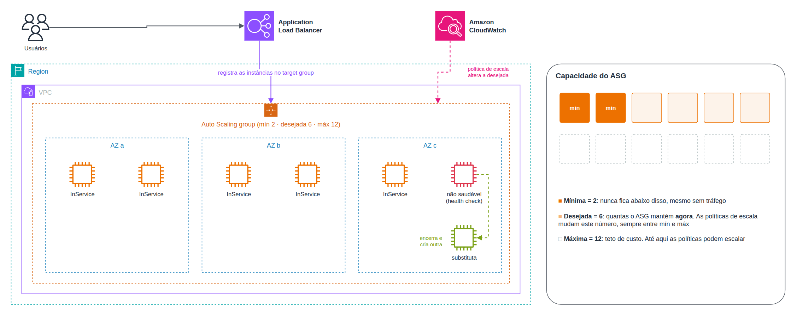

> **Paralelo com o Lambda:** a **capacidade mínima** lembra a **provisioned concurrency**: capacidade sempre pronta, paga mesmo sem uso. A **capacidade máxima** lembra a **reserved concurrency** usada como teto, que limita quanto a função pode escalar para proteger o orçamento ou um banco de dados downstream.

[↑ Índice](#índice)

### Health checks e substituição de instâncias

O ASG verifica periodicamente se cada instância está **saudável**. Se não está, ele a **encerra e cria outra** no lugar. O ponto que mais cai na prova é **qual** verificação ele usa:

- **EC2 status checks** (padrão): só detectam problemas de **infraestrutura**: a instância parou, o hardware falhou, o sistema operacional não responde. Uma instância com o SO funcionando e a **aplicação travada** continua "saudável" para esse check.
- **ELB health checks** (precisa ser habilitado no ASG): o load balancer faz requisições periódicas a uma rota da aplicação (ex: `/health`). Se ela não responde corretamente, o ASG considera a instância não saudável e a substitui. É a opção certa quando o ASG está atrás de um load balancer.
- **Health checks personalizados:** um script ou sistema externo marca a instância como não saudável pela API (`SetInstanceHealth`).
- **VPC Lattice** e **EBS** health checks também podem ser habilitados.

Uma instância recém-criada pode demorar para ficar pronta, porque ainda está fazendo boot, rodando o user data e aquecendo o cache. Dois parâmetros evitam que ela seja considerada não saudável, ou que distorça as métricas, antes da hora:

- **Health check grace period:** quanto tempo depois do lançamento o ASG **espera** antes de começar a avaliar a saúde da instância.
- **Default instance warmup:** quanto tempo a instância nova leva para começar a **contribuir para as métricas**. Até lá, as métricas dela não entram nas decisões de escala, o que evita escalar de novo porque as instâncias novas ainda estão "frias".

> **Obs:** "As instâncias estão com a aplicação travada, mas o ASG não as substitui" é um cenário clássico. A causa é o ASG usar apenas os **EC2 status checks**. A solução é habilitar os **ELB health checks** no ASG.

> **Paralelo com o Lambda:** no Lambda, uma execução que falha não deixa sequelas: o próximo evento pode cair em outro ambiente, e a AWS recicla ambientes com problemas. No EC2, uma instância "doente" continua recebendo tráfego até que alguém a tire de circulação. O health check do ASG é esse "alguém".

[↑ Índice](#índice)

### Políticas de escala

As políticas de escala decidem **quando** e **quanto** mudar a capacidade desejada. Há duas famílias:
- as **reativas**, que respondem a uma métrica que já mudou;
- as **proativas**, que mudam a capacidade **antes** da demanda chegar.

| Política | Como funciona | Quando usar |
|---|---|---|
| **Target tracking** | Você escolhe uma métrica e um **valor-alvo** (ex: CPU média em 50%). O ASG cria e gerencia os alarmes do CloudWatch e ajusta a capacidade para manter a métrica perto do alvo, como um termostato | **Primeira opção** na maioria dos casos. Simples e eficiente |
| **Step scaling** | Você define alarmes e **degraus** de ajuste: CPU entre 60% e 80% → +2 instâncias; acima de 80% → +4 | Reações **proporcionais** ao tamanho do desvio, com controle fino |
| **Simple scaling** | Um alarme → um ajuste, e depois espera o **cooldown** (padrão 300 s) antes de reagir de novo | Legado. Hoje, step scaling ou target tracking são preferidos |
| **Scheduled actions** | Muda mínima, máxima e desejada em **horários definidos** (ex: dias úteis às 8h → mínimo 10; às 20h → mínimo 2) | Padrões **conhecidos** e previsíveis: horário comercial, campanhas, fechamento de mês |
| **Predictive scaling** | Usa **machine learning** sobre o histórico do ASG para **prever** a demanda das próximas 48 horas e lançar instâncias **antes** do pico | Carga com padrão **cíclico** (diário ou semanal) e aplicações com boot demorado. Precisa de pelo menos 24 h de histórico; pode começar em modo **só previsão** para validar |

**Combinações comuns:** predictive ou scheduled para preparar a **base** do dia, e target tracking por cima para absorver variações **inesperadas**. Quando várias políticas estão ativas ao mesmo tempo, o ASG aplica a que resulta na **maior** capacidade, tanto para escalar para cima quanto para baixo, privilegiando a disponibilidade.

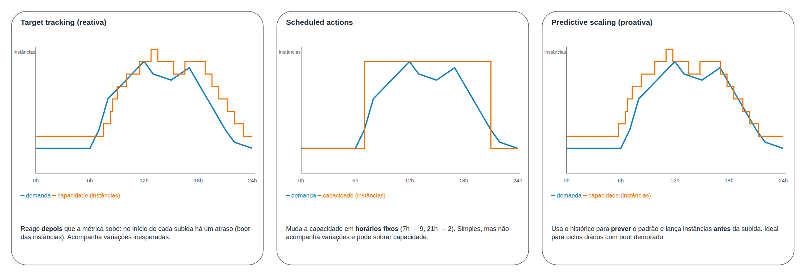

**Qual métrica usar:**

- **CPU média** (`CPUUtilization`): a mais comum, boa para aplicações limitadas por processamento.
- **Requisições por instância** (`ALBRequestCountPerTarget`): boa para aplicações web atrás de um ALB, porque acompanha a demanda **diretamente**.
- **Tráfego de rede** (`NetworkIn`/`NetworkOut`): aplicações limitadas por rede.
- **Métricas personalizadas** publicadas no CloudWatch. O caso clássico é o de **workers que consomem uma fila SQS**, em que a métrica certa é o **backlog por instância**: o número de mensagens visíveis na fila dividido pelo número de instâncias. O valor-alvo é calculado assim:
  - **Alvo = latência aceitável ÷ tempo de processamento de uma mensagem.** Por exemplo: cada mensagem leva 0,1 s e a fila pode atrasar no máximo 10 s, então o alvo é 100 mensagens por instância.
  - Escalar só pelo **tamanho da fila** é um erro comum. 1.000 mensagens com 2 instâncias e 1.000 mensagens com 50 instâncias são situações muito diferentes.

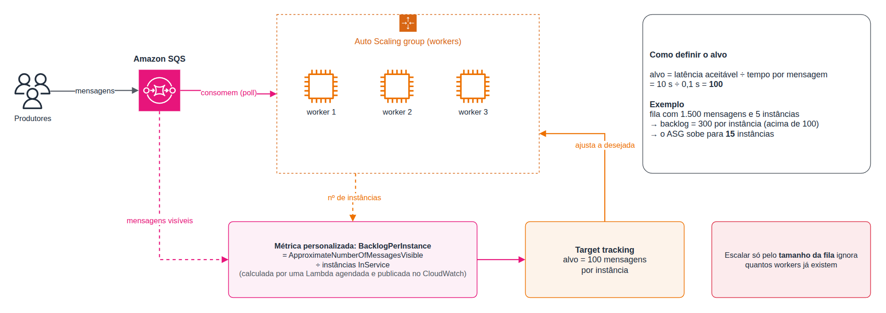

> **Paralelo com o Lambda:** com Lambda + SQS, o *event source mapping* aumenta sozinho o número de execuções conforme a fila cresce. Com EC2, você monta esse mecanismo: publica a métrica de backlog por instância e cria uma política de target tracking sobre ela. Quando a carga é por fila, vale perguntar se o processamento cabe no Lambda (menos de 15 min, sem GPU) antes de montar workers em EC2.

[↑ Índice](#índice)

### Ciclo de vida da instância e lifecycle hooks

Cada instância de um ASG passa por estados. Os principais são:
- **Pending:** sendo lançada;
- **InService:** em operação, recebendo tráfego;
- **Terminating:** sendo encerrada;
- **Terminated:** encerrada.

Os **lifecycle hooks** criam uma **pausa** nesses momentos de transição para você executar ações:

- **Hook de lançamento** (`Pending:Wait`): a instância já existe, mas ainda **não entra em serviço**. Usado para instalar software, baixar configuração, registrar a instância em um sistema externo ou rodar testes antes de ela receber tráfego.
- **Hook de encerramento** (`Terminating:Wait`): a instância vai ser encerrada, mas **ainda está viva**. Usado para copiar logs, terminar o processamento em andamento, fazer backup de dados locais ou retirar a instância de um cluster.
- **Como funciona:** o hook gera um evento no **EventBridge**, ou uma notificação em SNS ou SQS, que aciona uma **Lambda**, um **SSM Run Command** ou um script. Ao terminar, a ação chama `CompleteLifecycleAction` com `CONTINUE` ou `ABANDON`. Se ninguém responder, a instância segue o caminho padrão depois do **timeout**, que é de 1 hora por padrão e pode ser estendido com *heartbeats*.

Há também estados manuais:
- **Standby:** tira a instância de serviço **temporariamente**, para manutenção ou diagnóstico, sem que o ASG a substitua;
- **Detach:** remove a instância do ASG, mantendo-a viva.

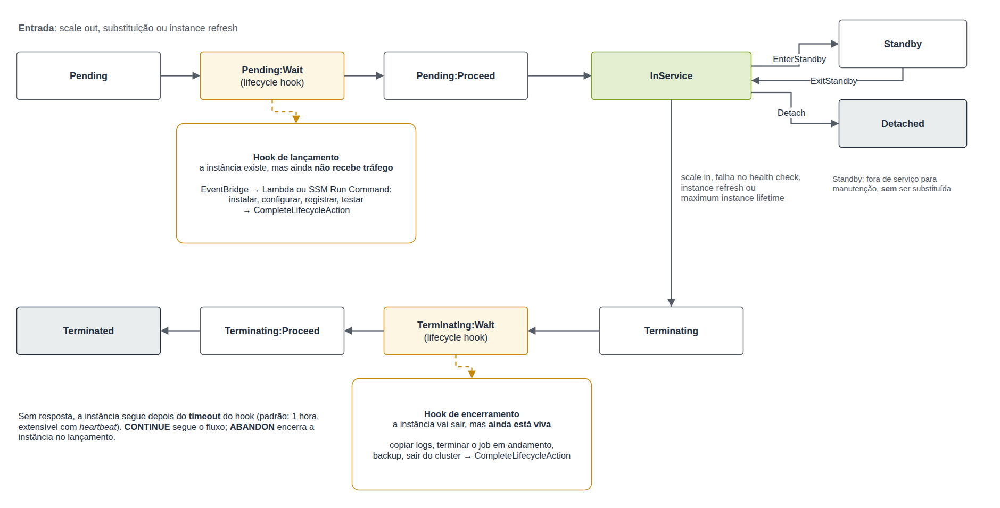

> **Paralelo com o Lambda:** o hook de lançamento lembra o código de **inicialização** fora do handler, e o hook de encerramento lembra a fase **Shutdown** das *Lambda extensions*, usada para enviar os últimos logs antes de o ambiente sumir. A diferença é que, no ASG, a pausa é explícita e pode durar minutos ou horas.

[↑ Índice](#índice)

### Qual instância é encerrada primeiro (termination policies)

Quando a capacidade desejada diminui, o ASG precisa escolher **quais** instâncias encerrar. A **política padrão** segue esta ordem:

1. Escolhe a **AZ com mais instâncias**, para manter o balanceamento entre AZs.
2. Nessa AZ, prefere as instâncias que mantêm a **estratégia de alocação** (ex: a proporção On-Demand/Spot).
3. Depois, as instâncias com o **launch template ou a configuração mais antiga**.
4. Depois, a mais próxima da **próxima hora de cobrança**.
5. Por último, escolhe aleatoriamente.

Outras políticas podem ser configuradas: `OldestInstance` (útil para renovar a frota aos poucos), `NewestInstance` (útil para testar uma nova versão e voltar atrás), `OldestLaunchTemplate`, `ClosestToNextInstanceHour`, ou uma **função Lambda** com regras próprias.

- **Scale-in protection:** marca instâncias que **não podem** ser encerradas por uma redução de capacidade, por exemplo uma instância processando um job longo. Ela continua podendo ser substituída por falha de saúde.
- **Maximum instance lifetime:** encerra e substitui instâncias com mais de N dias (mínimo de 1 dia). Força a renovação da frota, útil para aplicar patches ou por compliance.

[↑ Índice](#índice)

### Warm pools: instâncias pré-aquecidas

Algumas aplicações levam **muitos minutos** para ficar prontas: uma aplicação Java grande, um servidor que carrega gigabytes de cache, um software que precisa ser instalado. Quando o pico chega, o target tracking reage, mas as instâncias novas só ajudam muito depois.

O **warm pool** mantém um conjunto de instâncias **já inicializadas**, que passaram pelo boot, pelo user data e pelo hook de lançamento, esperando **fora** do ASG. Quando o ASG precisa escalar, ele puxa instâncias do warm pool em vez de criar do zero. Elas podem esperar em três estados:

| Estado no warm pool | Custo enquanto espera | Tempo para entrar em serviço |
|---|---|---|
| **Stopped** | Só o volume EBS | Rápido: só o *start* |
| **Hibernated** | EBS (com a RAM gravada nele) | Rápido, e a memória volta como estava (ex: cache carregado) |
| **Running** | Instância inteira | Imediato |

- As instâncias do warm pool **não contam** na capacidade desejada nem recebem tráfego.
- Na redução de capacidade, as instâncias podem **voltar** ao warm pool (*instance reuse policy*) em vez de serem encerradas.
- Alternativas para reduzir o tempo até a instância ficar pronta: uma **golden AMI** com tudo pré-instalado, e o **predictive scaling**, que lança as instâncias antes do pico.

> **Paralelo com o Lambda:** é a mesma ideia da **provisioned concurrency** e do **SnapStart**: pagar um pouco para ter ambientes já inicializados e eliminar o cold start nos picos.

[↑ Índice](#índice)

### Atualizar as instâncias: instance refresh

Quando o launch template muda (nova AMI, novo tipo de instância), as instâncias que já estão rodando **não mudam**. O **instance refresh** substitui a frota aos poucos:

- **Minimum healthy percentage:** quantas instâncias precisam continuar saudáveis durante a troca (ex: 90% troca de 10% em 10%). O **maximum healthy percentage** (até 200%) permite lançar as novas **antes** de encerrar as antigas, sem perder capacidade.
- **Checkpoints:** pausam a troca em percentuais definidos (ex: 10%, 50%) para validar a nova versão, como um **canary**.
- **Skip matching:** não substitui instâncias que já estão na configuração desejada.
- **Rollback automático:** se o refresh falhar, ou se **alarmes do CloudWatch** indicarem problema, o ASG volta à configuração anterior.
- **Outras estratégias**, como blue/green com dois ASGs, canary com pesos no ALB ou troca via Route 53, estão em [Auto Scaling Update Strategies](#auto-scaling-update-strategies).

[↑ Índice](#índice)

### Outros recursos importantes

- **Mixed instances policy e Spot:** um ASG pode combinar **vários tipos de instância** e **On-Demand + Spot**, com **Capacity Rebalancing**. Ver [Spot Instances](#spot-instances--spot-fleet).
- **Attribute-based instance type selection:** em vez de listar tipos, você informa requisitos (ex: 4–8 vCPUs, 16–32 GiB), e o ASG usa qualquer tipo compatível, inclusive gerações futuras.
- **Suspender processos:** é possível pausar processos específicos do ASG (`Launch`, `Terminate`, `HealthCheck`, `ReplaceUnhealthy`, `AZRebalance`, `AlarmNotification`, `ScheduledActions`, `AddToLoadBalancer`...), por exemplo para investigar uma instância com problema sem que ela seja substituída.
- **Notificações:** eventos de lançamento, encerramento e falha vão para o **EventBridge** ou para o **SNS**.
- **Instance maintenance policy:** define se, ao substituir instâncias (por falha de saúde ou rebalanceamento), o ASG lança a nova **antes** de encerrar a antiga ou o contrário.

[↑ Índice](#índice)

### EC2 Auto Scaling, Application Auto Scaling e AWS Auto Scaling

São três nomes parecidos para coisas diferentes, e a prova usa isso:

| Serviço | O que escala |
|---|---|
| **Amazon EC2 Auto Scaling** | **Instâncias EC2**, em Auto Scaling groups. É o assunto desta seção |
| **Application Auto Scaling** | **Outros serviços**, com as mesmas ideias de target tracking, step e scheduled: tasks de **ECS**, capacidade de **DynamoDB**, réplicas do **Aurora**, **provisioned concurrency do Lambda**, Spot Fleet, EMR, endpoints do SageMaker, entre outros |
| **AWS Auto Scaling** (*scaling plans*) | Um console unificado para criar planos de escala para **vários recursos** de uma aplicação ao mesmo tempo (ASGs, ECS, DynamoDB, Aurora). Hoje, a AWS recomenda configurar cada recurso diretamente, com o predictive scaling nativo do ASG |

> **Paralelo com o Lambda:** se você já configurou **provisioned concurrency** com escala por horário ou por utilização, já usou o **Application Auto Scaling**.

[↑ Índice](#índice)

### Dicas para a prova

- "Aplicação travada, mas o ASG não substitui as instâncias" → habilitar **ELB health checks** no ASG.
- "Manter a CPU média em torno de X%" ou "escalar de forma simples" → **target tracking**.
- "Pico **todo dia** no mesmo horário" → **scheduled actions** ou **predictive scaling**. "Padrão cíclico + aplicação com **boot demorado**" → **predictive scaling**.
- "Escalar workers que leem uma **fila SQS**" → target tracking sobre a métrica personalizada **backlog por instância**, e não sobre o tamanho da fila.
- "Instâncias levam **muito tempo** para ficar prontas e o pico chega rápido" → **warm pool** (de preferência *stopped* ou *hibernated*), **golden AMI** e/ou **predictive scaling**.
- "Executar uma ação **antes** de a instância entrar em serviço ou **antes** de ser encerrada" (ex: copiar logs, drenar jobs) → **lifecycle hooks** + EventBridge + Lambda/SSM.
- "Não encerrar a instância que está processando um job longo na redução de capacidade" → **scale-in protection**.
- "Investigar uma instância com problema sem que o ASG a substitua" → colocar em **Standby** ou **suspender** o processo `ReplaceUnhealthy`/`HealthCheck`.
- "Trocar a AMI de toda a frota sem indisponibilidade, com validação gradual e rollback" → **instance refresh** com **checkpoints** e **rollback automático**. "Rollback instantâneo" → **blue/green** com dois ASGs.
- "Alta disponibilidade para uma aplicação de **uma instância** só" → ASG com **mínimo = máximo = 1** em várias AZs.
- "Escalar tasks ECS, DynamoDB ou provisioned concurrency do Lambda" → **Application Auto Scaling**.
- "O ASG passou temporariamente da capacidade máxima" → **AZRebalance** (até +10%) ou instance refresh com *maximum healthy percentage* acima de 100%.

[↑ Índice](#índice)

## Auto Scaling Update Strategies

Uma aplicação rodando em um ASG atrás de um load balancer precisa, de tempos em tempos, de uma **nova versão**: código novo, uma golden AMI com patches de segurança, outro tipo de instância, uma configuração diferente. A pergunta é **como trocar a frota inteira sem derrubar a aplicação**, e com que nível de risco. Não existe uma resposta única. Cada estratégia troca **velocidade**, **custo** e **segurança** de um jeito diferente, e a SAP-C02 costuma descrever um requisito ("rollback imediato", "sem custo extra", "testar com 10% dos usuários") e pedir a estratégia que o atende.

> **Paralelo com o Lambda:** você provavelmente já conhece esses conceitos pelo Lambda. Ao publicar uma **versão** nova e mudar o **alias** com pesos (ex: 90% na v1 e 10% na v2), você faz um **canary**. O **CodeDeploy** automatiza isso com configurações como `Canary10Percent5Minutes` ou `Linear10PercentEvery1Minute`, e faz rollback automático por alarmes. No EC2, a ideia é a mesma. A diferença é que o "alias" passa a ser um **load balancer**, um **target group** ou um **registro DNS**, e as "versões" passam a ser **grupos de instâncias** que levam minutos para subir.

### Conceitos básicos

**Mutável vs. imutável:**

- **Atualização mutável** (*in-place*): as instâncias existentes são **alteradas** com um novo pacote da aplicação, um patch aplicado por SSM ou um `git pull`. É rápida e barata, mas cada instância acumula mudanças ao longo do tempo (*configuration drift*), e um erro no meio da atualização deixa a frota em um estado misto e difícil de reverter.
- **Atualização imutável:** as instâncias **nunca são alteradas**. Uma versão nova significa **novas instâncias**, criadas a partir de uma nova AMI ou de um novo launch template, e as antigas são descartadas. Rollback significa voltar a usar as instâncias, ou a AMI, anteriores. É o modelo recomendado na AWS e o que combina com Auto Scaling: as instâncias são **descartáveis**.

> **Paralelo com o Lambda:** uma versão publicada do Lambda é **imutável**: você não altera a v5, publica a v6. As estratégias imutáveis no EC2 seguem a mesma filosofia.

**Vocabulário de deploy:**

- **All at once** (tudo de uma vez): troca todas as instâncias ao mesmo tempo. É rápido, mas há **indisponibilidade** e todos os usuários são afetados se a versão tiver problema.
- **Rolling** (em lotes): troca as instâncias **em lotes** (ex: 20% por vez). Não há indisponibilidade, mas a capacidade fica temporariamente reduzida, a não ser que se lance antes de encerrar, e as **duas versões convivem** durante o deploy.
- **Canary:** manda uma **pequena parte** do tráfego (ex: 10%) para a versão nova, observa as métricas e só depois libera o resto. O nome vem dos canários que mineiros levavam para detectar gás antes que afetasse as pessoas.
- **Linear:** aumenta o tráfego da versão nova em **degraus iguais** (ex: +10% a cada 5 minutos).
- **Blue/green:** mantém **dois ambientes completos**: o *blue*, com a versão atual, e o *green*, com a nova. O tráfego é **trocado** de um para o outro. O rollback é tão rápido quanto apontar de volta para o blue, mas a infraestrutura **dobra** durante a troca.

**O que comparar ao escolher uma estratégia:**

| Critério | Pergunta |
|---|---|
| **Disponibilidade** | Há indisponibilidade durante o deploy? |
| **Capacidade** | A frota fica menor durante a troca? |
| **Custo** | É preciso pagar por instâncias extras durante o deploy? |
| **Raio de impacto** (*blast radius*) | Quantos usuários são afetados se a versão nova tiver um bug? |
| **Velocidade do rollback** | Voltar atrás leva segundos (mudar um peso) ou minutos (recriar instâncias)? |
| **Convivência de versões** | As duas versões atendem usuários ao mesmo tempo? Se sim, a aplicação e o **banco de dados** precisam ser compatíveis com as duas |

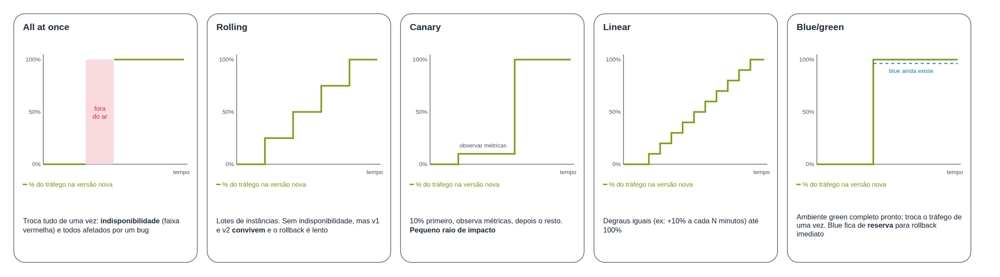

[↑ Índice](#índice)

### As quatro estratégias com ASG

As quatro arquiteturas abaixo vão da mais simples e barata à mais isolada e cara.

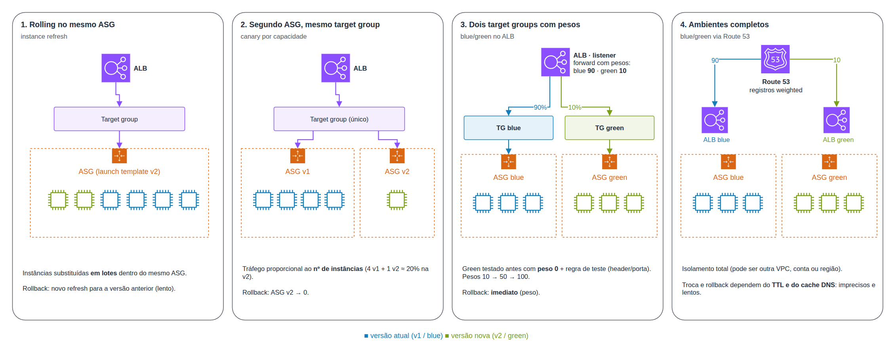

#### 1. Rolling update no mesmo ASG (instance refresh)

Um **único ASG**, com um **único target group**. O launch template recebe uma nova versão, e as instâncias são substituídas **em lotes**, normalmente com o **instance refresh** (ver [Atualizar as instâncias: instance refresh](#atualizar-as-instâncias-instance-refresh)).

- **Como funciona:** com *minimum healthy percentage* de 90%, o ASG encerra 10% das instâncias antigas, lança 10% de novas, espera elas ficarem saudáveis e passa para o próximo lote. Com *maximum healthy percentage* acima de 100%, ele **lança antes de encerrar**, e a capacidade não diminui.
- **Controle de risco:** **checkpoints** pausam a troca (ex: em 10% e em 50%) para validar a versão nova, e o **rollback automático** por alarmes do CloudWatch volta à configuração anterior se as métricas piorarem.
- **Prós:** é o mais simples, não exige infraestrutura extra e é nativo do ASG.
- **Contras:** o rollback é **lento**, porque também troca instâncias em lotes. As duas versões convivem durante todo o deploy. A divisão do tráfego segue o número de instâncias, sem controle fino.

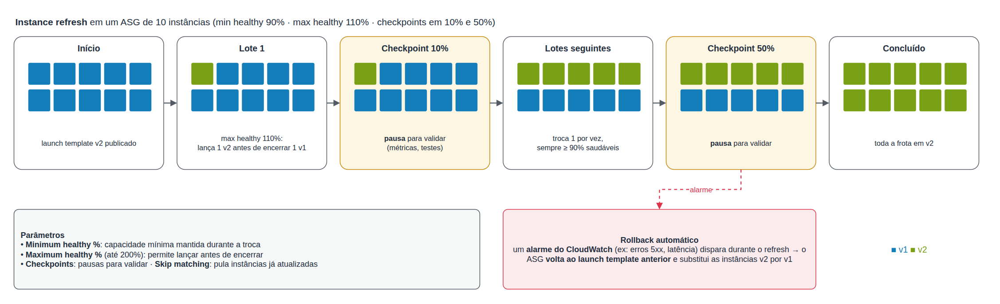

#### 2. Segundo ASG no mesmo target group (canary por capacidade)

Um **segundo ASG**, com o launch template da versão nova, é registrado **no mesmo target group** do ASG atual. O ALB distribui as requisições entre **todas** as instâncias do target group. Por isso, a fatia de tráfego da versão nova é proporcional ao **número de instâncias** dela.

- **Como funciona:** com 9 instâncias v1 e 1 v2, cerca de 10% do tráfego vai para a v2. Para avançar, aumenta-se a capacidade do ASG novo e reduz-se a do antigo. No fim, o ASG antigo é removido.
- **Rollback:** reduzir o ASG novo a **zero**. É rápido, porque as instâncias v1 continuam lá.
- **Prós:** canary simples, sem mudar o load balancer.
- **Contras:** o percentual de tráfego depende do número de instâncias: com 4 instâncias, o menor passo é 25%. Não dá para testar a versão nova **isoladamente** antes de ela receber tráfego real, e os usuários podem alternar entre versões a cada requisição, a menos que haja *sticky sessions*.

#### 3. Blue/green com dois target groups e pesos no ALB

Dois ASGs, cada um no **seu próprio target group** (blue e green), atrás do **mesmo ALB**. A regra do listener usa uma ação de *forward* com **weighted target groups**, ou seja, pesos para cada target group (ex: blue 90, green 10).

- **Como funciona:**
  1. O green sobe com **peso 0**. Ele já pode ser **testado isoladamente** por uma regra separada do listener (ex: um header `X-Version: green` ou uma porta de teste), sem receber tráfego real.
  2. Os pesos mudam aos poucos: 10% → 50% → 100%.
  3. Depois de um período de observação, o ASG blue é removido.
- **Rollback:** voltar o peso do blue para 100%. É **imediato** e não depende de DNS.
- **Consistência por usuário:** com **stickiness no nível do target group**, um usuário que caiu no green continua no green durante a sessão.
- **Prós:** controle fino do percentual, testes isolados antes de liberar e rollback em segundos.
- **Contras:** a capacidade do green precisa estar pronta antes de receber tráfego, o que significa custo duplicado durante a transição e mais componentes para gerenciar.

#### 4. Blue/green com ambientes completos e Route 53

Dois **ambientes completos**, cada um com seu próprio **ALB + ASG**. Às vezes eles ficam em contas ou regiões diferentes. A troca é feita por **registros ponderados** (*weighted*) do **Route 53**.

- **Quando usar:** quando a mudança vai além das instâncias. Por exemplo, um ALB novo, outra configuração de rede, outra VPC, conta ou região. Ou quando se quer **isolamento total** entre as versões.
- **O problema do DNS:** a troca depende do **TTL** dos registros e de clientes e resolvedores que **ignoram o TTL** e guardam a resposta em cache por mais tempo. A migração não é precisa, alguns clientes continuam no blue por minutos ou horas, e o **rollback também não é imediato**.
- **Alternativa sem o problema do DNS:** o **AWS Global Accelerator**, com seus IPs fixos e o ajuste de pesos por endpoint (*traffic dials* e *endpoint weights*), muda o tráfego **sem depender de cache DNS**.
- **Prós:** isolamento máximo, e permite mudar qualquer coisa na infraestrutura.
- **Contras:** é o mais caro, porque duplica tudo, e o mais lento e impreciso para trocar e para voltar atrás.

#### Comparação

| | **1. Rolling (instance refresh)** | **2. Segundo ASG, mesmo TG** | **3. Dois TGs com pesos no ALB** | **4. Ambientes completos + Route 53** |
|---|---|---|---|---|
| Infraestrutura extra | Nenhuma (ou só alguns % com max healthy > 100%) | Um ASG | Um ASG + um TG | ALB + ASG (+ VPC/conta) |
| Controle do % de tráfego | Pelo nº de instâncias trocadas | Pelo nº de instâncias | **Pesos precisos** | Pesos DNS (impreciso por cache) |
| Testar a versão nova sem tráfego real | Não | Não | **Sim** (regra de teste) | Sim (endpoint próprio) |
| Velocidade do rollback | Lenta (novo refresh) | Rápida (ASG novo → 0) | **Imediata** (peso) | Lenta (TTL e cache DNS) |
| Isolamento entre versões | Baixo | Baixo | Médio | **Total** |
| Custo durante o deploy | Menor | Médio | Médio/alto | Maior |

[↑ Índice](#índice)

### Ferramentas que implementam essas estratégias

Na prática, raramente se faz isso à mão. Os serviços abaixo automatizam as estratégias, e a prova costuma citá-los pelo nome:

**AWS CloudFormation: `UpdatePolicy` do ASG.** Define o que acontece quando a stack muda o launch template do ASG:

- **`AutoScalingRollingUpdate`:** **rolling** no mesmo ASG, em lotes. Os parâmetros são `MaxBatchSize` (quantas por vez), `MinInstancesInService` (quantas ficam em serviço) e `PauseTime`. Com `WaitOnResourceSignals`, cada instância nova precisa enviar um sinal de sucesso (`cfn-signal`, normalmente ao fim do user data) antes de o lote seguinte começar. Se os sinais não chegam, a stack faz **rollback**.
- **`AutoScalingReplacingUpdate`** (`WillReplace: true`): cria um **ASG novo inteiro**. Só depois que ele está saudável, o antigo é removido. Se algo falha, o rollback é **rápido**, porque o ASG antigo ainda existe. É o equivalente imutável/blue-green dentro do CloudFormation.
- **`AutoScalingScheduledAction`:** evita que um update da stack desfaça a capacidade ajustada por scheduled actions.

**AWS CodeDeploy (EC2/on-premises):**

- **In-place:** para a aplicação em cada instância, instala a versão nova e reinicia. É feito em lotes definidos pela *deployment configuration* (`OneAtATime`, `HalfAtATime`, `AllAtOnce` ou personalizada), com **hooks** no `appspec.yml` (ex: `BeforeInstall`, `ValidateService`). É uma estratégia **mutável**.
- **Blue/green:** o CodeDeploy **copia o ASG** (ou usa instâncias já existentes), instala a versão nova nele, redireciona o load balancer para as instâncias novas e encerra as antigas depois de um tempo de espera configurável. É uma estratégia **imutável**.
- **Rollback automático** por falha do deploy ou por alarmes do CloudWatch.
- No EC2, as configurações são por **lotes de instâncias**. As configurações **canary** e **linear** por percentual de tráfego existem para **Lambda** e **ECS**.

**AWS Elastic Beanstalk:** tem as estratégias prontas como *deployment policies*:

| Política | O que faz |
|---|---|
| **All at once** | Atualiza todas as instâncias de uma vez, com indisponibilidade |
| **Rolling** | Em lotes, com capacidade reduzida durante o deploy |
| **Rolling with additional batch** | Lança um lote extra antes, mantendo a capacidade total |
| **Immutable** | Cria um **ASG temporário** com instâncias novas e só depois as move para o ASG original, descartando as antigas |
| **Traffic splitting** | Canary: uma parte do tráfego vai para instâncias novas por um período de avaliação |
| **Blue/green** | Um **ambiente novo** e a troca de URL (*swap environment URLs*), que é uma troca de **DNS** com as mesmas ressalvas da estratégia 4 |

[↑ Índice](#índice)

### Boas práticas para qualquer estratégia

- **Preferir o imutável:** **golden AMI** versionada (Image Builder) + nova versão do launch template, em vez de atualizar instâncias em execução.
- **Health checks do ELB no ASG**, para que instâncias com a versão quebrada sejam detectadas, e um endpoint `/health` que teste dependências reais.
- **Deregistration delay** (*connection draining*) no target group, para que as requisições em andamento terminem antes de a instância antiga sair.
- **Rollback automático por alarmes:** taxa de erros 5xx, latência e métricas de negócio, no instance refresh, no CodeDeploy ou no CloudFormation.
- **Sessões fora das instâncias** (ElastiCache, DynamoDB): sem isso, trocar a instância do usuário derruba a sessão dele.
- **Banco de dados compatível com as duas versões:** em qualquer estratégia sem indisponibilidade, v1 e v2 rodam **ao mesmo tempo** contra o mesmo banco. Mudanças de schema devem ser feitas em etapas (*expand/contract*): primeiro **adicionar** colunas e tabelas de um jeito que a v1 ignore, fazer o deploy da v2, e só depois **remover** o que a v1 usava.
- **Feature flags** (ex: **AWS AppConfig**): separar o **deploy** do código da **ativação** da funcionalidade, o que permite desligar uma funcionalidade sem novo deploy.

[↑ Índice](#índice)

### Dicas para a prova

- "Atualizar a AMI da frota **sem infraestrutura extra**, de forma gradual" → **instance refresh** (rolling), com checkpoints e rollback automático.
- "Atualizar **sem reduzir a capacidade** durante o deploy" → instance refresh com **maximum healthy percentage > 100%**, *rolling with additional batch* (Beanstalk) ou blue/green.
- "Rollback **imediato**, sem depender de DNS" → **blue/green com dois target groups e pesos no ALB** (weighted target groups).
- "Enviar **10% do tráfego** para a versão nova e aumentar aos poucos" → **weighted target groups** no ALB (precisão) ou um segundo ASG no mesmo TG (proporcional ao nº de instâncias).
- "**Testar** a versão nova em produção **antes** de ela receber tráfego de usuários" → green com **peso 0** e uma **regra de listener** de teste (header, path ou porta).
- "Usuários alternando entre versões e perdendo a sessão durante o canary" → **stickiness no target group** e sessão em ElastiCache/DynamoDB.
- "Blue/green via **Route 53**, mas parte dos clientes continua no ambiente antigo" → **cache DNS/TTL**. Usar **pesos no ALB** ou **Global Accelerator** (traffic dials).
- "A mudança envolve um **ALB novo**, outra VPC, conta ou região" → blue/green com **ambientes completos** + Route 53 weighted (ou Global Accelerator).
- "CloudFormation: criar um ASG **novo** e só remover o antigo se o novo estiver saudável" → **`AutoScalingReplacingUpdate`**. "Em lotes, no mesmo ASG, esperando sinal das instâncias" → **`AutoScalingRollingUpdate`** + `WaitOnResourceSignals`/`cfn-signal`.
- "CodeDeploy no EC2 **sem alterar** as instâncias existentes" → deploy **blue/green** (cópia do ASG). "Atualizar o código nas instâncias atuais" → **in-place**.
- "Beanstalk: deploy sem perda de capacidade e com rollback rápido criando instâncias novas" → **immutable**. "Canary no Beanstalk" → **traffic splitting**.
- "Durante o deploy, a versão nova quebra porque o banco mudou" → mudanças de schema **compatíveis com as duas versões** (expand/contract).

[↑ Índice](#índice)

## Spot Instances & Spot Fleet

A AWS precisa manter capacidade sobrando em cada AZ para atender picos de demanda dos clientes On-Demand. Em vez de deixar esses servidores parados, ela os **vende com grande desconto**, de até ~90% em relação ao On-Demand, como instâncias **Spot**. O preço baixo vem com uma condição: quando a AWS precisar dessa capacidade de volta, ela **interrompe** a sua instância com **2 minutos** de aviso.

Uma instância Spot é uma instância EC2 **idêntica** a uma On-Demand: mesmo hardware, mesmo desempenho, mesmas AMIs. Só o **modelo de compra** muda. Por isso, a pergunta não é "Spot é pior?", e sim "**minha carga aguenta perder uma instância a qualquer momento?**". Se sim, Spot é a forma mais barata de rodar EC2. Exemplos de cargas que aguentam: processar um lote de arquivos, renderizar vídeos, rodar testes de CI ou atender requisições web em uma frota stateless. Não servem: um banco de dados de instância única, ou um processo longo sem checkpoints.

Pedir **uma** instância Spot é simples. O desafio é manter **uma frota** de instâncias Spot estável, mesmo com interrupções. É para isso que existem o **Spot Fleet**, o **EC2 Fleet** e a mixed instances policy do **Auto Scaling group**. Eles pedem capacidade em **muitos pools ao mesmo tempo** e **repõem** o que é interrompido.

> **Paralelo com o Lambda:** pense em uma carga que você faria com Lambda + SQS. Ela é **idempotente**, processa mensagens de uma fila e, se uma execução falhar, a mensagem volta para a fila e outra execução a processa. Esse mesmo desenho é o que torna uma carga **segura para Spot**: um worker interrompido apenas deixa a mensagem voltar para a fila. Se o processamento passar de 15 minutos ou precisar de GPU, workers em Spot consumindo a fila são a alternativa natural ao Lambda. E se você quer Spot sem gerenciar servidores, existe o **Fargate Spot**, para containers.

### Como funciona o mercado Spot

- **Pool de capacidade Spot:** cada combinação de **tipo de instância + AZ** (ex: `m7i.large` em us-east-1a) é um **pool** separado, com oferta, preço e risco de interrupção próprios. Se um pool fica sem capacidade, só as instâncias **dele** são interrompidas. Daí vem a regra de ouro do Spot: **diversificar** entre muitos pools.
- **Preço:** cada pool tem um **preço Spot** que muda **gradualmente**, conforme a oferta e a demanda de longo prazo. Não existe mais leilão nem disputa de lances. Você paga o preço vigente do pool, por segundo, como no On-Demand.
- **Preço máximo (*max price*):** é opcional, e o padrão é o preço On-Demand. A AWS **não recomenda** defini-lo, porque um valor baixo só aumenta as interrupções e não reduz o que você paga.
- **Por que uma instância é interrompida:**
  - **capacidade**, o motivo principal: a AWS precisa do servidor para On-Demand;
  - **preço**: o preço do pool passou do seu *max price*, se você definiu um;
  - **restrições** do pedido não atendidas, como lançar todas as instâncias juntas na mesma AZ.
- **Ferramentas para escolher pools:**
  - **Spot Instance Advisor:** mostra, por tipo de instância e região, a **frequência histórica de interrupção** (faixas como <5%, 5–10%... >20%) e a economia média.
  - **Spot placement score:** dá uma nota de 1 a 10 para a chance de um pedido de capacidade (ex: 500 vCPUs com estes tipos) ser atendido em cada **região** ou **AZ**. É útil para decidir **onde** rodar uma carga flexível.
  - **Histórico de preços Spot**, no console e na API.

[↑ Índice](#índice)

### Interrupções: avisos e comportamento

Uma instância Spot recebe até dois avisos antes de ser interrompida:

1. **EC2 Instance Rebalance Recommendation:** um aviso **antecipado**, sem prazo fixo, de que a instância está com **risco elevado** de interrupção. É a melhor hora para reagir com calma: lançar uma substituta em outro pool, terminar o trabalho em andamento ou não aceitar trabalho novo.
2. **Spot Instance Interruption Warning:** a instância **será** interrompida em **2 minutos**.

Os dois avisos chegam por dois caminhos:
- **de dentro da instância**, pelo **IMDS** (`/latest/meta-data/events/recommendations/rebalance` e `/latest/meta-data/spot/instance-action`), que a aplicação pode consultar periodicamente;
- **de fora dela**, por eventos no **EventBridge**, que podem acionar Lambda, SNS ou SSM.

**O que acontece na interrupção** (*interruption behavior*):

- **Terminate** (padrão): a instância é encerrada.
- **Stop:** a instância é parada, mantendo o volume EBS, e reiniciada automaticamente quando houver capacidade. Exige um pedido **persistente** ou uma frota do tipo *maintain*.
- **Hibernate:** grava a memória no EBS e retoma de onde parou quando houver capacidade. Tem as mesmas exigências do stop.

**O que fazer nos 2 minutos:** retirar a instância do load balancer, salvar um **checkpoint** (S3, DynamoDB, EFS), devolver o trabalho em andamento à fila (não apagar a mensagem SQS) e enviar os logs.

**Testar antes de acontecer:** o **AWS Fault Injection Service (FIS)** tem uma ação que **envia avisos de interrupção** a instâncias Spot de verdade. Assim, dá para validar que a aplicação reage corretamente sem esperar uma interrupção real.

O diagrama abaixo mostra o processo completo:
1. O ASG pede capacidade em vários pools.
2. A estratégia de alocação escolhe os pools mais disponíveis.
3. A instância roda pagando o preço Spot.
4. Quando o pool fica sob pressão, a AWS emite a **rebalance recommendation**.
5. Depois vem o **aviso de 2 minutos**.
6. Por fim, a instância é interrompida.

O ASG repõe a capacidade **antes** da interrupção, se o Capacity Rebalancing estiver ligado, ou **depois** dela.


[↑ Índice](#índice)

### Pedidos Spot: one-time e persistent

A forma mais simples de usar Spot é lançar a instância com a opção de mercado Spot. Pelo console, pelo `RunInstances` com `InstanceMarketOptions` ou pelo launch template, ela vira um **pedido Spot** (*Spot Instance request*). O pedido tem um tipo:

- **One-time:** o pedido é atendido uma vez. Se a instância for interrompida, o pedido **fecha** e nada é relançado.
- **Persistent:** o pedido **continua aberto** depois de uma interrupção. Quando a capacidade volta, uma nova instância é lançada, ou a instância parada/hibernada é reiniciada. Isso se repete até o pedido ser cancelado ou expirar (*valid until*).

O pedido passa pelos estados **open** (esperando capacidade), **active** (instância rodando), **closed**, **cancelled** e **failed**.

> **Obs:** Para encerrar de vez instâncias de um pedido **persistent**, a ordem importa: **primeiro cancelar o pedido**, **depois terminar as instâncias**. Se você só terminar as instâncias, o pedido continua aberto e **lança outras** no lugar. E cancelar o pedido **não** encerra as instâncias que já estão rodando. Esse detalhe costuma aparecer em questões.

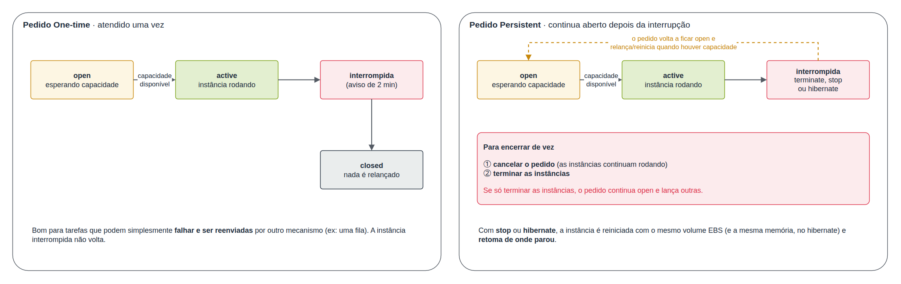

[↑ Índice](#índice)

### Spot Fleet

Uma instância isolada não basta para uma carga de produção. O **Spot Fleet** é um pedido de **frota**: você diz **quanta capacidade** quer e **em quais pools** aceita rodar, e ele lança e mantém o conjunto de instâncias que atende ao pedido.

- **Launch specifications** (ou launch templates com *overrides*): a lista de opções aceitáveis, ou seja, os tipos de instância e as subnets/AZs. Cada combinação é um pool candidato. Quanto **mais opções**, mais estável a frota.
- **Target capacity:** a capacidade-alvo, em **instâncias**, **vCPUs**, **memória** ou **unidades personalizadas**.
- **Instance weighting** (peso por tipo): define quanto cada tipo "vale". Por exemplo, com `c7i.large` = peso 2 e `c7i.xlarge` = peso 4, uma capacidade-alvo de **20 unidades** pode ser atendida com 10 `large`, com 5 `xlarge` ou com uma mistura dos dois. O preço é comparado **por unidade**, o que permite trocar instâncias grandes por pequenas conforme o preço e a disponibilidade.
- **Allocation strategy:** como a frota escolhe os pools. Ver [Estratégias de alocação](#estratégias-de-alocação).
- **Tipo de pedido:**
  - **request:** atende a capacidade **uma vez**. As instâncias interrompidas **não** são repostas.
  - **maintain:** **mantém** a capacidade-alvo e repõe automaticamente o que for interrompido, em outros pools se necessário.
- **Parte On-Demand:** a frota pode incluir uma **capacidade On-Demand** fixa (a base) e completar o resto com Spot.
- **Proteções de custo:** *max total price*, um teto de gasto por hora para a frota inteira, além de datas de validade (*valid from* / *valid until*).
- **Capacity Rebalancing:** como no ASG, lança uma substituta ao receber a rebalance recommendation.

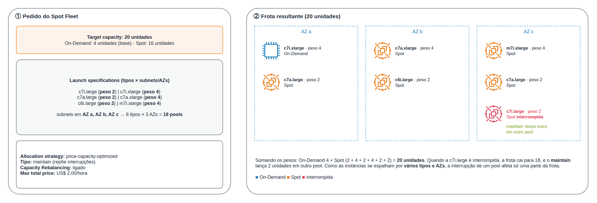

> **Obs:** O Spot Fleet (`RequestSpotFleet`) é uma API **antiga**. A própria AWS desencoraja seu uso em projetos novos e recomenda o **EC2 Fleet** ou, na maioria dos casos, o **Auto Scaling group** com mixed instances policy. Ele continua aparecendo na prova pelo nome e pelos conceitos (pools, pesos, *maintain*, estratégias de alocação), que são os mesmos nas três opções.

[↑ Índice](#índice)

### EC2 Fleet

O **EC2 Fleet** é a evolução do Spot Fleet. Em **uma única chamada de API**, ele lança uma frota que combina **On-Demand**, **Spot** e até **Reserved Instances/Capacity Reservations**, em vários tipos de instância e AZs. Ele tem três tipos:

- **instant:** a chamada é **síncrona**. Ela tenta lançar a capacidade e **devolve na hora** as instâncias criadas e os erros, sem manter nada depois. Ideal para ferramentas que precisam de "N instâncias agora", como um orquestrador de jobs batch ou de CI.
- **request:** assíncrono, atende **uma vez** e não repõe.
- **maintain:** **mantém** a capacidade-alvo e repõe interrupções.

Outros recursos são a estratégia de alocação também para a **parte On-Demand** (`lowest-price` ou `prioritized`, para respeitar uma ordem de preferência de tipos) e a opção de **usar primeiro as Capacity Reservations** da conta.

[↑ Índice](#índice)

### Estratégias de alocação

A estratégia de alocação é a regra que a frota usa para escolher **em quais pools** lançar as instâncias Spot. Ela vale para o ASG, o EC2 Fleet e o Spot Fleet. A escolha é sempre uma troca entre **preço** e **risco de interrupção**:

| Estratégia | Como escolhe | Quando usar |
|---|---|---|
| **price-capacity-optimized** | Primeiro os pools com **mais capacidade disponível**; entre eles, os de **menor preço** | **Recomendada** para a maioria das cargas. Bom equilíbrio entre custo e interrupções |
| **capacity-optimized** | Só pela **maior capacidade disponível**, ignorando o preço | Cargas em que uma interrupção é **muito cara**: jobs longos, CI com builds demorados, renderização |
| **capacity-optimized-prioritized** | Como a anterior, mas respeitando uma **ordem de preferência** de tipos de instância, sempre que possível | Quando há tipos preferidos (ex: uma geração específica), sem abrir mão da capacidade |
| **lowest-price** | Os pools **mais baratos**, distribuindo entre os N mais baratos (`InstancePoolsToUseCount`) | **Não recomendada**: os pools mais baratos costumam ser os mais disputados e interrompem mais. Era o padrão antigamente |
| **diversified** | Distribui **igualmente** entre **todos** os pools da lista | Frotas grandes e de longa duração, em que nenhum pool pode concentrar a capacidade |

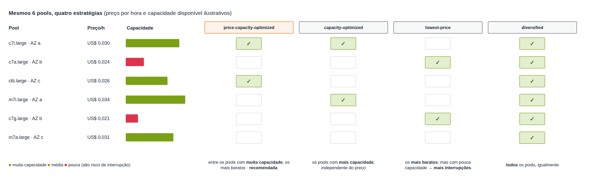

[↑ Índice](#índice)

### Spot Fleet vs. EC2 Fleet vs. Auto Scaling group

| | **Spot Fleet** | **EC2 Fleet** | **Auto Scaling group** |
|---|---|---|---|
| Situação | API antiga, desencorajada para projetos novos | API atual para frotas "puras" | **Recomendado** para a maioria dos casos |
| On-Demand + Spot | Sim | Sim | Sim (mixed instances policy) |
| Lançamento síncrono (*instant*) | Não | **Sim** | Não |
| Escala por métricas (target tracking etc.) | Sim (via Application Auto Scaling) | Não | **Sim**, nativo |
| Health checks, ELB, lifecycle hooks, instance refresh, warm pools | Limitado | Não | **Sim** |
| Uso típico | Legado | Ferramentas que precisam de N instâncias agora | Aplicações web, workers, filas: qualquer carga contínua |

**Regra prática:** para uma aplicação que escala e precisa de load balancer e health checks, use **ASG com mixed instances policy**. Para um lote de instâncias de uma vez, em uma ferramenta própria, use **EC2 Fleet `instant`**. O **Spot Fleet** aparece em arquiteturas antigas e em questões que usam o nome.

O diagrama abaixo mostra o padrão recomendado: um ASG com base On-Demand e escala em Spot, distribuída em vários tipos e AZs, com tratamento dos avisos pelo EventBridge.


[↑ Índice](#índice)

### Onde usar Spot (e onde não usar)

**Boas cargas para Spot:**

- **Processamento em lote e big data:** AWS Batch com compute environments Spot. No **EMR**, os nós de **task**, que não guardam dados do HDFS, podem ser Spot, enquanto o nó **master** e os nós **core** ficam em On-Demand.
- **Containers:** **ECS** com *capacity providers* Spot, **EKS** com managed node groups Spot ou **Karpenter**, e o **Fargate Spot**, em que a task recebe um `SIGTERM` 2 minutos antes de ser interrompida.
- **Aplicações web stateless** atrás de um ALB, em ASG com base On-Demand e escala em Spot.
- **CI/CD**, testes, ambientes de desenvolvimento.
- **HPC fracamente acoplado** e **treinamento de ML** com checkpoints, como no **SageMaker Managed Spot Training**.

**Más cargas para Spot:**

- Bancos de dados e sistemas com **estado em uma única instância**.
- Jobs **longos sem checkpoint**, em que uma interrupção perde horas de trabalho.
- HPC **fortemente acoplado** sem checkpoint, em que perder um nó derruba o job inteiro (ver [HPC](#high-performance-computing-hpc)).
- Cargas com **prazo rígido** e sem plano B em On-Demand.

**Boas práticas:**

- **Diversificar ao máximo:** muitos tipos de instância, de várias famílias e gerações, e todas as AZs. A **attribute-based instance type selection** (ex: "2–8 vCPUs, 4–32 GiB") faz isso automaticamente.
- **price-capacity-optimized** como estratégia de alocação.
- **Capacity Rebalancing** ligado no ASG ou na frota.
- **Base On-Demand** (ou coberta por Savings Plans) para o mínimo necessário, e Spot para o resto.
- Aplicação **stateless**, com **checkpoints** e trabalho **idempotente**.
- **Testar interrupções** com o AWS FIS.

[↑ Índice](#índice)

### Dicas para a prova

- "Menor custo para uma carga **tolerante a interrupções**" → **Spot**. Com "base que não pode cair" → **On-Demand/Savings Plans para a base + Spot** para o resto (ASG com mixed instances policy).
- "Reduzir as interrupções das instâncias Spot" → **diversificar** tipos e AZs + **price-capacity-optimized** (ou **capacity-optimized**).
- "Escolher a estratégia de alocação para o **menor preço**" → cuidado: **lowest-price** aumenta as interrupções. A resposta recomendada costuma ser **price-capacity-optimized**.
- "Reagir **antes** do aviso de 2 minutos" → **rebalance recommendation** + **Capacity Rebalancing**.
- "Detectar a interrupção e salvar o estado" → consultar o **IMDS** (`spot/instance-action`) ou uma regra do **EventBridge** → Lambda.
- "Instância Spot deve **retomar de onde parou** quando a capacidade voltar" → pedido **persistent** com comportamento **stop** ou **hibernate**.
- "Terminei as instâncias Spot, mas outras foram lançadas no lugar" → pedido **persistent** ainda aberto: **cancelar o pedido primeiro**, depois terminar as instâncias.
- "Frota Spot que mantém a capacidade e **repõe** interrupções" → Spot Fleet/EC2 Fleet do tipo **maintain**, ou ASG.
- "Capacidade-alvo em **vCPUs** ou unidades, com tipos de tamanhos diferentes" → **instance weighting**.
- "Ferramenta precisa de **N instâncias imediatamente**, com resposta síncrona" → **EC2 Fleet `instant`**.
- "Escolher a **região/AZ** com mais chance de conseguir capacidade Spot" → **Spot placement score**.
- "Testar se a aplicação aguenta interrupções Spot" → **AWS Fault Injection Service**.
- "EMR com o menor custo sem perder dados" → **task nodes em Spot**, master e core em On-Demand.
- "Containers com Spot sem gerenciar servidores" → **Fargate Spot**.

[↑ Índice](#índice)

## Containers

Antes dos serviços de containers da AWS (ECS, EKS, Fargate, ECR), vale entender **o que é um container**, **que problema ele resolve** e **por que ele precisa de um orquestrador**. Nenhum desses conceitos é exclusivo da AWS: eles valem para qualquer nuvem e para o data center. Os serviços da AWS são formas diferentes de **guardar**, **executar** e **orquestrar** containers.

> **Paralelo com o Lambda:** no Lambda, a AWS cuida de quase tudo que um container resolve. Ela empacota o runtime (Node, Python, Java), isola cada execução em um ambiente próprio e garante que o código rode igual em todo lugar. Um container é a forma de ter esse **mesmo pacote isolado e portátil** para **qualquer** aplicação: um servidor que fica no ar o tempo todo, um runtime que o Lambda não oferece, um binário legado. Você inclusive já pode ter usado containers sem perceber: o Lambda aceita **container images** (até 10 GB) como pacote de deploy.

### O problema que os containers resolvem

Antes dos containers, colocar uma aplicação em produção significava **preparar o servidor**: instalar a versão certa do runtime, as bibliotecas do sistema, as dependências e os arquivos de configuração. Isso gerava três problemas clássicos:

- **"Na minha máquina funciona":** o notebook do desenvolvedor, o servidor de testes e a produção tinham versões ligeiramente diferentes de tudo. Bugs apareciam só em produção.
- **Conflito de dependências:** duas aplicações no mesmo servidor precisavam de versões diferentes da mesma biblioteca (ex: Python 3.9 e 3.12). Para evitar conflito, cada aplicação ganhava o **seu próprio servidor ou VM**, que ficava subutilizado.
- **Deploy lento e frágil:** atualizar significava rodar scripts de instalação em cada servidor, com chance de falhar no meio e deixar a frota em um estado misto.

Um container resolve isso empacotando a aplicação **junto com tudo que ela precisa** em um artefato único, imutável e versionado: a **imagem**. O servidor só precisa saber **rodar containers**. O que está dentro de cada um não importa para ele.

> **Como pensar:** é o **contêiner de navio**. Antes dele, cada carga (sacos, caixas, barris) exigia um jeito diferente de embarcar. Com uma caixa de tamanho padrão, qualquer navio, guindaste ou caminhão transporta qualquer carga sem saber o que tem dentro. O container de software faz o mesmo: qualquer host que roda containers executa qualquer aplicação empacotada.

[↑ Índice](#índice)

### Container vs. máquina virtual

As duas tecnologias isolam aplicações, mas em **camadas diferentes**:

- **Máquina virtual:** o **hypervisor** divide o hardware físico em várias VMs. Cada VM tem um **sistema operacional completo** (kernel incluído), como um computador inteiro. É um isolamento forte, mas pesado: cada VM ocupa gigabytes, consome memória com o próprio SO e leva dezenas de segundos ou minutos para iniciar.
- **Container:** todos os containers de um host **compartilham o kernel** do sistema operacional desse host. Cada container é só um **processo** (ou grupo de processos) que **enxerga** um ambiente próprio. É leve: imagens de megabytes, início em **segundos ou menos** e dezenas de containers na mesma instância.

Como o kernel isola esses processos:

- **Namespaces:** fazem cada container ver **a sua própria versão** dos recursos do sistema. Ele vê os próprios processos (o processo principal é o PID 1), a própria rede e IP, o próprio sistema de arquivos e o próprio hostname. Ele não enxerga os processos e arquivos dos outros containers.
- **Cgroups** (*control groups*): **limitam** quanto de CPU e memória cada container pode usar. São eles que fazem valer o "0,5 vCPU e 1 GB" de uma task definition. Um container que passa do limite de memória é encerrado (*OOM kill*), sem afetar os vizinhos.

| | **Máquina virtual** | **Container** |
|---|---|---|
| O que isola | Um computador inteiro (hardware virtual + SO completo) | Um processo (sistema de arquivos, rede, processos, limites) |
| Sistema operacional | Um SO **por VM** | Kernel **compartilhado** com o host |
| Tamanho típico | Gigabytes | Megabytes a poucos gigabytes |
| Tempo para iniciar | Dezenas de segundos a minutos | Segundos ou menos |
| Isolamento | **Forte** (fronteira de hardware virtual) | Mais fraco (o kernel é compartilhado) |
| Na AWS | Instância EC2 | Task ECS, pod EKS, container no Fargate |

**Containers rodam dentro de VMs.** Na AWS, um container no ECS ou no EKS com EC2 roda **dentro de uma instância EC2**, que é uma VM. Os dois níveis se complementam: a VM isola **clientes e ambientes**, e o container empacota e isola **aplicações** dentro dela. É também por isso que um container precisa de um kernel compatível: imagens **Linux** rodam em hosts Linux, imagens **Windows** em hosts Windows, e imagens **arm64** em processadores ARM, como o Graviton. Imagens **multi-arquitetura** trazem as duas versões, x86 e ARM, sob a mesma tag.

> **Obs:** Como o kernel é compartilhado, o isolamento entre containers no mesmo host é **mais fraco** do que entre VMs. Por isso, o **Lambda** e o **Fargate** não colocam cargas de clientes diferentes apenas em containers lado a lado: cada execução ou task ganha uma camada de virtualização própria. No Lambda, são as **microVMs Firecracker**, VMs mínimas que iniciam em milissegundos. No ECS com EC2, a fronteira de segurança entre aplicações que não confiam umas nas outras deve ser a **instância** ou a **conta**, e não o container.

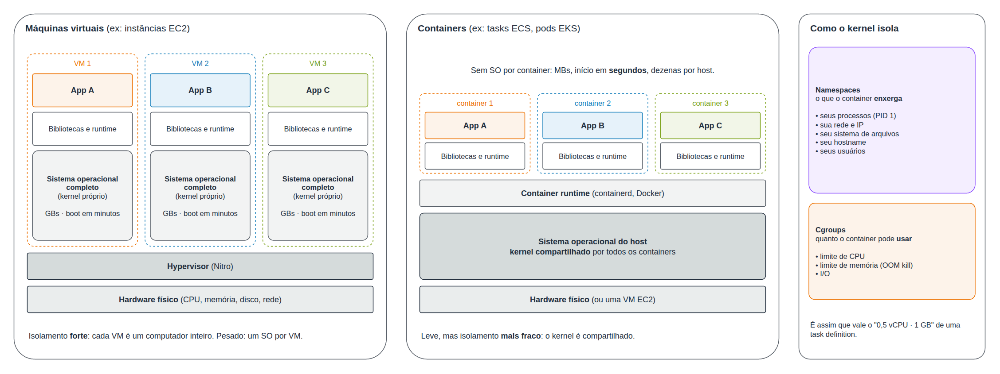

[↑ Índice](#índice)

### Imagens, camadas e registries

- **Imagem:** o pacote **imutável** a partir do qual os containers são criados: o sistema de arquivos com o runtime, as bibliotecas, o código e os metadados (comando de início, portas, variáveis). Um **container** é uma imagem **em execução**. Da mesma imagem, saem quantos containers você quiser.
- **Dockerfile:** a "receita" da imagem, um arquivo de texto com os passos para construí-la:

```dockerfile
FROM public.ecr.aws/docker/library/node:22-slim   # imagem base: SO mínimo + Node.js
WORKDIR /app
COPY package*.json ./
RUN npm ci --omit=dev                            # instala as dependências
COPY src/ ./src/                                 # copia o código
EXPOSE 8080
CMD ["node", "src/server.js"]                    # processo principal do container
```

- **Camadas** (*layers*): cada instrução do Dockerfile gera uma **camada** somente leitura, empilhada sobre a anterior. Elas são **reaproveitadas**: dez imagens com a mesma base guardam a base uma vez só, e um deploy que só mudou o código baixa só a **última camada**. Por isso, as instruções que mudam pouco (base, dependências) ficam no início do Dockerfile, e o código, que muda sempre, fica no fim.
- **Camada gravável:** ao iniciar, o container ganha uma camada **gravável** por cima da imagem (*copy-on-write*). Tudo o que ele grava vai para essa camada, que **desaparece quando o container é removido**. Daí vem a regra de que containers são **efêmeros**: estado que precisa durar vai para fora (banco de dados, S3, EFS).
- **Tags e digests:** a imagem é identificada por um **repositório + tag** (ex: `api:1.4.2`) ou, de forma imutável, pelo **digest** (um hash SHA-256 do conteúdo). Uma tag pode ser **movida** para outra imagem, como acontece com a `latest`. O digest nunca muda. Em produção, use tags de versão, e não a `latest`, ou configure **tag immutability** no registry.
- **Registry:** o "repositório de pacotes" das imagens. Nele, o CI publica (**push**) e os hosts baixam (**pull**). Pode ser público (Docker Hub, ECR Public) ou privado. Na AWS, é o **Amazon ECR** (ver [Amazon ECR](#amazon-ecr-elastic-container-registry)).
- **Padrão OCI:** imagens e runtimes seguem a especificação aberta da **Open Container Initiative**. Uma imagem construída com Docker roda no ECS, no EKS, no Lambda ou em qualquer outra plataforma compatível. O "Docker" virou quase sinônimo de container, mas é só uma das ferramentas desse ecossistema (outras: containerd, Podman, BuildKit).

**O ciclo de vida de uma imagem:**

1. **Build:** a imagem é construída a partir do Dockerfile, normalmente no pipeline de CI (CodeBuild, GitHub Actions).
2. **Scan:** a imagem passa por uma varredura de vulnerabilidades, por exemplo o scanning do ECR com o Inspector.
3. **Push:** a imagem é publicada no registry com uma tag de versão.
4. **Pull:** cada host que vai executar a aplicação baixa a imagem do registry, ou só as camadas que ainda não tem.
5. **Run:** o host cria containers a partir dela.

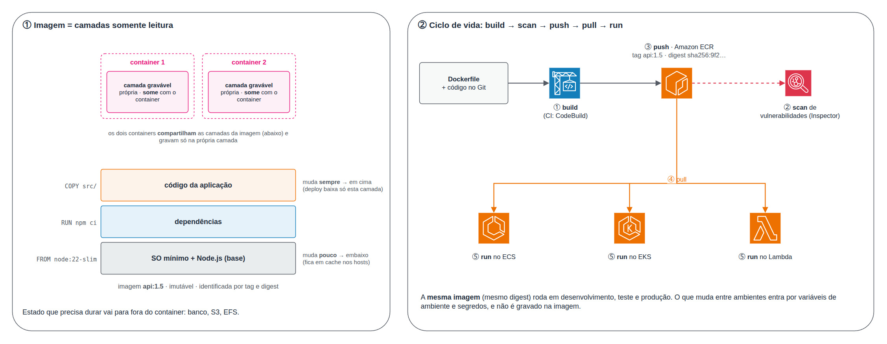

> **Paralelo com o Lambda:** a imagem equivale a uma **versão publicada** de uma função: um artefato imutável que você promove de ambiente em ambiente. O ECR equivale ao lugar onde o Lambda guarda o código de cada versão. E a regra "containers são efêmeros, estado vai para fora" é a mesma regra do Lambda, em que o `/tmp` não é confiável entre execuções.

[↑ Índice](#índice)

### Boas práticas para aplicações em containers

A metodologia **twelve-factor app** resume como uma aplicação deve se comportar para rodar bem em containers. Os pontos principais:

- **Stateless:** nada de estado importante no disco ou na memória do container. Sessões, uploads e dados ficam em ElastiCache, DynamoDB, RDS, S3 ou EFS. Assim, qualquer container pode ser destruído e recriado a qualquer momento.
- **Configuração por ambiente:** a **mesma imagem** vai do desenvolvimento à produção. O que muda entre ambientes (URLs, credenciais, *feature flags*) entra por **variáveis de ambiente** ou por **segredos** injetados na hora de iniciar, e não é gravado na imagem.
- **Logs no stdout/stderr:** o container escreve os logs na saída padrão, e a plataforma os coleta (ex: CloudWatch Logs). Não escreve em arquivos locais que somem com o container.
- **Um processo principal por container:** cada container faz uma coisa, como a API ou o worker. Auxiliares, como um agente de logs ou um proxy, vão em containers separados na mesma task ou pod, os **sidecars**.
- **Início rápido e desligamento gracioso:** ao receber o sinal **SIGTERM**, que é o que o orquestrador envia antes de parar o container (e o que o Fargate Spot envia antes da interrupção), a aplicação termina as requisições em andamento e encerra.
- **Imagens pequenas e seguras:** imagens base mínimas (`slim`, *distroless*), sem ferramentas desnecessárias, rodando com **usuário não-root**, e reconstruídas com frequência para incluir patches de segurança.

[↑ Índice](#índice)

### Por que é preciso um orquestrador

Rodar **um** container é simples: `docker run`. Rodar **centenas**, de dezenas de serviços, em várias máquinas e AZs, não é. Alguém precisa responder continuamente:

- **Agendamento:** em **qual host** cada container vai rodar, considerando a CPU e a memória livres?
- **Autorrecuperação:** se um container cai ou um host morre, quem **cria outro** no lugar?
- **Escala:** quem aumenta e diminui o número de containers conforme a demanda?
- **Rede:** como os containers recebem endereço, como o load balancer os encontra e como os serviços se encontram entre si (*service discovery*)?
- **Deploy:** como trocar a versão de todos os containers sem indisponibilidade, e voltar atrás se der errado?
- **Configuração e segredos:** como entregar a cada container as variáveis e credenciais certas?

O **orquestrador** é o sistema que faz tudo isso. Você **declara** o estado desejado ("quero 6 containers da imagem `api:1.5`, com 1 vCPU cada, atrás deste ALB"), e ele trabalha continuamente para que a realidade bata com a declaração. Os dois orquestradores da AWS são:

- **Amazon ECS:** orquestrador **próprio da AWS**, mais simples e integrado nativamente a IAM, ALB, CloudWatch e Service Connect.
- **Amazon EKS:** **Kubernetes** gerenciado. É o padrão de mercado, portável entre nuvens e on-premises, com um ecossistema enorme (Helm, operators), mas é mais complexo de operar.

[↑ Índice](#índice)

### Containers na AWS: o mapa

Os serviços de containers da AWS se organizam em **camadas**. Quase toda escolha de arquitetura com containers é uma combinação de uma opção de cada camada:

| Camada | Pergunta | Opções na AWS |
|---|---|---|
| **Registry** | Onde guardo as imagens? | **Amazon ECR** (privado e público) |
| **Orquestração** | Quem decide onde e quantos containers rodam? | **Amazon ECS** ou **Amazon EKS** |
| **Computação** | Em que máquinas os containers rodam? | **EC2** (você gerencia), **Fargate** (serverless, sem servidores), **ECS Managed Instances / EKS Auto Mode** (EC2 gerenciado pela AWS), **on-premises** (ECS Anywhere, EKS Hybrid Nodes) |
| **Serviços que usam containers por baixo** | Não quero orquestrar nada | **AWS Lambda** (container images), **AWS Batch** (jobs), **Elastic Beanstalk** (Docker) |

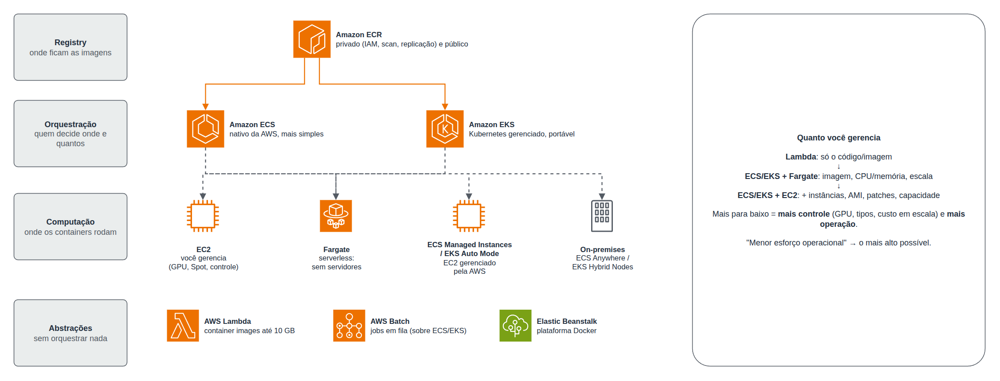

> **Paralelo com o Lambda:** pense em uma escala de "quanto eu gerencio":
> 1. **Lambda:** só o código ou a imagem.
> 2. **ECS/EKS + Fargate:** a imagem, a CPU e a memória de cada task, e a escala.
> 3. **ECS/EKS + EC2:** tudo isso mais as instâncias: AMI, patches e capacidade do cluster.
>
> Quanto mais para baixo nessa escala, mais controle (GPU, tipos de instância, custo em escala) e mais trabalho operacional. Em questões que pedem "menor esforço operacional", a resposta costuma estar o mais alto possível nessa escala.

[↑ Índice](#índice)

### Dicas para a prova

- "Garantir que a aplicação rode igual em desenvolvimento, teste e produção" → **containers** (mesma imagem em todos os ambientes, com configuração por variáveis e segredos).
- "Modernizar uma aplicação legada com o **mínimo de mudanças**" → **containerizar** a aplicação como está (*lift and shift* para containers) e rodar no **ECS/Fargate**. O **AWS App2Container** gera a imagem e a task definition a partir de aplicações Java e .NET existentes.
- "Isolar fortemente cargas de clientes diferentes" → separar por **instância** ou **conta**, ou usar **Fargate**, que isola cada task, e não apenas containers lado a lado no mesmo host.
- "Imagem para instâncias **Graviton**" → imagem **arm64** ou **multi-arquitetura**.
- "Reduzir o tempo de deploy e de download das imagens" → **imagens pequenas** e Dockerfile ordenado para aproveitar o **cache de camadas**.
- "Garantir que a tag de produção sempre aponte para a mesma imagem" → **tag immutability** no ECR (ou deploy por **digest**).
- "Containers perdem os dados ao reiniciar" → estado em serviço externo (**EFS**, **S3**, banco de dados). A camada gravável do container é efêmera.
- "Containers com o **menor esforço operacional**" → orquestrador gerenciado + **Fargate**. "Equipe já usa **Kubernetes**" → **EKS**.

[↑ Índice](#índice)

## Amazon Elastic Container Service (ECS)

O **Amazon ECS** é o orquestrador de **containers** da AWS. Ele decide **onde** cada container roda, mantém a quantidade certa rodando, substitui os que falham, conecta-os ao load balancer e faz deploy de versões novas. É um serviço **regional**, sem custo próprio: paga-se a computação usada, seja EC2 ou Fargate.

Na SAP-C02, o ECS aparece principalmente em três tipos de questão:
- **modernização**: levar uma aplicação monolítica ou on-premises para containers;
- **escolha de computação**: EC2, Fargate ou Lambda;
- **detalhes de arquitetura**: as roles IAM corretas, a rede, a escala e o deploy sem indisponibilidade.

> **Paralelo com o Lambda:** você já conhece metade do ECS sem saber. O Lambda também roda o seu código em um ambiente isolado que a AWS gerencia, e aceita **container images** como pacote de deploy. A diferença está no **modelo de execução**:
> - **Lambda:** um handler acionado por evento, que roda no máximo 15 minutos e é cobrado por invocação.
> - **ECS:** um **processo que fica rodando**, como um servidor web, um worker ou uma API, sem limite de tempo, com a CPU e a memória que você definir, e cobrado pelo tempo em que a task fica no ar.
>
> O **ECS com Fargate** é o ponto mais próximo do serverless no mundo de containers. Você entrega a imagem, diz quanta CPU e memória quer, e não gerencia servidores.

> **Pré-requisito:** os conceitos de container, imagem, registry e orquestração estão na seção [Containers](#containers).

### Componentes do ECS

| Componente | O que é | Paralelo com o Lambda |
|---|---|---|
| **Cluster** | Agrupamento lógico onde tasks e serviços rodam. Pode usar instâncias EC2, Fargate ou ambos | Não existe: o Lambda não expõe essa camada |
| **Task definition** | O "molde" da aplicação, em JSON: imagem(ns), **CPU e memória**, portas, variáveis de ambiente, segredos, volumes, **roles IAM**, modo de rede, logs. É **versionada** por *revisões* (`api:1`, `api:2`...) | A **configuração** da função + a versão publicada |
| **Task** | Uma **instância em execução** da task definition. Pode ter **um ou vários containers** que rodam juntos, compartilhando rede e volumes (ex: a aplicação + um *sidecar* de logs) | Um ambiente de execução do Lambda |
| **Service** | Mantém **N tasks** de uma task definition sempre rodando (*desired count*), substitui as que falham, registra-as no **load balancer**, escala e faz **deploy** de revisões novas | O alias com escala e deploy gerenciados |
| **Standalone task** | Uma task executada **uma vez** (`RunTask`), sem service, que termina quando o processo acaba. Usada para jobs, migrações e tarefas agendadas | Uma invocação, mas sem o limite de 15 min |
| **Container agent** | Processo que roda em cada instância EC2 do cluster e conversa com o ECS. Não existe no Fargate | — |

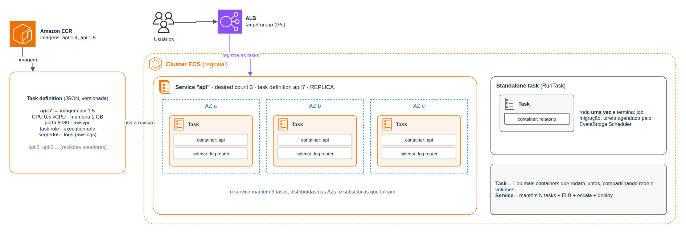

**Estratégias de agendamento** (*scheduling*) de um service:

- **REPLICA** (padrão): mantém o número desejado de tasks, distribuídas pelas AZs.
- **DAEMON:** roda **exatamente uma task em cada instância EC2** do cluster. Serve para agentes de monitoramento, coletores de logs e segurança. Só existe com EC2, porque no Fargate não há instâncias.

[↑ Índice](#índice)

### Onde as tasks rodam: EC2, Fargate e capacity providers

Toda task precisa de CPU e memória **de algum lugar**. O ECS oferece três modelos:

| | **EC2** | **Fargate** | **ECS Managed Instances** |
|---|---|---|---|
| Quem gerencia os servidores | **Você**: AMI otimizada para ECS, patches, escala do cluster (ASG) | **A AWS**: não há instâncias visíveis; cada task roda em um ambiente isolado próprio | **A AWS** provisiona, atualiza e escala instâncias EC2 para você |
| Cobrança | Pelas **instâncias**, mesmo com espaço sobrando | Por **vCPU e memória da task**, por segundo | Pelas instâncias + taxa de gerenciamento |
| Densidade e custo em escala | Alta: várias tasks por instância. Combina com Savings Plans, RIs e Spot | Sem desperdício por task, mas o preço por vCPU é maior | Intermediária |
| GPU, tipos de instância específicos | **Sim** | **Não** (sem GPU) | Sim |
| Acesso ao host, privileged, DAEMON, placement strategies | **Sim** | Não | Limitado |
| Spot | EC2 Spot (via ASG) | **Fargate Spot** | Sim |
| Quando escolher | Controle fino, GPU, grande escala com custo otimizado, requisitos de host | **Padrão** para a maioria das cargas: menor esforço operacional | Quer EC2 (GPU, tipos específicos) sem gerenciar instâncias |

- **Fargate**, em mais detalhes: cada task recebe um ambiente isolado com a CPU e a memória da task definition, até 16 vCPUs e 120 GiB. Tem **armazenamento efêmero** de 20 GiB (expansível até 200 GiB) e sempre usa a rede **awsvpc**. O **Fargate Spot** custa até ~70% menos e avisa a task com um `SIGTERM` **2 minutos** antes da interrupção.
- **ECS Managed Instances** é um recurso recente: o ECS escolhe e gerencia as instâncias EC2 a partir de requisitos (vCPU, memória, GPU), aplicando patches e trocando as instâncias periodicamente.
- **ECS Anywhere:** registra **servidores on-premises** ou de outras nuvens no cluster (tipo `EXTERNAL`), com o agente do SSM e do ECS. Útil em migrações híbridas e para processar dados que precisam ficar no data center.

**Capacity providers:** definem **de onde vem a capacidade** de um service e em que proporção.

- **Tipos:** `FARGATE`, `FARGATE_SPOT`, ou um **ASG** de instâncias EC2.
- **Capacity provider strategy:** uma **base** (o mínimo de tasks que sempre vai para aquele provider) e **pesos** (a proporção do resto). Exemplo: base 2 em `FARGATE` + peso 1 em `FARGATE` + peso 3 em `FARGATE_SPOT` significa que as 2 primeiras tasks rodam em Fargate e, das seguintes, 1 em cada 4 vai para Fargate e 3 para Fargate Spot.
- **Managed scaling** (para ASGs): o ECS ajusta o tamanho do ASG conforme as tasks pendentes. É o *cluster auto scaling*.
- **Managed termination protection:** impede que o ASG encerre instâncias que ainda têm tasks rodando.

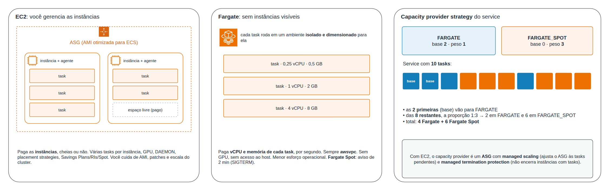

> **Paralelo com o Lambda:** a capacity provider strategy com `FARGATE` + `FARGATE_SPOT` é o mesmo raciocínio de base On-Demand + escala em Spot da seção [Spot](#spot-instances--spot-fleet), só que sem gerenciar instâncias.

[↑ Índice](#índice)

### Rede: network modes

O *network mode* da task definition define **como os containers recebem endereço de rede**:

- **awsvpc** (recomendado; **obrigatório no Fargate**): cada task recebe **sua própria ENI**, com um **IP privado da VPC** e **security groups próprios**. A task se comporta como uma instância na rede: regras de firewall por serviço, flow logs por task e acesso direto a recursos da VPC.
  - **Limite no EC2:** cada instância tem um número máximo de ENIs, que limita quantas tasks awsvpc cabem nela. O **ENI trunking** aumenta esse limite nas instâncias compatíveis.
- **bridge** (padrão histórico no EC2 Linux): os containers ficam em uma rede virtual do Docker dentro da instância e são expostos por **mapeamento de portas**. Com **mapeamento dinâmico** (host port 0), cada container recebe uma porta aleatória da instância, e o **ALB** registra o par instância:porta no target group. Isso permite **várias tasks iguais na mesma instância**. Todas compartilham o security group da instância.
- **host:** o container usa a rede da instância diretamente, sem isolamento. A porta do container é a porta da instância, então só uma task por porta por instância.
- **none:** sem rede externa.

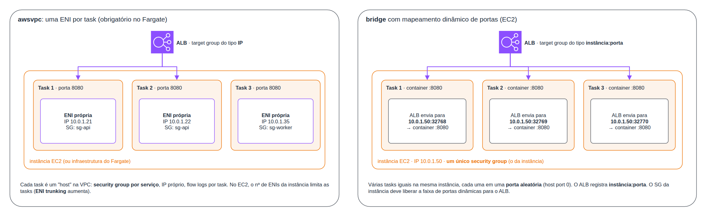

#### Quando usar awsvpc ou bridge

O **awsvpc é o padrão**, e o bridge é a exceção, disponível só no ECS com EC2.

**Use awsvpc quando:**

- é preciso um **security group por serviço**. Por exemplo, a API de pagamentos só aceita conexões do frontend. No bridge, todas as tasks da instância dividem o mesmo SG, e esse isolamento não existe;
- há necessidade de **visibilidade e controle de rede por task**: IP próprio, VPC Flow Logs por task, NACLs e rotas como se cada task fosse um servidor;
- a task roda no **Fargate**, que só aceita awsvpc;
- a integração espera um **IP da VPC**: target groups do tipo **IP** no ALB/NLB, Service Connect, VPC Lattice.

**O bridge ainda faz sentido quando:**

- há **muitas tasks pequenas por instância** e o **limite de ENIs** atrapalha. No awsvpc, cada task consome uma ENI, e cada instância aceita poucas: uma `c5.large` tem 3, e uma delas é da própria instância. O **ENI trunking** resolve isso nos tipos compatíveis. Sem ele, o bridge com portas dinâmicas coloca dezenas de tasks na mesma instância;
- a **subnet está ficando sem IPs**. Cada task awsvpc ocupa **um IP da subnet**, e centenas de tasks podem esgotar subnets pequenas. No bridge, só a instância consome IP;
- o workload é **legado** e já foi desenhado com mapeamento de portas, e migrar não traz ganho.

Para **desempenho bruto de rede**, a opção é o **host**, e não o bridge: o container usa a rede da instância sem a camada de NAT do Docker, mas só cabe uma task por porta em cada instância.

| Critério | **awsvpc** | **bridge** |
|---|---|---|
| Fargate | Obrigatório | Não existe |
| Security group | **Por task** | Da instância (compartilhado) |
| IP | Um IP da VPC por task | Só o da instância |
| Densidade no EC2 | Limitada pelas ENIs (melhora com ENI trunking) | Alta (portas dinâmicas) |
| Consumo de IPs da subnet | Alto (1 por task) | Baixo |
| Target group no ALB/NLB | Tipo **IP** | Tipo **instância** (instância:porta) |
| Recomendação da AWS | **Padrão** | Casos específicos |

> **Paralelo com o Lambda:** uma função Lambda **em VPC** usa ENIs gerenciadas e security groups, assim como uma task **awsvpc**. A diferença é que no ECS cada task tem a sua ENI.

[↑ Índice](#índice)

### IAM: task role vs. task execution role

Esse é um dos pontos **mais cobrados** sobre ECS. Há **duas roles** na task definition, usadas por **quem** é diferente:

| | **Task execution role** | **Task role** |
|---|---|---|
| Quem usa | O **ECS/Fargate** (o agente), para **preparar** a task | O **código da aplicação**, dentro do container |
| Para quê | **Baixar a imagem** do ECR, enviar logs ao **CloudWatch Logs**, buscar **segredos** no Secrets Manager/Parameter Store para injetar como variáveis | Chamar serviços da AWS: ler o S3, gravar no DynamoDB, publicar no SNS... |
| Erro típico se faltar permissão | A task **não inicia**: `CannotPullContainerError`, erro ao buscar segredo | A task sobe, mas a aplicação recebe **AccessDenied** |

- **Como a aplicação recebe as credenciais da task role:** o SDK as busca automaticamente em um endpoint local do ECS (variável `AWS_CONTAINER_CREDENTIALS_RELATIVE_URI`). São temporárias e rotacionadas, como no instance profile do EC2 (ver [Instance metadata (IMDS) e IAM](#instance-metadata-imds-e-iam)).
- **Menor privilégio por serviço:** cada task definition tem a **sua** task role. A API de pagamentos e o worker de e-mails têm permissões diferentes, mesmo rodando na **mesma instância**.
- **Cuidado no EC2:** a instância também tem uma role (*container instance role*, usada pelo agente para se registrar no cluster). Por padrão, um container pode alcançar o **IMDS** da instância e usar essa role. Isso deve ser **bloqueado**, com o IMDSv2 com *hop limit* 1 ou com a configuração do agente que bloqueia o IMDS nas tasks, para que cada task use só a **sua** task role.

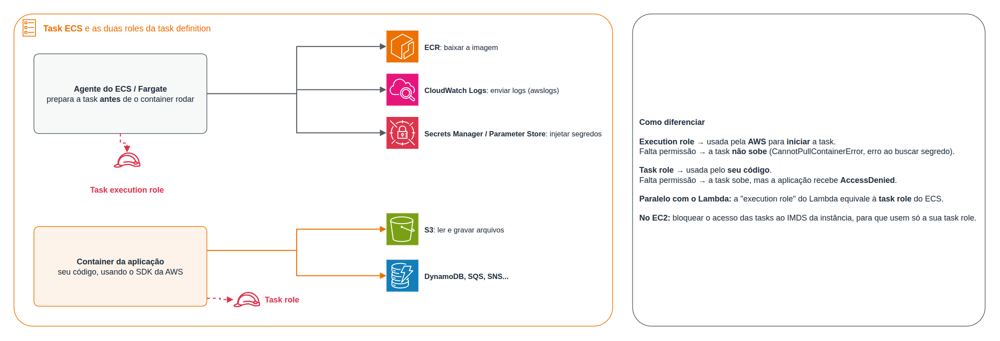

> **Paralelo com o Lambda:** a **task role** é a **execution role** do Lambda: a permissão que o seu código usa. A *task execution role* do ECS não tem equivalente no Lambda, porque lá é a própria AWS que baixa o código e envia os logs. O nome parecido é uma armadilha: a "execution role" do Lambda corresponde à **task role** do ECS.

[↑ Índice](#índice)

### Load balancing e comunicação entre serviços

- **Application Load Balancer:** o padrão para HTTP/HTTPS. Um único ALB pode atender **vários services** com regras de **path** (`/api` → service A, `/web` → service B) ou de **host**. Cada service registra suas tasks no seu target group (IP no awsvpc, instância:porta no bridge).
- **Network Load Balancer:** TCP/UDP, desempenho extremo, IP estático, ou quando o service precisa ser exposto via **PrivateLink**.
- **Service discovery** (comunicação entre serviços sem load balancer):
  - **ECS Service Connect** (recomendado): os serviços se chamam por **nomes curtos** (ex: `http://pedidos:8080`) dentro de um *namespace* do **Cloud Map**. O ECS injeta um proxy (Envoy) gerenciado em cada task, que faz balanceamento, *retries*, *timeouts* e coleta **métricas de tráfego** entre serviços, sem alterar o código.
  - **Cloud Map** direto: registra as tasks em registros **DNS** (ou na API do Cloud Map) para outros serviços as encontrarem.
  - **VPC Lattice:** conecta serviços entre VPCs e contas, com autenticação IAM.
  - O **AWS App Mesh** foi **descontinuado**, com o fim do suporte anunciado para setembro de 2026. Em cenários novos, a resposta é **Service Connect** ou **VPC Lattice**.

[↑ Índice](#índice)

### Auto Scaling no ECS: dois níveis

Escalar no ECS significa escalar **duas coisas diferentes**:

1. **Tasks (service auto scaling):** quantas tasks o service roda. Usa o **Application Auto Scaling** com target tracking (CPU média do service, memória média ou **requisições por target** do ALB), step scaling ou scheduled scaling. Para workers que consomem filas, usa-se o **backlog por task** (ver [Políticas de escala](#políticas-de-escala)).
2. **Capacidade (cluster auto scaling):** só no **EC2**. Se o service quer mais tasks e as instâncias estão cheias, as tasks novas ficam **pendentes** (`PROVISIONING`). O **managed scaling** do capacity provider usa a métrica **CapacityProviderReservation** (capacidade necessária ÷ capacidade existente) e ajusta o ASG para mantê-la no alvo (ex: 100%).

No **Fargate**, só existe o nível 1: cada task nova já vem com a sua capacidade.

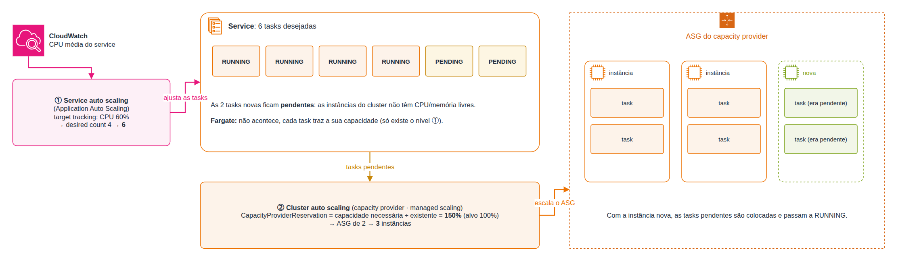

> **Paralelo com o Lambda:** o Lambda escala sozinho a cada requisição, sem nenhuma política. No ECS com Fargate, você define **a regra** (ex: manter a CPU em 60%) e a AWS cuida da capacidade. No ECS com EC2, você também cuida de ter **instâncias suficientes** para as tasks.

[↑ Índice](#índice)

### Deploy de novas versões

Atualizar um service significa apontá-lo para uma **nova revisão** da task definition, normalmente com uma nova tag de imagem. As estratégias seguem os mesmos conceitos de [Auto Scaling Update Strategies](#auto-scaling-update-strategies):

- **Rolling update** (padrão): substitui as tasks aos poucos, controlado por dois parâmetros:
  - **`minimumHealthyPercent`:** quantas tasks precisam continuar saudáveis. Ex: 100% significa não derrubar nenhuma antes de a nova estar pronta.
  - **`maximumPercent`:** quantas tasks podem existir durante o deploy. Ex: 200% permite subir todas as novas antes de remover as antigas.
- **Deployment circuit breaker:** se as tasks novas não ficam saudáveis (falham ao iniciar, falham no health check), o ECS **para o deploy** e, com *rollback* habilitado, **volta à última revisão que funcionava**. Alarmes do CloudWatch também podem disparar o rollback.
- **Blue/green:** dois target groups e a troca do tráfego no ALB. Pode ser feito com o **AWS CodeDeploy** (configurações *all at once*, **canary** e **linear**, com hooks de teste e rollback automático) ou com o blue/green **nativo do ECS**, um recurso recente que dispensa o CodeDeploy e também oferece canary e linear.

[↑ Índice](#índice)

### Armazenamento em containers

Containers são **efêmeros**: o que é gravado no sistema de arquivos do container **some** quando a task termina. Para persistir ou compartilhar dados:

| Opção | Características | Uso |
|---|---|---|
| **Armazenamento efêmero** da task | Fargate: 20 GiB, expansível até 200 GiB. Some com a task | Arquivos temporários, cache local |
| **Amazon EFS** | Sistema de arquivos **compartilhado** entre tasks e AZs, **persistente**, funciona no **Fargate** e no EC2 | Conteúdo compartilhado, uploads, dados que sobrevivem às tasks |
| **Volumes EBS** por task | Um volume EBS criado e anexado a **cada task** no deploy (Fargate e EC2) | Cargas com muito I/O que precisam de disco de bloco próprio por task |
| **Bind mounts / volumes Docker** (EC2) | Pastas da instância montadas no container | Compartilhar arquivos entre containers da mesma task (ex: app + sidecar) |
| **FSx for Windows File Server** | Compartilhamento SMB | Containers **Windows** |

[↑ Índice](#índice)

### Configuração, segredos e observabilidade

- **Segredos:** declarados na task definition como referências ao **Secrets Manager** ou ao **SSM Parameter Store**. O ECS os busca, usando a **task execution role**, e os injeta como **variáveis de ambiente** no início da task. O valor nunca fica gravado na task definition. Arquivos de variáveis também podem vir do **S3** (`environmentFiles`).
- **Logs:** o driver **`awslogs`** envia o stdout/stderr dos containers ao **CloudWatch Logs**. O **FireLens** (um sidecar com Fluent Bit) envia para outros destinos: S3, OpenSearch, Firehose ou ferramentas de terceiros.
- **Métricas:** **CloudWatch Container Insights** (CPU, memória, rede e disco por cluster, service e task).
- **Tracing:** **AWS X-Ray** ou **OpenTelemetry (ADOT)**, normalmente como sidecar.
- **ECS Exec:** abre um shell ou executa comandos **dentro de um container em execução**, via SSM, sem SSH e com auditoria no CloudTrail. É o equivalente ao Session Manager para containers.

[↑ Índice](#índice)

### Sidecars

Uma aplicação em produção precisa de várias funções **além** do próprio negócio:
- enviar logs para algum lugar;
- coletar métricas e traces;
- criptografar o tráfego;
- descobrir outros serviços;
- buscar configuração.

Colocar tudo isso **dentro** do código da aplicação mistura responsabilidades e obriga cada equipe a reimplementar o mesmo em cada linguagem. O padrão **sidecar** resolve isso tirando essas funções da aplicação e colocando-as em um **container auxiliar**, que roda **ao lado** dela, na **mesma task**.

> **Como pensar:** é o **sidecar de uma moto**, o carrinho preso ao lado dela. Ele vai sempre junto, para onde a moto for, mas é uma peça separada, que pode ser trocada sem mexer no motor.

**O que faz um container ser "sidecar" e não apenas outro serviço:** ele vive **dentro da mesma task** (ou do mesmo *pod*, no Kubernetes) que a aplicação, e por isso:

- **Mesmo ciclo de vida:** o sidecar sobe e desce **junto** com a aplicação, e escala junto, porque cada task nova traz o seu sidecar.
- **Mesma rede:** no modo **awsvpc**, todos os containers da task compartilham a mesma ENI e o mesmo IP, e conversam por **`localhost`**. A aplicação envia traces para `localhost:4317`, e o sidecar recebe.
- **Volumes compartilhados:** os containers da task podem montar o **mesmo volume**. A aplicação grava um arquivo, e o sidecar o lê e envia para fora.
- **Mesmo host e recursos da task:** os containers dividem a CPU e a memória definidas na task definition. É possível reservar uma parte para cada container.

**Sidecars comuns na AWS:**

| Sidecar | O que faz |
|---|---|
| **FireLens** (Fluent Bit ou Fluentd) | Recebe os logs da aplicação e os envia para **vários destinos**: CloudWatch Logs, S3, Firehose, OpenSearch, ferramentas de terceiros. Pode filtrar e enriquecer os logs no caminho |
| **AWS Distro for OpenTelemetry (ADOT)** / **X-Ray daemon** | Recebe **traces** e **métricas** da aplicação e envia para o X-Ray, CloudWatch ou Prometheus |
| **CloudWatch agent** | Coleta métricas personalizadas (ex: StatsD, Prometheus) e envia ao CloudWatch |
| **Proxy Envoy do Service Connect** | Injetado e **gerenciado pelo ECS**: faz service discovery, balanceamento, *retries*, *timeouts* e métricas de tráfego entre serviços. É um sidecar que você nem declara |
| **Proxies de autenticação e TLS** | Terminam TLS, validam tokens ou fazem mTLS antes de a requisição chegar à aplicação |
| **Agentes de terceiros** | Datadog, New Relic, agentes de segurança em tempo de execução |

**Como o ECS controla os containers de uma task** (campos da task definition):

- **`essential`:** se um container **essencial** para, a **task inteira** é encerrada, e o service cria outra. A aplicação é sempre essencial. Um sidecar de logs normalmente também é, porque uma task sem logs é um problema. Um sidecar opcional pode ser marcado como não essencial, e a task continua rodando se ele falhar.
- **`dependsOn`:** define a **ordem de início**. Por exemplo, a aplicação só sobe depois que o sidecar de logs estiver **`HEALTHY`** (com health check do container), para não perder os primeiros logs. As condições são `START`, `HEALTHY`, `COMPLETE` e `SUCCESS`.
- **Container de inicialização (*init container*):** um container **não essencial** que roda **antes** da aplicação e termina, como uma migração de banco, o download de um arquivo de configuração ou a preparação de um volume. A aplicação declara `dependsOn` com a condição **`SUCCESS`**, e só sobe se ele terminar com sucesso.
- **`stopTimeout`:** quanto tempo cada container tem, depois do `SIGTERM`, para terminar. Os containers param na **ordem inversa** das dependências, então o sidecar de logs consegue enviar os últimos logs da aplicação.
- **Recursos:** a CPU e a memória são definidas para a **task** e podem ser divididas entre os containers. O sidecar ocupa parte do que a task paga, e isso deve entrar no dimensionamento.

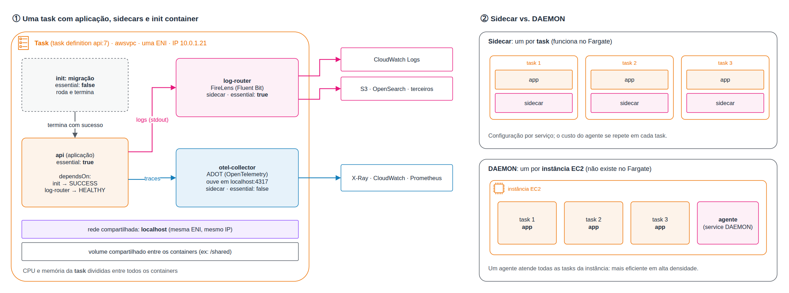

**Sidecar vs. DAEMON:** as duas formas são usadas para agentes de logs e de monitoramento, mas funcionam de modos diferentes:

| | **Sidecar** | **DAEMON** (estratégia de agendamento) |
|---|---|---|
| Quantos | **Um por task** | **Um por instância EC2** |
| Fargate | **Sim**: é a única opção, porque não há instâncias | Não |
| Isolamento | Cada task tem o seu, com configuração própria | Compartilhado por todas as tasks da instância |
| Custo de recursos | Repetido em cada task | Um só por instância (mais eficiente em alta densidade) |
| Quando usar | Fargate, configuração por serviço, proxy por task | Muitas tasks por instância EC2, agente de host (segurança, métricas da instância) |

**Prós e contras do padrão:**

- **Prós:** separa responsabilidades, reaproveita o mesmo sidecar em serviços de linguagens diferentes, permite atualizar o agente sem mexer na aplicação e padroniza a observabilidade e a segurança.
- **Contras:** consome CPU e memória **em cada task**, aumenta o tempo de início, acrescenta pontos de falha (um sidecar essencial que cai derruba a task) e torna a task definition mais complexa.

**Padrões relacionados** (do mesmo conceito de containers auxiliares):

- **Ambassador:** um proxy que representa um serviço **externo** para a aplicação. A aplicação chama `localhost`, e o ambassador cuida de conexão, retries e autenticação com o destino real.
- **Adapter:** **converte** a saída da aplicação para um formato padrão, por exemplo transformando métricas proprietárias em métricas no formato Prometheus.

> **Paralelo com o Lambda:** as **Lambda extensions** são os "sidecars" do Lambda. Uma extensão externa roda como um **processo separado**, dentro do mesmo ambiente de execução da função, com o mesmo ciclo de vida. Ela inicia junto, recebe os eventos de **Shutdown** para enviar os últimos dados, e serve para o mesmo tipo de função auxiliar: agentes de observabilidade como Datadog ou New Relic, e a extensão de **Parameters and Secrets**, que faz cache de configuração e segredos. Se você já usou uma Lambda Layer com uma extensão de monitoramento, já usou o padrão sidecar.

[↑ Índice](#índice)

### Amazon ECR (Elastic Container Registry)

O registry de imagens da AWS, integrado ao IAM. Os pontos que caem na prova:

- **Repositórios privados** (com políticas IAM e políticas de repositório para **acesso entre contas**) e **ECR Public**.
- **Image scanning:** *basic* ou *enhanced*, com o **Amazon Inspector**, que procura vulnerabilidades (CVEs) nas imagens, inclusive de forma contínua.
- **Replicação** entre **regiões** e entre **contas**, para DR e para reduzir a latência de *pull* em ambientes multi-região.
- **Lifecycle policies:** apagam automaticamente imagens antigas ou sem tag, reduzindo custo.
- **Tag immutability:** impede sobrescrever uma tag existente (ex: `1.4.2`), garantindo que a mesma tag sempre aponte para a mesma imagem.
- **Pull through cache:** espelha imagens de registries públicos (Docker Hub, ECR Public, Quay...) no ECR privado. Evita limites de taxa e dependência da internet.
- **Acesso privado:** com **VPC endpoints** do ECR (`ecr.api`, `ecr.dkr`) e do **S3** (gateway, porque as camadas das imagens ficam no S3), tasks em subnets privadas baixam imagens **sem NAT Gateway**.

[↑ Índice](#índice)

### Padrões comuns com ECS

- **Tarefas agendadas:** o **EventBridge Scheduler** executa uma standalone task em um horário (ex: um relatório diário). É a alternativa ao Lambda quando o job passa de 15 minutos.
- **Tarefas orientadas a eventos:** um arquivo chega no S3 → uma regra do **EventBridge** → `RunTask` processa o arquivo. O **Step Functions** também executa tasks ECS como etapas de um fluxo, esperando a conclusão.
- **Workers de fila:** um service lê uma fila **SQS** e escala pelo **backlog por task**.
- **Sidecar:** um container auxiliar na mesma task, como proxy, agente de logs ou coletor de métricas. Ver [Sidecars](#sidecars).
- **Placement** (só no EC2): as **placement strategies** (`binpack` para usar o mínimo de instâncias, `spread` por AZ ou instância para alta disponibilidade, `random`) e as **constraints** (`distinctInstance`, ou `memberOf` com expressões, como "só em instâncias com GPU") definem em qual instância cada task cai.

[↑ Índice](#índice)

### ECS, EKS, Fargate ou Lambda?

| Situação | Escolha |
|---|---|
| Containers com o **menor esforço operacional**, integração nativa com a AWS | **ECS + Fargate** |
| Equipe já usa **Kubernetes**, precisa de portabilidade entre nuvens/on-premises ou do ecossistema K8s (Helm, operators) | **EKS** (com nós EC2 ou Fargate) |
| Containers com **GPU**, tipos de instância específicos ou o menor custo em grande escala | **ECS no EC2** (ou ECS Managed Instances) com Savings Plans/Spot |
| Código **acionado por eventos**, de curta duração (< 15 min), com tráfego irregular ou que escala até zero | **Lambda** |
| Processo longo, servidor que fica ouvindo conexões (WebSocket, gRPC), ou dependências do sistema operacional | **ECS** |
| Jobs batch com filas, prioridades e dependências | **AWS Batch** (que roda sobre ECS/EKS) |
| Levar uma aplicação legada para containers sem reescrever | **ECS** (com o **App2Container** para gerar a imagem e a task definition) |

[↑ Índice](#índice)

### Dicas para a prova

- "Rodar containers **sem gerenciar servidores**" → **ECS com Fargate**.
- "Containers com **GPU**" → **ECS no EC2** (Fargate não tem GPU).
- "Menor custo para containers tolerantes a interrupção" → **Fargate Spot** (ou EC2 Spot via capacity provider), com uma **base** em Fargate/On-Demand na capacity provider strategy.
- "A task **não inicia** e o erro é ao baixar a imagem ou ao buscar o segredo" → permissão na **task execution role**. "A aplicação recebe **AccessDenied** ao acessar o S3" → **task role**.
- "Permissões diferentes para cada serviço na mesma instância" → uma **task role** por task definition, e bloquear o acesso das tasks ao **IMDS** da instância.
- "Security group **por serviço**" → network mode **awsvpc**.
- "Várias tasks iguais na **mesma instância EC2** atrás de um ALB" → network mode **bridge** com **mapeamento dinâmico de portas** (ou awsvpc com ENI trunking).
- "Tasks awsvpc não sobem por **falta de ENIs** na instância" → **ENI trunking** (em instâncias compatíveis) ou bridge. "A subnet está **ficando sem IPs**" com muitas tasks awsvpc → subnets maiores (ou um CIDR secundário na VPC), ou bridge.
- "Um agente de monitoramento em **cada instância** do cluster" → service com estratégia **DAEMON**. "Agente de logs ou de tracing no **Fargate**" → **sidecar** (FireLens, ADOT), porque no Fargate não há DAEMON.
- "Enviar os logs dos containers para **vários destinos** (S3, OpenSearch, ferramenta de terceiros)" → sidecar **FireLens**.
- "Rodar uma migração ou preparar arquivos **antes** de a aplicação subir" → container **não essencial** + `dependsOn` com condição **`SUCCESS`** (init container).
- "Tasks novas ficam **pendentes** por falta de capacidade no cluster EC2" → **capacity provider** com **managed scaling**.
- "Escalar o número de tasks pela CPU ou pelas requisições" → **service auto scaling** (Application Auto Scaling) com target tracking.
- "Deploy que **volta sozinho** se as tasks novas não ficarem saudáveis" → **deployment circuit breaker** com rollback. "Canary/linear com rollback automático" → **blue/green** com CodeDeploy ou o nativo do ECS.
- "Comunicação entre microsserviços por nome, com métricas e retries, sem alterar o código" → **ECS Service Connect**. "App Mesh" em cenário novo → **não**: foi descontinuado.
- "Dados **compartilhados e persistentes** entre tasks no Fargate" → **EFS**.
- "Injetar senhas sem gravá-las na task definition" → referências ao **Secrets Manager/Parameter Store**.
- "Abrir um shell em um container em produção, com auditoria" → **ECS Exec**.
- "Tasks em subnet privada sem NAT precisam baixar imagens" → **VPC endpoints** do ECR (`api` e `dkr`) + **gateway endpoint do S3**.
- "Imagens disponíveis em outra região para DR" → **replicação** do ECR. "Encontrar vulnerabilidades nas imagens" → **enhanced scanning** (Inspector).
- "Rodar containers gerenciados pelo ECS **on-premises**" → **ECS Anywhere**.
- "Job agendado que dura mais de 15 minutos" → **ECS task** via **EventBridge Scheduler** (em vez de Lambda).

[↑ Índice](#índice)

## Amazon Elastic Kubernetes Service (EKS)

O **Amazon EKS** é o **Kubernetes gerenciado** da AWS. Ele resolve o mesmo problema que o ECS: orquestrar containers. A diferença é que o EKS usa o **Kubernetes**, o orquestrador **open source** que virou o padrão de mercado. Kubernetes roda em qualquer nuvem, no data center e no notebook do desenvolvedor.

Para entender o EKS, é preciso primeiro entender o Kubernetes, que tem vocabulário e jeito de funcionar próprios. Esta seção começa pelos conceitos do Kubernetes, sem AWS, compara-os com o que você já viu no ECS, e só depois mostra o que o EKS acrescenta.

Na SAP-C02, o EKS aparece em cenários de:
- **portabilidade e padronização**: "a empresa já usa Kubernetes on-premises", "quer evitar dependência de um provedor";
- **migração** de clusters existentes;
- **detalhes de integração com a AWS**: rede (IPs de pods), IAM por pod, load balancers, armazenamento e escala.

> **Paralelo com o Lambda:** no Lambda, você entrega código e a AWS decide tudo. No ECS, você descreve a task e o service. No Kubernetes, você descreve **tudo** em arquivos YAML: a aplicação, a rede, a escala e as permissões internas. O orquestrador trabalha para que o cluster fique igual ao que está escrito. É o modelo com **mais controle e mais conceitos para aprender**. Em compensação, o mesmo YAML funciona em qualquer Kubernetes, em qualquer lugar.

### Kubernetes: o que é e por que existe

O **Kubernetes** (abreviado **K8s**: o 8 representa as oito letras entre o "K" e o "s") nasceu no Google, a partir da experiência com o orquestrador interno da empresa, e foi doado à comunidade open source em 2014. Hoje é mantido pela **CNCF** (*Cloud Native Computing Foundation*).

Ele faz o que qualquer orquestrador faz (ver [Por que é preciso um orquestrador](#por-que-é-preciso-um-orquestrador)): escolhe em que máquina cada container roda, recria os que falham, escala, faz deploy e conecta os serviços. Três características o tornam diferente:

- **Declarativo:** você não dá ordens ("suba 3 containers"). Você **declara o estado desejado** em YAML ("devem existir 3 réplicas desta aplicação") e entrega ao cluster.
- **Ciclo de reconciliação** (*reconciliation loop*): dentro do cluster, **controladores** comparam o tempo todo o estado **desejado** com o estado **real** e agem para corrigir a diferença. Se um container morre, o real passa a ser 2 réplicas, o desejado continua 3, e o controlador cria outra. É como um **termostato**, aplicado a tudo no cluster.
- **Extensível e portável:** a mesma API funciona em qualquer Kubernetes (EKS, Azure, Google, on-premises). A comunidade criou um ecossistema enorme de ferramentas, e qualquer um pode criar **novos tipos de objeto** para ensinar o Kubernetes a gerenciar outras coisas.

**O que se ganha e o que se paga:**

- **Ganha:** portabilidade entre nuvens e data center, padrão de mercado (profissionais, ferramentas, documentação), ecossistema rico e muito controle.
- **Paga:** **curva de aprendizado** grande, muitos componentes para operar e atualizar, e versões novas a cada ~4 meses, que obrigam a atualizar o cluster com frequência.

[↑ Índice](#índice)

### Arquitetura de um cluster Kubernetes

Um cluster Kubernetes tem duas partes:

**1. Control plane (plano de controle): o "cérebro" do cluster.** Ele não roda as aplicações; ele decide e acompanha tudo.

| Componente | Função | Analogia |
|---|---|---|
| **API server** (`kube-apiserver`) | A **porta de entrada** do cluster. Todo comando, de pessoas, de pipelines ou dos próprios componentes, passa por essa API REST | A recepção de um prédio: tudo passa por ela |
| **etcd** | Banco de dados chave-valor que guarda **todo o estado** do cluster: o desejado e o real | O livro de registros oficial |
| **Scheduler** (`kube-scheduler`) | Decide **em qual nó** cada pod novo vai rodar, conforme a CPU e a memória livres e as regras de posicionamento | O *maître* que escolhe a mesa |
| **Controller manager** | Roda os **controladores**, os ciclos de reconciliação que mantêm o estado real igual ao desejado (réplicas, nós, endpoints...) | Os supervisores que conferem e corrigem |

**2. Worker nodes (nós de trabalho): as máquinas que rodam os containers.** Na AWS, normalmente instâncias EC2. Cada nó tem:

| Componente | Função |
|---|---|
| **kubelet** | O agente do nó. Recebe do API server a lista de pods que devem rodar ali, manda o container runtime iniciá-los e informa se estão saudáveis. É o equivalente ao **agente do ECS** |
| **Container runtime** (containerd) | Quem de fato executa os containers |
| **kube-proxy** | Configura as regras de rede do nó para que o tráfego enviado a um **Service** chegue aos pods certos |

**Como um deploy acontece por dentro:**

1. Você envia um YAML ao **API server** com `kubectl apply -f app.yaml`.
2. O API server valida o pedido e grava o estado desejado no **etcd**.
3. Um **controlador** percebe que deveriam existir 3 pods e só existem 0, e cria a definição de 3 pods.
4. O **scheduler** escolhe um nó para cada pod.
5. O **kubelet** de cada nó escolhido vê o pod atribuído a ele e manda o runtime iniciar os containers.
6. Daí em diante, os controladores **vigiam** o tempo todo: se um pod ou um nó some, o ciclo recomeça.

**kubectl** é a ferramenta de linha de comando para falar com o API server (`kubectl get pods`, `kubectl apply`, `kubectl logs`). Equivale ao AWS CLI para o Kubernetes.

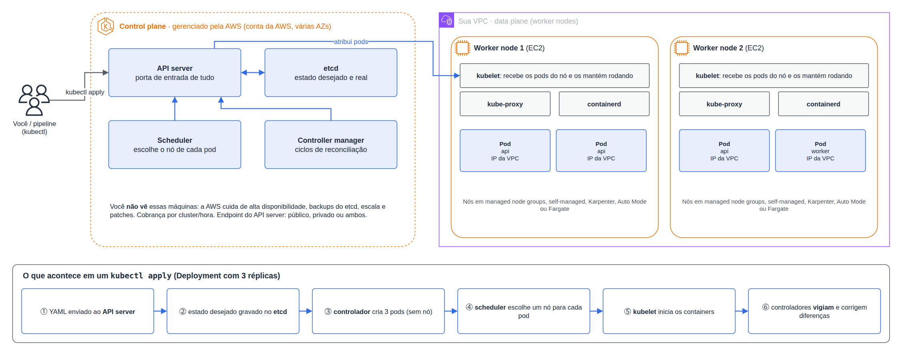

[↑ Índice](#índice)

### Objetos do Kubernetes

Tudo no Kubernetes é um **objeto** descrito em YAML: um registro do estado desejado, com um **tipo** (`kind`), um nome e uma especificação (`spec`). Estes são os que mais importam:

**Executar a aplicação:**

- **Pod:** a **menor unidade** do Kubernetes. É um ou mais containers que rodam **juntos**, no mesmo nó, compartilhando o **mesmo IP** (conversam por `localhost`) e volumes. É o equivalente exato de uma **task do ECS**, inclusive para sidecars (ver [Sidecars](#sidecars)). Pods são **descartáveis**: quando morrem, não "voltam", e outro pod, com outro IP, é criado no lugar.
- **ReplicaSet:** garante que exista **um número fixo de pods** iguais. Raramente é criado diretamente; quem o cria é o Deployment.
- **Deployment:** o objeto mais usado para aplicações **stateless**. Declara a imagem, o número de réplicas e a estratégia de atualização. Para trocar de versão, ele cria um ReplicaSet novo e migra os pods aos poucos (*rolling update*), com *rollback* para a versão anterior. Equivale ao **service do ECS** na parte de "manter N tasks e fazer deploy".
- **StatefulSet:** como o Deployment, mas para aplicações **com estado**, como bancos de dados, Kafka e Elasticsearch. Cada pod tem **nome fixo** (`db-0`, `db-1`), ordem de início e **disco próprio**, que o acompanha mesmo se o pod for recriado.
- **DaemonSet:** roda **exatamente um pod em cada nó**, para agentes de logs, monitoramento e rede. Equivale à estratégia **DAEMON do ECS**.
- **Job:** roda pods **até terminarem com sucesso**, como uma migração ou um processamento em lote. **CronJob:** um Job agendado ("todo dia às 2h"). Equivalem à **task avulsa** e à **tarefa agendada** do ECS.

**Rede:**

- **Service:** como os pods são descartáveis e trocam de IP, os outros componentes não podem depender do IP de um pod. O **Service** dá a um conjunto de pods um **nome e um IP estáveis** e distribui o tráfego entre eles. Ele encontra os pods por **labels** (etiquetas). Por exemplo, o Service `api` encaminha para todos os pods com o label `app: api`. Existem três tipos:
  - **ClusterIP** (padrão): IP interno, acessível **só dentro do cluster**. Os outros serviços chamam `http://api` (via DNS interno, o **CoreDNS**).
  - **NodePort:** expõe o Service em uma porta de **todos os nós**. É pouco usado diretamente.
  - **LoadBalancer:** pede ao provedor de nuvem um **load balancer externo**. Na AWS, cria um **NLB**.
- **Ingress:** regras de roteamento **HTTP/HTTPS** de fora para dentro do cluster: host, path e TLS. Por exemplo, `/api` vai para o Service `api` e `/` vai para o Service `web`. Na AWS, um Ingress vira um **ALB**. O **Gateway API** é a evolução mais moderna e flexível do Ingress.
- **NetworkPolicy:** regras de firewall **entre pods**. Por exemplo, "só pods com o label `app: web` podem chamar a `api`".

**Configuração e organização:**

- **Namespace:** uma divisão **lógica** do cluster, como uma pasta. Os nomes só precisam ser únicos dentro do namespace, e é possível aplicar permissões, cotas de recursos (**ResourceQuota**) e políticas por namespace. É comum ter um namespace por equipe, aplicação ou ambiente.
- **ConfigMap:** configurações (variáveis e arquivos) entregues aos pods como variáveis de ambiente ou arquivos montados.
- **Secret:** como o ConfigMap, mas para dados sensíveis. Por padrão, é só codificado em base64, **não criptografado**. No EKS, ele deve ser criptografado com **KMS**, ou buscado direto do **Secrets Manager** (ver [Segurança](#segurança-quem-acessa-o-cluster-e-o-que-os-pods-acessam)).
- **ServiceAccount:** a **identidade de um pod** dentro do Kubernetes. No EKS, é por meio dela que o pod recebe uma **role IAM**.
- **Labels e selectors:** etiquetas chave-valor (`app: api`, `env: prod`) colocadas nos objetos. Quase tudo no Kubernetes se conecta por labels: o Service encontra os pods, o Deployment controla os seus pods e as NetworkPolicies escolhem a quem se aplicam.

**Armazenamento:**

- **PersistentVolume (PV):** um disco real disponível para o cluster, como um volume EBS ou um file system EFS.
- **PersistentVolumeClaim (PVC):** o **pedido** de disco feito por um pod ("quero 20 GiB, leitura e escrita"). O Kubernetes liga o pedido a um PV.
- **StorageClass:** o "tipo de disco" disponível (ex: `gp3` criptografado). Com ela, os PVs são **criados automaticamente** quando surge um PVC (*provisionamento dinâmico*).

**Exemplo:** uma aplicação descrita em YAML, com um Deployment de 3 réplicas e um Service interno:

```yaml
apiVersion: apps/v1
kind: Deployment
metadata:
  name: api
  namespace: pedidos
spec:
  replicas: 3                       # estado desejado: 3 pods
  selector:
    matchLabels: { app: api }       # o Deployment controla os pods com este label
  template:                         # modelo de cada pod (equivale à task definition)
    metadata:
      labels: { app: api }
    spec:
      serviceAccountName: api-sa    # identidade do pod (→ role IAM no EKS)
      containers:
        - name: api
          image: 123456789012.dkr.ecr.us-east-1.amazonaws.com/api:1.5
          ports: [{ containerPort: 8080 }]
          resources:
            requests: { cpu: 500m, memory: 512Mi }   # reserva usada pelo scheduler
            limits:   { memory: 1Gi }
---
apiVersion: v1
kind: Service
metadata:
  name: api
  namespace: pedidos
spec:
  selector: { app: api }            # envia tráfego para os pods com app=api
  ports: [{ port: 80, targetPort: 8080 }]
```

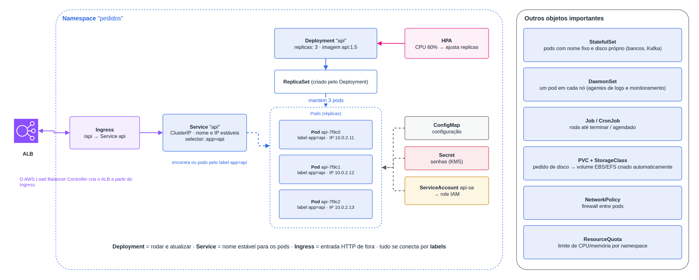

**Ferramentas do ecossistema que aparecem em questões:**

- **Helm:** o "gerenciador de pacotes" do Kubernetes. Um **chart** empacota todos os YAMLs de uma aplicação com parâmetros, e com ele se instala um software completo (ex: Prometheus) com um comando.
- **GitOps (Argo CD, Flux):** o estado desejado fica em um **repositório Git**, e uma ferramenta dentro do cluster aplica automaticamente o que estiver lá. O deploy passa a ser um *pull request*.
- **CRDs e Operators:** as **Custom Resource Definitions** criam tipos novos de objeto (ex: `kind: PostgresCluster`). Um **Operator** é um controlador que sabe gerenciar esse tipo, fazendo backups, failover e upgrades. Muitas ferramentas da AWS para Kubernetes, como o Karpenter e o AWS Load Balancer Controller, funcionam assim.

[↑ Índice](#índice)

### Do ECS para o Kubernetes: equivalências

| ECS | Kubernetes / EKS | Observação |
|---|---|---|
| Cluster | Cluster | No EKS, o control plane é gerenciado pela AWS |
| Task definition | Template de pod (dentro do Deployment) | Imagem, CPU/memória, variáveis, volumes |
| Task | **Pod** | Um ou mais containers, mesmo IP, mesmos volumes |
| Service (manter N tasks + deploy) | **Deployment** (+ ReplicaSet) | Réplicas, rolling update, rollback |
| Service (registrar no ALB) | **Service** + **Ingress** | No K8s, "rodar" e "expor" são objetos separados |
| Estratégia DAEMON | **DaemonSet** | Um pod por nó |
| Task avulsa / tarefa agendada | **Job** / **CronJob** | Rodam até terminar |
| Container instance (EC2 com agente) | **Node** (EC2 com kubelet) | |
| Agente do ECS | **kubelet** | |
| Capacity provider (ASG) | **Managed node group** / **Karpenter** | |
| Task role | **IRSA** / **EKS Pod Identity** (via ServiceAccount) | Role IAM por aplicação |
| Service Connect / Cloud Map | **Service** (ClusterIP) + **CoreDNS** | Descoberta de serviços por nome |
| Service auto scaling | **Horizontal Pod Autoscaler (HPA)** | |
| Secrets via task definition | **Secret** (+ KMS) ou Secrets Store CSI Driver | |
| — | **Namespace**, **ConfigMap**, **StatefulSet**, **CRDs** | Conceitos sem equivalente direto no ECS |

[↑ Índice](#índice)

### O que o EKS gerencia

Operar o **control plane** do Kubernetes é a parte mais difícil: o etcd precisa de backups e alta disponibilidade, e o API server precisa escalar e ser atualizado. O EKS assume essa parte:

- **Control plane gerenciado:** o API server e o etcd rodam em uma **conta da AWS**, fora da sua VPC, distribuídos em **várias AZs**, com backups, escala e correções de segurança feitos pela AWS. Você não vê nem acessa essas máquinas.
- **Cobrança:** um valor **por cluster por hora** (cerca de US$ 0,10/h no suporte padrão), além dos nós e dos recursos usados.
- **Endpoint do API server:**
  - **público:** acessível pela internet, com restrição opcional por IPs de origem;
  - **público e privado:** os nós usam o caminho privado;
  - **privado:** só de dentro da VPC ou de redes conectadas (VPN, Direct Connect).

  Clusters de produção costumam usar o endpoint **privado**.
- **Versões e suporte:** cada versão do Kubernetes tem **suporte padrão** de cerca de 14 meses no EKS e depois **suporte estendido** (mais ~12 meses), que é **cobrado a mais** por cluster. A atualização do control plane é **feita por você**, uma versão menor por vez (ex: 1.30 → 1.31), e depois vêm os nós e os add-ons (ver [Atualização de versões](#atualização-de-versões)).
- **EKS add-ons:** componentes essenciais instalados e atualizados pelo EKS: VPC CNI, CoreDNS, kube-proxy, os drivers CSI de EBS e EFS, o agente do Pod Identity, o agente de observabilidade do CloudWatch, entre outros.

**Onde os pods rodam** (o *data plane*) é escolha sua:

| Opção | Quem gerencia os nós | Características | Quando usar |
|---|---|---|---|
| **Managed node groups** | AWS cria e atualiza um **ASG** de instâncias EC2 com a AMI otimizada para EKS; você escolhe tipos e tamanhos | Atualização de nós com drenagem automática dos pods; On-Demand ou Spot | Padrão "clássico", com controle sobre as instâncias |
| **Self-managed nodes** | **Você**: ASG, AMI, atualizações | Controle total (AMIs personalizadas, SOs específicos) | Requisitos que os managed node groups não atendem |
| **Fargate** | **AWS**: cada pod roda em um ambiente isolado | Sem nós para gerenciar; **um pod por "nó"**; sem DaemonSets, sem GPU, sem EBS (EFS sim); só subnets privadas. Um **Fargate profile** define quais pods (namespace + labels) vão para o Fargate | Cargas pequenas e isoladas, menor esforço operacional |
| **Karpenter** | Você instala; ele **cria nós sob medida** para os pods pendentes | Escolhe o tipo de instância ideal na hora, sem ASG, consolida nós subutilizados e trata interrupções Spot | Escala rápida e eficiente em custo, frotas grandes e diversificadas |
| **EKS Auto Mode** | **AWS** gerencia os nós (baseado no Karpenter), e também a rede, o armazenamento e o load balancer | Nós com Bottlerocket, atualizados e trocados automaticamente; taxa adicional por instância | Kubernetes com **menor esforço operacional** sem abrir mão de EC2 (GPU, Spot, tipos específicos) |
| **EKS Hybrid Nodes** | Você fornece servidores **on-premises** ou de borda | O control plane fica na AWS e os nós ficam no seu data center | Rodar pods perto dos dados on-premises com o control plane gerenciado |

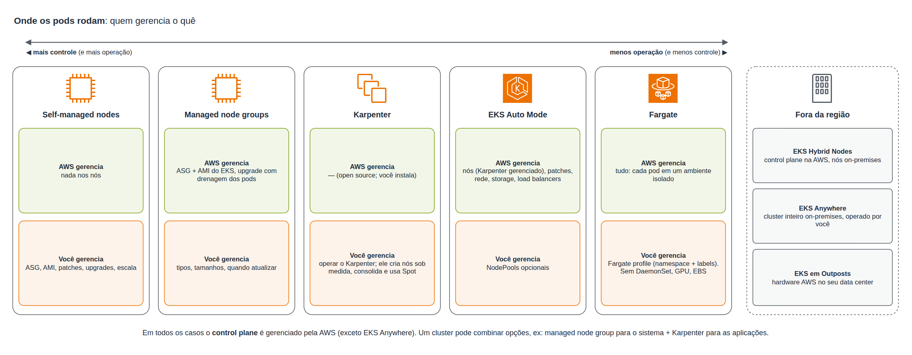

**Kubernetes da AWS fora da região:**

- **EKS Anywhere:** um Kubernetes **completo**, control plane incluído, que **você** roda e opera no seu data center (VMware, bare metal), com ferramentas e suporte da AWS. O cluster não depende de conexão com a AWS.
- **EKS em Outposts:** EKS rodando em racks do **AWS Outposts** instalados no seu data center.
- **EKS Hybrid Nodes:** só os **nós** ficam on-premises, e o control plane fica na região.

[↑ Índice](#índice)

### Rede no EKS

**Pods recebem IPs da VPC (VPC CNI).** No EKS, o plugin de rede padrão (**Amazon VPC CNI**) dá a **cada pod um IP real da subnet**, assim como o modo **awsvpc** dá um IP a cada task do ECS. Os pods conversam com bancos, outros serviços e redes on-premises **sem tradução de endereço**, e aparecem nos VPC Flow Logs com IP próprio.

- **Consequência 1: esgotamento de IPs.** Cada pod consome um IP da subnet. Clusters grandes esgotam subnets pequenas rapidamente, e esse é um problema **muito comum** em EKS. As soluções:
  - **subnets maiores**, já no planejamento da VPC;
  - **CIDR secundário** na VPC (ex: `100.64.0.0/16`), usado só para os pods (*custom networking*);
  - **IPv6**, que elimina o problema de escassez.
- **Consequência 2: pods por nó.** O número de pods por nó é limitado pelas ENIs e pelos IPs por ENI do tipo de instância. O **prefix delegation** atribui **blocos de IPs** (prefixos /28) às ENIs, aumentando bastante a quantidade de pods por nó.
- **Security groups for pods:** permite aplicar **security groups da VPC a pods específicos**. Por exemplo, só os pods da `api` podem acessar o RDS. Sem isso, os pods usam o SG do nó.
- **NetworkPolicies:** o VPC CNI também aplica as **NetworkPolicies** do Kubernetes, as regras entre pods.

**Expor aplicações (AWS Load Balancer Controller).** É um controlador instalado no cluster que **cria load balancers da AWS a partir de objetos do Kubernetes**:
- um **Ingress** (ou Gateway API HTTP) cria um **ALB**;
- um **Service** do tipo `LoadBalancer` cria um **NLB**.

Com o **target type `ip`**, o load balancer envia o tráfego **direto para os IPs dos pods**, sem passar pela porta dos nós. Um mesmo ALB pode ser compartilhado por vários Ingresses (*IngressGroup*). No **EKS Auto Mode**, esse controlador já vem gerenciado.

- **Comunicação entre serviços:** dentro do cluster, os Services ClusterIP e o **CoreDNS** (`http://api.pedidos.svc.cluster.local`, ou só `http://api` no mesmo namespace). Entre clusters, VPCs ou contas, o **VPC Lattice**, com um controlador para Gateway API, ou um *service mesh* open source como o Istio. O App Mesh foi descontinuado.

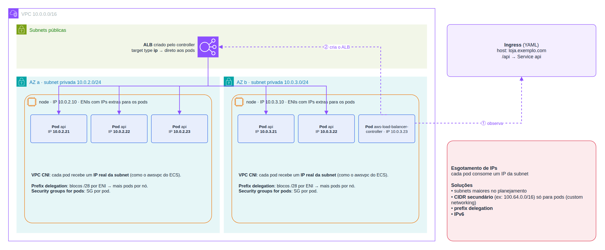

> **Paralelo com o Lambda:** um Lambda em VPC também consome IPs das subnets por meio das ENIs, mas compartilhadas entre execuções. No EKS, cada pod tem o seu IP, e por isso o planejamento de endereços pesa muito mais.

[↑ Índice](#índice)

### Segurança: quem acessa o cluster e o que os pods acessam

Há **dois sistemas de permissão** no EKS, e é importante não confundi-los:
- o **IAM da AWS**, que controla recursos da AWS;
- o **RBAC do Kubernetes**, que controla objetos do cluster.

**1. Pessoas e pipelines acessando o cluster (IAM → Kubernetes).** Quem roda `kubectl` se autentica com a **identidade IAM** (usuário, role ou role do SSO). O EKS então traduz essa identidade em permissões **dentro** do Kubernetes:

- **Access entries** (recomendado): pela **API do EKS**, você associa uma role IAM a permissões no cluster. Por exemplo, a role `DevOps` recebe uma *access policy* de administrador do cluster, e a role `TimePedidos` recebe edição só no namespace `pedidos`. Isso é gerenciado como qualquer recurso AWS (CloudFormation, CloudTrail).
- **ConfigMap `aws-auth`** (legado): o mapeamento ficava em um objeto **dentro** do cluster. Um erro de edição podia trancar todos para fora. As access entries substituem esse modelo.
- **RBAC do Kubernetes:** **Roles/ClusterRoles** (o que pode ser feito: ler pods, criar Deployments...) ligadas a usuários ou grupos por **RoleBindings**. As access policies do EKS são atalhos para permissões RBAC comuns.

**2. Pods acessando serviços da AWS (Kubernetes → IAM).** Um pod que lê o S3 ou grava no DynamoDB precisa de credenciais. A regra é a mesma da [task role do ECS](#iam-task-role-vs-task-execution-role): **uma role IAM por aplicação**, nunca a role do nó. Há dois mecanismos:

| | **IRSA** (IAM Roles for Service Accounts) | **EKS Pod Identity** |
|---|---|---|
| Como funciona | O cluster tem um **provedor OIDC** registrado no IAM. A **trust policy da role** confia nesse OIDC e na ServiceAccount; a ServiceAccount recebe uma anotação com o ARN da role | Um **agente** (add-on) roda nos nós. Você cria uma **associação** pela API do EKS: "ServiceAccount X do namespace Y → role Z" |
| Configuração por cluster | Um OIDC por cluster, e a trust policy de cada role cita o cluster | A trust policy confia no serviço `pods.eks.amazonaws.com` e pode ser **reaproveitada** em vários clusters |
| Situação | Mecanismo mais antigo, amplamente usado (e o que funciona em mais cenários, como clusters fora do EKS) | **Recomendado** para clusters EKS novos: mais simples de configurar e de escalar |

O SDK da AWS dentro do pod obtém as credenciais **automaticamente** nos dois casos, assim como no ECS e no Lambda.

> **Obs:** Por padrão, um pod pode alcançar o **IMDS do nó** e usar a **role IAM do nó**, que normalmente tem permissões amplas. Assim como no ECS, isso deve ser **bloqueado** (IMDSv2 com *hop limit* 1), e cada aplicação deve usar só a sua role via Pod Identity ou IRSA.

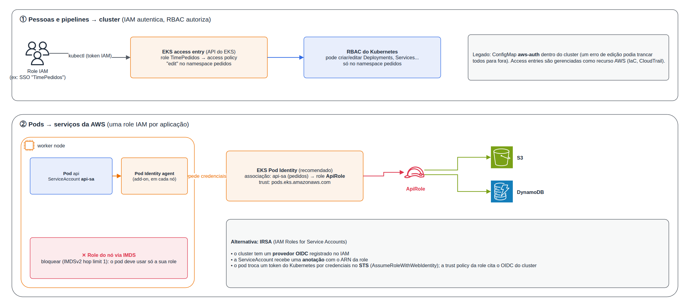

**Outros pontos de segurança:**

- **Criptografia de Secrets** com **KMS** (*envelope encryption*) no etcd, ou o **Secrets Store CSI Driver**, que monta segredos do **Secrets Manager/Parameter Store** direto nos pods.
- **Logs do control plane** (API, **audit**, authenticator, scheduler, controller manager) enviados ao **CloudWatch Logs**. O log de **audit** registra quem fez o quê no cluster.
- **Amazon GuardDuty** (EKS Protection / Runtime Monitoring) detecta comportamentos suspeitos no cluster e nos containers.
- **Pod Security Standards:** proíbem pods privilegiados ou rodando como root nos namespaces.
- **Multi-tenancy:** **namespaces** + RBAC + ResourceQuotas + NetworkPolicies dão um isolamento **lógico** (*soft*) entre equipes. Para isolamento **forte** entre clientes ou ambientes, o caminho é **um cluster por tenant ou ambiente**, de preferência em **contas separadas**.

[↑ Índice](#índice)

### Armazenamento no EKS

Os discos são conectados por **drivers CSI** (*Container Storage Interface*), instalados como add-ons, e consumidos pelos pods por meio de **PVCs**:

| Driver CSI | Tipo de acesso | Características | Uso típico |
|---|---|---|---|
| **EBS CSI** | **ReadWriteOnce**: um nó por vez | Disco de bloco, **preso a uma AZ**: o pod precisa rodar na mesma AZ do volume | Bancos de dados em StatefulSets, dados por pod |
| **EFS CSI** | **ReadWriteMany**: vários pods e nós ao mesmo tempo | **Multi-AZ**, compartilhado, elástico. Funciona no **Fargate** | Conteúdo compartilhado, uploads, aplicações que precisam do mesmo diretório |
| **FSx for Lustre CSI** | ReadWriteMany | Alto desempenho, ligado ao S3 | ML e HPC no Kubernetes |
| **Mountpoint for S3 CSI** | Leitura (e escrita sequencial) | Monta um bucket S3 como diretório | Datasets grandes para leitura |

> **Obs:** Um StatefulSet com volumes **EBS** fica preso à **AZ** de cada volume. Se a AZ cair, o pod não pode ser recriado em outra AZ com o mesmo disco. Por isso, bancos de dados **dentro** do Kubernetes exigem replicação no nível da aplicação. Em muitos casos, a resposta mais simples na prova é usar um **banco gerenciado** (RDS, Aurora, DynamoDB) fora do cluster.

[↑ Índice](#índice)

### Auto Scaling no EKS: pods e nós

Assim como no ECS, a escala acontece em **dois níveis**:

1. **Pods:**
   - **Horizontal Pod Autoscaler (HPA):** aumenta ou diminui o número de **réplicas** de um Deployment pela CPU, pela memória ou por métricas personalizadas. Equivale ao service auto scaling do ECS.
   - **KEDA** (*Kubernetes Event-Driven Autoscaling*): escala pods por **eventos externos**, como o tamanho de uma fila **SQS**, um tópico Kafka ou um cron, e pode escalar **até zero**.
   - **Vertical Pod Autoscaler (VPA):** ajusta a **CPU e a memória** pedidas por cada pod, conforme o uso real.
2. **Nós:** quando o HPA cria pods e não há espaço nos nós, os pods ficam **Pending**. Alguém precisa criar nós:
   - **Cluster Autoscaler:** o mecanismo tradicional. Aumenta e diminui o **ASG** dos node groups. É limitado aos tipos de instância de cada grupo e mais lento.
   - **Karpenter:** observa os pods pendentes e **lança diretamente** a instância EC2 mais adequada (tipo, tamanho, arquitetura, Spot ou On-Demand), sem ASG, em segundos. Também **consolida**: remove ou troca nós subutilizados por menores, reduzindo custo. É o padrão recomendado hoje, e é a base do **EKS Auto Mode**.
   - **Fargate:** cada pod já traz a sua capacidade, e não existe esse nível.

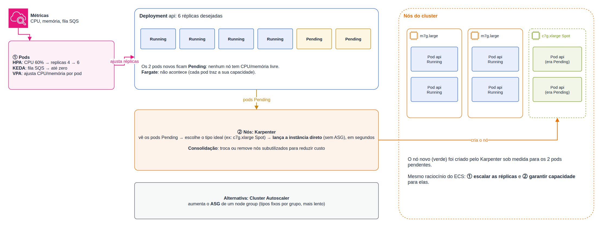

> **Paralelo com o Lambda:** o **KEDA** escalando pods pelo tamanho de uma fila SQS, inclusive até zero, é o que mais se aproxima do comportamento de Lambda + SQS dentro do Kubernetes.

[↑ Índice](#índice)

### Atualização de versões

O Kubernetes lança uma versão menor (*minor*) a cada ~4 meses, e versões antigas saem do suporte padrão do EKS. Ficar parado significa pagar **suporte estendido** e, depois, ter o cluster atualizado à força. O processo de atualização é:

1. **Verificar compatibilidade:** APIs depreciadas nos YAMLs e nos charts Helm. Os **upgrade insights** do EKS apontam problemas.
2. **Atualizar o control plane**, uma versão menor por vez, sem indisponibilidade para os pods.
3. **Atualizar os add-ons** (VPC CNI, CoreDNS, kube-proxy, drivers CSI).
4. **Atualizar os nós:** os managed node groups e o Karpenter trocam os nós aos poucos, **drenando** os pods antes. Os **PodDisruptionBudgets** garantem que não caiam réplicas demais ao mesmo tempo.

**Alternativa blue/green de clusters:** criar um **cluster novo** na versão nova, implantar as aplicações nele (fácil com GitOps) e migrar o tráfego (Route 53 ponderado ou load balancer). Permite pular várias versões e voltar atrás, mas exige que os dados e o estado fiquem **fora** do cluster.

[↑ Índice](#índice)

### Observabilidade no EKS

- **CloudWatch Container Insights** (via add-on de observabilidade do CloudWatch): métricas e logs de cluster, nós, pods e containers.
- **Amazon Managed Service for Prometheus** + **Amazon Managed Grafana:** a pilha de monitoramento padrão do mundo Kubernetes, gerenciada pela AWS. Faz sentido quando a equipe já usa Prometheus e Grafana.
- **ADOT** (OpenTelemetry) para traces e métricas, e **Fluent Bit** (DaemonSet) para enviar logs.
- **Logs do control plane** no CloudWatch Logs.

[↑ Índice](#índice)

### ECS ou EKS?

| Critério | **ECS** | **EKS** |
|---|---|---|
| Curva de aprendizado | Baixa: conceitos próprios e poucos | **Alta**: Kubernetes tem muitos conceitos e componentes |
| Esforço operacional | Menor: sem control plane para atualizar | Maior: upgrades de versão frequentes, add-ons, ferramentas (menor com Auto Mode) |
| Custo do orquestrador | **Sem custo** | Taxa por cluster/hora (+ suporte estendido em versões antigas) |
| Portabilidade | Só AWS | **Qualquer Kubernetes**: outras nuvens, on-premises (EKS Anywhere, Hybrid Nodes) |
| Ecossistema | Integração nativa com a AWS | Enorme: Helm, operators, GitOps, service meshes, CRDs |
| Equipe | Equipe pequena, foco em AWS | Equipe que **já conhece Kubernetes** ou plataforma interna multi-nuvem |

**Regra prática:** sem um motivo claro para Kubernetes (portabilidade, padronização com o que já existe, ecossistema), **ECS com Fargate** costuma ser a resposta de menor esforço operacional. Com uma organização que **já usa Kubernetes**, ou um requisito de rodar a mesma plataforma em várias nuvens e on-premises, a resposta é **EKS**.

[↑ Índice](#índice)

### Dicas para a prova

- "A empresa já usa **Kubernetes** on-premises e quer migrar com o mínimo de mudanças" → **EKS**, com os mesmos manifests e charts Helm.
- "Kubernetes on-premises **gerenciado com ferramentas da AWS**, sem depender da região" → **EKS Anywhere**. "Control plane na AWS, nós no data center" → **EKS Hybrid Nodes**. "Hardware AWS no data center" → EKS em **Outposts**.
- "Kubernetes com o **menor esforço operacional**" → **EKS Auto Mode** (ou **Fargate** para cargas simples, sem GPU e sem DaemonSets).
- "Pods precisam acessar o S3 com **permissões diferentes por aplicação**" → **EKS Pod Identity** (ou **IRSA**), nunca a role do nó.
- "Dar acesso ao cluster a uma role IAM do SSO, restrito a um namespace" → **access entries** + access policy com escopo de namespace (em vez do ConfigMap `aws-auth`).
- "Os pods não conseguem IP / a subnet esgotou" → **CIDR secundário** com custom networking, **prefix delegation** ou **IPv6**.
- "Aumentar o número de pods por nó" → **prefix delegation** no VPC CNI.
- "Restringir quais pods acessam o banco RDS por security group" → **security groups for pods**. "Firewall entre pods" → **NetworkPolicies**.
- "Expor um serviço HTTP com regras de path/host" → **Ingress** + **AWS Load Balancer Controller** (cria um **ALB**). "TCP/UDP" → Service `LoadBalancer` (cria um **NLB**). "Tráfego direto para os pods" → **target type ip**.
- "Nós sobem devagar e há desperdício de capacidade" → **Karpenter** (em vez do Cluster Autoscaler).
- "Escalar pods pela fila SQS, inclusive até zero" → **KEDA**.
- "Volume compartilhado entre pods em várias AZs" → **EFS CSI**. "Disco de bloco por pod" → **EBS CSI** (preso à AZ).
- "Criptografar os Secrets do Kubernetes" → **KMS envelope encryption**. "Usar segredos do Secrets Manager nos pods" → **Secrets Store CSI Driver**.
- "Auditar quem alterou objetos no cluster" → **audit logs** do control plane no CloudWatch Logs.
- "Isolamento **forte** entre clientes" → **clusters separados** (e contas). "Isolamento entre equipes internas" → **namespaces** + RBAC + quotas + NetworkPolicies.
- "Cluster em versão fora do suporte padrão, com custo maior" → **suporte estendido**: planejar upgrades (control plane → add-ons → nós) ou blue/green de clusters.
- "Containers com o menor esforço, sem requisito de Kubernetes" → **ECS + Fargate** (não EKS).

[↑ Índice](#índice)

## AWS Lambda

O **AWS Lambda** executa código **sob demanda, acionado por eventos**, sem servidores para gerenciar: a AWS cuida da capacidade, da escala, da alta disponibilidade multi-AZ e dos patches do runtime. A cobrança é por **requisição** e por **duração × memória** (GB-segundo), e uma função sem uso não custa nada.

O uso diário de Lambda é parecido em qualquer projeto. Na SAP-C02, o que diferencia uma resposta certa de uma errada são os **detalhes de comportamento**:
- **como** a função é invocada, e o que isso muda em retries e erros;
- **quanto** ela pode escalar e como proteger os sistemas que ela chama;
- como lidar com **cold start**, **VPC** e **bancos relacionais**;
- **quando o Lambda não é a resposta**: processos longos, cargas constantes e pesadas, estado em memória.

> **Comparação com o resto deste arquivo:** o Lambda é o extremo "a AWS gerencia tudo" da escala vista em [Containers na AWS: o mapa](#containers-na-aws-o-mapa). Muitos mecanismos do EC2/ECS têm equivalente aqui:
> - a **execution role** corresponde ao instance profile e à task role;
> - a **provisioned concurrency** corresponde à capacidade mínima do ASG;
> - a **reserved concurrency** corresponde à capacidade máxima;
> - as **versões e aliases com pesos** correspondem ao blue/green com target groups ponderados.

### Ambiente de execução e cold start

Cada invocação roda em um **ambiente de execução**: uma microVM **Firecracker** isolada, com o runtime, o código e a memória configurada. O ciclo de vida de um ambiente é:

1. **Init (cold start):** a AWS cria o ambiente, baixa o código ou a imagem, inicia o runtime e roda o **código de inicialização** (tudo fora do handler: imports, clientes do SDK, conexões). Isso leva de dezenas de milissegundos a alguns segundos, dependendo do runtime, do tamanho do pacote e do que a inicialização faz.
2. **Invoke:** o handler processa o evento. O mesmo ambiente é **reaproveitado** nas próximas invocações (*warm start*): variáveis globais, conexões e o conteúdo de `/tmp` persistem entre elas, mas **sem garantia**.
3. **Shutdown:** depois de um tempo ocioso, ou quando a AWS recicla o ambiente, ele é destruído. As extensões recebem o evento de Shutdown.

**Cada ambiente atende uma invocação por vez.** Se chegam 50 requisições simultâneas, são necessários 50 ambientes. É isso que define a **concorrência**.

**Como reduzir o cold start:**

- **Provisioned concurrency:** mantém N ambientes **já inicializados**, prontos para responder. Elimina o cold start, mas é **cobrada** enquanto estiver configurada, usada ou não. É configurada em uma **versão ou alias**, e pode escalar por horário ou por utilização com o **Application Auto Scaling**.
- **SnapStart:** no publish de uma versão, a AWS roda o Init uma vez, tira um **snapshot** da memória do ambiente inicializado e, nos cold starts, **restaura o snapshot** em vez de reinicializar. Reduz drasticamente o cold start de runtimes pesados (Java, .NET, Python), com custo bem menor que o da provisioned concurrency. Cuidado com o que é único por ambiente: números aleatórios, conexões abertas e credenciais criadas no Init precisam ser renovados depois da restauração (*runtime hooks*). Não pode ser usado junto com provisioned concurrency.
- **Otimizações:** pacote menor, menos dependências, inicialização preguiçosa (*lazy*), runtime leve e **mais memória**, porque a CPU acompanha a memória.

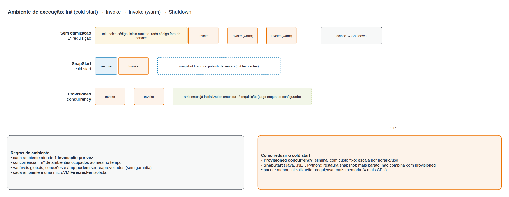

[↑ Índice](#índice)

### Modelos de invocação

O mesmo código se comporta de forma **muito diferente** conforme quem o invoca. Esse é um dos assuntos mais cobrados:

| | **Síncrona** | **Assíncrona** | **Event source mapping** (polling) |
|---|---|---|---|
| Quem invoca | API Gateway, ALB, Function URL, Cognito, SDK (`RequestResponse`) | S3, SNS, EventBridge, CloudWatch Logs, SES, SDK (`Event`) | O **próprio Lambda** lê de **SQS**, **Kinesis**, **DynamoDB Streams**, **MSK/Kafka**, **Amazon MQ**, DocumentDB |
| Quem espera a resposta | O chamador | Ninguém: o evento vai para uma **fila interna** do Lambda | O poller, que entrega **lotes** (*batches*) de registros |
| Retries em caso de erro | **Do chamador** (o Lambda não refaz) | **Do Lambda**: até **2 novas tentativas** (configurável de 0 a 2), com espera crescente; o evento pode ficar até **6 horas** na fila | Depende da fonte: **SQS** devolve a mensagem à fila; **streams** repetem o lote até sucesso ou expiração |
| Para onde vão as falhas | Erro para o chamador | **Destinations** (on failure) ou **DLQ** | **On-failure destination** (streams, Kafka) ou **DLQ da própria fila SQS** |
| Payload máximo | 6 MB (requisição e resposta) | ~256 KB (a AWS vem ampliando esse limite; conferir o valor atual) | Definido pelo lote |

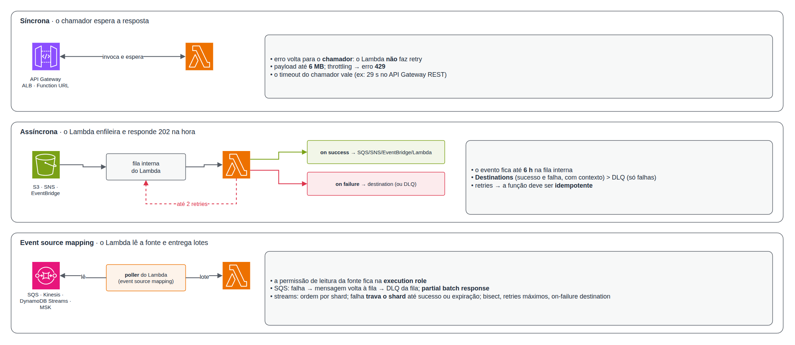

**Invocação assíncrona: destinations vs. DLQ.**

- **Destinations:** enviam o resultado de uma invocação assíncrona para **SQS, SNS, EventBridge ou outra Lambda**, tanto em **sucesso** quanto em **falha**, com o **contexto completo** (evento original, erro, tentativas). É o mecanismo **recomendado**.
- **DLQ (Dead-Letter Queue):** SQS ou SNS que recebe **só as falhas**, com menos contexto. É o mecanismo mais antigo.
- **Idempotência:** com retries automáticos, o mesmo evento pode ser processado **mais de uma vez**. As funções devem ser **idempotentes**, por exemplo registrando um ID do evento já processado no DynamoDB, com o *Powertools for AWS Lambda*.

**Event source mapping: SQS.**

- O Lambda lê **lotes** (até 10 mil mensagens em filas standard, com *batching window* para juntar mensagens) e escala o número de pollers conforme a fila cresce.
- Se a função falha, as mensagens **voltam a ficar visíveis** e são reprocessadas. Depois de N tentativas (`maxReceiveCount`), vão para a **DLQ da fila**.
- **Partial batch response** (`ReportBatchItemFailures`): a função informa **quais mensagens** falharam, e só elas voltam para a fila. Sem isso, uma mensagem ruim faz o **lote inteiro** ser reprocessado.
- O **visibility timeout** da fila deve ser **maior que o timeout da função**. A recomendação é pelo menos 6 vezes, para dar tempo aos retries sem que a mensagem reapareça enquanto ainda está sendo processada.
- **Maximum concurrency** no event source mapping limita quantas execuções a fila pode disparar ao mesmo tempo, protegendo um banco de dados ou uma API downstream.
- **FIFO:** a ordem é mantida por *message group*, e cada grupo é processado por uma execução por vez.

**Event source mapping: Kinesis e DynamoDB Streams.**

- Os registros são lidos **por shard, em ordem**. Por padrão, **um lote por shard por vez**.
- Um registro que falha **bloqueia o shard**: o lote é repetido até ter sucesso ou até os registros expirarem. Isso é o *poison pill*. Para evitar, use:
  - **bisect batch on error** (divide o lote ao meio para isolar o registro ruim);
  - **maximum retry attempts** e **maximum record age**;
  - **on-failure destination**, que envia os metadados do lote que falhou para SQS, SNS ou S3;
  - **partial batch response**.
- **Parallelization factor** (até 10): processa até 10 lotes por shard ao mesmo tempo, mantendo a ordem **por chave de partição**. Aumenta a vazão sem precisar de mais shards.

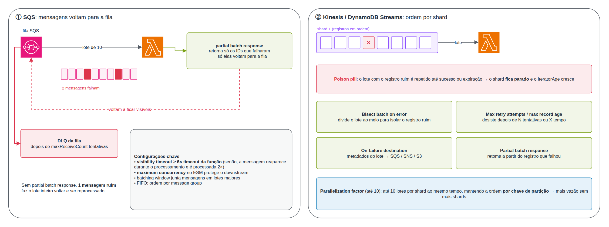

[↑ Índice](#índice)

### Concorrência e escala

**Concorrência** é o número de **execuções simultâneas**. Uma estimativa útil: concorrência ≈ **requisições por segundo × duração média (s)**. Por exemplo, 500 req/s × 0,2 s = 100 execuções simultâneas.

- **Limite da conta:** por padrão, **1.000 execuções simultâneas por região**, compartilhadas por **todas** as funções da conta. É uma quota ajustável. Quando ela é atingida, as invocações sofrem **throttling**:
  - **síncronas** recebem erro **429**;
  - **assíncronas** e de **event source mapping** são repetidas automaticamente.
- **Velocidade de escala:** cada função pode aumentar a concorrência em até **1.000 execuções a cada 10 segundos**, até o limite da conta.
- **Reserved concurrency:** reserva uma parte do limite da conta para uma função (ex: 100), com dois efeitos:
  - **garante** que ela sempre terá essa capacidade, mesmo que outras funções consumam o resto;
  - **limita** a função a esse valor, protegendo um banco de dados ou uma API que não aguenta mais.

  Com reserved concurrency **0**, a função é **desligada**, o que serve como um *kill switch*. Não tem custo.
- **Provisioned concurrency:** ambientes **pré-inicializados**, para latência sem cold start (ver [Ambiente de execução e cold start](#ambiente-de-execução-e-cold-start)). Tem custo.

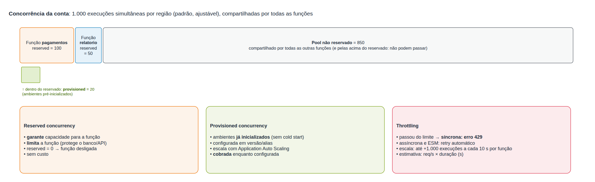

**Proteger o que está atrás do Lambda.** O Lambda escala muito mais rápido do que um banco relacional ou uma API legada aguentam. Padrões comuns:

- **Fila na frente** (SQS) + **maximum concurrency** no event source mapping, ou **reserved concurrency** na função, para controlar o ritmo.
- **RDS Proxy** para bancos relacionais (ver [Lambda em VPC e acesso a dados](#lambda-em-vpc-e-acesso-a-dados)).
- **Throttling** no **API Gateway** (limites por stage, por método e por cliente via *usage plans*), antes mesmo de a requisição chegar ao Lambda.

[↑ Índice](#índice)

### Lambda em VPC e acesso a dados

Por padrão, a função roda em uma **VPC gerenciada pela AWS**, com acesso à internet e aos endpoints públicos dos serviços, mas **sem acesso** aos recursos privados da sua VPC (RDS, ElastiCache, serviços internos).

**Ao associar a função a subnets e security groups da sua VPC:**

- O Lambda cria **Hyperplane ENIs** nas subnets: interfaces **compartilhadas** por todos os ambientes que usam a mesma combinação de subnet e security group. São criadas quando a função é configurada, e não a cada invocação, então o antigo cold start extra de VPC não existe mais.
- A função passa a acessar os recursos privados, controlada pelos **security groups**.
- A função **perde o acesso direto à internet**: ela **não recebe IP público**, mesmo em subnet pública. Para alcançar a internet ou APIs públicas, é preciso colocá-la em **subnets privadas** com rota para um **NAT Gateway**.
- Para acessar serviços AWS **sem NAT**, use **VPC endpoints**: gateway para S3 e DynamoDB, e interface para os demais (SQS, Secrets Manager, STS...).
- Use subnets em **várias AZs**, para alta disponibilidade.

**Bancos relacionais: RDS Proxy.** Cada ambiente de execução abre **suas próprias conexões**. Com 500 execuções simultâneas, são 500+ conexões, e o banco esgota o limite de conexões e a memória. O **RDS Proxy** mantém um **pool de conexões** compartilhado entre as funções e o banco, e ainda:
- reduz o tempo de failover do Aurora/RDS;
- pode autenticar com **IAM** e buscar a senha no **Secrets Manager**.

O proxy fica na VPC, então a função também precisa estar. A alternativa sem conexões persistentes é a **RDS Data API** (Aurora), que funciona por HTTPS.

**Arquivos compartilhados: EFS.** A função pode montar um **EFS**, para arquivos grandes, modelos de ML ou dados compartilhados entre execuções e com instâncias EC2 e containers. É obrigatório estar em VPC. O `/tmp` (até 10 GB) é local a cada ambiente e efêmero.

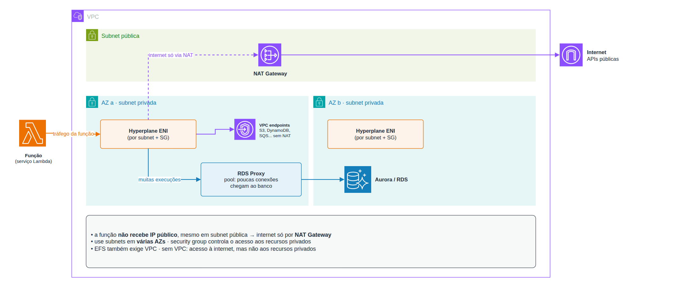

[↑ Índice](#índice)

### Permissões

São **duas políticas diferentes**, e a prova costuma testar qual usar:

- **Execution role** (role de execução): o que a **função pode fazer**, como ler o S3, gravar no DynamoDB ou enviar logs. Equivale à task role do ECS.
- **Resource-based policy** (política da função): **quem pode invocar** a função. Por exemplo, permitir que o S3 de um bucket específico, o SNS, o EventBridge, o API Gateway ou **outra conta AWS** chame a função. Ao configurar um gatilho pelo console, essa permissão é criada automaticamente.
- **Event source mappings** são o caso oposto: quem lê a fila ou o stream é o **Lambda**, então a permissão de `sqs:ReceiveMessage`, `kinesis:GetRecords` etc. fica na **execution role**, e não na resource policy.
- **Invocação entre contas:** resource-based policy na função permitindo a conta ou role de origem, e a role de origem com permissão `lambda:InvokeFunction`.

**Outros pontos de segurança:**

- **Variáveis de ambiente** são criptografadas em repouso com KMS. Para **segredos**, o recomendado é buscá-los no **Secrets Manager** ou no **Parameter Store**, com cache pela extensão *Parameters and Secrets*.
- **Code signing** (com o AWS Signer) garante que só código **assinado por publicadores confiáveis** seja implantado.
- **Detecção de loops recursivos:** o Lambda interrompe automaticamente loops como "a função grava no S3, que dispara a mesma função". É uma proteção, não um substituto de um bom desenho.

[↑ Índice](#índice)

### Deploy: versões, aliases e pacotes

- **Versões:** um snapshot **imutável** do código e da configuração (`:1`, `:2`...). `$LATEST` é a versão editável.
- **Aliases:** ponteiros com nome (`prod`, `staging`) para uma versão. Os gatilhos e os clientes apontam para o **alias**, e o deploy muda o alias para a nova versão.
- **Alias com pesos** (*weighted alias*): divide o tráfego entre duas versões (ex: 90% na v5 e 10% na v6), o que permite fazer **canary**. O **CodeDeploy** automatiza isso com as configurações **canary** (`Canary10Percent5Minutes`), **linear** (`Linear10PercentEvery1Minute`) e **all at once**, com **rollback automático** por alarmes do CloudWatch e hooks de validação antes e depois da troca. É o mesmo conceito de [Auto Scaling Update Strategies](#auto-scaling-update-strategies), aplicado a funções.
- **Pacotes:**
  - **.zip:** até 50 MB compactado no upload direto, ou 250 MB descompactado, contando as layers;
  - **container image:** até **10 GB**, no ECR. É bom para dependências grandes (ex: bibliotecas de ML) e para padronizar com o pipeline de containers.
- **Layers:** bibliotecas e dependências compartilhadas entre funções, até 5 por função.
- **Extensions:** processos auxiliares no ambiente de execução, como agentes de observabilidade e cache de segredos. São os "sidecars" do Lambda (ver [Sidecars](#sidecars)).
- **Infraestrutura como código:** AWS SAM, CDK ou CloudFormation. O SAM inclui o *deployment preference* que liga o CodeDeploy automaticamente.

[↑ Índice](#índice)

### Limites que mudam a arquitetura

| Limite | Valor | Consequência na arquitetura |
|---|---|---|
| **Timeout** | **15 minutos** | Processos mais longos → **Step Functions** (dividir em etapas), **ECS/Fargate** ou **AWS Batch** |
| **Memória** | 128 MB a **10.240 MB**, com CPU proporcional (até 6 vCPUs) | Cargas muito pesadas de CPU ou memória → EC2/ECS |
| **`/tmp`** | 512 MB a **10 GB** | Arquivos maiores ou compartilhados → **EFS** ou S3 |
| **Payload síncrono** | **6 MB** | Arquivos grandes → upload direto ao **S3** com URL pré-assinada, e processar no evento do S3 |
| **API Gateway (REST)** | Timeout de integração de **29 s** (ampliável sob pedido) | Processamento longo atrás de API → assíncrono (fila + polling ou WebSocket) |
| **Concorrência** | 1.000 por região (ajustável) | Planejar quota, reserved concurrency e proteção do downstream |
| **GPU** | Não há | ML com GPU → SageMaker, ECS/EKS em EC2 |

[↑ Índice](#índice)

### Lambda na borda e formas de expor funções

- **Function URL:** um endpoint HTTPS **dedicado** para a função, com autenticação **IAM** ou pública, e CORS. Não tem os recursos do API Gateway (autorizadores, throttling por cliente, cache, WAF direto), mas é a forma mais simples de expor uma função.
- **API Gateway:** REST ou HTTP API, com autorizadores (Cognito, Lambda, IAM), *usage plans*, cache, validação e integração com WAF.
- **ALB:** uma função pode ser um **target** de um ALB, útil para misturar Lambda com EC2/ECS atrás do mesmo load balancer.
- **Response streaming:** a função envia a resposta **aos poucos**, o que reduz o tempo até o primeiro byte e permite respostas maiores que 6 MB. Funciona via Function URL ou API Gateway.
- **Lambda@Edge vs. CloudFront Functions:** código executado no **CloudFront**, perto dos usuários.

| | **CloudFront Functions** | **Lambda@Edge** |
|---|---|---|
| Linguagem | JavaScript (subconjunto) | Node.js, Python |
| Execução | Sub-milissegundo, nos edge locations | Milissegundos a segundos, nos *regional edge caches* |
| Eventos | Viewer request/response | Viewer **e origin** request/response |
| Acesso à rede/corpo da requisição | Não | Sim (chamar APIs, ler o corpo) |
| Uso típico | Reescrita de URL, headers, redirecionamentos, validação simples de token, em altíssima escala e baixo custo | Lógica mais pesada: autenticação com chamadas externas, personalização, roteamento por origem |

[↑ Índice](#índice)

### Observabilidade

- **CloudWatch Logs:** tudo o que a função escreve no stdout vai para um log group. Os *advanced logging controls* permitem logs em **JSON** e filtro por nível.
- **Métricas:** invocações, erros, duração, **throttles**, concorrência, **IteratorAge** (atraso no processamento de streams) e idade de eventos assíncronos.
- **AWS X-Ray / ADOT:** tracing distribuído entre API Gateway, Lambda, DynamoDB e outros serviços.
- **CloudWatch Lambda Insights:** métricas de sistema (CPU, memória, cold starts) via extensão.
- **Powertools for AWS Lambda:** biblioteca com logs estruturados, métricas, tracing, idempotência e *batch processing*.

[↑ Índice](#índice)

### Custo e quando o Lambda não é a melhor escolha

- **Cobrança:** requisições + GB-segundo + extras (provisioned concurrency, SnapStart, transferência de dados, armazenamento efêmero acima de 512 MB). A arquitetura **arm64 (Graviton)** custa cerca de 20% menos por GB-segundo, com desempenho igual ou melhor para a maioria das cargas. **Compute Savings Plans** também cobrem o Lambda.
- **Rightsizing:** mais memória dá mais CPU. Às vezes, dobrar a memória **reduz o custo**, porque a duração cai mais do que pela metade. O **Lambda Power Tuning** e o **Compute Optimizer** ajudam a achar o ponto ideal.

**Quando outra opção é melhor:**

| Situação | Melhor opção |
|---|---|
| Processamento acima de **15 min** | Step Functions (em etapas), **ECS/Fargate**, **AWS Batch** |
| Carga **constante e alta**, 24×7 | **ECS/Fargate ou EC2** com Savings Plans costumam sair mais baratos a partir de certa utilização |
| Conexões **persistentes** (WebSocket com estado, gRPC streaming, TCP) | ECS/EKS/EC2 (ou API Gateway WebSocket + Lambda, sem estado na função) |
| **GPU** ou hardware específico | EC2, ECS/EKS em EC2, SageMaker |
| Estado em memória entre requisições, cache local grande | ECS/EC2 (ou ElastiCache externo) |
| Orquestrar várias funções com retries, esperas e paralelismo | **Step Functions** (em vez de uma função chamando outra) |

> **Obs:** "Lambda chamando Lambda" de forma síncrona é um **anti-padrão**. A primeira função fica parada, e paga, esperando a segunda, os erros se acumulam e os timeouts somam. Use **Step Functions** para orquestrar, ou **eventos** (SQS, SNS, EventBridge) para desacoplar.

[↑ Índice](#índice)

### Dicas para a prova

- "Eliminar o **cold start** de uma API com picos previsíveis" → **provisioned concurrency** (com Application Auto Scaling por horário). "Reduzir cold start de **Java** com menor custo" → **SnapStart**.
- "Garantir capacidade para uma função crítica e **limitar** outra que sobrecarrega o banco" → **reserved concurrency**. "Desligar uma função imediatamente" → reserved concurrency = **0**.
- "Invocações síncronas retornando **429**" → **throttling**: aumentar a quota da conta, rever reserved concurrency, ou colocar uma **fila** na frente.
- "Muitas funções esgotando as **conexões** do RDS/Aurora" → **RDS Proxy**.
- "Função em VPC não acessa a **internet**" → subnet **privada** com rota para **NAT Gateway** (Lambda não recebe IP público). "Acessar S3/DynamoDB sem NAT" → **gateway VPC endpoints**.
- "Capturar o **resultado** (sucesso e falha) de invocações assíncronas com contexto" → **Lambda destinations** (em vez de DLQ).
- "Uma mensagem ruim faz o **lote inteiro** do SQS ser reprocessado" → **partial batch response** (`ReportBatchItemFailures`).
- "Mensagens do SQS processadas **duas vezes**" → visibility timeout **menor que o timeout da função**: aumentar para ≥ 6× o timeout, e tornar a função **idempotente**.
- "Um registro com erro **trava o processamento** do Kinesis/DynamoDB Streams" → **bisect batch on error**, **maximum retry attempts/record age** e **on-failure destination**.
- "Aumentar a vazão do Kinesis **sem adicionar shards**" → **parallelization factor**.
- "Limitar quantas execuções uma fila SQS dispara, para proteger o downstream" → **maximum concurrency** do event source mapping.
- "Permitir que o S3 ou outra conta invoque a função" → **resource-based policy**. "A função precisa ler o DynamoDB" → **execution role**.
- "Deploy gradual de uma nova versão com rollback automático" → **alias com pesos + CodeDeploy** (canary/linear) e alarmes do CloudWatch.
- "Dependências grandes (ex: bibliotecas de ML) que não cabem no .zip" → **container image** (até 10 GB) ou **EFS**.
- "Upload de arquivos grandes por uma API com Lambda" → **URL pré-assinada do S3** (o payload síncrono é limitado a 6 MB).
- "Manipulação simples de headers/URLs no CloudFront, em grande escala e baixo custo" → **CloudFront Functions**. "Lógica com chamadas de rede ou no evento de origem" → **Lambda@Edge**.
- "Processamento de **mais de 15 minutos**" → **Step Functions**, **ECS/Fargate** ou **Batch**.
- "Reduzir o custo do Lambda sem mudar o código (runtime compatível)" → **arm64 (Graviton)** e **rightsizing** de memória; Compute Savings Plans para uso constante.

[↑ Índice](#índice)

## Amazon API Gateway

O **Amazon API Gateway** é a "porta da frente" gerenciada para APIs. Ele recebe as requisições dos clientes e cuida de tudo que fica **antes** do código: autenticação, limites de uso, validação, transformação, cache e logs. Depois, encaminha cada requisição para o **backend**, seja Lambda, um serviço HTTP, um container em VPC ou até um serviço AWS diretamente. É serverless: escala sozinho e cobra por requisição (e por hora, no caso de cache e conexões WebSocket).

Na SAP-C02, o API Gateway aparece em perguntas sobre:
- **qual tipo de API** escolher (REST, HTTP ou WebSocket) e **qual tipo de endpoint** (edge, regional ou privado);
- **segurança** (autorizadores, resource policies, WAF, mTLS) e **proteção do backend** (throttling, usage plans, cache);
- **integração** com recursos privados na VPC (VPC Link) e com serviços AWS **sem Lambda no meio**;
- **limites** (o timeout de integração) e padrões para processamento longo.

> **Comparação com o resto deste arquivo:** o API Gateway ocupa o lugar que um **ALB** ocupa na frente de instâncias e containers, mas com funções de **gestão de API**: chaves, cotas por cliente, autorizadores e transformação. No ECS e no EKS, o ALB distribui tráfego. Aqui, o API Gateway também decide **quem pode chamar o quê e quantas vezes**.

### Tipos de API: REST, HTTP e WebSocket

| | **REST API** | **HTTP API** | **WebSocket API** |
|---|---|---|---|
| Para quê | APIs com **gestão completa**: chaves, cotas, cache, transformação, WAF | APIs **simples e baratas** na frente de Lambda ou backends HTTP | Comunicação **bidirecional** em tempo real: chat, notificações, dashboards ao vivo |
| Custo e latência | Maior | **Até ~70% mais barata**, latência menor | Por mensagem + minutos de conexão |
| Autorização | IAM, Cognito, Lambda authorizer, resource policy | IAM, **JWT nativo** (Cognito ou qualquer OIDC), Lambda authorizer | IAM, Lambda authorizer (na conexão) |
| API keys e usage plans | **Sim** | Não | Não |
| Cache | **Sim** | Não | Não |
| AWS WAF | **Sim** | Não (usar CloudFront + WAF na frente) | Não |
| Validação e transformação de requisições (*mapping templates*) | **Sim** | Limitada (mapeamento de parâmetros) | Sim (por rota) |
| Endpoint privado (só da VPC) | **Sim** | Não | Não |
| Integração direta com serviços AWS | Ampla (qualquer API AWS) | Algumas (SQS, Step Functions, Kinesis, EventBridge, AppConfig) | Sim |
| Canary deployment | **Sim** | Não | Não |

**Regra prática:** comece pela **HTTP API**, que é mais simples e barata. Mude para **REST API** quando precisar de algo que só ela tem: **usage plans/API keys**, **cache**, **WAF direto**, **endpoint privado**, **validação ou transformação** de requisições, ou **canary**. Muitas questões giram exatamente em torno dessas diferenças.

[↑ Índice](#índice)

### Tipos de endpoint (REST API)

| Tipo | Como funciona | Quando usar |
|---|---|---|
| **Edge-optimized** | As requisições entram por uma distribuição **CloudFront gerenciada pela AWS** (que você não controla) e seguem para a região da API | Clientes **espalhados pelo mundo**, sem necessidade de customizar a CDN |
| **Regional** | A API é acessada diretamente na região | Clientes na mesma região, ou quando você quer **o seu próprio CloudFront** na frente (com cache, WAF e comportamentos personalizados). Também é o tipo usado em arquiteturas **multi-região** com Route 53 |
| **Private** | Acessível **somente de dentro de VPCs**, por um **interface VPC endpoint** (`execute-api`). Exige uma **resource policy** dizendo quais VPCs ou endpoints podem chamar | APIs **internas** entre microsserviços, ou expostas a outras contas e VPCs sem passar pela internet |

- **Custom domain** (ex: `api.empresa.com`): com certificado do **ACM**. Para edge-optimized, o certificado precisa estar em **us-east-1**. Para regional, na mesma região da API. Os **base path mappings** permitem publicar várias APIs ou versões sob o mesmo domínio (`/v1`, `/v2`, `/pedidos`).
- **mTLS** (*mutual TLS*) no custom domain: o **cliente** também apresenta um certificado. É comum em integrações B2B e em IoT.

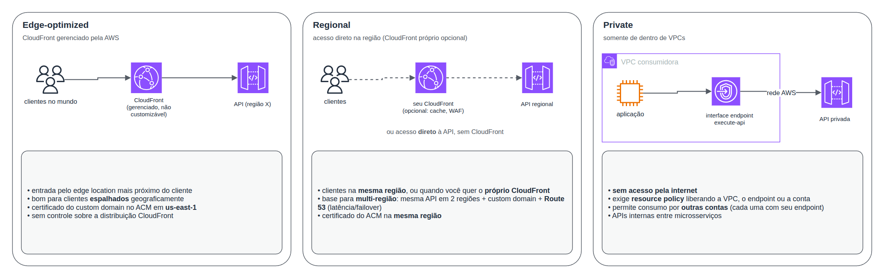

[↑ Índice](#índice)

### O caminho de uma requisição

Uma requisição a uma REST API passa por várias etapas antes de chegar ao backend. Cada uma é um ponto de controle:

1. **AWS WAF** (opcional): bloqueia ataques comuns (SQL injection, XSS), IPs e países, e aplica *rate limiting* por IP.
2. **Resource policy:** quem pode chamar a API (contas, IPs, VPCs, VPC endpoints).
3. **Autorização:** o autorizador configurado no método (IAM, Cognito, Lambda authorizer).
4. **Throttling:** limites da conta, do stage, do método e do **usage plan** do cliente (API key).
5. **Validação da requisição:** parâmetros obrigatórios e corpo conforme um JSON Schema. Uma requisição inválida é rejeitada **sem custo de backend**.
6. **Cache:** se a resposta está em cache, ela volta daqui, sem chamar o backend.
7. **Transformação** (*mapping template*) da requisição para o formato que o backend espera.
8. **Integração:** a chamada ao backend.
9. **Transformação da resposta** e devolução ao cliente.

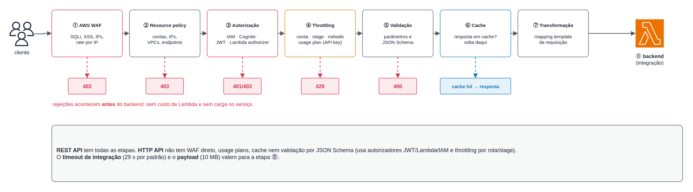

[↑ Índice](#índice)

### Integrações

| Tipo | O que faz | Exemplo |
|---|---|---|
| **Lambda proxy** | Passa a requisição inteira (headers, path, corpo) para a função, que monta a resposta HTTP | A forma mais comum com Lambda |
| **Lambda (não proxy)** | O API Gateway transforma a requisição e a resposta com *mapping templates* | Adaptar um contrato de API sem mudar a função |
| **HTTP / HTTP proxy** | Encaminha para um endpoint HTTP **público** | API legada, serviço de terceiros |
| **AWS service** | Chama uma **API de um serviço AWS diretamente**, sem Lambda: `SendMessage` no SQS, `PutItem` no DynamoDB, `StartExecution` no Step Functions, `PutRecord` no Kinesis, `PutEvents` no EventBridge | Receber eventos e gravar em fila com o **menor custo e latência**, sem código |
| **Private integration (VPC Link)** | Alcança backends em **subnets privadas**: na **REST API**, via **NLB** (e, mais recentemente, ALB); na **HTTP API**, via **ALB, NLB ou Cloud Map** | Expor um serviço ECS/EKS/EC2 privado sem colocá-lo em subnet pública |
| **Mock** | Responde sem backend | Testes, respostas fixas, CORS |

**Padrão "storage-first":** em vez de `API Gateway → Lambda → SQS`, usar `API Gateway → SQS` diretamente. O cliente recebe a confirmação assim que a mensagem é **gravada**, e o processamento acontece depois, consumindo a fila. É mais barato, mais resiliente (nada se perde se o processamento falhar) e protege o backend de picos.

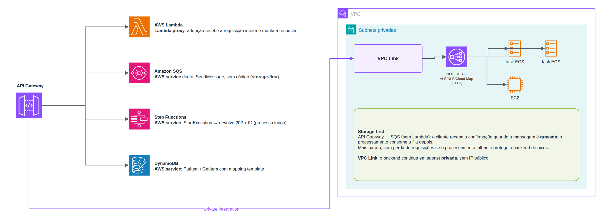

[↑ Índice](#índice)

### Segurança

**Quem pode chamar (autorização):**

| Mecanismo | Como funciona | Quando usar |
|---|---|---|
| **IAM (SigV4)** | O cliente assina a requisição com credenciais AWS; a permissão `execute-api:Invoke` é avaliada | Chamadas **entre serviços AWS**, contas e aplicações internas |
| **Cognito User Pools** | O cliente envia o token do usuário logado no Cognito, e o API Gateway o valida sem código | Aplicações web/mobile com usuários no Cognito |
| **JWT authorizer** (HTTP API) | Valida tokens JWT de **qualquer provedor OIDC** (Cognito, Auth0, Okta, Entra ID) | Identidade externa com OIDC, sem código |
| **Lambda authorizer** | Uma função recebe o token (ou headers, query, contexto) e devolve uma **política IAM** de allow/deny. O resultado pode ficar em **cache** por um TTL | Lógica própria: tokens proprietários, consultas a bases de permissões, autorização por tenant |

- **Resource policy** (REST): restringe **de onde** a API pode ser chamada: contas, faixas de IP, VPCs, VPC endpoints. É obrigatória nas APIs **privadas** e permite acesso **entre contas**.
- **API keys não são autenticação.** Elas identificam um cliente para aplicar um **usage plan**: cotas e limites. Devem ser combinadas com um autorizador de verdade.
- **AWS WAF** (REST, ou via CloudFront para HTTP API): proteção contra ataques de aplicação e rate limiting por IP.
- **mTLS** e certificados de cliente para o backend: o API Gateway pode apresentar um certificado ao backend HTTP, que confirma que a requisição veio dele.
- **CORS:** precisa ser configurado na API quando o navegador chama de outro domínio.

[↑ Índice](#índice)

### Throttling, usage plans e cache

**Throttling em camadas:**

- **Conta:** por padrão, cerca de **10.000 requisições por segundo** (com *burst* de 5.000) por região, somando **todas** as APIs da conta. É uma quota ajustável.
- **Stage e método** (REST): limites específicos, por exemplo para proteger um endpoint caro.
- **Usage plan + API key** (REST): limites e **cotas** (por dia, semana ou mês) **por cliente**. Por exemplo, o plano "básico" tem 10 req/s e 10 mil req/dia, e o "premium" tem 100 req/s e cota ilimitada. É o mecanismo para **monetizar** ou controlar o consumo de APIs por parceiros.
- Passou do limite → **429 Too Many Requests**. Os limites usam o algoritmo *token bucket*: uma taxa média e um *burst* permitido.

**Cache** (REST):

- Cache **por stage**, com tamanho de 0,5 GB a 237 GB e **cobrança por hora**. O TTL padrão é de 300 s, com máximo de 3.600 s, e pode ser ajustado **por método**.
- A chave de cache pode incluir parâmetros, headers e query strings.
- Clientes podem pedir a invalidação com o header `Cache-Control: max-age=0`, que deve ser **protegida por IAM**.
- Reduz a latência e as chamadas ao backend. Para cache **global**, perto dos usuários, use **CloudFront** na frente de uma API regional.

[↑ Índice](#índice)

### Limites do API Gateway

| Limite | Valor | Consequência |
|---|---|---|
| **Timeout de integração** | **29 s** por padrão (REST regional/privada pode pedir aumento) | Processamento longo → padrão **assíncrono**: a API grava o pedido (SQS/Step Functions), devolve **202** com um ID, e o cliente consulta o status (polling) ou recebe o resultado por **WebSocket** ou callback |
| **Payload** | **10 MB** | Arquivos grandes → **URL pré-assinada do S3** para upload e download diretos |
| **WebSocket** | Mensagem de até 128 KB; conexão de até **2 h**; desconexão após **10 min** ociosa | Clientes precisam reconectar e mandar *heartbeats* |
| **Throttling da conta** | ~10.000 req/s por região (ajustável) | Planejar a quota em sistemas de grande volume |

[↑ Índice](#índice)

### Stages, deploys e versionamento

- **Stage:** uma "versão publicada" da API (`dev`, `prod`), com URL, configurações de logs, throttling e cache próprias. As **stage variables** funcionam como variáveis de ambiente, por exemplo para apontar cada stage para um alias diferente do Lambda.
- **Deployment:** na REST API, as mudanças só valem depois de um **deploy** para um stage. A HTTP API pode fazer deploy automático.
- **Canary release** (REST): uma porcentagem do tráfego do stage vai para um **deploy novo**, com métricas separadas, até ser promovido. É o mesmo conceito de canary visto em [Auto Scaling Update Strategies](#auto-scaling-update-strategies).
- **Versionamento:** por path (`/v1`, `/v2`) com base path mappings no custom domain, ou por stages e APIs separadas.
- **Definição por OpenAPI:** APIs podem ser importadas e exportadas em OpenAPI (Swagger), o que facilita IaC e documentação.

[↑ Índice](#índice)

### WebSocket APIs

Em uma API HTTP comum, o servidor só responde quando o cliente pergunta. Em uma **WebSocket API**, a conexão fica **aberta**, e o servidor pode **enviar mensagens a qualquer momento**. Funciona assim:

- **Rotas:** `$connect` (abertura da conexão, onde se faz a autorização), `$disconnect`, `$default`, e rotas personalizadas escolhidas por um campo da mensagem (*route selection expression*, ex: `$request.body.action`). Cada rota tem sua integração, normalmente uma Lambda.
- **Connection ID:** cada cliente conectado tem um ID. O backend **guarda** esses IDs, normalmente no DynamoDB, ao receber o `$connect`.
- **Enviar para o cliente:** o backend chama a **API de gerenciamento de conexões** (`@connections`, com `POST` para o connection ID) para enviar uma mensagem a um cliente específico, ou percorre os IDs para fazer *broadcast*.
- **Sem estado no Lambda:** a conexão é mantida pelo API Gateway. As funções só são invocadas quando há mensagens, e o Lambda continua stateless.

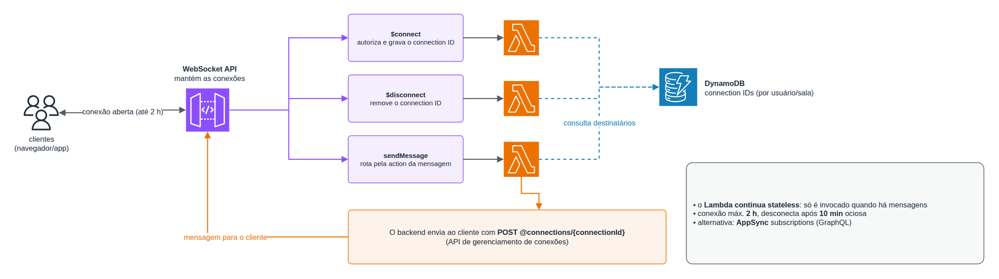

[↑ Índice](#índice)

### Observabilidade

- **CloudWatch metrics:** `Count`, `4XXError`, `5XXError`, `Latency` (total) e `IntegrationLatency` (só o backend). A diferença entre as duas mostra o tempo gasto no próprio API Gateway. Para cache, `CacheHitCount` e `CacheMissCount`.
- **Access logs:** um registro por requisição, em formato configurável: quem chamou, status, latência.
- **Execution logs** (REST): o detalhe de cada etapa, útil para depurar autorizadores e mapping templates. Deve ficar desligado ou em nível baixo em produção, por custo e volume.
- **AWS X-Ray** (REST): tracing da requisição através do API Gateway e do backend.

[↑ Índice](#índice)

### API Gateway, ALB, AppSync ou Function URL?

| Necessidade | Escolha |
|---|---|
| Gestão de API: chaves, cotas por cliente, cache, transformação, autorizadores | **API Gateway (REST)** |
| API simples na frente de Lambda, com JWT/OIDC e baixo custo | **API Gateway (HTTP)** |
| Comunicação bidirecional em tempo real | **API Gateway WebSocket** (ou **AppSync** com subscriptions) |
| Tráfego HTTP de alto volume e constante para containers/instâncias, sem recursos de gestão de API | **ALB** (custo por hora + LCU, mais barato em volume muito alto) |
| **GraphQL**: o cliente escolhe os campos, junta várias fontes de dados em uma chamada, *subscriptions* em tempo real | **AWS AppSync** |
| Expor **uma** função Lambda com o mínimo de configuração | **Lambda Function URL** |
| Conectar serviços **internos** entre VPCs e contas, com autenticação IAM | **VPC Lattice** (ou API Gateway privada) |

[↑ Índice](#índice)

### Padrões arquiteturais

- **Storage-first:** API Gateway → **SQS**, Kinesis ou EventBridge diretamente, com o processamento desacoplado.
- **Processamento longo:** API Gateway → **Step Functions** (`StartExecution`) → devolve **202** com o ID da execução → o cliente consulta o status em outro endpoint, ou recebe o resultado por WebSocket.
- **Upload de arquivos grandes:** a API devolve uma **URL pré-assinada** do S3, e o cliente envia o arquivo direto ao S3. O evento do S3 dispara o processamento.
- **Multi-região ativo-ativo:** APIs **regionais** idênticas em duas regiões, com o mesmo **custom domain**, e o **Route 53** com roteamento por **latência** e **health checks**/failover. Os dados ficam em DynamoDB Global Tables ou Aurora Global Database.
- **APIs internas e entre contas:** **API privada** + interface VPC endpoint na VPC consumidora + resource policy liberando aquele endpoint ou conta.
- **Proteger um backend legado:** throttling e usage plans no API Gateway, cache para leituras repetidas e **VPC Link** para alcançar o backend sem expô-lo.

[↑ Índice](#índice)

### Dicas para a prova

- "Cotas e limites **por cliente/parceiro**, com chaves de acesso" → **REST API** + **usage plans** + **API keys** (e um autorizador de verdade, porque API key não é autenticação).
- "API simples para Lambda com o **menor custo**, autenticação **JWT/OIDC**" → **HTTP API**.
- "Proteger a API contra SQL injection/XSS e limitar requisições por IP" → **AWS WAF** na **REST API** (ou CloudFront + WAF na frente da HTTP API).
- "API acessível **somente de dentro da VPC**" → **API privada** + **interface VPC endpoint** (`execute-api`) + **resource policy**.
- "Expor um serviço ECS/EC2 em **subnet privada** pelo API Gateway" → **VPC Link** (REST: NLB; HTTP: ALB/NLB/Cloud Map).
- "Gravar requisições em uma fila **sem Lambda**" → integração **AWS service** direta com **SQS** (storage-first).
- "Processamento que leva **mais de 29 segundos**" → **assíncrono**: SQS ou Step Functions + resposta **202** + polling/WebSocket.
- "Upload de arquivos maiores que **10 MB**" → **URL pré-assinada do S3**.
- "Reduzir chamadas repetidas ao backend" → **cache** do API Gateway (REST), ou **CloudFront** na frente.
- "Autorização com lógica própria (token proprietário, permissões por tenant)" → **Lambda authorizer**, com cache do resultado.
- "Chamadas entre serviços/contas com credenciais AWS" → autorização **IAM (SigV4)** + resource policy para entre contas.
- "Clientes recebem **429**" → throttling: rever limites de stage, método ou usage plan, ou pedir aumento da quota da conta.
- "Clientes no mundo todo, sem customizar a CDN" → **edge-optimized**. "CloudFront próprio com WAF e cache personalizados" → **regional** + CloudFront.
- "Certificado do custom domain para endpoint **edge-optimized**" → ACM em **us-east-1**.
- "Clientes B2B precisam se autenticar com certificado" → **mTLS** no custom domain.
- "Notificações em tempo real do servidor para o navegador" → **WebSocket API** (connection IDs no DynamoDB + `@connections`), ou **AppSync** subscriptions.
- "Testar uma versão nova da API com uma parte do tráfego" → **canary release** no stage (REST).
- "API ativa em duas regiões com failover" → APIs **regionais** + custom domain + **Route 53** (latência/failover + health checks).

[↑ Índice](#índice)

## High Performance Computing (HPC)

**HPC** (*High Performance Computing*, computação de alto desempenho) é usar **muitos computadores trabalhando juntos** para resolver um problema grande demais para uma máquina só. O problema é dividido em milhares de pedaços, cada núcleo calcula um pedaço, e os resultados são combinados no final. Exemplos: previsão do tempo, simulação de colisão de carros, aerodinâmica (**CFD**, *Computational Fluid Dynamics*), sequenciamento genômico, descoberta de medicamentos, análise sísmica, risco financeiro e renderização de filmes.

HPC não é um serviço da AWS, e sim um **tipo de carga de trabalho** que combina vários serviços: instâncias EC2 otimizadas, rede de baixa latência (EFA), sistemas de arquivos paralelos (FSx for Lustre) e orquestradores de jobs (ParallelCluster, PCS, Batch). On-premises, um cluster HPC é caro, fica **ocioso** entre projetos e cria **filas de espera** nos picos. Na AWS, o cluster cresce para milhares de núcleos quando há jobs na fila e volta a **zero** quando a fila esvazia.

> **Paralelo com o Lambda:** você provavelmente já faz uma forma de HPC: dividir um trabalho grande em muitos pedaços **independentes** e processá-los em paralelo, com Lambda + SQS ou com o **Step Functions Distributed Map**. Isso é HPC **fracamente acoplado**. O que o serverless não atende são as cargas em que os pedaços precisam **conversar entre si o tempo todo**, que exigem máquinas fixas, fisicamente próximas e com rede especial. Também não atende tarefas que passam de **15 minutos** ou que precisam de **GPU**.

### Como funciona um cluster HPC

Antes dos serviços, vale entender como um cluster HPC **tradicional** funciona. Eles existem há décadas em universidades, centros de pesquisa e indústrias, e os serviços da AWS reproduzem exatamente essa estrutura. Um cluster tem cinco componentes:

1. **Login/head node:** a "porta de entrada". Os usuários se conectam a ele por SSH, preparam os arquivos e **submetem jobs**. Ninguém roda cálculos pesados ali.
2. **Job scheduler** (agendador): roda no head node e funciona como um **maître de restaurante**. Recebe os pedidos (jobs), coloca-os em **fila**, decide a ordem de acordo com prioridades e cotas de cada grupo, e reserva os nós para cada job. O mais usado é o **Slurm**.
3. **Compute nodes:** dezenas a milhares de servidores **idênticos**, que só executam jobs. Cada job recebe nós **exclusivos** enquanto roda.
4. **Interconnect:** a **rede especial** que liga os compute nodes, com latência muito menor do que a de uma rede comum. On-premises, a tecnologia clássica é o **InfiniBand**; na AWS, é o **EFA**.
5. **Sistema de arquivos paralelo:** um storage **compartilhado** que todos os nós enxergam como uma pasta comum e que aguenta milhares de leituras e escritas simultâneas. O clássico é o **Lustre**; na AWS, é o **FSx for Lustre**.

**O ciclo de vida de um job:**

1. O usuário escreve um **script de job**, que diz o que rodar e quantos recursos usar (ex: 16 nós, 64 núcleos cada, por até 12 horas), e o submete.
2. O job entra na **fila** e espera.
3. O agendador **reserva** os nós quando há recursos livres e chega a vez do job.
4. O programa roda em todos os nós ao mesmo tempo, lendo e gravando no sistema de arquivos compartilhado e trocando mensagens pelo interconnect.
5. Ao terminar, os nós são **liberados** para o próximo job.

**O que muda na nuvem:** on-premises, o número de nós é **fixo**. Quando a fila cresce, os jobs esperam dias; quando ela esvazia, máquinas caras ficam paradas. Na AWS, o passo 3 muda: em vez de esperar um nó livre, o agendador **cria** as instâncias necessárias e as **destrói** quando o job termina. A fila praticamente desaparece, e o custo acompanha o uso.

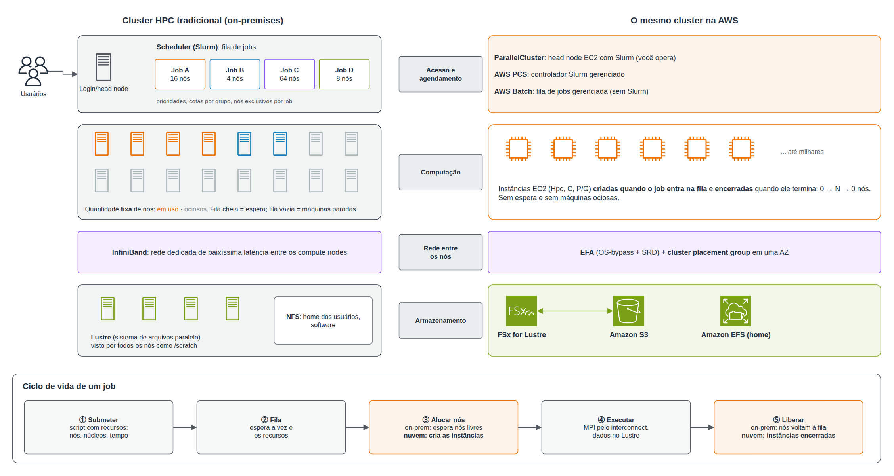

| Componente do cluster | Equivalente na AWS |
|---|---|
| Login/head node + scheduler | Instância EC2 com Slurm (**ParallelCluster**), controlador gerenciado (**PCS**) ou fila gerenciada (**Batch**) |
| Compute nodes | Instâncias EC2 (**Hpc**, C, P/G), criadas e destruídas conforme a fila |
| Interconnect (InfiniBand) | **EFA** + **cluster placement group** |
| Sistema de arquivos paralelo (Lustre) | **FSx for Lustre**, ligado ao **S3** |
| Arquivos de usuário (home) | **EFS** ou FSx for NetApp ONTAP/OpenZFS |
| Estação de visualização | Instância com GPU + **Amazon DCV** |

**Por que levar HPC para a nuvem, e o que pesa contra:**

- **A favor:** sem fila de espera, hardware sempre atualizado, nenhum investimento inicial (CapEx), capacidade para picos (ex: entrega de projeto) e a possibilidade de rodar **vários experimentos em paralelo** em clusters separados.
- **Contra, ou o que exige planejamento:**
  - **gravidade dos dados**: mover petabytes leva tempo e custa;
  - **licenças** de software comercial que dependem de um servidor de licenças on-premises;
  - cargas que rodam **24×7** a 100% de uso, para as quais um cluster próprio já amortizado pode ser mais barato.

[↑ Índice](#índice)

### Conceitos básicos

#### Como um problema é dividido

Imagine simular o ar passando em volta de um carro. O espaço ao redor dele é dividido em uma **malha** com milhões de pequenas células. Em cada **passo de tempo** (ex: um milésimo de segundo simulado), o programa calcula a pressão e a velocidade do ar em cada célula, com base nas **células vizinhas**. Essa conta é feita milhares de vezes até cobrir alguns segundos de simulação.

Uma máquina só levaria semanas. Por isso, a malha é dividida em pedaços (**decomposição de domínio**), e cada processo, em um núcleo, cuida de um pedaço. Surge então um problema: as células na **borda** de cada pedaço dependem de células que estão **no pedaço de outro nó**. Por isso, cada passo da simulação segue sempre o mesmo ciclo:

1. **Calcular:** cada processo atualiza as células do seu pedaço.
2. **Trocar bordas:** cada processo envia aos vizinhos os valores da sua borda e recebe os deles (*halo exchange*). Essa troca é feita com **MPI**.
3. **Sincronizar:** ninguém começa o próximo passo até **todos** terminarem a troca. Isso é uma **barreira**.

O ponto crítico está no passo 3: **o processo mais lento dita o ritmo de todos**. Se um nó demora mais para receber uma mensagem, os outros milhares de núcleos ficam **parados esperando**. Por isso, em HPC fortemente acoplado, a rede precisa de latência **baixa** e também **consistente**, todos os nós devem ser **iguais** e não pode haver "vizinho barulhento" disputando recursos. Isso explica as escolhas de arquitetura: núcleos físicos dedicados (SMT desligado), cluster placement group, EFA, uma única AZ e um único tipo de instância.

Já em uma carga **fracamente acoplada**, como renderizar frames de um filme, cada tarefa é independente: não há troca de bordas nem barreira. Um nó lento atrasa só a própria tarefa. Por isso essas cargas aceitam Spot, várias AZs e tipos de instância misturados.

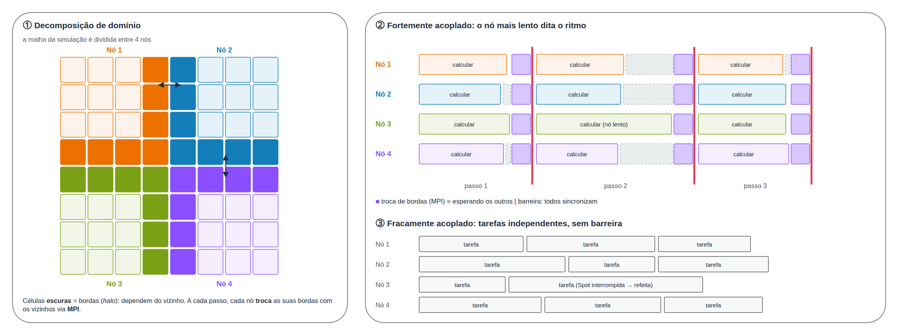

#### Escalabilidade: mais nós nem sempre é mais rápido

Dobrar o número de nós dobra a capacidade de cálculo, mas cada nó fica com um pedaço **menor** da malha. A conta de cada passo fica mais rápida, e a troca de bordas **não diminui na mesma proporção**. A partir de certo ponto, o tempo de comunicação domina e adicionar nós **não acelera mais**, ou até piora. É a [Lei de Amdahl](https://pt.wikipedia.org/wiki/Lei_de_Amdahl) aplicada à rede. Duas formas de medir:

- **Strong scaling:** o **mesmo problema** com mais nós. Mede quanto o resultado sai mais rápido.
- **Weak scaling:** um **problema maior** (malha mais fina) com mais nós, mantendo o mesmo trabalho por nó. Mede se dá para resolver problemas maiores no mesmo tempo.

Na nuvem, isso vira uma decisão de **custo**. Um job em 64 nós por 1 hora custa o mesmo que em 128 nós por 30 minutos, **se** a escala for perfeita. Se não for, os nós extras são dinheiro gasto em núcleos esperando a rede. Testar o ponto de escala ideal antes de rodar a produção é uma boa prática.

#### Fortemente vs. fracamente acoplado

A distinção mais importante em HPC é entre cargas **fortemente** e **fracamente acopladas**, porque ela define toda a arquitetura:

| | **Fortemente acoplado** (*tightly coupled*) | **Fracamente acoplado** (*loosely coupled*, *embarrassingly parallel*) |
|---|---|---|
| Como funciona | Os nós **trocam dados o tempo todo** durante o cálculo: cada pedaço depende dos vizinhos | Cada tarefa é **independente** e não conversa com as outras |
| Exemplo | Simulação de clima ou de CFD: cada região do modelo depende das vizinhas a cada passo | Renderizar 10.000 frames, analisar 1 milhão de genomas, simulação de Monte Carlo |
| Gargalo | **Latência de rede** entre os nós | Quantidade de CPU disponível e vazão de leitura dos dados |
| Comunicação | **MPI** | Nenhuma: uma fila de tarefas basta |
| Se um nó cai | O job **inteiro** para (ou volta ao último checkpoint) | Só aquela tarefa é refeita |
| Arquitetura na AWS | **Cluster placement group** + **EFA** + **FSx for Lustre** em **uma AZ**, com ParallelCluster ou PCS | **AWS Batch** com **Spot**, em **várias AZs** e com vários tipos de instância |

#### Glossário

- **MPI** (*Message Passing Interface*): o padrão de biblioteca que os programas HPC usam para trocar mensagens entre processos rodando em máquinas diferentes. É o "idioma" das cargas fortemente acopladas. Implementações comuns: Open MPI e Intel MPI. Em ML distribuído, o papel equivalente é da **NCCL** (NVIDIA), entre GPUs.
- **Rank:** cada processo de um programa MPI recebe um número, o *rank* (0, 1, 2...), usado para saber qual pedaço do problema é dele e com quem trocar mensagens. Normalmente há **um rank por núcleo físico**.
- **Core-hours** (núcleo-hora): a unidade de consumo em HPC. 1.000 núcleos por 1 hora = 1.000 core-hours. Centros de pesquisa distribuem cotas nessa unidade, e alguns softwares comerciais de simulação são **licenciados por núcleo**.
- **Interconnect:** a rede entre os compute nodes de um cluster. InfiniBand on-premises, EFA na AWS.
- **POSIX:** o padrão de sistema de arquivos do Unix/Linux: pastas, `open`/`read`/`write`, permissões e travas (locks). Programas HPC esperam um sistema de arquivos POSIX, e o S3 não é um.
- **Job:** uma unidade de trabalho submetida ao cluster, por exemplo "rodar esta simulação com 1.024 núcleos".
- **Job scheduler** (agendador): o software que recebe os jobs, coloca-os em **fila** e decide quando e em quais nós cada um roda. O mais usado em HPC é o **Slurm**.
- **Head node** (nó principal): a máquina que roda o agendador e onde os usuários entram para submeter jobs. Os **compute nodes** (nós de computação) executam os jobs.
- **Checkpoint:** um "save game" periódico do estado da simulação em disco. Se algo falhar, o job continua do último checkpoint em vez de recomeçar. É o que torna viável usar Spot em jobs longos.
- **Scratch:** armazenamento **temporário** e rápido, usado durante o job e descartado depois.

[↑ Índice](#índice)

### Computação

Escolher a máquina para HPC é diferente de escolher para uma aplicação web. Quatro características pesam mais do que o número de vCPUs:

- **Núcleos físicos dedicados:** cada rank MPI quer um núcleo inteiro. Duas threads SMT no mesmo núcleo disputam recursos e criam exatamente o "nó mais lento" que trava todos os outros.
- **Largura de banda de memória:** muitos códigos de simulação (CFD, clima) passam mais tempo **buscando dados na memória** do que calculando. São chamados de *memory-bound*. Para eles, colocar mais núcleos em um nó não ajuda se a memória não acompanha. Às vezes, usar **menos núcleos por nó** em mais nós é mais rápido.
- **Rede:** a largura de banda e o suporte a EFA definem o quanto o job escala para muitos nós.
- **GPU ou CPU:** códigos reescritos para GPU (dinâmica molecular, alguns solvers de CFD, ML) podem rodar muitas vezes mais rápido. Código que não foi portado para GPU não ganha nada com ela.

Há também o fator **licença**. Softwares comerciais de simulação costumam ser licenciados **por núcleo**. Nesse caso, compensa usar **menos núcleos, mais rápidos**, mesmo pagando mais pela instância.

- **Famílias de instância:**
  - **Hpc** (ex: `hpc7g` com Graviton, `hpc7a` com AMD, `hpc6id` com disco NVMe local): feitas para HPC fortemente acoplado. Têm muitos núcleos físicos, **SMT desligado**, EFA de alta largura de banda e o melhor preço por núcleo para essas cargas. Estão disponíveis em poucas regiões e AZs.
  - **C** (compute optimized): alternativa geral para HPC, com mais opções de tamanho e de região.
  - **P e G** (GPUs NVIDIA) e **Trn/Inf** (chips da AWS para ML): simulações aceleradas por GPU e treinamento de modelos.
  - **R e X** (memory optimized): simulações que precisam de muita memória por núcleo, como bancos genômicos e análise de elementos finitos.
- **SMT desligado:** em HPC, normalmente cada processo MPI deve ter um núcleo físico **só para ele**. Nas famílias que usam SMT, desliga-se com **Optimize CPUs** (`ThreadsPerCore = 1`). As Hpc e o Graviton já vêm assim. Ver [O que é uma vCPU](#o-que-é-uma-vcpu).
- **Modelo de compra:**
  - **Fracamente acoplado:** **Spot**, porque uma tarefa interrompida é apenas refeita.
  - **Fortemente acoplado:** **On-Demand**, porque perder um nó derruba o job inteiro. Para garantir que todos os nós vão subir juntos na mesma AZ, usar **On-Demand Capacity Reservations**. Spot só é viável com **checkpoints** frequentes.
  - **Cluster ligado o ano todo:** **Savings Plans**.
  - **GPUs para treinamentos de dias ou semanas:** **Capacity Blocks for ML**.
- **Quotas:** clusters HPC usam milhares de vCPUs de uma vez. Pedir aumento de quota antes de um projeto grande. Ver [Quotas](#quotas).

[↑ Índice](#índice)

### Rede: ENA e Elastic Fabric Adapter (EFA)

Uma rede tem duas medidas de desempenho, e é comum confundi-las:

- **Latência:** quanto tempo uma mensagem leva para **chegar** do outro lado, mesmo que seja minúscula. É o tempo de entrega de uma carta.
- **Largura de banda:** quanto dado passa **por segundo**. É o tamanho do caminhão.

Uma aplicação web ou um backup precisam de **largura de banda**: são poucos arquivos grandes. Já a troca de bordas em uma simulação gera **milhões de mensagens pequenas**, uma por vizinho a cada passo, e cada passo só termina quando a **última** mensagem chega (ver [Como um problema é dividido](#como-um-problema-é-dividido)). Por isso, em HPC fortemente acoplado, importam a **latência** e, principalmente, a sua **consistência**. Uma única mensagem atrasada (*tail latency*) deixa todos os núcleos esperando.

Em uma rede comum, cada mensagem passa pela pilha TCP/IP do kernel do sistema operacional, o que acrescenta atraso e variação. Clusters on-premises resolvem isso com **InfiniBand**, uma rede especializada em que a aplicação fala direto com a placa. Na AWS, há dois níveis de interface de rede, e é importante saber quando cada um basta.

#### Enhanced networking (ENA)

É o mesmo **enhanced networking** descrito na seção [Rede do EC2](#rede). *Enhanced networking* é o nome do recurso, e o **ENA** (*Elastic Network Adapter*) é a placa de rede virtual que o implementa. Ele vem habilitado por padrão em todas as instâncias atuais (Nitro). Com **SR-IOV**, a instância acessa a placa de rede quase diretamente, sem o hypervisor no caminho de cada pacote. Isso entrega muita largura de banda (de alguns Gbps nas instâncias pequenas a centenas de Gbps nas maiores), muitos pacotes por segundo e latência baixa **para uma rede TCP/IP**. Mas o tráfego continua passando pelo **kernel** do sistema operacional. O diagrama daquela seção mostra as camadas que o ENA e o EFA contornam.

Para HPC, o ENA é suficiente em vários casos:

- **Cargas fracamente acopladas:** as tarefas não conversam entre si, e a rede serve só para ler e gravar dados (S3, FSx).
- **Acesso ao storage:** a leitura e a escrita no FSx for Lustre passam pelo ENA, e é aqui que a **largura de banda** da instância importa.
- **Jobs MPI pequenos ou pouco sensíveis à latência:** poucos nós, ou códigos que trocam mensagens com pouca frequência.

**Limites de banda por fluxo:** a banda anunciada de uma instância (ex: 100 Gbps) é o **total** da placa, não o de uma única conexão. Um único **fluxo TCP** (uma conexão entre dois IPs e portas) é limitado a cerca de **5 Gbps**, ou cerca de **10 Gbps** dentro de um **cluster placement group**. Para usar toda a banda, a aplicação precisa abrir **várias conexões em paralelo**, como fazem o AWS CLI no S3, o DataSync e os clientes Lustre. Esse limite costuma aparecer em questões do tipo "a instância tem 100 Gbps, mas a cópia não passa de 5 Gbps".

**ENA Express:** um recurso do ENA que usa o protocolo **SRD** (o mesmo do EFA, descrito abaixo) para o tráfego **TCP e UDP comum**, sem mudar a aplicação. Ele aumenta a banda de um **único fluxo** (até cerca de 25 Gbps) e reduz a latência de cauda (*tail latency*). Funciona apenas entre instâncias compatíveis na **mesma AZ** e precisa ser habilitado nas duas pontas. É útil para aplicações que não usam MPI, mas sofrem com o limite por fluxo, como replicação de bancos de dados, transferência de arquivos grandes e storage distribuído.

#### EFA (Elastic Fabric Adapter)

O **EFA** é um ENA com uma capacidade a mais: o **OS-bypass**. Ele é a resposta da AWS ao InfiniBand e o nível necessário para MPI fortemente acoplado em escala:

- **OS-bypass:** a biblioteca MPI ou NCCL fala **direto com a placa de rede**, sem passar pelo kernel do sistema operacional. Isso corta boa parte da latência de cada mensagem. Funciona por meio da biblioteca **libfabric**, que as implementações de MPI já suportam.
- **SRD** (*Scalable Reliable Datagram*): o protocolo de transporte do EFA, criado pela AWS. Ele espalha os pacotes por **vários caminhos** da rede ao mesmo tempo e retransmite rapidamente o que se perder. Isso dá latência baixa e **consistente**, mesmo com milhares de nós.
- O EFA também funciona como uma **ENA comum** para o tráfego TCP/IP normal (SSH, acesso ao storage, internet).

| | **ENA** | **ENA Express** | **EFA** |
|---|---|---|---|
| O que é | Interface padrão (enhanced networking, SR-IOV) | ENA + transporte SRD para TCP/UDP | ENA + OS-bypass + SRD para MPI/NCCL |
| Passa pelo kernel? | Sim | Sim | **Não** (no tráfego MPI/NCCL) |
| Muda a aplicação? | Não | Não (só habilitar nas duas pontas) | Usa MPI/NCCL com libfabric |
| Alcance | Qualquer destino | Mesma AZ | **Mesma subnet** |
| Uso típico em HPC | Fracamente acoplado, acesso ao storage | Transferências grandes entre instâncias | MPI fortemente acoplado, ML distribuído |

**Restrições que caem na prova:**

- O tráfego **OS-bypass** do EFA **não é roteável**: ele só funciona entre instâncias na **mesma subnet**, e portanto na **mesma AZ**. Um cluster MPI que precisa de EFA não pode ser distribuído entre AZs.
- O **security group** precisa permitir **todo o tráfego de entrada e saída para ele mesmo** (uma regra que referencia o próprio security group). Sem isso, o EFA não funciona.
- Só alguns tipos de instância suportam EFA (em geral, os tamanhos maiores das famílias C, M, R, Hpc, P e Trn), e o EFA precisa ser **anexado no lançamento** da instância.
- Combinar com **cluster placement group**, para colocar os nós fisicamente próximos.

> **Obs:** Para HPC fortemente acoplado, **uma única AZ** é a resposta certa, mesmo que isso pareça contradizer as boas práticas de alta disponibilidade. A latência entre AZs prejudica o MPI, e o EFA nem funciona entre subnets. A resiliência vem de **checkpoints** no S3 ou no FSx e da possibilidade de **recriar o cluster** em outra AZ, e não de distribuir os nós.

[↑ Índice](#índice)

### Armazenamento para HPC

Um job HPC típico tem três fases de dados: **ler** um grande volume de entrada (malhas de simulação, genomas, imagens), **escrever** resultados intermediários e checkpoints durante a execução, e **gravar** a saída final. Milhares de núcleos lendo e escrevendo ao mesmo tempo esgotam rapidamente um storage comum. Por isso, HPC usa **sistemas de arquivos paralelos**, em que os dados ficam espalhados por muitos servidores e cada cliente lê de vários deles ao mesmo tempo.

**Por que um NFS comum não basta:** em um servidor de arquivos tradicional (NFS), **um único servidor** atende todos os clientes. Ele funciona bem para dezenas de máquinas, mas com mil nós lendo os mesmos arquivos de entrada no início de um job, esse servidor vira um **funil**. Os nós ficam esperando dados em vez de calcular.

**Como um sistema de arquivos paralelo resolve isso:** o Lustre separa duas funções e distribui os dados.

- **Servidor de metadados (MDS):** guarda os **nomes**, as pastas, as permissões e o **mapa** de onde está cada pedaço de cada arquivo. É consultado só ao abrir o arquivo.
- **Servidores de armazenamento (OSS), com seus discos (OSTs):** guardam os **dados** de fato.
- **Striping:** cada arquivo grande é **fatiado** em blocos (*stripes*) espalhados por vários servidores de armazenamento, como um RAID 0 em rede. Para ler um arquivo de 100 GB, o cliente busca as fatias em **vários servidores ao mesmo tempo**, e mil clientes se distribuem por todos eles.
- **Resultado:** a vazão total cresce com o número de servidores, e é por isso que o desempenho do FSx for Lustre **cresce com a capacidade provisionada**. Mais TB significa mais servidores por trás e mais GB/s.

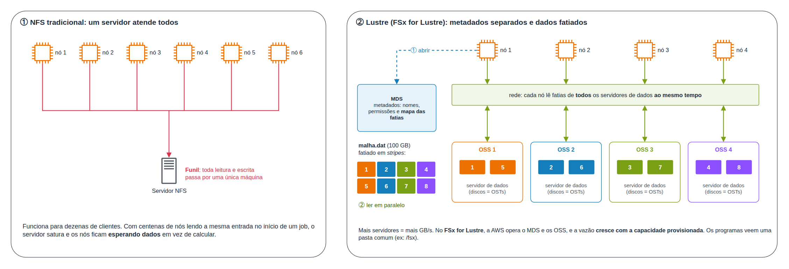

Os programas veem tudo isso como uma **pasta comum** (POSIX), por exemplo `/fsx/projeto/malha.dat`, sem saber que o arquivo está fatiado em dezenas de servidores.

**Amazon FSx for Lustre:** o Lustre é o sistema de arquivos paralelo mais usado em supercomputadores. O FSx for Lustre é a versão **gerenciada** dele, com throughput de centenas de GB/s, milhões de IOPS e latência abaixo de 1 ms. Os pontos-chave são:

- **Tipos de implantação:**
  - **Scratch:** sem replicação, mais barato, para dados **temporários** de jobs curtos. Se um servidor de arquivos falhar, os dados se perdem.
  - **Persistent:** os dados são **replicados dentro da AZ** e o servidor com falha é substituído automaticamente. Para armazenamento de longa duração ou jobs longos.
- **Integração com o S3 (*data repository association*):** o sistema de arquivos é **ligado a um bucket S3**. Os arquivos do bucket aparecem no Lustre como se estivessem lá, mas são carregados **sob demanda** no primeiro acesso (*lazy loading*). Os resultados podem ser **exportados** de volta para o S3, automaticamente ou com um comando. Assim, o S3 guarda os dados de forma durável e barata, e o Lustre é só a camada rápida enquanto o job roda. Um padrão comum é criar o FSx scratch no início do projeto e **apagá-lo** no fim.
- O FSx for Lustre fica em **uma única AZ**, a mesma do cluster.

| Storage | Papel em HPC |
|---|---|
| **Amazon S3** | Repositório **durável** de entradas e saídas. Barato, mas não é um sistema de arquivos POSIX: os programas HPC não o leem diretamente com bom desempenho |
| **FSx for Lustre** | Sistema de arquivos **paralelo** de alto desempenho para o processamento, ligado ao S3 |
| **Instance store NVMe** (ex: `hpc6id`) | Scratch **local** de cada nó: o mais rápido, mas efêmero e não compartilhado |
| **Amazon EFS** | Diretórios **home** dos usuários, scripts e software compartilhado. Não é feito para o throughput de um job HPC |
| **EBS** | Disco de sistema do head node e dos nós |

> **Paralelo com o Lambda:** o padrão "S3 como fonte da verdade + uma camada rápida temporária" é o mesmo de uma função que baixa um arquivo do S3 para o `/tmp`, processa e envia o resultado de volta ao S3. A diferença é que o FSx for Lustre faz isso de forma **compartilhada** entre milhares de núcleos, e de forma transparente para o programa.

[↑ Índice](#índice)

### Orquestração: ParallelCluster, PCS e Batch

Em um cluster compartilhado por dezenas de pesquisadores, alguém precisa decidir **qual job roda onde e quando**. Esse é o papel do **agendador** (*job scheduler*), que:

- mantém **filas** (no Slurm, *partitions*), por exemplo uma para nós com GPU e outra para nós com muita memória;
- aplica **prioridades** e cotas por grupo (*fair-share*), para que um usuário não monopolize o cluster;
- **reserva nós inteiros** para cada job, já que jobs MPI precisam de todos os nós ao mesmo tempo;
- faz ***backfill***: encaixa jobs pequenos nos "buracos" enquanto um job grande espera nós suficientes ficarem livres.

O usuário descreve o job em um script e o envia com `sbatch`:

```bash
#!/bin/bash
#SBATCH --job-name=simulacao-asa
#SBATCH --partition=hpc7g        # fila (tipo de nó)
#SBATCH --nodes=16               # 16 nós
#SBATCH --ntasks-per-node=64     # 64 ranks MPI por nó = 1.024 núcleos
#SBATCH --time=12:00:00          # tempo máximo
srun ./solver /fsx/projeto/malha.dat   # roda o programa MPI em todos os nós
```

Na nuvem, o agendador ganha mais uma função: **criar e destruir as instâncias** conforme a fila. Quando esse job chega, 16 instâncias `hpc7g` são lançadas; quando termina, são encerradas. A AWS oferece três caminhos para isso:

- **AWS ParallelCluster:** ferramenta **open source** (CLI e interface web) que cria um cluster HPC "tradicional" a partir de um arquivo **YAML**. Ela gera a infraestrutura com **CloudFormation**: head node, compute nodes, rede, storage compartilhado e agendador **Slurm**. Os compute nodes **escalam automaticamente**, de zero até o máximo, conforme a fila de jobs. É gratuita (paga-se só pelos recursos), mas **você** opera o cluster: atualizações, versões e o head node.
- **AWS Parallel Computing Service (PCS):** serviço **gerenciado** de Slurm. A AWS opera o controlador do Slurm (o equivalente ao head node), as atualizações e a disponibilidade. Você define **grupos de nós** de computação e **filas**. É o caminho para quem quer Slurm **sem gerenciar** a ferramenta.
- **AWS Batch:** serviço **gerenciado** de filas de jobs, **sem Slurm**. Você define **job definitions** (uma imagem de container + recursos), **job queues** e **compute environments** (EC2 On-Demand, **Spot** ou **Fargate**). O Batch escolhe as instâncias, executa os containers e escala até zero. Recursos importantes:
  - **Array jobs:** um único envio cria até **10.000 jobs filhos**. Cada um recebe um índice (`AWS_BATCH_JOB_ARRAY_INDEX`) para saber qual pedaço dos dados processar. É o padrão do fracamente acoplado.
  - **Multi-node parallel jobs:** um job que usa **vários nós ao mesmo tempo**, com suporte a MPI e EFA. Permite rodar cargas fortemente acopladas no Batch.
  - **Dependências** entre jobs e integração com **Step Functions** para montar pipelines (ex: alinhar genomas → chamar variantes → gerar relatório).

| Critério | ParallelCluster | PCS | Batch |
|---|---|---|---|
| Modelo | Ferramenta open source; você opera | Slurm gerenciado | Filas de jobs gerenciadas, com containers |
| Agendador | Slurm | Slurm | Próprio do Batch |
| Público típico | Equipes de HPC que já usam Slurm on-premises e querem controle total | Equipes de HPC que usam Slurm e querem menos operação | Desenvolvedores e pipelines de dados; cargas fracamente acopladas |
| Força | Flexibilidade e personalização | Menor esforço operacional com Slurm | Integração com containers, Spot e Step Functions |

> **Paralelo com o Lambda:** o **AWS Batch** é o mais próximo do serverless: você envia um container, não gerencia servidores e só paga enquanto os jobs rodam. Pense nele como um "Lambda para jobs longos". Ele não tem limite de 15 minutos, aceita GPU e muita memória, e tem uma fila nativa. Para tarefas curtas e muito numerosas, **Step Functions Distributed Map + Lambda** continua sendo uma opção, com até 10.000 execuções em paralelo.

[↑ Índice](#índice)

### Arquiteturas de referência

**HPC fortemente acoplado com Slurm:**

- **Acesso:** os usuários entram no **head node**, que fica na subnet pública ou atrás de um **Session Manager**/**DCV**, e submetem jobs ao Slurm.
- **Computação:** os **compute nodes** (Hpc ou C, com **EFA**) ficam em uma subnet privada, em um **cluster placement group**, e são criados conforme a fila.
- **Storage:** o **FSx for Lustre** fica ligado ao **S3**.
- **Orquestração:** tudo é criado pelo **ParallelCluster**, ou gerenciado pelo **PCS**.

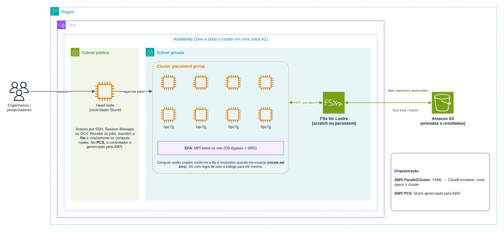

**HPC fracamente acoplado com AWS Batch:**

1. A chegada dos dados no S3, ou um agendamento, dispara um pipeline no **Step Functions** ou no **EventBridge**.
2. O pipeline envia um **array job** ao **Batch**.
3. O Batch distribui os jobs filhos em um compute environment **Spot** com **vários tipos de instância** e **várias AZs**.
4. Cada filho lê seu pedaço no S3 e grava o resultado de volta no S3.

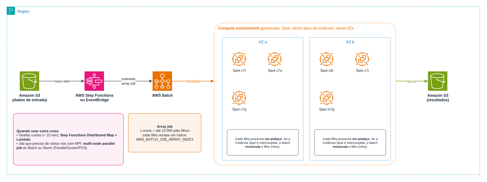

[↑ Índice](#índice)

### HPC híbrido e migração

Muitas empresas já têm um cluster HPC on-premises e não vão abandoná-lo. O cenário típico de prova é o **cloud bursting**: usar a AWS **só quando a fila local fica grande**, por exemplo antes de um prazo de projeto.

Levar jobs para a nuvem é a parte fácil. Os desafios de um ambiente híbrido estão em volta dele:

- **Dados:** os jobs precisam dos arquivos de entrada, que estão on-premises. É preciso decidir entre **copiar antes** (DataSync, Snowball) ou **acessar sob demanda** (File Cache), e trazer os resultados de volta.
- **Licenças:** softwares comerciais costumam consultar um **servidor de licenças** (ex: FlexLM) on-premises. Os nós na nuvem precisam alcançá-lo pela rede privada, ou o servidor precisa de uma cópia na AWS com uma ENI fixa (ver [Rede](#rede)).
- **Identidade:** os usuários e grupos Linux (UIDs/GIDs) precisam ser **os mesmos** nos dois lados, ou as permissões de arquivo quebram. A solução comum é integrar os nós da nuvem ao mesmo **Active Directory/LDAP**, via **AWS Directory Service** ou AD Connector.
- **Rede:** um link estável e com banda suficiente para dados e controle, ou seja, **Direct Connect**.

- **Rede:** **Direct Connect** (ou VPN) entre o data center e a VPC.
- **Movimentação de dados:**
  - **AWS DataSync:** copia dados do storage on-premises (NFS, SMB, HDFS) para S3, EFS ou FSx de forma agendada e incremental, com verificação de integridade.
  - **Snowball Edge:** para volumes muito grandes (centenas de TB ou PB) quando a rede não comporta a transferência no prazo.
  - **Amazon File Cache:** um cache de alto desempenho, baseado em Lustre, na AWS. Ele apresenta aos nós da nuvem os dados de um **NFS on-premises** (ou do S3) **sem copiar tudo antes**: os arquivos são carregados sob demanda e as alterações podem ser escritas de volta na origem.
- **Agendamento:** o Slurm on-premises pode ser configurado para enviar jobs a uma partição na AWS, criada com **ParallelCluster** ou **PCS**.
- **Visualização remota:** o **Amazon DCV** (antigo NICE DCV) transmite a tela de uma instância com GPU para o computador do engenheiro. Ele vê e manipula modelos 3D e resultados de simulação **sem baixar** os arquivos, que podem ter centenas de GB. Não há custo de licença do DCV em instâncias EC2.

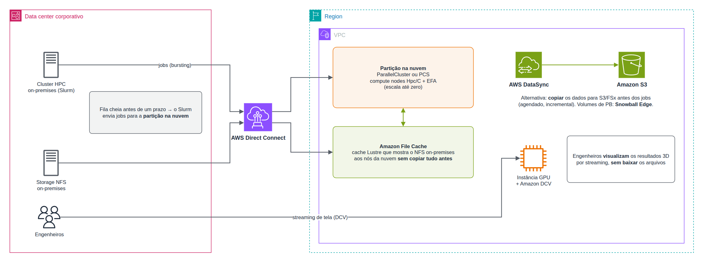

[↑ Índice](#índice)

### Otimização de custo

- **Escalar até zero:** ParallelCluster, PCS e Batch removem os nós quando a fila esvazia. Só o head node fica ligado, e no PCS nem ele é seu.
- **Spot** para cargas fracamente acopladas e para jobs com **checkpoint**, com vários tipos de instância (ex: `c6i`, `c7i`, `c7a`, `c7g`) para ter mais pools disponíveis.
- **Graviton** (`hpc7g`, `c7g`, `c8g`): melhor preço por núcleo, se o software compilar para ARM64.
- **FSx for Lustre scratch** apagado no fim do projeto, com os dados permanentes no **S3**. Aplicar **lifecycle** do S3 para mover resultados antigos para classes mais baratas.
- **Savings Plans** para a base de uso constante e **Capacity Blocks** para picos planejados de GPU.

[↑ Índice](#índice)

### Dicas para a prova

- "Simulação com **MPI**, comunicação **intensa entre nós**, **latência** mínima" → **cluster placement group** + **EFA** + instâncias **Hpc**/C, em **uma única AZ e subnet**.
- "Instância de 100 Gbps, mas uma cópia entre duas instâncias **não passa de ~5 Gbps**" → limite **por fluxo** do ENA: usar **várias conexões em paralelo**, **cluster placement group** (~10 Gbps por fluxo) ou **ENA Express** (mesma AZ).
- "Reduzir latência e aumentar a banda de um fluxo TCP **sem alterar a aplicação**" → **ENA Express**. "MPI em escala" → **EFA**.
- "EFA configurado, mas os nós não se comunicam" → **security group** sem a regra de **todo o tráfego** para ele mesmo, ou nós em **subnets diferentes**.
- "Milhares de tarefas **independentes** com o **menor custo**" → **AWS Batch** (array jobs) com **Spot**, vários tipos de instância e AZs.
- "Tarefas independentes **curtas** (< 15 min) em grande volume" → **Step Functions Distributed Map** + **Lambda**.
- "Sistema de arquivos **paralelo** de alto desempenho para HPC, com os dados no **S3**" → **FSx for Lustre** com **data repository association**.
- "Armazenamento temporário mais barato para um job curto" → FSx for Lustre **scratch**. "Jobs longos, dados que precisam sobreviver a falhas" → FSx for Lustre **persistent**.
- "Equipe que usa **Slurm** on-premises quer levar o cluster para a AWS" → **ParallelCluster** (controle total) ou **PCS** (gerenciado, **menor esforço operacional**).
- "Pipeline de jobs em containers, com dependências e sem gerenciar agendador" → **AWS Batch** + **Step Functions**.
- "Usar a nuvem só quando o cluster **on-premises** fica sobrecarregado" → **cloud bursting** com **Direct Connect** + ParallelCluster/PCS, e **DataSync** ou **File Cache** para os dados.
- "Acessar os dados on-premises a partir da nuvem **sem copiar tudo antes**" → **Amazon File Cache**.
- "Engenheiros precisam visualizar resultados 3D **sem baixar** os arquivos" → **Amazon DCV** em instâncias com GPU.
- "Job longo e fortemente acoplado precisa sobreviver a falhas" → **checkpoints** periódicos no FSx ou no S3.
- "Garantir que **todos** os nós do cluster consigam subir juntos" → **On-Demand Capacity Reservation** (ou **Capacity Blocks** para GPU).

[↑ Índice](#índice)

## Revisão: qual serviço usar

Resumo das comparações que mais aparecem nas questões. Os detalhes estão nas seções de cada serviço.

### Opções de compra do EC2

| Pergunta do cenário | Solução |
|---|---|
| Carga constante, máxima flexibilidade (família, região, Fargate, Lambda) | [Compute Savings Plan](#opções-de-compra) |
| Carga constante em uma família e região, maior desconto | [EC2 Instance Savings Plan / Standard RI](#opções-de-compra) |
| Carga tolerante a interrupções, menor custo | [Spot](#spot-instances--spot-fleet) |
| Garantir capacidade em uma AZ sem compromisso longo | [On-Demand Capacity Reservation](#opções-de-compra) |
| Licenças por socket/core (BYOL) | [Dedicated Hosts](#opções-de-compra) |
| Carga curta, imprevisível ou de teste | [On-Demand](#opções-de-compra) |

### Spot

| Pergunta do cenário | Solução |
|---|---|
| Reduzir interrupções Spot | [Diversificar + price-capacity-optimized](#estratégias-de-alocação) |
| Retomar de onde parou quando a capacidade voltar | [Pedido persistent + stop/hibernate](#pedidos-spot-one-time-e-persistent) |
| Instâncias relançadas depois de terminadas | [Cancelar o pedido persistent antes](#pedidos-spot-one-time-e-persistent) |
| Frota que repõe interrupções | [Spot Fleet / EC2 Fleet maintain ou ASG](#spot-fleet-vs-ec2-fleet-vs-auto-scaling-group) |
| N instâncias imediatamente, resposta síncrona | [EC2 Fleet instant](#ec2-fleet) |
| Capacidade em vCPUs/unidades com tamanhos mistos | [Instance weighting](#spot-fleet) |
| Escolher região/AZ com mais capacidade Spot | [Spot placement score](#como-funciona-o-mercado-spot) |

### Posicionamento das instâncias

| Pergunta do cenário | Solução |
|---|---|
| Latência mínima entre nós (HPC) | [Cluster placement group](#placement-groups) + EFA |
| Poucas instâncias críticas isoladas umas das outras | [Spread placement group](#placement-groups) |
| Sistemas distribuídos com consciência de rack (HDFS, Cassandra, Kafka) | [Partition placement group](#placement-groups) |

### Auto Scaling

| Pergunta do cenário | Solução |
|---|---|
| Manter uma métrica perto de um alvo | [Target tracking](#políticas-de-escala) |
| Pico previsível em horário conhecido | [Scheduled actions](#políticas-de-escala) |
| Padrão cíclico + boot demorado, escalar antes do pico | [Predictive scaling](#políticas-de-escala) |
| Workers consumindo uma fila SQS | [Target tracking sobre backlog por instância](#políticas-de-escala) |
| Aplicação travada não é substituída | [ELB health checks no ASG](#health-checks-e-substituição-de-instâncias) |
| Ação antes de entrar em serviço ou de ser encerrada | [Lifecycle hooks](#ciclo-de-vida-da-instância-e-lifecycle-hooks) |
| Instâncias demoram a ficar prontas | [Warm pool](#warm-pools-instâncias-pré-aquecidas) |
| Trocar a AMI da frota de forma gradual | [Instance refresh](#atualizar-as-instâncias-instance-refresh) |
| Escalar ECS, DynamoDB, Aurora ou provisioned concurrency | [Application Auto Scaling](#ec2-auto-scaling-application-auto-scaling-e-aws-auto-scaling) |

### Atualização de aplicações em ASG

| Pergunta do cenário | Solução |
|---|---|
| Atualização gradual sem infraestrutura extra | [Instance refresh (rolling)](#1-rolling-update-no-mesmo-asg-instance-refresh) |
| Canary simples sem mexer no load balancer | [Segundo ASG no mesmo target group](#2-segundo-asg-no-mesmo-target-group-canary-por-capacidade) |
| % de tráfego preciso, teste isolado e rollback imediato | [Dois target groups com pesos no ALB](#3-bluegreen-com-dois-target-groups-e-pesos-no-alb) |
| Mudança de ALB, VPC, conta ou região; isolamento total | [Ambientes completos + Route 53](#4-bluegreen-com-ambientes-completos-e-route-53) |
| ASG novo no CloudFormation, removendo o antigo só se der certo | [AutoScalingReplacingUpdate](#ferramentas-que-implementam-essas-estratégias) |
| Deploy imutável no Beanstalk | [Immutable](#ferramentas-que-implementam-essas-estratégias) |

### Containers (ECS)

| Pergunta do cenário | Solução |
|---|---|
| Containers sem gerenciar servidores | [ECS + Fargate](#onde-as-tasks-rodam-ec2-fargate-e-capacity-providers) |
| Containers com GPU ou custo mínimo em grande escala | [ECS no EC2](#onde-as-tasks-rodam-ec2-fargate-e-capacity-providers) |
| Task não inicia (imagem/segredo) vs. AccessDenied na aplicação | [Task execution role vs. task role](#iam-task-role-vs-task-execution-role) |
| Security group por serviço | [awsvpc](#rede-network-modes) |
| Tasks pendentes por falta de capacidade | [Capacity provider com managed scaling](#auto-scaling-no-ecs-dois-níveis) |
| Comunicação entre microsserviços por nome | [Service Connect](#load-balancing-e-comunicação-entre-serviços) |
| Deploy com rollback automático | [Circuit breaker / blue/green](#deploy-de-novas-versões) |
| Dados compartilhados entre tasks no Fargate | [EFS](#armazenamento-em-containers) |
| ECS ou EKS ou Lambda | [Comparação](#ecs-eks-fargate-ou-lambda) |

### Kubernetes (EKS)

| Pergunta do cenário | Solução |
|---|---|
| Já usa Kubernetes e quer migrar com mínimo de mudanças | [EKS](#ecs-ou-eks) |
| Kubernetes com menor esforço operacional | [EKS Auto Mode / Fargate](#o-que-o-eks-gerencia) |
| Kubernetes on-premises | [EKS Anywhere / Hybrid Nodes / Outposts](#o-que-o-eks-gerencia) |
| Permissões AWS por aplicação (pod) | [EKS Pod Identity / IRSA](#segurança-quem-acessa-o-cluster-e-o-que-os-pods-acessam) |
| Acesso de roles IAM ao cluster | [Access entries](#segurança-quem-acessa-o-cluster-e-o-que-os-pods-acessam) |
| Subnet sem IPs para pods | [CIDR secundário / prefix delegation / IPv6](#rede-no-eks) |
| Expor HTTP com regras de path | [Ingress + AWS Load Balancer Controller](#rede-no-eks) |
| Nós rápidos e sob medida | [Karpenter](#auto-scaling-no-eks-pods-e-nós) |
| Volume compartilhado multi-AZ | [EFS CSI](#armazenamento-no-eks) |

### Lambda

| Pergunta do cenário | Solução |
|---|---|
| Eliminar cold start | [Provisioned concurrency / SnapStart](#ambiente-de-execução-e-cold-start) |
| Garantir ou limitar a capacidade de uma função | [Reserved concurrency](#concorrência-e-escala) |
| Resultado de invocações assíncronas com contexto | [Destinations](#modelos-de-invocação) |
| Lote SQS inteiro reprocessado por uma mensagem | [Partial batch response](#modelos-de-invocação) |
| Registro ruim travando o stream | [Bisect + retries + on-failure destination](#modelos-de-invocação) |
| Conexões esgotadas no RDS | [RDS Proxy](#lambda-em-vpc-e-acesso-a-dados) |
| Função em VPC sem internet | [NAT Gateway / VPC endpoints](#lambda-em-vpc-e-acesso-a-dados) |
| Quem pode invocar vs. o que a função pode fazer | [Resource policy vs. execution role](#permissões) |
| Deploy gradual com rollback | [Alias com pesos + CodeDeploy](#deploy-versões-aliases-e-pacotes) |
| Lógica no CloudFront | [CloudFront Functions / Lambda@Edge](#lambda-na-borda-e-formas-de-expor-funções) |
| Processo longo, carga constante, GPU | [Outra opção](#custo-e-quando-o-lambda-não-é-a-melhor-escolha) |

### API Gateway

| Pergunta do cenário | Solução |
|---|---|
| Cotas e limites por cliente | [REST API + usage plans + API keys](#throttling-usage-plans-e-cache) |
| API simples e barata com JWT/OIDC | [HTTP API](#tipos-de-api-rest-http-e-websocket) |
| API só acessível da VPC | [API privada + interface endpoint + resource policy](#tipos-de-endpoint-rest-api) |
| Backend em subnet privada | [VPC Link](#integrações) |
| Gravar em fila sem Lambda | [Integração AWS service (storage-first)](#integrações) |
| Processamento > 29 s | [Padrão assíncrono (202 + polling/WebSocket)](#limites-do-api-gateway) |
| Autorização com lógica própria | [Lambda authorizer](#segurança) |
| Tempo real servidor → cliente | [WebSocket API](#websocket-apis) |
| API Gateway, ALB, AppSync ou Function URL | [Comparação](#api-gateway-alb-appsync-ou-function-url) |

### High Performance Computing

| Pergunta do cenário | Solução |
|---|---|
| Simulação MPI fortemente acoplada, latência mínima | [Cluster placement group + EFA](#rede-ena-e-elastic-fabric-adapter-efa) + Hpc/C em uma AZ |
| Milhares de tarefas independentes, menor custo | [AWS Batch](#orquestração-parallelcluster-pcs-e-batch) (array jobs) + Spot |
| Cluster Slurm com controle total | [AWS ParallelCluster](#orquestração-parallelcluster-pcs-e-batch) |
| Slurm com menor esforço operacional | [AWS PCS](#orquestração-parallelcluster-pcs-e-batch) |
| Sistema de arquivos paralelo ligado ao S3 | [FSx for Lustre](#armazenamento-para-hpc) |
| Dados on-premises acessados da nuvem sem cópia prévia | [Amazon File Cache](#hpc-híbrido-e-migração) |
| Usar a nuvem quando o cluster local fica sobrecarregado | [Cloud bursting](#hpc-híbrido-e-migração) |
| Visualização remota de resultados 3D | [Amazon DCV](#hpc-híbrido-e-migração) |

[↑ Índice](#índice)
