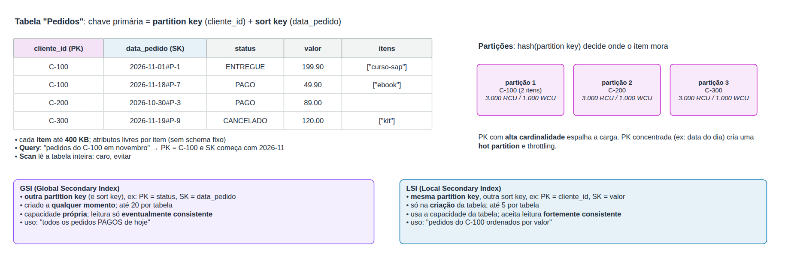
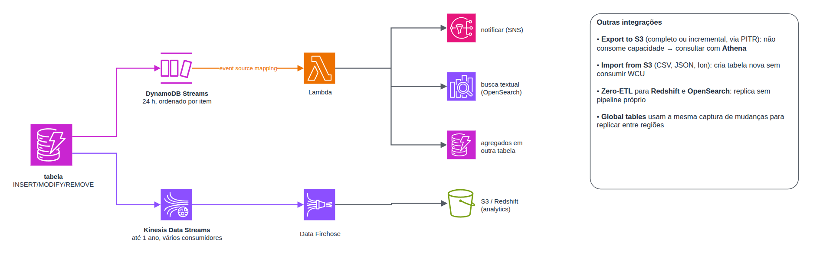
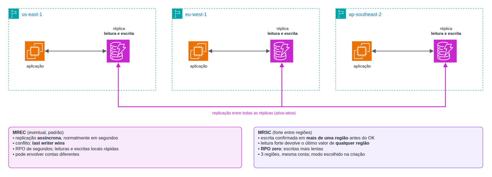
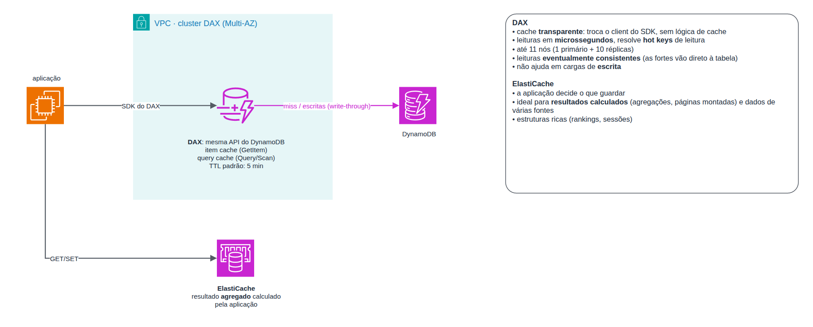
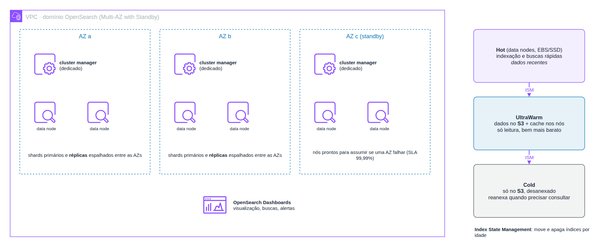
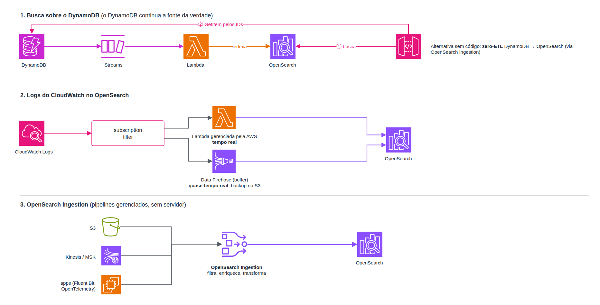
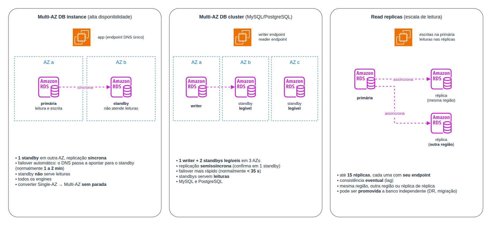
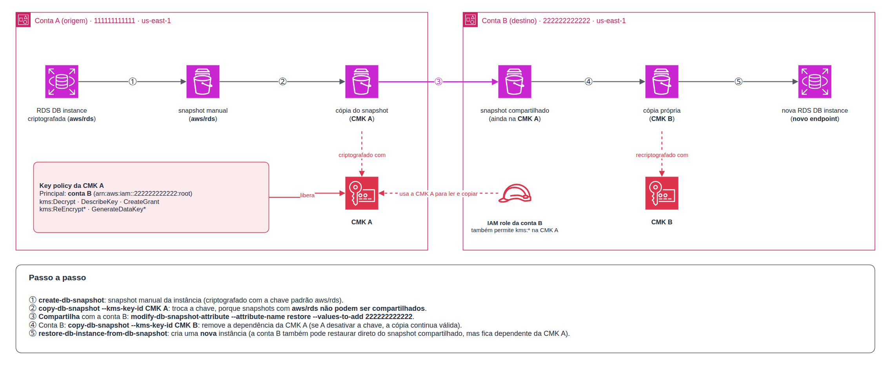
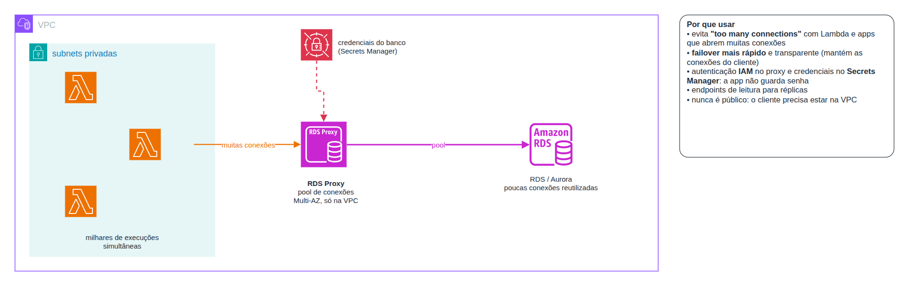
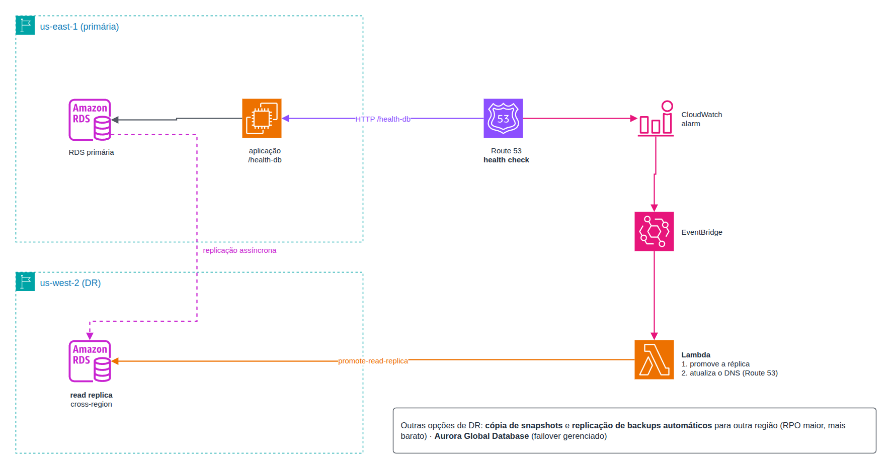

# Databases

> **Escopo:** _(em uma frase, o que este arquivo cobre)_
>
> **Por que cai na prova:** _(o ângulo que a SAP-C02 costuma explorar)_

## Índice

- **NoSQL:** [Amazon DynamoDB](#amazon-dynamodb)
- **Busca e análise:** [Amazon OpenSearch Service](#amazon-opensearch-service)
- **Relacional:** [Amazon RDS](#amazon-rds)
- **Revisão:** [Qual serviço usar](#revisão-qual-serviço-usar)

## Amazon DynamoDB

### Contexto: bancos relacionais e NoSQL

Os bancos **relacionais** (MySQL, PostgreSQL, Oracle, SQL Server) organizam os dados em **tabelas com schema fixo**, ligadas por **chaves estrangeiras**, e respondem a qualquer pergunta com **SQL e joins**. Essa flexibilidade de consulta tem um preço: o banco normalmente roda em **um servidor principal**, que precisa crescer verticalmente, e consultas complexas ficam mais lentas à medida que os dados aumentam. Escalar escritas para milhões de requisições por segundo exige particionar os dados à mão (*sharding*), o que é complexo.

Os bancos **NoSQL** partem do caminho inverso: abrem mão de joins e de consultas arbitrárias para **escalar horizontalmente**, distribuindo os dados entre muitos servidores pela **chave** de cada registro. Em troca, você precisa **modelar os dados a partir das consultas** que a aplicação fará. Existem vários tipos: chave-valor, documentos, colunas largas, grafos.

O **Amazon DynamoDB** é o banco NoSQL **chave-valor e de documentos**, **serverless**, da AWS. Ele entrega latência de **um dígito de milissegundo** em qualquer escala, sem servidores, versões ou patches para gerenciar. Na prova, ele aparece em cenários de **alta escala**, **serverless**, **sessões**, **dados de IoT e jogos**, **multi-região ativo-ativo** e sempre que o requisito é "**sem gerenciar infraestrutura**".

[↑ Índice](#índice)

### O que é o DynamoDB

- **Totalmente gerenciado e serverless:** não há instâncias, discos ou versões. Você cria uma **tabela** e escolhe o modo de capacidade.
- **Escala massiva:** tabelas com petabytes de dados e milhões de requisições por segundo, com desempenho **constante**.
- **Latência de um dígito de milissegundo**. Com o **DAX**, leituras em **microssegundos**.
- **Alta disponibilidade:** os dados são replicados automaticamente em **três AZs** da região. Com **global tables**, a disponibilidade chega a **99,999%**.
- **Sem armazenamento para provisionar:** a tabela cresce sozinha. Cada **item** tem até **400 KB**.
- **Recursos de banco:** leituras **eventualmente** ou **fortemente consistentes**, **transações ACID** entre itens e tabelas, escritas **condicionais**, **TTL**, **streams**, **backup** e **PITR**.
- **Acesso por API HTTPS** (via SDK), autenticado com **IAM**. Não há conexões persistentes nem pool de conexões, o que combina com **Lambda**.

[↑ Índice](#índice)

### Modelo de dados: tabelas, itens e chaves

- **Tabela:** um conjunto de **itens** (equivalente às linhas). Não há schema fixo além da chave primária: cada item pode ter **atributos** diferentes.
- **Tipos de atributo:**
  - **escalares:** String, Number, Binary, Boolean, Null;
  - **documentos:** List e Map (JSON aninhado);
  - **conjuntos:** String Set, Number Set, Binary Set.
- **Chave primária** (definida na **criação** e imutável):
  - **só partition key (hash key):** precisa ser **única** por item. Ex: `user_id` em uma tabela de usuários;
  - **partition key + sort key (range key):** a **combinação** é única. Os itens com a mesma partition key ficam **juntos e ordenados** pela sort key. Ex: `cliente_id` + `data_pedido` em uma tabela de pedidos.
- **Partições:** o DynamoDB aplica um **hash** na partition key para decidir em qual partição física o item fica. Cada partição suporta até **3.000 RCU e 1.000 WCU** e cerca de **10 GB**. Por isso, a partition key precisa ter **alta cardinalidade** e acessos **bem distribuídos**. Uma chave concentrada (ex: a data do dia, um status com poucos valores) cria uma **hot partition** e **throttling**, mesmo com capacidade sobrando na tabela.
- **Sort keys compostas** permitem consultas hierárquicas: `PAIS#BR#ESTADO#SP#CIDADE#Campinas` com `begins_with`.

> **Obs:** no DynamoDB, **a modelagem começa pelas consultas** (*access patterns*), não pelas entidades. Primeiro se lista o que a aplicação vai perguntar, depois se escolhem as chaves e os índices. Uma prática avançada é o **single-table design**, em que várias entidades (cliente, pedido, item do pedido) ficam **na mesma tabela**, com chaves que permitem buscar tudo de que a tela precisa em **uma única Query**.

[↑ Índice](#índice)

### Índices secundários

Na tabela, só é possível consultar pela **chave primária**. Para consultar por **outros atributos** sem ler a tabela inteira, criam-se índices:

| | **GSI (Global Secondary Index)** | **LSI (Local Secondary Index)** |
|---|---|---|
| Chave | **Outra partition key** (e, opcionalmente, outra sort key) | **Mesma partition key**, outra sort key |
| Quando criar | **A qualquer momento** | **Só na criação** da tabela |
| Quantidade | Até 20 por tabela | Até 5 por tabela |
| Capacidade | **Própria** (RCU/WCU do índice) | A **da tabela** |
| Consistência | Só **eventual** | Eventual ou **forte** |
| Limite de tamanho | Nenhum | 10 GB por valor de partition key |
| Exemplo | "Pedidos por **status**" (PK = status) | "Pedidos **do cliente** ordenados por **valor**" |

- **Projeção:** cada índice guarda os atributos escolhidos (só as chaves, alguns atributos ou todos). Projetar menos reduz custo; projetar o que a consulta precisa evita buscar o item na tabela.
- **Throttling em GSI:** se o GSI não tiver capacidade de escrita suficiente, as **escritas na tabela também sofrem throttling**. Dimensione os GSIs junto com a tabela.

[↑ Índice](#índice)

### Leitura, escrita e consistência

- **Operações de leitura:**
  - **GetItem:** um item pela chave primária completa. A mais barata e rápida;
  - **Query:** os itens de **uma partition key**, com filtro na sort key (`=`, `<`, `between`, `begins_with`). Eficiente;
  - **Scan:** lê **a tabela inteira** e filtra depois. **Caro e lento**: evitar em produção (no máximo com **parallel scan** para exportações pontuais, ou usar o **export para o S3**);
  - **BatchGetItem / BatchWriteItem:** várias operações em uma chamada;
  - **PartiQL:** sintaxe parecida com SQL, mas com as mesmas regras (sem joins).
- **Consistência de leitura:**
  - **eventual** (padrão): pode não refletir uma escrita feita há milissegundos. Custa **metade**;
  - **forte:** sempre devolve o último valor gravado. Só na **tabela e em LSIs**, na **mesma região**.
- **Escritas condicionais:** `PutItem`/`UpdateItem` com uma **condição** (ex: "só grave se o estoque for > 0" ou "se a versão ainda for 7"). Implementam **controle de concorrência otimista** sem locks.
- **Contadores atômicos:** `UpdateItem` com `ADD` incrementa um número sem ler antes.
- **Transações** (`TransactWriteItems`, `TransactGetItems`): **ACID** com até **100 ações** em várias tabelas, tudo ou nada. Ex: debitar o estoque e criar o pedido juntos. Custam **o dobro** de capacidade.

[↑ Índice](#índice)

### Capacidade: on-demand e provisionado

| | **On-demand** | **Provisionado** |
|---|---|---|
| Como funciona | Paga **por requisição** (read/write request units) | Você define **RCU e WCU** por segundo |
| Escala | **Automática e instantânea** para picos | **Auto Scaling** ajusta entre mínimo e máximo (reage em minutos) |
| Quando usar | Carga **imprevisível**, nova, com picos ou ociosa | Carga **previsível** e estável |
| Custo | Mais caro por requisição em uso constante | Mais barato em uso estável, ainda mais com **reserved capacity** |

- **Unidades de capacidade:**
  - **1 RCU** = 1 leitura **fortemente consistente** por segundo de até **4 KB**, ou **2 leituras eventuais**. Transacional = 2 RCU;
  - **1 WCU** = 1 escrita por segundo de até **1 KB**. Transacional = 2 WCU.
  - Exemplo: 100 leituras fortes/s de itens de 6 KB = 100 × ⌈6/4⌉ = **200 RCU**. Se forem eventuais: **100 RCU**.
- **Troca de modo:** é possível alternar entre on-demand e provisionado (com limite de frequência).
- **On-demand com teto:** dá para definir uma **vazão máxima** por tabela ou índice, para evitar custos descontrolados.
- **Warm throughput:** mostra quanto a tabela suporta **imediatamente**, e permite **pré-aquecer** a tabela antes de um pico conhecido (ex: lançamento, Black Friday).
- **Burst e adaptive capacity:** o DynamoDB guarda capacidade não usada por alguns minutos para picos curtos, e redistribui capacidade entre partições automaticamente. Isso **não resolve** uma partition key mal escolhida.
- Em **novembro de 2024**, a AWS reduziu o preço do **on-demand** em cerca de **50%**, o que o tornou o **padrão recomendado** para a maioria das cargas.

[↑ Índice](#índice)

### Classes de tabela e TTL

- **Classes de tabela:**
  - **Standard:** padrão, para tabelas com muito acesso;
  - **Standard-IA (Infrequent Access):** armazenamento **cerca de 60% mais barato**, com leituras e escritas mais caras. É usado em tabelas **grandes e pouco acessadas** (histórico, logs, dados antigos de aplicações).
- **TTL (Time to Live):** um atributo com uma data em formato **epoch**. Depois dela, o DynamoDB **apaga o item automaticamente**, **sem consumir WCU**, normalmente em até alguns dias. Itens expirados ainda podem aparecer em leituras até serem removidos, então a aplicação deve **filtrar** pela data. As exclusões por TTL aparecem no **stream**, o que permite **arquivar** os itens no S3 antes de sumirem.
- Usos do TTL: **sessões**, tokens temporários, dados de cache, eventos que só valem por um tempo.

[↑ Índice](#índice)

### DynamoDB Streams e integrações

- **DynamoDB Streams:** um registro ordenado (por item) de **cada mudança** na tabela (INSERT, MODIFY, REMOVE), com retenção de **24 horas**. A imagem gravada pode ser só a chave, a imagem **nova**, a **antiga** ou **ambas**.
  - Consumido principalmente por **Lambda** (event source mapping), para reagir a mudanças: enviar notificações, atualizar agregados, indexar no **OpenSearch**, replicar para outros sistemas;
  - também é a base das **global tables**.
- **Kinesis Data Streams for DynamoDB:** envia as mudanças para um **Kinesis Data Stream**, com retenção de **até 1 ano**, **vários consumidores** e integração com **Data Firehose** (S3, Redshift, OpenSearch) e **Managed Service for Apache Flink**. Não garante ordem nem deduplicação como o DynamoDB Streams.
- **Export to S3:** exporta a tabela (**completa** ou **incremental**, usando o PITR) em DynamoDB JSON ou Ion, **sem consumir capacidade**. Os dados podem ser consultados com **Athena** ou processados com Glue e EMR.
- **Import from S3:** cria uma **tabela nova** a partir de arquivos CSV, DynamoDB JSON ou Ion no S3, **sem consumir WCU**.
- **Zero-ETL:** integrações gerenciadas que replicam a tabela para o **Amazon Redshift**, o **OpenSearch Service** e o **SageMaker Lakehouse**, sem montar pipelines.

| Necessidade | Use |
|---|---|
| Reagir a mudanças com Lambda, em ordem por item | **DynamoDB Streams** |
| Retenção longa, vários consumidores, analytics em streaming | **Kinesis Data Streams for DynamoDB** |
| Analisar a tabela com SQL sem afetar a produção | **Export to S3** + Athena, ou **zero-ETL** para Redshift |
| Busca textual ou por vários atributos | **Zero-ETL** para OpenSearch (ou Streams + Lambda) |

[↑ Índice](#índice)

### Global tables

- Uma **global table** é a mesma tabela replicada em **várias regiões**. Cada réplica aceita **leituras e escritas** (**ativo-ativo**).
- **MREC (multi-Region eventual consistency)**, o modo padrão:
  - a replicação é **assíncrona**, normalmente em **segundos**;
  - conflitos de escrita no mesmo item em regiões diferentes são resolvidos por **last writer wins**;
  - réplicas podem estar em **contas diferentes**.
- **MRSC (multi-Region strong consistency):**
  - a escrita só é confirmada depois de gravada em **mais de uma região**, e uma leitura forte devolve o último valor de **qualquer região**;
  - **RPO zero**, à custa de escritas mais lentas;
  - usa **três regiões** (réplicas ou uma região "testemunha") na **mesma conta**.
- O modo é escolhido na **criação** e não pode ser alterado.
- Casos de uso: **baixa latência** para usuários globais, **DR** com RPO de segundos (ou zero) e RTO quase imediato, aplicações **multi-região ativo-ativo**.

> **Obs:** com **last writer wins**, se duas regiões alteram o mesmo item ao mesmo tempo, uma das escritas **se perde**. Para evitar isso no MREC, a aplicação pode **direcionar as escritas de cada item para uma região** (ex: por país do cliente) ou usar o **MRSC**.

[↑ Índice](#índice)

### Backup e recuperação

- **Backups on-demand:** cópias completas a qualquer momento, guardadas até você apagar. Não afetam o desempenho.
- **Point-in-time recovery (PITR):** backups **contínuos**, com restauração para **qualquer segundo** dentro de um período configurável de **1 a 35 dias**. Protege contra escritas ou exclusões acidentais.
- **A restauração sempre cria uma tabela nova** (inclusive em outra região, no caso do PITR e dos backups via AWS Backup). Depois, a aplicação é apontada para ela.
- **AWS Backup:** planos centralizados, **cópia entre regiões e contas**, **Vault Lock** (backups imutáveis) e armazenamento frio para retenção longa.
- **Deletion protection:** impede que a tabela seja apagada por engano até a proteção ser desligada.
- **Export to S3** também serve como cópia de longo prazo e para análise.

[↑ Índice](#índice)

### DynamoDB Accelerator (DAX)

- **Cache em memória gerenciado** e **compatível com a API do DynamoDB**: a aplicação troca o client do SDK pelo client do DAX, **sem escrever lógica de cache**.
- Leituras em **microssegundos**, com dois caches:
  - **item cache:** resultados de `GetItem` e `BatchGetItem`;
  - **query cache:** resultados de `Query` e `Scan`.
- **TTL padrão de 5 minutos**. As escritas passam pelo DAX até a tabela (**write-through**).
- Resolve **hot keys de leitura**: milhares de leituras por segundo no mesmo item não chegam à tabela.
- Cluster na **VPC**, com até **11 nós** (1 primário + 10 réplicas), **Multi-AZ** (3 nós no mínimo recomendado em produção), criptografia com KMS e acesso por IAM.
- **Limites:** leituras **fortemente consistentes** passam direto para a tabela (sem cache). O DAX **não acelera escritas** e não é útil para cargas com poucas leituras repetidas.

| | **DAX** | **ElastiCache** |
|---|---|---|
| Integração | **Transparente**, mesma API do DynamoDB | A aplicação decide o que guardar e quando invalidar |
| O que guarda | Itens e resultados de queries do DynamoDB | Qualquer dado: **agregações**, páginas montadas, dados de várias fontes |
| Quando usar | Acelerar leituras do DynamoDB **sem mudar a lógica** | Guardar **resultados calculados** ou dados que não vêm só do DynamoDB |

[↑ Índice](#índice)

### Segurança do DynamoDB

- **IAM:** toda requisição é autenticada e autorizada pelo IAM. **Fine-grained access control** restringe o acesso a **itens** e **atributos** específicos com condições:
  - `dynamodb:LeadingKeys` limita o usuário aos itens cuja partition key é o **próprio ID** (ex: `${cognito-identity.amazonaws.com:sub}`). É o padrão para apps móveis com **Cognito**, em que cada usuário só acessa seus dados;
  - `dynamodb:Attributes` limita quais **atributos** podem ser lidos ou alterados.
- **Resource-based policies:** políticas **na própria tabela**, no stream ou no índice, para dar acesso **entre contas** sem assumir role. São analisadas pelo **IAM Access Analyzer**.
- **Rede:**
  - **gateway endpoint** (gratuito) para acessar a partir da VPC sem internet;
  - **interface endpoint** (PrivateLink) para acesso de **on-premises** ou de outras VPCs.
- **Criptografia em repouso:** sempre ativa, com chave **AWS owned** (padrão, sem custo), **AWS managed** (`aws/dynamodb`) ou **customer managed key** (controle e auditoria da chave). **Em trânsito:** HTTPS.
- **Auditoria:** **CloudTrail** registra as operações de gerenciamento e, se habilitados, os **data events** (leituras e escritas de itens).

[↑ Índice](#índice)

### Padrões de arquitetura

- **Índice de metadados do S3:** o S3 não pesquisa objetos por atributos. Um **evento do S3** dispara uma **Lambda** que grava os metadados (cliente, data, tamanho, tags) no DynamoDB. A aplicação consulta o DynamoDB para listar objetos por data, somar o espaço usado por cliente ou filtrar por atributos.
- **Objetos grandes:** como o item tem até **400 KB**, o padrão é guardar o arquivo no **S3** e só a **referência** (chave do objeto) e os metadados no DynamoDB.
- **Backend serverless:** **API Gateway + Lambda + DynamoDB**, sem servidores e escalando de zero a milhões.
- **Sessões e estado:** sessões com **TTL**, carrinhos, perfis, preferências.
- **Event-driven:** **Streams + Lambda** para propagar mudanças (CQRS, auditoria, notificações).
- **Migração do Cassandra ou MongoDB:** o DynamoDB é uma opção (com remodelagem), mas para **manter a compatibilidade** existem o **Amazon Keyspaces** (Cassandra) e o **Amazon DocumentDB** (MongoDB).

[↑ Índice](#índice)

### Monitoramento e custo do DynamoDB

- **CloudWatch:**
  - **`ThrottledRequests`** / `ReadThrottleEvents` / `WriteThrottleEvents`: indicam capacidade insuficiente ou **hot partition**;
  - `ConsumedReadCapacityUnits` / `ConsumedWriteCapacityUnits` vs. o provisionado;
  - `SuccessfulRequestLatency`, `SystemErrors`, `UserErrors`;
  - `ReplicationLatency` nas global tables.
- **CloudWatch Contributor Insights:** mostra as **chaves mais acessadas** e as mais limitadas, para encontrar hot keys.
- **Custo:**
  - capacidade (on-demand por requisição; provisionado por hora de RCU/WCU, com **reserved capacity** de 1 ou 3 anos);
  - **armazenamento** por GB (mais barato na **Standard-IA**);
  - global tables (escritas replicadas), backups, PITR, streams lidos fora da Lambda, DAX, export/import.
- **Reduzir custo:**
  - **on-demand** para cargas variáveis e **provisionado + auto scaling + reserved** para cargas estáveis;
  - **Standard-IA** para tabelas grandes e pouco acessadas;
  - **TTL** para apagar dados velhos sem custo de escrita;
  - **leituras eventuais** quando possível (metade do custo);
  - projetar nos índices só os atributos necessários;
  - **evitar Scan**.

[↑ Índice](#índice)

### DynamoDB vs. outras opções

| Necessidade | Solução |
|---|---|
| Chave-valor ou documentos, escala massiva, latência baixa, **serverless** | **DynamoDB** |
| Consultas **SQL** flexíveis, **joins**, relatórios, schema relacional | **RDS / Aurora** |
| Leituras em **microssegundos** no DynamoDB sem mudar o código | **DAX** |
| Banco em memória **compatível com Redis/Valkey**, durável | **MemoryDB** |
| Compatibilidade com **MongoDB** | **DocumentDB** |
| Compatibilidade com **Cassandra** (CQL) | **Keyspaces** |
| **Busca textual**, filtros por muitos atributos, logs | **OpenSearch** (alimentado pelo DynamoDB) |
| Séries temporais (IoT, métricas) com funções de tempo | **Timestream** |
| Relações complexas (redes sociais, fraude) | **Neptune** (grafos) |

[↑ Índice](#índice)

### Dicas para a prova

- "Banco **serverless**, escala massiva, latência de milissegundos, **sem gerenciar servidores**" → **DynamoDB**.
- "Carga **imprevisível** ou com picos" → **on-demand**. "Carga estável e **menor custo**" → **provisionado + auto scaling + reserved capacity**.
- "**Throttling** mesmo com capacidade sobrando" → **hot partition**: escolher uma partition key com **alta cardinalidade** (ou adicionar sufixo aleatório, *write sharding*). Para hot keys de **leitura** → **DAX**.
- "Consultar por um atributo que não é a chave" → **GSI** (pode ser criado depois). "Mesma partition key, outra ordenação, com leitura forte" → **LSI** (só na criação).
- "Leituras em **microssegundos** sem alterar a lógica da aplicação" → **DAX**. "Guardar resultados **agregados**" → **ElastiCache**.
- "Apagar dados expirados automaticamente **sem custo de escrita**" → **TTL**.
- "Reagir a mudanças na tabela" → **DynamoDB Streams + Lambda**. "Retenção maior que 24 h ou vários consumidores" → **Kinesis Data Streams for DynamoDB**.
- "Aplicação **multi-região ativo-ativo**", "baixa latência global" ou "DR com RPO de segundos" → **global tables** (MREC). "**RPO zero** entre regiões" → **MRSC**.
- "Recuperar a tabela de uma exclusão ou escrita errada" → **PITR** (qualquer segundo, até 35 dias). "Backup entre **contas** ou imutável" → **AWS Backup**.
- "Analisar a tabela com SQL **sem impactar** a produção" → **Export to S3** + **Athena**, ou **zero-ETL** para Redshift.
- "Cada usuário do app móvel só acessa **seus próprios itens**" → **Cognito** + IAM com `dynamodb:LeadingKeys`.
- "Acessar a tabela a partir de subnet privada sem internet" → **gateway endpoint**. "De **on-premises**" → **interface endpoint**.
- "Guardar arquivos grandes" → **S3** com a referência no DynamoDB (item até 400 KB).
- "Pesquisar objetos do S3 por metadados" → **evento S3 → Lambda → DynamoDB**.
- "Operações que precisam ser **tudo ou nada** em vários itens" → **transações** (TransactWriteItems).
- "Tabela grande com pouco acesso, reduzir custo" → classe **Standard-IA**.
- "Migrar **Cassandra** mantendo CQL" → **Keyspaces**. "**MongoDB**" → **DocumentDB**.

[↑ Índice](#índice)

## Amazon OpenSearch Service

### Contexto: busca e análise de texto

Bancos relacionais e o DynamoDB são ótimos para buscar **pela chave** ou por filtros exatos, mas não para perguntas como:

- "produtos cujo nome ou descrição **contém** 'tênis corrida', ordenados por **relevância**, tolerando erros de digitação";
- "quantos erros **500** houve nos logs da última hora, agrupados por serviço";
- "os 10 documentos **mais parecidos** com esta pergunta" (busca semântica).

Um `LIKE '%tenis%'` em SQL varre a tabela inteira e não sabe ordenar por relevância. Os **motores de busca** resolvem isso com um **índice invertido**: para cada palavra, uma lista dos documentos que a contêm, já com o peso de cada ocorrência. Assim, buscas textuais e agregações sobre bilhões de documentos respondem em milissegundos.

O **Elasticsearch** se tornou o motor de busca mais popular, e o **OpenSearch** é o seu **fork open source**, mantido pela AWS e pela comunidade depois que o Elasticsearch mudou de licença. O **Amazon OpenSearch Service** é a versão **gerenciada** (o antigo "Amazon Elasticsearch Service"). Na prova, ele é a resposta para **busca textual**, **análise de logs** e **observabilidade**, e cada vez mais para **busca vetorial**.

[↑ Índice](#índice)

### O que é o OpenSearch Service

- **Motor de busca e análise** gerenciado, compatível com **OpenSearch** e com versões legadas do **Elasticsearch** (até 7.10).
- **Componentes:**
  - **OpenSearch:** guarda e indexa **documentos JSON** em **índices**, divididos em **shards** distribuídos pelos nós;
  - **OpenSearch Dashboards** (antigo Kibana): visualizações, buscas interativas, alertas e relatórios;
  - **ingestão:** **OpenSearch Ingestion** (pipelines gerenciados), **Data Firehose**, **Logstash**, **Fluent Bit**, Lambda.
- **Duas formas de uso:**
  - **domínios gerenciados:** você escolhe os **nós** (tipo, quantidade, armazenamento) e a AWS cuida da operação;
  - **OpenSearch Serverless:** **coleções** que escalam sozinhas, sem nós para dimensionar.
- **Casos de uso:**
  - **busca textual** em sites e aplicações (catálogo, documentos, autocomplete);
  - **análise de logs** e **observabilidade** (logs, métricas, traces);
  - **análise de segurança** (SIEM);
  - **clickstream** e análise em tempo real;
  - **busca vetorial** (k-NN) para **busca semântica**, recomendações e **RAG** com IA generativa.
- **Não é banco principal:** não tem transações nem garantias de consistência como um banco. O padrão é manter a **fonte da verdade** no DynamoDB, RDS ou S3 e **indexar uma cópia** no OpenSearch para busca.

[↑ Índice](#índice)

### Domínios gerenciados: arquitetura e escala

- **Data nodes:** guardam os shards e executam indexação e buscas. Escalam **horizontalmente** (mais nós) ou verticalmente.
- **Dedicated cluster manager nodes** (antigos *master nodes*): coordenam o cluster (estado, criação de índices, distribuição de shards), sem guardar dados. Recomendados em produção: **3**, em AZs diferentes, para evitar *split brain*.
- **Shards e réplicas:** cada índice é dividido em **shards primários**, e cada primário pode ter **réplicas** em outros nós. As réplicas dão **alta disponibilidade** e mais capacidade de **leitura**.
- **Multi-AZ:**
  - **2 ou 3 AZs**, com as réplicas distribuídas entre elas;
  - **Multi-AZ with Standby:** 3 AZs, uma delas em **standby**, pronta para assumir se outra falhar, com SLA de **99,99%**. É a configuração recomendada para produção crítica.
- **Camadas de armazenamento:**
  - **hot:** data nodes com EBS/SSD. Indexação e buscas rápidas, para dados **recentes**;
  - **UltraWarm:** dados no **S3** com cache nos nós. **Só leitura**, custo **bem menor**, para dados **mais antigos** ainda consultados;
  - **cold:** índices **desanexados**, guardados só no S3. Custo mínimo; precisam ser **reanexados** ao UltraWarm para consulta.
- **Index State Management (ISM):** políticas que **movem** índices entre as camadas e os **apagam** por idade ou tamanho. Ex: logs ficam 7 dias em hot, 90 em UltraWarm, 1 ano em cold, e depois são apagados.
- **Instâncias OR1/OR2:** guardam os dados de forma durável no **S3** e reduzem o custo de cargas com muita indexação (logs).
- **Mudanças de configuração** (tipo de nó, versão) usam **blue/green**: a AWS cria um novo conjunto de nós e migra os dados, sem indisponibilidade.

> **Obs:** a forma de reduzir o custo de **logs** no OpenSearch é a mesma ideia do lifecycle do S3: dados recentes em **hot**, antigos em **UltraWarm** e **cold**, com o **ISM** automatizando a passagem e a exclusão.

[↑ Índice](#índice)

### OpenSearch Serverless

- Em vez de nós, você cria **coleções** de um tipo:
  - **search:** busca textual em aplicações;
  - **time series:** logs e métricas;
  - **vector search:** embeddings para busca semântica e RAG. É o armazenamento vetorial padrão das **Bedrock Knowledge Bases**.
- A capacidade é medida em **OCUs** (OpenSearch Compute Units), separadas para **indexação** e **busca**, e escala **automaticamente**. Os dados ficam no **S3**.
- Não há nós, versões, shards ou camadas para gerenciar.
- **Quando usar:**
  - carga **variável** ou **imprevisível**;
  - times que querem **menos operação**;
  - busca vetorial para IA generativa.
- **Quando preferir domínios gerenciados:** carga **estável e grande** (custo menor com reserved instances), necessidade de **plugins** específicos, UltraWarm/cold, ou controle fino de configuração.

| | **Domínio gerenciado** | **Serverless** |
|---|---|---|
| Capacidade | Nós escolhidos por você | **OCUs** que escalam sozinhas |
| Operação | Dimensionar nós, shards, camadas | Mínima |
| Custo | Por hora de instância + EBS (reserved instances disponíveis) | Por OCU-hora + armazenamento no S3 |
| Ideal para | Cargas grandes e estáveis, controle fino | Cargas variáveis, vector search, menos operação |

[↑ Índice](#índice)

### Ingestão e padrões de arquitetura

- **Busca sobre o DynamoDB:** **DynamoDB Streams → Lambda → OpenSearch**. A aplicação **busca no OpenSearch**, recebe os IDs e **lê os itens completos no DynamoDB**, que continua a fonte da verdade. Hoje, a forma sem código é a integração **zero-ETL** DynamoDB → OpenSearch, via OpenSearch Ingestion.
- **Logs do CloudWatch no OpenSearch:** um **subscription filter** no log group envia os eventos:
  - para uma **Lambda gerenciada pela AWS**, em **tempo real**;
  - ou para o **Data Firehose**, em **quase tempo real** (com buffer, menos chamadas e **backup no S3**).
- **OpenSearch Ingestion:** pipelines **serverless** (baseados no Data Prepper) que recebem dados de **S3**, **Kinesis**, **MSK**, **HTTP**, **OpenTelemetry** e **Fluent Bit**, e **filtram, enriquecem e transformam** os dados antes de indexar. Substitui o Logstash autogerenciado.
- **Data Firehose:** entrega streams (inclusive do Kinesis Data Streams) para o OpenSearch, com buffer e backup no S3.
- **Logstash e Fluent Bit:** agentes de coleta de logs. O Logstash em EC2 é a opção **autogerenciada**, em que você decide retenção e formato.
- **Consultas diretas (direct query):** o OpenSearch consulta dados que ficam no **S3**, no **CloudWatch Logs** ou no **Security Lake** **sem copiá-los** para o cluster, útil para dados frios e investigações pontuais.
- **Aplicações relacionais:** **RDS/Aurora** → captura de mudanças (DMS, ou Debezium + MSK) → OpenSearch, para busca textual em dados relacionais.

[↑ Índice](#índice)

### Segurança do OpenSearch

- **Rede:** o domínio é criado **na VPC** (endpoint privado, com **security groups**) ou com **endpoint público**. A escolha é feita **na criação** e **não pode ser alterada**. Para produção, use a **VPC**.
- **Políticas de acesso:**
  - **resource-based policy** do domínio: quais principals IAM (ou IPs, no endpoint público) podem acessar;
  - **identity-based policies** no IAM.
- **Fine-grained access control:** usuários e **roles internos** com permissões por **índice**, **documento** e **campo**. Ex: o time de vendas só vê o índice de pedidos e sem o campo de CPF.
- **Login nos Dashboards:** **SAML** (Okta, Entra ID, Identity Center), **Amazon Cognito** ou usuários internos.
- **Criptografia:**
  - **em repouso** com KMS (definida na criação);
  - **node-to-node encryption** (TLS entre os nós);
  - **HTTPS obrigatório** para os clientes.
- **Auditoria:** **audit logs** (quem acessou o quê) enviados ao **CloudWatch Logs**, e chamadas de configuração no **CloudTrail**.

[↑ Índice](#índice)

### Backup, replicação e monitoramento

- **Snapshots automáticos:** a cada hora, guardados pela AWS por **14 dias**, para recuperar o domínio.
- **Snapshots manuais:** gravados em um **bucket S3 seu**. Servem para **migrar** entre domínios, **restaurar em outra região ou conta** e guardar por mais tempo.
- **Cross-cluster replication:** replica índices de um domínio **líder** para um domínio **seguidor** (ativo-passivo), inclusive em **outra região**. É usado para **DR** e para leituras com baixa latência em outras regiões.
- **Cross-cluster search:** uma busca consulta **vários domínios** de uma vez (ex: um domínio por região ou por unidade de negócio).
- **Monitoramento:**
  - métricas no **CloudWatch**: `ClusterStatus.red/yellow`, `FreeStorageSpace`, `JVMMemoryPressure`, CPU, latência de indexação e busca, `ThreadpoolWriteRejected`;
  - **slow logs**, **error logs** e **audit logs** no CloudWatch Logs;
  - **alertas** do próprio OpenSearch (alerting plugin) e **anomaly detection**.
- **Status do cluster:**
  - **red:** algum shard **primário** não está alocado; há dados indisponíveis;
  - **yellow:** algum shard de **réplica** não está alocado (comum em domínios com um só nó).

[↑ Índice](#índice)

### Custo do OpenSearch

- **Domínios gerenciados:** horas de **instância** (data nodes e cluster managers), **armazenamento EBS**, **UltraWarm** e **cold** (por GB no S3), transferência de dados. **Reserved instances** de 1 ou 3 anos dão desconto.
- **Serverless:** **OCU-horas** de indexação e busca + armazenamento no S3.
- **Reduzir custo:**
  - camadas **UltraWarm** e **cold** com **ISM** para dados antigos;
  - instâncias **OR1/OR2** ou **Graviton**;
  - **reserved instances** para cargas estáveis;
  - apagar ou reduzir **réplicas** de índices pouco críticos;
  - **direct query** em vez de indexar dados raramente consultados;
  - dimensionar **shards** corretamente (shards demais desperdiçam memória).

[↑ Índice](#índice)

### OpenSearch vs. outras opções

| Necessidade | Solução |
|---|---|
| **Busca textual** com relevância, autocomplete, filtros por vários campos | **OpenSearch** |
| **Análise e visualização de logs** com dashboards ricos, retenção e consultas flexíveis | **OpenSearch** (com UltraWarm/cold) |
| Logs de aplicações AWS com o **menor esforço**, consultas pontuais | **CloudWatch Logs + Logs Insights** |
| Consultar logs ou dados no **S3** com SQL, sem cluster | **Athena** |
| Data warehouse, **BI** e SQL analítico em grandes volumes estruturados | **Redshift** |
| Busca pela **chave** com latência baixa e escala massiva | **DynamoDB** |
| Banco transacional com SQL | **RDS / Aurora** |
| **Busca vetorial** para RAG | **OpenSearch Serverless** (vector), ou **Aurora PostgreSQL com pgvector**, **S3 Vectors** |
| SIEM e análise de segurança centralizada | **OpenSearch** (Security Analytics) ou **Security Lake** + ferramentas de análise |

[↑ Índice](#índice)

### Dicas para a prova

- "**Busca textual**", "pesquisar por qualquer campo", "busca parcial ou por relevância" → **OpenSearch**.
- "Pesquisar itens do **DynamoDB** por vários atributos ou texto" → **DynamoDB Streams + Lambda → OpenSearch** (ou **zero-ETL**), com o DynamoDB como fonte da verdade.
- "Enviar logs do **CloudWatch Logs** para o OpenSearch" → **subscription filter**: **Lambda** (tempo real) ou **Data Firehose** (quase tempo real, com backup no S3).
- "Ingestão de logs **sem gerenciar Logstash**" → **OpenSearch Ingestion**.
- "Dashboards de logs mais ricos que o CloudWatch" → **OpenSearch Dashboards**.
- "Reduzir custo de logs antigos no OpenSearch" → **UltraWarm** e **cold storage** com **ISM**.
- "Alta disponibilidade do domínio" → **Multi-AZ** (de preferência **with Standby**, 3 AZs) + **3 dedicated cluster manager nodes** + réplicas.
- "Domínio acessível só de dentro da AWS" → domínio **na VPC** (escolhido na criação, não muda depois).
- "Permissões por **índice, documento ou campo**" → **fine-grained access control**. "Login nos Dashboards com o IdP corporativo" → **SAML**.
- "DR do OpenSearch em outra região" → **cross-cluster replication** (ou snapshots manuais no S3 copiados para a outra região).
- "Busca sem dimensionar nós" ou "**vector store** para Bedrock/RAG" → **OpenSearch Serverless**.
- "Cluster **red**" → shard primário sem alocação (falta de espaço, nó perdido). "**JVMMemoryPressure** alta" → nós maiores ou menos shards.
- "Consultar logs no S3 sem indexar" → **Athena** ou **direct query** do OpenSearch.

[↑ Índice](#índice)

## Amazon RDS

### Contexto: banco relacional gerenciado

Um banco relacional em produção exige muito mais do que instalar o MySQL ou o PostgreSQL em um servidor. A equipe precisa cuidar de:

- **hardware e sistema operacional**, com patches e atualizações de versão do banco;
- **backups** diários, testes de restauração e retenção;
- **alta disponibilidade**: uma réplica em outro data center, pronta para assumir em caso de falha;
- **escala de leitura** com réplicas;
- **monitoramento**, criptografia, controle de acesso.

Rodar o banco em **EC2** dá controle total, mas deixa todo esse trabalho com você. O **Amazon RDS** (*Relational Database Service*) oferece os bancos relacionais mais usados como **serviço gerenciado**: você escolhe o engine, o tamanho da instância e o armazenamento, e a AWS cuida de provisionamento, patches, backups, failover e monitoramento. Você continua responsável pelo **schema**, pelas **consultas** e pelo **ajuste do banco**. Na prova, o RDS aparece em quase todo cenário de banco relacional: **alta disponibilidade**, **DR entre regiões**, **escala de leitura**, **criptografia**, **migração** e **conexões de Lambda**.

[↑ Índice](#índice)

### O que é o RDS

- **Engines:** **PostgreSQL**, **MySQL**, **MariaDB**, **Oracle**, **SQL Server** e **IBM Db2**. O **Aurora** (MySQL e PostgreSQL compatível) também faz parte da família RDS, mas tem arquitetura própria.
- **Instância de banco (DB instance):** uma classe de instância (ex: `db.r7g.large`) com armazenamento **EBS** anexado. Escala **verticalmente** trocando a classe (com breve indisponibilidade, ou sem, em Multi-AZ).
- **Armazenamento:** **gp3** (uso geral) ou **io2 Block Express** (IOPS provisionadas, para cargas críticas). O **storage autoscaling** aumenta o disco automaticamente quando o espaço livre fica baixo, até um limite que você define.
- **Na VPC:** a instância fica em um **DB subnet group** (subnets privadas, normalmente em várias AZs) e é protegida por **security groups**. A aplicação conecta pelo **endpoint DNS** da instância, não por IP.
- **O que você não tem:** acesso **SSH** ao servidor nem ao sistema operacional, e alguns recursos que exigem privilégios de administrador do sistema.
- **RDS Custom** (Oracle e SQL Server): RDS com **acesso ao sistema operacional** e ao banco como administrador, para aplicações legadas que exigem customizações (agentes, patches específicos, configurações do SO). A AWS ainda automatiza backups e monitoramento.
- **Manutenção:** patches e upgrades de **versão menor** acontecem na **janela de manutenção** que você define. Upgrades de **versão maior** são manuais. Versões fora do suporte padrão entram no **RDS Extended Support**, cobrado à parte.

[↑ Índice](#índice)

### Alta disponibilidade: Multi-AZ

- **Multi-AZ DB instance:**
  - uma instância **standby** em **outra AZ**, com replicação **síncrona** do armazenamento;
  - o standby **não atende leituras**: existe só para o **failover**;
  - em uma falha (instância, AZ, rede, armazenamento) ou em manutenções, o RDS faz o **failover automático**: o **endpoint DNS** passa a apontar para o standby, normalmente em **1 a 2 minutos**;
  - a aplicação só precisa **reconectar** (e não guardar o IP em cache);
  - disponível para **todos os engines**. Converter uma instância Single-AZ para Multi-AZ é feito **sem parada**: o RDS tira um snapshot, cria o standby a partir dele e sincroniza.
- **Multi-AZ DB cluster** (MySQL e PostgreSQL):
  - **1 writer + 2 standbys legíveis**, em **3 AZs**;
  - replicação **semissíncrona**: a escrita é confirmada quando pelo menos um standby a recebe;
  - **failover mais rápido** (normalmente abaixo de 35 segundos) e standbys que **servem leituras** por um **reader endpoint**;
  - usa armazenamento local mais rápido, com **menor latência de escrita** que o Multi-AZ instance.

> **Obs:** o **Multi-AZ** resolve **disponibilidade** dentro da região, não **escala de leitura** (no modelo de instância) nem **DR entre regiões**. Para leitura, use **read replicas**. Para outra região, use **réplica cross-region**, **cópia de backups** ou o **Aurora Global Database**.

[↑ Índice](#índice)

### Read replicas

- Cópias **somente leitura** da instância primária, atualizadas por replicação **assíncrona** (há **lag**, e as leituras são **eventualmente consistentes**).
- Até **15 réplicas** (MySQL, MariaDB, PostgreSQL; Oracle e SQL Server têm limites menores), cada uma com **seu próprio endpoint**.
- Podem estar na **mesma AZ**, em **outra AZ** ou em **outra região** (**cross-region**), e até ser **réplicas de réplicas** (MySQL, MariaDB).
- Uma réplica pode ter **Multi-AZ** própria e pode ser **promovida** a um banco **independente**, que passa a aceitar escritas e deixa de replicar. Usos: **DR**, **migração** para outra região, separar um ambiente.
- **Distribuir leituras entre réplicas:** como cada uma tem seu endpoint, a aplicação precisa escolher. Opções:
  - um **registro ponderado no Route 53** com os endpoints das réplicas e **health checks**;
  - um **RDS Proxy** com endpoint de leitura;
  - no **Aurora**, o **reader endpoint** já faz isso.
- **Custo de rede:** a replicação para réplicas **na mesma região** não tem custo de transferência. Para **outra região**, há cobrança de transferência entre regiões.
- Usos típicos: **relatórios** e consultas analíticas sem pesar na primária, **leituras** de aplicações com muito acesso, réplica de **DR** em outra região.

| | **Multi-AZ instance** | **Multi-AZ cluster** | **Read replica** |
|---|---|---|---|
| Objetivo | **Alta disponibilidade** | Alta disponibilidade + leituras | **Escala de leitura**, DR |
| Replicação | **Síncrona** | **Semissíncrona** | **Assíncrona** |
| Atende leituras | Não | Sim (2 standbys) | Sim |
| Failover | **Automático**, 1–2 min | **Automático**, < 35 s | **Manual** (promover) |
| Outra região | Não | Não | **Sim** |

[↑ Índice](#índice)

### Backup, snapshots e recuperação

- **Backups automáticos:**
  - um **snapshot diário** na janela de backup, mais os **logs de transação** enviados ao S3 a cada **5 minutos**;
  - **retenção de 1 a 35 dias** (0 desativa);
  - permitem o **point-in-time recovery (PITR)**: restaurar para **qualquer segundo** dentro da retenção, com perda máxima de cerca de 5 minutos;
  - são **apagados** junto com a instância, a menos que você os retenha.
- **Snapshots manuais:** feitos por você a qualquer momento e mantidos **até você apagar**. Usados antes de mudanças arriscadas e para guardar a longo prazo.
- **Toda restauração cria uma nova instância**, com **novo endpoint**. A aplicação precisa ser reapontada.
- **Cópia entre regiões e contas:**
  - **snapshots** podem ser **copiados** para outra região e **compartilhados** com outras contas;
  - a **replicação de backups automáticos** copia snapshots e logs para outra região, permitindo **PITR na região de DR**;
  - o **AWS Backup** centraliza os planos, a cópia entre regiões e contas e o **Vault Lock**.
- **Compartilhar snapshots criptografados:** só funciona com uma **customer managed key** (KMS), com a key policy liberando a conta de destino. Snapshots com a chave `aws/rds` **não podem ser compartilhados**: é preciso **copiá-los** antes, trocando para uma CMK. Detalhes da chave em [AWS KMS](security.md#aws-key-management-service-kms).

- **Backups nativos do engine:**
  - **SQL Server:** backup e restore **nativos** (`.bak`) de e para o **S3**, útil para migrar;
  - **MySQL:** importar um backup do **Percona XtraBackup** do S3 para criar uma instância;
  - **Oracle:** no RDS, use os **backups do RDS**. O **RMAN** pode gerar backups para restaurar **fora** do RDS, mas não para restaurar **dentro** dele.
- **Parar a instância:** é possível parar uma instância por até **7 dias** (paga só o armazenamento). Depois disso, ela **religa sozinha**. Para economizar por mais tempo, faça um **snapshot** e apague a instância.

[↑ Índice](#índice)

### Segurança do RDS

- **Rede:** subnets **privadas** e **security groups** liberando só a aplicação (ou o security group dela) na porta do banco. A opção **publicly accessible** deve ficar desligada em produção.
- **Criptografia em repouso** com **KMS**: cobre o armazenamento, os backups, os snapshots e as réplicas. É definida **na criação**. Para criptografar uma instância existente:
  1. snapshot;
  2. **cópia do snapshot com criptografia**;
  3. restaurar uma nova instância a partir da cópia;
  4. trocar o endpoint na aplicação.
- **TDE (Transparent Data Encryption)** no **Oracle** e no **SQL Server**: criptografia feita pelo próprio banco.
- **Em trânsito:** **TLS** em todos os engines. Pode ser **obrigatório** por parâmetro (ex: `rds.force_ssl` no PostgreSQL, `require_secure_transport` no MySQL).
- **Autenticação:**
  - **usuário e senha** do banco. A senha do usuário master pode ser **gerenciada pelo Secrets Manager** com **rotação automática** feita pelo próprio RDS. Ver [AWS Secrets Manager](security.md#aws-secrets-manager);
  - **autenticação IAM** (MySQL, MariaDB, PostgreSQL): a aplicação pede ao RDS um **token** (assinado com **SigV4**, válido por **15 minutos**) e o usa como senha, **sempre com TLS**. Centraliza os acessos no IAM e permite usar a **role** da EC2 ou da Lambda. A **autorização** (o que o usuário pode fazer no banco) continua sendo feita **pelo banco** (`GRANT`);
  - **Kerberos / Active Directory** (SQL Server, Oracle, MySQL, PostgreSQL) com o **AWS Managed Microsoft AD**.
- **Auditoria:**
  - o **CloudTrail** registra as **chamadas à API do RDS** (criar, modificar, apagar), **não as consultas SQL**;
  - para auditar as consultas, use os **logs do engine** (audit log, pgAudit) enviados ao **CloudWatch Logs**, ou o **Database Activity Streams** (Oracle, SQL Server e Aurora), que envia a atividade para o **Kinesis** em tempo quase real, fora do controle dos DBAs;
  - o **GuardDuty RDS Protection** detecta **logins anômalos**.

[↑ Índice](#índice)

### RDS Proxy

- Um **proxy gerenciado** entre a aplicação e o banco, que mantém um **pool de conexões** e as **reutiliza**.
- **Problema que resolve:** cada conexão a um banco relacional consome memória. Aplicações que abrem e fecham muitas conexões, especialmente **Lambda** (milhares de execuções simultâneas, cada uma com sua conexão), esgotam o limite e geram erros **"too many connections"**.
- **Benefícios:**
  - **pool de conexões** compartilhado, sem lógica de pool na aplicação;
  - **failover até 66% mais rápido** e transparente: o proxy mantém as conexões dos clientes enquanto o banco troca de instância;
  - **autenticação IAM** no proxy e **credenciais no Secrets Manager**: a aplicação não guarda senha;
  - **endpoints de leitura** para as réplicas.
- **Nunca é público:** fica na **VPC**. A Lambda precisa estar **na VPC** para usá-lo.
- Funciona com **RDS** (MySQL, MariaDB, PostgreSQL, SQL Server) e **Aurora**.

[↑ Índice](#índice)

### DR entre regiões

| Estratégia | RPO | RTO | Custo |
|---|---|---|---|
| **Cópia de snapshots** para outra região (manual, AWS Backup, DLM) | Horas (intervalo entre cópias) | Horas (restaurar) | Baixo |
| **Replicação de backups automáticos** para outra região | **Minutos** (PITR na região de DR) | Restaurar a instância | Baixo |
| **Read replica cross-region** + promoção | **Segundos** a minutos (lag) | **Minutos** (promover + DNS) | Instância extra |
| **Aurora Global Database** | ~1 segundo | **Minutos**, failover gerenciado | Maior |

**Automatizando o failover com uma read replica cross-region:**

1. Um **health check do Route 53** chama uma rota da aplicação que testa o banco (ex: `/health-db`), ou monitora um **alarme do CloudWatch**.
2. Quando o check falha, um **alarme do CloudWatch** dispara uma regra do **EventBridge** (ou um tópico SNS).
3. Uma **Lambda** **promove a réplica** (`promote-read-replica`) e **atualiza o DNS** no Route 53 para o novo endpoint.

> **Obs:** depois de promovida, a réplica é um banco **independente**. A antiga primária **não** volta automaticamente: para retornar à região original, é preciso criar uma nova réplica no sentido inverso.

[↑ Índice](#índice)

### Migração e integração

- **AWS DMS (Database Migration Service):** migra dados de bancos on-premises, EC2 ou outras nuvens para o RDS, com **carga completa + CDC** (captura de mudanças contínua), minimizando a parada. Com o **Schema Conversion Tool / DMS Schema Conversion**, também converte entre engines diferentes (ex: Oracle → PostgreSQL).
- **Ferramentas nativas:**
  - **MySQL/MariaDB:** `mysqldump` para exportar e importar, e **replicação por binlog** entre o RDS e um MySQL externo (on-premises ou EC2), em qualquer direção, para migrar com parada mínima;
  - **PostgreSQL:** `pg_dump` / `pg_restore` e **replicação lógica**;
  - **SQL Server:** backup nativo `.bak` via S3;
  - **Oracle:** Data Pump, ou **DMS**.
- **Oracle RAC** (*Real Application Clusters*) **não é suportado** no RDS. Para RAC, use **Oracle em EC2** (com gestão própria) ou o **Oracle Database@AWS**.
- **Blue/green deployments:** o RDS cria um ambiente **green** (cópia sincronizada por replicação) onde você aplica upgrade de versão, mudança de parâmetros ou de schema. A **troca** (*switchover*) leva normalmente **menos de um minuto**, sem mudar o endpoint, com **rollback** simples. É a resposta para **upgrades com parada mínima**.
- **Zero-ETL com o Redshift** (MySQL e PostgreSQL): replica os dados do RDS para o **Redshift** em quase tempo real, para análises, sem montar pipelines.
- **Eventos do RDS:** notificações de failover, backup, manutenção e mudanças de configuração, entregues ao **EventBridge** e ao **SNS**.

[↑ Índice](#índice)

### Monitoramento e custo do RDS

- **Monitoramento:**
  - **CloudWatch:** CPU, memória livre, IOPS, latência, `DatabaseConnections`, `FreeStorageSpace`, `ReplicaLag`;
  - **Enhanced Monitoring:** métricas do **sistema operacional** (processos, memória, CPU por núcleo) com granularidade de até 1 segundo;
  - **Performance Insights / CloudWatch Database Insights:** mostra as **consultas e esperas** que mais consomem o banco, para encontrar gargalos;
  - **logs do engine** (erro, slow query, auditoria) exportados para o **CloudWatch Logs**.
- **Custo:**
  - horas de **instância** (dobradas em Multi-AZ instance, porque o standby é cobrado);
  - **armazenamento** e IOPS provisionadas;
  - **backups** acima do tamanho do banco, snapshots manuais e cópias entre regiões;
  - transferência de dados entre regiões;
  - **Extended Support** para versões antigas.
- **Reduzir custo:**
  - **Reserved Instances** de 1 ou 3 anos para bancos estáveis;
  - instâncias **Graviton** (`db.r7g`, `db.m7g`);
  - **gp3** em vez de io2 quando as IOPS permitirem;
  - **parar** instâncias de desenvolvimento fora do horário (até 7 dias seguidos);
  - **rightsizing** com o Compute Optimizer e o Performance Insights;
  - **ElastiCache** ou read replicas antes de aumentar a primária.

[↑ Índice](#índice)

### RDS vs. outras opções

| Necessidade | Solução |
|---|---|
| Banco relacional gerenciado, engine comum, operação mínima | **RDS** |
| MySQL/PostgreSQL com mais desempenho, failover rápido, até 15 réplicas com reader endpoint, Global Database | **Aurora** |
| Acesso ao **SO**, customizações, Oracle/SQL Server legados | **RDS Custom** |
| **Oracle RAC** ou controle total do banco e do SO | **EC2** (ou Oracle Database@AWS) |
| Escala massiva chave-valor, serverless, sem joins | **DynamoDB** |
| Reduzir carga de leitura repetida | **ElastiCache** na frente do RDS |
| Muitas conexões (Lambda) | **RDS Proxy** |
| Análises e BI sobre os dados do RDS | **Zero-ETL para o Redshift**, ou export para o S3 + Athena |

[↑ Índice](#índice)

### Dicas para a prova

- "**Alta disponibilidade** do banco com failover automático" → **Multi-AZ**. "Failover em **segundos** e standbys que servem leitura" → **Multi-AZ DB cluster** (ou **Aurora**).
- "**Relatórios pesados** deixam a aplicação lenta" ou "escalar leituras" → **read replicas** (consistência eventual). Distribuir entre réplicas → **Route 53 ponderado** com health checks, ou **RDS Proxy**.
- "DR em outra região com RPO de segundos" → **read replica cross-region** + promoção (automatizada com Route 53 health check, CloudWatch, EventBridge e Lambda). "RPO de minutos e menor custo" → **replicação de backups automáticos**.
- "Restaurar o banco para **antes de um erro**" → **PITR** (cria uma **nova instância**, com novo endpoint).
- "Criptografar um banco **existente**" → snapshot → **cópia criptografada** → restaurar.
- "Compartilhar snapshot criptografado com outra conta" → **customer managed key** + key policy liberando a conta. Com `aws/rds`, copiar antes trocando a chave.
- "Lambda gera **too many connections**" → **RDS Proxy** (Lambda na VPC).
- "Acessar o banco **sem senha** na aplicação" → **autenticação IAM** (token de 15 min, TLS) ou **RDS Proxy** com IAM + Secrets Manager. "Rotacionar a senha do master" → **Secrets Manager** gerenciado pelo RDS.
- "Auditar **as consultas** SQL" → logs do engine no CloudWatch Logs ou **Database Activity Streams**. O **CloudTrail** só vê as chamadas de API.
- "**Upgrade de versão** com parada mínima e rollback" → **blue/green deployments**.
- "Precisa de **Oracle RAC**" → **EC2**, não RDS. "Acesso ao **sistema operacional** do banco" → **RDS Custom**.
- "Migrar com **parada mínima**" → **DMS** (carga completa + CDC) ou replicação nativa (binlog do MySQL).
- "Banco de dev parado à noite e nos fins de semana" → **parar a instância** (religa após 7 dias) ou **snapshot + apagar**.
- "Disco do banco enchendo sem intervenção" → **storage autoscaling**.

[↑ Índice](#índice)

## Revisão: qual serviço usar

Resumo das comparações que mais aparecem nas questões. Os detalhes estão nas seções de cada serviço.

### NoSQL (DynamoDB)

| Pergunta do cenário | Solução |
|---|---|
| Banco serverless, escala massiva, sem gerenciar servidores | [DynamoDB](#o-que-é-o-dynamodb) |
| Throttling com capacidade sobrando / modelar as chaves | [Partições e partition key](#modelo-de-dados-tabelas-itens-e-chaves) |
| Consultar por outro atributo / outra ordenação | [GSI / LSI](#índices-secundários) |
| Tudo ou nada em vários itens / evitar sobrescrita concorrente | [Transações / escritas condicionais](#leitura-escrita-e-consistência) |
| Carga imprevisível vs. estável | [On-demand vs. provisionado](#capacidade-on-demand-e-provisionado) |
| Apagar itens expirados / tabela grande pouco acessada | [TTL / Standard-IA](#classes-de-tabela-e-ttl) |
| Reagir a mudanças / analytics sem afetar produção | [Streams, Kinesis, export, zero-ETL](#dynamodb-streams-e-integrações) |
| Multi-região ativo-ativo / RPO zero | [Global tables MREC / MRSC](#global-tables) |
| Recuperar de exclusão acidental / backup entre contas | [PITR / AWS Backup](#backup-e-recuperação) |
| Leituras em microssegundos sem mudar o código | [DAX](#dynamodb-accelerator-dax) |
| Cada usuário só acessa seus itens / acesso privado | [LeadingKeys / VPC endpoints](#segurança-do-dynamodb) |
| DynamoDB, RDS, DocumentDB, Keyspaces ou OpenSearch? | [Comparação](#dynamodb-vs-outras-opções) |

[↑ Índice](#índice)

### Busca e análise (OpenSearch)

| Pergunta do cenário | Solução |
|---|---|
| Busca textual, relevância, filtros por vários campos | [OpenSearch](#o-que-é-o-opensearch-service) |
| Alta disponibilidade / custo de logs antigos | [Multi-AZ with Standby / UltraWarm, cold e ISM](#domínios-gerenciados-arquitetura-e-escala) |
| Sem dimensionar nós / vector store para RAG | [OpenSearch Serverless](#opensearch-serverless) |
| Buscar itens do DynamoDB / logs do CloudWatch no OpenSearch | [Streams + Lambda, zero-ETL / subscription filter](#ingestão-e-padrões-de-arquitetura) |
| Acesso privado / permissões por índice e campo / login SAML | [VPC / fine-grained access control / SAML](#segurança-do-opensearch) |
| DR em outra região / cluster red | [Cross-cluster replication, snapshots / monitoramento](#backup-replicação-e-monitoramento) |
| OpenSearch, CloudWatch Logs Insights, Athena ou Redshift? | [Comparação](#opensearch-vs-outras-opções) |

[↑ Índice](#índice)

### Relacional (RDS)

| Pergunta do cenário | Solução |
|---|---|
| Alta disponibilidade com failover automático / failover em segundos | [Multi-AZ instance / Multi-AZ cluster](#alta-disponibilidade-multi-az) |
| Escalar leituras / relatórios pesados | [Read replicas](#read-replicas) |
| Voltar para antes de um erro / snapshot criptografado para outra conta | [PITR / CMK + cópia](#backup-snapshots-e-recuperação) |
| Criptografar banco existente / acesso sem senha / auditar consultas | [Snapshot + cópia / IAM auth / Activity Streams](#segurança-do-rds) |
| Too many connections com Lambda | [RDS Proxy](#rds-proxy) |
| DR em outra região: RPO de segundos vs. minutos | [Read replica cross-region vs. backups replicados](#dr-entre-regiões) |
| Migrar com parada mínima / upgrade com rollback / Oracle RAC | [DMS / blue/green / EC2](#migração-e-integração) |
| RDS, Aurora, RDS Custom, EC2 ou DynamoDB? | [Comparação](#rds-vs-outras-opções) |

[↑ Índice](#índice)

[↑ Índice](#índice)
