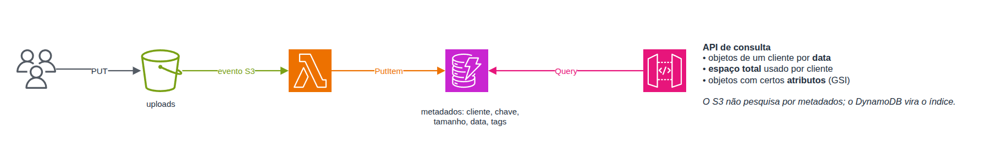

# Databases

> **Escopo:** _(em uma frase, o que este arquivo cobre)_
>
> **Por que cai na prova:** _(o ângulo que a SAP-C02 costuma explorar)_

## Índice

- **NoSQL:** [Amazon DynamoDB](#amazon-dynamodb)
- **Revisão:** [Qual serviço usar](#revisão-qual-serviço-usar)

## Amazon DynamoDB

### Contexto: bancos relacionais e NoSQL

Os bancos **relacionais** (MySQL, PostgreSQL, Oracle, SQL Server) organizam os dados em **tabelas com schema fixo**, ligadas por **chaves estrangeiras**, e respondem a qualquer pergunta com **SQL e joins**. Essa flexibilidade de consulta tem um preço: o banco normalmente roda em **um servidor principal**, que precisa crescer verticalmente, e consultas complexas ficam mais lentas à medida que os dados aumentam. Escalar escritas para milhões de requisições por segundo exige particionar os dados à mão (*sharding*), o que é complexo.

Os bancos **NoSQL** partem do caminho inverso: abrem mão de joins e de consultas arbitrárias para **escalar horizontalmente**, distribuindo os dados entre muitos servidores pela **chave** de cada registro. Em troca, você precisa **modelar os dados a partir das consultas** que a aplicação fará. Existem vários tipos: chave-valor, documentos, colunas largas, grafos.

O **Amazon DynamoDB** é o banco NoSQL **chave-valor e de documentos**, **serverless**, da AWS. Ele entrega latência de **um dígito de milissegundo** em qualquer escala, sem servidores, versões ou patches para gerenciar. Na prova, ele aparece em cenários de **alta escala**, **serverless**, **sessões**, **dados de IoT e jogos**, **multi-região ativo-ativo** e sempre que o requisito é "**sem gerenciar infraestrutura**".

[↑ Índice](#índice)

### O que é o DynamoDB

- **Totalmente gerenciado e serverless:** não há instâncias, discos ou versões. Você cria uma **tabela** e escolhe o modo de capacidade.
- **Escala massiva:** tabelas com petabytes de dados e milhões de requisições por segundo, com desempenho **constante**.
- **Latência de um dígito de milissegundo**. Com o **DAX**, leituras em **microssegundos**.
- **Alta disponibilidade:** os dados são replicados automaticamente em **três AZs** da região. Com **global tables**, a disponibilidade chega a **99,999%**.
- **Sem armazenamento para provisionar:** a tabela cresce sozinha. Cada **item** tem até **400 KB**.
- **Recursos de banco:** leituras **eventualmente** ou **fortemente consistentes**, **transações ACID** entre itens e tabelas, escritas **condicionais**, **TTL**, **streams**, **backup** e **PITR**.
- **Acesso por API HTTPS** (via SDK), autenticado com **IAM**. Não há conexões persistentes nem pool de conexões, o que combina com **Lambda**.

[↑ Índice](#índice)

### Modelo de dados: tabelas, itens e chaves

- **Tabela:** um conjunto de **itens** (equivalente às linhas). Não há schema fixo além da chave primária: cada item pode ter **atributos** diferentes.
- **Tipos de atributo:**
  - **escalares:** String, Number, Binary, Boolean, Null;
  - **documentos:** List e Map (JSON aninhado);
  - **conjuntos:** String Set, Number Set, Binary Set.
- **Chave primária** (definida na **criação** e imutável):
  - **só partition key (hash key):** precisa ser **única** por item. Ex: `user_id` em uma tabela de usuários;
  - **partition key + sort key (range key):** a **combinação** é única. Os itens com a mesma partition key ficam **juntos e ordenados** pela sort key. Ex: `cliente_id` + `data_pedido` em uma tabela de pedidos.
- **Partições:** o DynamoDB aplica um **hash** na partition key para decidir em qual partição física o item fica. Cada partição suporta até **3.000 RCU e 1.000 WCU** e cerca de **10 GB**. Por isso, a partition key precisa ter **alta cardinalidade** e acessos **bem distribuídos**. Uma chave concentrada (ex: a data do dia, um status com poucos valores) cria uma **hot partition** e **throttling**, mesmo com capacidade sobrando na tabela.
- **Sort keys compostas** permitem consultas hierárquicas: `PAIS#BR#ESTADO#SP#CIDADE#Campinas` com `begins_with`.

> **Obs:** no DynamoDB, **a modelagem começa pelas consultas** (*access patterns*), não pelas entidades. Primeiro se lista o que a aplicação vai perguntar, depois se escolhem as chaves e os índices. Uma prática avançada é o **single-table design**, em que várias entidades (cliente, pedido, item do pedido) ficam **na mesma tabela**, com chaves que permitem buscar tudo de que a tela precisa em **uma única Query**.

[↑ Índice](#índice)

### Índices secundários

Na tabela, só é possível consultar pela **chave primária**. Para consultar por **outros atributos** sem ler a tabela inteira, criam-se índices:

| | **GSI (Global Secondary Index)** | **LSI (Local Secondary Index)** |
|---|---|---|
| Chave | **Outra partition key** (e, opcionalmente, outra sort key) | **Mesma partition key**, outra sort key |
| Quando criar | **A qualquer momento** | **Só na criação** da tabela |
| Quantidade | Até 20 por tabela | Até 5 por tabela |
| Capacidade | **Própria** (RCU/WCU do índice) | A **da tabela** |
| Consistência | Só **eventual** | Eventual ou **forte** |
| Limite de tamanho | Nenhum | 10 GB por valor de partition key |
| Exemplo | "Pedidos por **status**" (PK = status) | "Pedidos **do cliente** ordenados por **valor**" |

- **Projeção:** cada índice guarda os atributos escolhidos (só as chaves, alguns atributos ou todos). Projetar menos reduz custo; projetar o que a consulta precisa evita buscar o item na tabela.
- **Throttling em GSI:** se o GSI não tiver capacidade de escrita suficiente, as **escritas na tabela também sofrem throttling**. Dimensione os GSIs junto com a tabela.

[↑ Índice](#índice)

### Leitura, escrita e consistência

- **Operações de leitura:**
  - **GetItem:** um item pela chave primária completa. A mais barata e rápida;
  - **Query:** os itens de **uma partition key**, com filtro na sort key (`=`, `<`, `between`, `begins_with`). Eficiente;
  - **Scan:** lê **a tabela inteira** e filtra depois. **Caro e lento**: evitar em produção (no máximo com **parallel scan** para exportações pontuais, ou usar o **export para o S3**);
  - **BatchGetItem / BatchWriteItem:** várias operações em uma chamada;
  - **PartiQL:** sintaxe parecida com SQL, mas com as mesmas regras (sem joins).
- **Consistência de leitura:**
  - **eventual** (padrão): pode não refletir uma escrita feita há milissegundos. Custa **metade**;
  - **forte:** sempre devolve o último valor gravado. Só na **tabela e em LSIs**, na **mesma região**.
- **Escritas condicionais:** `PutItem`/`UpdateItem` com uma **condição** (ex: "só grave se o estoque for > 0" ou "se a versão ainda for 7"). Implementam **controle de concorrência otimista** sem locks.
- **Contadores atômicos:** `UpdateItem` com `ADD` incrementa um número sem ler antes.
- **Transações** (`TransactWriteItems`, `TransactGetItems`): **ACID** com até **100 ações** em várias tabelas, tudo ou nada. Ex: debitar o estoque e criar o pedido juntos. Custam **o dobro** de capacidade.

[↑ Índice](#índice)

### Capacidade: on-demand e provisionado

| | **On-demand** | **Provisionado** |
|---|---|---|
| Como funciona | Paga **por requisição** (read/write request units) | Você define **RCU e WCU** por segundo |
| Escala | **Automática e instantânea** para picos | **Auto Scaling** ajusta entre mínimo e máximo (reage em minutos) |
| Quando usar | Carga **imprevisível**, nova, com picos ou ociosa | Carga **previsível** e estável |
| Custo | Mais caro por requisição em uso constante | Mais barato em uso estável, ainda mais com **reserved capacity** |

- **Unidades de capacidade:**
  - **1 RCU** = 1 leitura **fortemente consistente** por segundo de até **4 KB**, ou **2 leituras eventuais**. Transacional = 2 RCU;
  - **1 WCU** = 1 escrita por segundo de até **1 KB**. Transacional = 2 WCU.
  - Exemplo: 100 leituras fortes/s de itens de 6 KB = 100 × ⌈6/4⌉ = **200 RCU**. Se forem eventuais: **100 RCU**.
- **Troca de modo:** é possível alternar entre on-demand e provisionado (com limite de frequência).
- **On-demand com teto:** dá para definir uma **vazão máxima** por tabela ou índice, para evitar custos descontrolados.
- **Warm throughput:** mostra quanto a tabela suporta **imediatamente**, e permite **pré-aquecer** a tabela antes de um pico conhecido (ex: lançamento, Black Friday).
- **Burst e adaptive capacity:** o DynamoDB guarda capacidade não usada por alguns minutos para picos curtos, e redistribui capacidade entre partições automaticamente. Isso **não resolve** uma partition key mal escolhida.
- Em **novembro de 2024**, a AWS reduziu o preço do **on-demand** em cerca de **50%**, o que o tornou o **padrão recomendado** para a maioria das cargas.

[↑ Índice](#índice)

### Classes de tabela e TTL

- **Classes de tabela:**
  - **Standard:** padrão, para tabelas com muito acesso;
  - **Standard-IA (Infrequent Access):** armazenamento **cerca de 60% mais barato**, com leituras e escritas mais caras. É usado em tabelas **grandes e pouco acessadas** (histórico, logs, dados antigos de aplicações).
- **TTL (Time to Live):** um atributo com uma data em formato **epoch**. Depois dela, o DynamoDB **apaga o item automaticamente**, **sem consumir WCU**, normalmente em até alguns dias. Itens expirados ainda podem aparecer em leituras até serem removidos, então a aplicação deve **filtrar** pela data. As exclusões por TTL aparecem no **stream**, o que permite **arquivar** os itens no S3 antes de sumirem.
- Usos do TTL: **sessões**, tokens temporários, dados de cache, eventos que só valem por um tempo.

[↑ Índice](#índice)

### DynamoDB Streams e integrações

- **DynamoDB Streams:** um registro ordenado (por item) de **cada mudança** na tabela (INSERT, MODIFY, REMOVE), com retenção de **24 horas**. A imagem gravada pode ser só a chave, a imagem **nova**, a **antiga** ou **ambas**.
  - Consumido principalmente por **Lambda** (event source mapping), para reagir a mudanças: enviar notificações, atualizar agregados, indexar no **OpenSearch**, replicar para outros sistemas;
  - também é a base das **global tables**.
- **Kinesis Data Streams for DynamoDB:** envia as mudanças para um **Kinesis Data Stream**, com retenção de **até 1 ano**, **vários consumidores** e integração com **Data Firehose** (S3, Redshift, OpenSearch) e **Managed Service for Apache Flink**. Não garante ordem nem deduplicação como o DynamoDB Streams.
- **Export to S3:** exporta a tabela (**completa** ou **incremental**, usando o PITR) em DynamoDB JSON ou Ion, **sem consumir capacidade**. Os dados podem ser consultados com **Athena** ou processados com Glue e EMR.
- **Import from S3:** cria uma **tabela nova** a partir de arquivos CSV, DynamoDB JSON ou Ion no S3, **sem consumir WCU**.
- **Zero-ETL:** integrações gerenciadas que replicam a tabela para o **Amazon Redshift**, o **OpenSearch Service** e o **SageMaker Lakehouse**, sem montar pipelines.

| Necessidade | Use |
|---|---|
| Reagir a mudanças com Lambda, em ordem por item | **DynamoDB Streams** |
| Retenção longa, vários consumidores, analytics em streaming | **Kinesis Data Streams for DynamoDB** |
| Analisar a tabela com SQL sem afetar a produção | **Export to S3** + Athena, ou **zero-ETL** para Redshift |
| Busca textual ou por vários atributos | **Zero-ETL** para OpenSearch (ou Streams + Lambda) |

[↑ Índice](#índice)

### Global tables

- Uma **global table** é a mesma tabela replicada em **várias regiões**. Cada réplica aceita **leituras e escritas** (**ativo-ativo**).
- **MREC (multi-Region eventual consistency)**, o modo padrão:
  - a replicação é **assíncrona**, normalmente em **segundos**;
  - conflitos de escrita no mesmo item em regiões diferentes são resolvidos por **last writer wins**;
  - réplicas podem estar em **contas diferentes**.
- **MRSC (multi-Region strong consistency):**
  - a escrita só é confirmada depois de gravada em **mais de uma região**, e uma leitura forte devolve o último valor de **qualquer região**;
  - **RPO zero**, à custa de escritas mais lentas;
  - usa **três regiões** (réplicas ou uma região "testemunha") na **mesma conta**.
- O modo é escolhido na **criação** e não pode ser alterado.
- Casos de uso: **baixa latência** para usuários globais, **DR** com RPO de segundos (ou zero) e RTO quase imediato, aplicações **multi-região ativo-ativo**.

> **Obs:** com **last writer wins**, se duas regiões alteram o mesmo item ao mesmo tempo, uma das escritas **se perde**. Para evitar isso no MREC, a aplicação pode **direcionar as escritas de cada item para uma região** (ex: por país do cliente) ou usar o **MRSC**.

[↑ Índice](#índice)

### Backup e recuperação

- **Backups on-demand:** cópias completas a qualquer momento, guardadas até você apagar. Não afetam o desempenho.
- **Point-in-time recovery (PITR):** backups **contínuos**, com restauração para **qualquer segundo** dentro de um período configurável de **1 a 35 dias**. Protege contra escritas ou exclusões acidentais.
- **A restauração sempre cria uma tabela nova** (inclusive em outra região, no caso do PITR e dos backups via AWS Backup). Depois, a aplicação é apontada para ela.
- **AWS Backup:** planos centralizados, **cópia entre regiões e contas**, **Vault Lock** (backups imutáveis) e armazenamento frio para retenção longa.
- **Deletion protection:** impede que a tabela seja apagada por engano até a proteção ser desligada.
- **Export to S3** também serve como cópia de longo prazo e para análise.

[↑ Índice](#índice)

### DynamoDB Accelerator (DAX)

- **Cache em memória gerenciado** e **compatível com a API do DynamoDB**: a aplicação troca o client do SDK pelo client do DAX, **sem escrever lógica de cache**.
- Leituras em **microssegundos**, com dois caches:
  - **item cache:** resultados de `GetItem` e `BatchGetItem`;
  - **query cache:** resultados de `Query` e `Scan`.
- **TTL padrão de 5 minutos**. As escritas passam pelo DAX até a tabela (**write-through**).
- Resolve **hot keys de leitura**: milhares de leituras por segundo no mesmo item não chegam à tabela.
- Cluster na **VPC**, com até **11 nós** (1 primário + 10 réplicas), **Multi-AZ** (3 nós no mínimo recomendado em produção), criptografia com KMS e acesso por IAM.
- **Limites:** leituras **fortemente consistentes** passam direto para a tabela (sem cache). O DAX **não acelera escritas** e não é útil para cargas com poucas leituras repetidas.

| | **DAX** | **ElastiCache** |
|---|---|---|
| Integração | **Transparente**, mesma API do DynamoDB | A aplicação decide o que guardar e quando invalidar |
| O que guarda | Itens e resultados de queries do DynamoDB | Qualquer dado: **agregações**, páginas montadas, dados de várias fontes |
| Quando usar | Acelerar leituras do DynamoDB **sem mudar a lógica** | Guardar **resultados calculados** ou dados que não vêm só do DynamoDB |

[↑ Índice](#índice)

### Segurança do DynamoDB

- **IAM:** toda requisição é autenticada e autorizada pelo IAM. **Fine-grained access control** restringe o acesso a **itens** e **atributos** específicos com condições:
  - `dynamodb:LeadingKeys` limita o usuário aos itens cuja partition key é o **próprio ID** (ex: `${cognito-identity.amazonaws.com:sub}`). É o padrão para apps móveis com **Cognito**, em que cada usuário só acessa seus dados;
  - `dynamodb:Attributes` limita quais **atributos** podem ser lidos ou alterados.
- **Resource-based policies:** políticas **na própria tabela**, no stream ou no índice, para dar acesso **entre contas** sem assumir role. São analisadas pelo **IAM Access Analyzer**.
- **Rede:**
  - **gateway endpoint** (gratuito) para acessar a partir da VPC sem internet;
  - **interface endpoint** (PrivateLink) para acesso de **on-premises** ou de outras VPCs.
- **Criptografia em repouso:** sempre ativa, com chave **AWS owned** (padrão, sem custo), **AWS managed** (`aws/dynamodb`) ou **customer managed key** (controle e auditoria da chave). **Em trânsito:** HTTPS.
- **Auditoria:** **CloudTrail** registra as operações de gerenciamento e, se habilitados, os **data events** (leituras e escritas de itens).

[↑ Índice](#índice)

### Padrões de arquitetura

- **Índice de metadados do S3:** o S3 não pesquisa objetos por atributos. Um **evento do S3** dispara uma **Lambda** que grava os metadados (cliente, data, tamanho, tags) no DynamoDB. A aplicação consulta o DynamoDB para listar objetos por data, somar o espaço usado por cliente ou filtrar por atributos.
- **Objetos grandes:** como o item tem até **400 KB**, o padrão é guardar o arquivo no **S3** e só a **referência** (chave do objeto) e os metadados no DynamoDB.
- **Backend serverless:** **API Gateway + Lambda + DynamoDB**, sem servidores e escalando de zero a milhões.
- **Sessões e estado:** sessões com **TTL**, carrinhos, perfis, preferências.
- **Event-driven:** **Streams + Lambda** para propagar mudanças (CQRS, auditoria, notificações).
- **Migração do Cassandra ou MongoDB:** o DynamoDB é uma opção (com remodelagem), mas para **manter a compatibilidade** existem o **Amazon Keyspaces** (Cassandra) e o **Amazon DocumentDB** (MongoDB).

[↑ Índice](#índice)

### Monitoramento e custo do DynamoDB

- **CloudWatch:**
  - **`ThrottledRequests`** / `ReadThrottleEvents` / `WriteThrottleEvents`: indicam capacidade insuficiente ou **hot partition**;
  - `ConsumedReadCapacityUnits` / `ConsumedWriteCapacityUnits` vs. o provisionado;
  - `SuccessfulRequestLatency`, `SystemErrors`, `UserErrors`;
  - `ReplicationLatency` nas global tables.
- **CloudWatch Contributor Insights:** mostra as **chaves mais acessadas** e as mais limitadas, para encontrar hot keys.
- **Custo:**
  - capacidade (on-demand por requisição; provisionado por hora de RCU/WCU, com **reserved capacity** de 1 ou 3 anos);
  - **armazenamento** por GB (mais barato na **Standard-IA**);
  - global tables (escritas replicadas), backups, PITR, streams lidos fora da Lambda, DAX, export/import.
- **Reduzir custo:**
  - **on-demand** para cargas variáveis e **provisionado + auto scaling + reserved** para cargas estáveis;
  - **Standard-IA** para tabelas grandes e pouco acessadas;
  - **TTL** para apagar dados velhos sem custo de escrita;
  - **leituras eventuais** quando possível (metade do custo);
  - projetar nos índices só os atributos necessários;
  - **evitar Scan**.

[↑ Índice](#índice)

### DynamoDB vs. outras opções

| Necessidade | Solução |
|---|---|
| Chave-valor ou documentos, escala massiva, latência baixa, **serverless** | **DynamoDB** |
| Consultas **SQL** flexíveis, **joins**, relatórios, schema relacional | **RDS / Aurora** |
| Leituras em **microssegundos** no DynamoDB sem mudar o código | **DAX** |
| Banco em memória **compatível com Redis/Valkey**, durável | **MemoryDB** |
| Compatibilidade com **MongoDB** | **DocumentDB** |
| Compatibilidade com **Cassandra** (CQL) | **Keyspaces** |
| **Busca textual**, filtros por muitos atributos, logs | **OpenSearch** (alimentado pelo DynamoDB) |
| Séries temporais (IoT, métricas) com funções de tempo | **Timestream** |
| Relações complexas (redes sociais, fraude) | **Neptune** (grafos) |

[↑ Índice](#índice)

### Dicas para a prova

- "Banco **serverless**, escala massiva, latência de milissegundos, **sem gerenciar servidores**" → **DynamoDB**.
- "Carga **imprevisível** ou com picos" → **on-demand**. "Carga estável e **menor custo**" → **provisionado + auto scaling + reserved capacity**.
- "**Throttling** mesmo com capacidade sobrando" → **hot partition**: escolher uma partition key com **alta cardinalidade** (ou adicionar sufixo aleatório, *write sharding*). Para hot keys de **leitura** → **DAX**.
- "Consultar por um atributo que não é a chave" → **GSI** (pode ser criado depois). "Mesma partition key, outra ordenação, com leitura forte" → **LSI** (só na criação).
- "Leituras em **microssegundos** sem alterar a lógica da aplicação" → **DAX**. "Guardar resultados **agregados**" → **ElastiCache**.
- "Apagar dados expirados automaticamente **sem custo de escrita**" → **TTL**.
- "Reagir a mudanças na tabela" → **DynamoDB Streams + Lambda**. "Retenção maior que 24 h ou vários consumidores" → **Kinesis Data Streams for DynamoDB**.
- "Aplicação **multi-região ativo-ativo**", "baixa latência global" ou "DR com RPO de segundos" → **global tables** (MREC). "**RPO zero** entre regiões" → **MRSC**.
- "Recuperar a tabela de uma exclusão ou escrita errada" → **PITR** (qualquer segundo, até 35 dias). "Backup entre **contas** ou imutável" → **AWS Backup**.
- "Analisar a tabela com SQL **sem impactar** a produção" → **Export to S3** + **Athena**, ou **zero-ETL** para Redshift.
- "Cada usuário do app móvel só acessa **seus próprios itens**" → **Cognito** + IAM com `dynamodb:LeadingKeys`.
- "Acessar a tabela a partir de subnet privada sem internet" → **gateway endpoint**. "De **on-premises**" → **interface endpoint**.
- "Guardar arquivos grandes" → **S3** com a referência no DynamoDB (item até 400 KB).
- "Pesquisar objetos do S3 por metadados" → **evento S3 → Lambda → DynamoDB**.
- "Operações que precisam ser **tudo ou nada** em vários itens" → **transações** (TransactWriteItems).
- "Tabela grande com pouco acesso, reduzir custo" → classe **Standard-IA**.
- "Migrar **Cassandra** mantendo CQL" → **Keyspaces**. "**MongoDB**" → **DocumentDB**.

[↑ Índice](#índice)

## Revisão: qual serviço usar

Resumo das comparações que mais aparecem nas questões. Os detalhes estão nas seções de cada serviço.

[↑ Índice](#índice)

### NoSQL (DynamoDB)

| Pergunta do cenário | Solução |
|---|---|
| Banco serverless, escala massiva, sem gerenciar servidores | [DynamoDB](#o-que-é-o-dynamodb) |
| Throttling com capacidade sobrando / modelar as chaves | [Partições e partition key](#modelo-de-dados-tabelas-itens-e-chaves) |
| Consultar por outro atributo / outra ordenação | [GSI / LSI](#índices-secundários) |
| Tudo ou nada em vários itens / evitar sobrescrita concorrente | [Transações / escritas condicionais](#leitura-escrita-e-consistência) |
| Carga imprevisível vs. estável | [On-demand vs. provisionado](#capacidade-on-demand-e-provisionado) |
| Apagar itens expirados / tabela grande pouco acessada | [TTL / Standard-IA](#classes-de-tabela-e-ttl) |
| Reagir a mudanças / analytics sem afetar produção | [Streams, Kinesis, export, zero-ETL](#dynamodb-streams-e-integrações) |
| Multi-região ativo-ativo / RPO zero | [Global tables MREC / MRSC](#global-tables) |
| Recuperar de exclusão acidental / backup entre contas | [PITR / AWS Backup](#backup-e-recuperação) |
| Leituras em microssegundos sem mudar o código | [DAX](#dynamodb-accelerator-dax) |
| Cada usuário só acessa seus itens / acesso privado | [LeadingKeys / VPC endpoints](#segurança-do-dynamodb) |
| DynamoDB, RDS, DocumentDB, Keyspaces ou OpenSearch? | [Comparação](#dynamodb-vs-outras-opções) |

[↑ Índice](#índice)
