# Identity and Federation

> **Escopo:** _(em uma frase, o que este arquivo cobre)_
>
> **Por que cai na prova:** _(o ângulo que a SAP-C02 costuma explorar)_

## IAM (Identity and Access Management)

- **Usuários na AWS ->** possuem "long term credentials". Isso significa dizer que as credenciais dos usuários não possuem prazo de expiração e, uma vez criadas, permanecem válidas até que ocora a sua desativação;
- É possível criar agrupamentos para os usuários; 
- **Roles** são consideradas "short term credentials" e podem ser usadas por meio do serviço AWS Securit Service Token (AWS STS):
  - Justamente por serem utilizadas por meio do "assume role" via STS, as roles são temporárias (duram enquanto a operação realizar o assume role)
  - **Exemplos de roles:**
    - EC2 Instance Roles;
    - Service Roles (API Gateway, DynamoDB, S3);
    - Cross Account roles;
- **Policies ->** Servem para definir o que as roles são capazes de fazer. Elas permitem os níveis de acesso que uma role terá. Podem ser:
  - **AWS Managed:** Políticas gerenciadas pela própria AWS e servem para garantir que os usuários não façam nada além do permitido;
  - **Customer Managed:** Políticas gerenciadas pelo próprio cliente. São criadas e podem ser compartilhadas entre roles;
  - **Inline Policies:** Políticas "de linha" que estão associadas diretamenta a uma role em específico.

### Deep Dive em IAM Policies

Uma policy do IAM possui a estrutura de um JSON com os seguintes atributos:

  - **Effect:** Representa o efeito que aquela policy terá (permissiva ou restritiva). Marcado pelos valores "Allow" ou "Deny";
  - **Action:** Detalhas as ações que sofreção o efeito de allow ou deny (ex: ec2:AttachVolume);
  - **Resource:** Recurso(s) que está sendo impactado pela ação da policy (ex: arn de um serviço);
  - **Conditions:** Serve para filtrar ou criar condicionantes à aplicação da policy;
  - **Policy Variables:** Permite a atribuição de valores dinâmicos à policy por meio de variáveis.

> **Obs¹:** Uma boa prática na concepção de policies é o princípio do **least privilege** (menor privilégio), onde liberamos somente o que é necessário.

> **Obs²:** As actions de Deny possuem maior prioridade frente às actions de allow. Isso significa que o Deny sempre será atribuído primeiro. Dessa forma, cenários em que podem haver conflitos entre Deny e Allow devem ser analisados no detalhe de modo que seja escrita da maneira lógica que funcione.

**Funcionalidades Compĺementares à Policy**

Dentro do IAM podemos encontrar duas funcionalidades que nos ajudam no processo de análise e validação das permissões de roles e policies. São estas:

  - **AWS IAM Access Advisor:** Ferramenta de segurança da Amazon que permite analisar quais serviços um usuário, grupo, role ou policy têm acessos e quando foram utilizados pela última vez.
  - **AWS IAM Access Analyser:** Ferramenta de segurança que ajuda a definir, verificar e refinar permissões com base no princípio do menor privilégio

**IAM Policies Conditions**

As condicionantes nas policies possuem a seguinte estrutua:

```json
"Condition": {
    "{condition-operator}": {
        "{condition-key}": "{condition-value}"
      }
  }
```

Os operadores podem ser do seguinte tipo:

  - **String:** StringEquals, StringNotEquals, StringLike...
  - **Numeric:** NumericEquals, NumericNotEquals, NumericLessThan...
  - **Date:** DateEquals, DateNotEquals, DateLessThan...
  - **Boolean:** Bool (True or False).
  - **(Not)IpAddress:** Referência de Ip's.
  - **Referência de ARNs:** ArnEquals, ArnLike...
  - **Null:** É o operador que testa existência de chave — não o valor dela. É o único que faz isso diretamente.

### IAM Roles vs. Resource-Based Policies

Existem **dois caminhos** para conceder acesso a um recurso, sobretudo em cenários *cross-account*. A escolha entre eles é um dos temas mais cobrados na prova.

A diferença fundamental está em **o que acontece com a identidade do principal**:

  - **IAM Role (assume role):** o principal **abandona** temporariamente suas permissões originais e passa a operar com as permissões da role. É uma **troca de identidade** — durante a sessão, ele "vira" outra entidade;
  - **Resource-Based Policy:** o principal **mantém** suas próprias permissões e, adicionalmente, ganha acesso ao recurso. **Não há troca de identidade** — ele continua sendo quem era.

| | IAM Role | Resource-Based Policy |
|---|---|---|
| Onde é anexada | À identidade (usuário, grupo, role) | Ao próprio recurso (bucket, fila, função...) |
| Elemento `Principal` | Não possui (é implícito) | **Obrigatório** (define quem pode acessar) |
| Identidade do chamador | Substituída pela da role | Preservada |
| Chamada necessária | `sts:AssumeRole` | Nenhuma (acesso direto) |
| Suporte | Todos os serviços | Apenas alguns serviços |

**Por que a preservação da identidade importa**

Considere uma Lambda na **Conta A** que precisa ler um objeto no S3 da **Conta B** e, no mesmo processamento, gravar no DynamoDB da **Conta A**:

  - **Com assume role:** ao assumir a role da Conta B, a função perde as permissões da Conta A e não consegue mais gravar no DynamoDB. Seria necessário alternar entre as credenciais;
  - **Com resource-based policy:** o bucket da Conta B autoriza diretamente a role da Lambda. A função acessa os dois recursos na mesma execução, sem trocar de credencial.

> **Decisão:** quando o workload precisa acessar recursos de **duas contas simultaneamente**, a resource-based policy é a resposta. O assume role serve quando a operação ocorre inteiramente dentro da conta de destino.

**Regra de avaliação**

  - **Mesma conta:** basta que **uma** das políticas (identity-based **ou** resource-based) conceda o Allow;
  - **Cross-account:** é necessário Allow nos **dois lados** — na identity-based policy do principal (Conta A) **e** na resource-based policy do recurso (Conta B). Um lado sozinho não é suficiente.

**Serviços que suportam resource-based policies**

S3 (bucket policy), SQS, SNS, Lambda, KMS (key policy), Secrets Manager, EFS, ECR, API Gateway, CloudWatch Logs, EventBridge, SES, Backup Vault, CodeArtifact e VPC Endpoints (endpoint policy). O DynamoDB passou a suportar a partir de 2024.

Serviços como **EC2 e RDS não possuem** resource-based policies — nesses casos, o acesso cross-account só é possível via assume role.

> **Pegadinha:** a **trust policy** de uma role é, tecnicamente, uma resource-based policy — é ela que possui o elemento `Principal` e define **quem pode assumir** a role. Não confundir com a permissions policy, que define **o que a role pode fazer**.

> **Pegadinha:** no **KMS**, a key policy é obrigatória e tem precedência. Uma IAM policy concedendo `kms:Decrypt` **não funciona sozinha** se a key policy não delegar essa autoridade à conta (via `"Principal": {"AWS": "arn:aws:iam::<account-id>:root"}`).

## IAM Access Analyzer

Serviço dentro do IAM Console que permite localizar quais recursos estão sendo compartilhados externamente. Definimos as "Zones of Trust" que podem ser aplicadas às AWS Accounts ou AWS Organizations. Quaisquer acessos fora dessas zonas de segurança serão apontados como "findings".

Além disso, essa funcionalidade também é capaz de realizar a validação de policies e também gerar policies com base nos logs que são gerados via CloudTrail. Por exemplo: podemos ter uma lambda que acessa um bucket s3 e realiza chamada ao kinesis. O IAM Access Analyzer Policy Generation então é capaz de analisar os logs do cloudtrail nos últimos 90 dias para gerar uma policy com base nos acessos que a lambda executa.

## AWS Security Token Service (STS)

Serviço da AWS que permite com que seja feita o assume role entre diferentes contas, mesmas contas e também realizar o processo de Identity Federation. O proceso de utilização do STS para assume role pode ser descrito da seguinte maneira:

- Definição de uma IAM Role para acesso na mesma conta ou via cross-account;
- Definição de quais principals podem acessar essa role;
- Uso do AWS STS para realizar o retrieve de credenciais para realização do assume role;
- O grant de credenciais temporárias pode durar entre 15 minutos até 12 horas.

*Obs: O processo para efetuar o uso da role é feito via "AssumeRole API", funcionalidade a qual interage com o STS. O STS por sua vez realiza a validação se as permissões para assumir aquela role são válidas. Um vez válida, retorna as credenciais de segurança temporárias.

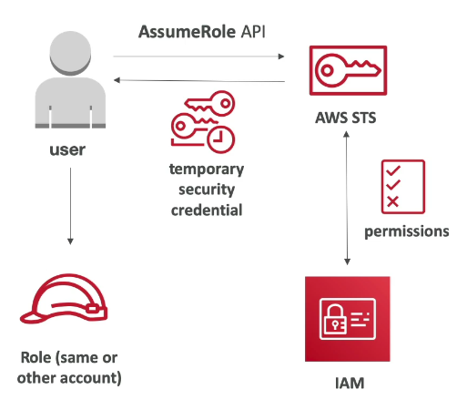

### Cenários em que podemos utilizar o Assume Role via STS

- Providenciar o acesso de um usuário IAM em uma conta AWS aos recursos de em outra conta;
- Providenciar o acesso de usuários terceiros à conta AWS;
- Liberar acesso aos serviços da AWS para recursos da prórpria AWS.
- Providenciar acesso para usuários externos autenticados (identify federation)

## Identity Federation & Cognito

- Principais conceitos: 
  - Faz com que usuários de fora da AWS tenham acesso aos recursos na sua conta.
  - Não é preciso criar IAM Users (usuários são gerenciados fora da AWS)

- Casos de uso:
  - Uma empresa possui um provedor de identidade externo (ex: Microsoft EntraID)
  - Aplicações Web/Mobile que necessitam acessar recursos da conta AWS

### Fluxo do Identity Federation

O processo de acesso aos recursos em uma conta AWS por meio de um provedor de identidade externo ocorre da seguinte maneira:

1. O Provedor de Identidade (ex: AD, EntraID) realiza o "trust relationship" com a AWS;
2. Usuários efetuam o Login no provedor de identidade;
3. O provedor retorna as credenciais temporárias de acesso aos usuários;
4. Os usuários utilizam as credenciais temporárias fornecidas para realizar o acesso à AWS

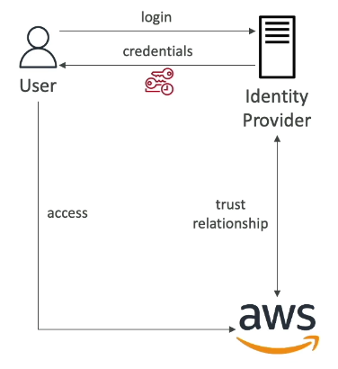 

A comunicação do Identity Federation pode ser realizada por meio de:

- SAML 2.0;
- Customer Identity Broker;
- Web Identity Federation With(out) Amazon Cognito;
- IAM Identity Center

#### Conexão via SAMl 2.0

SAML 2.0 (Security Assertion Markup Language) é um padrão aberto, baseado em XML, para trocar dados de autenticação e autorização entre duas partes. É o protocolo que viabiliza o SSO (Single Sign-On) corporativo: o usuário faz login uma vez no IdP da empresa e acessa vários sistemas (AWS, Salesforce, Office 365...) sem digitar a senha de novo. Foi publicado pela OASIS em 2005.

Este padrão permite aplicar o Identity Federation com diversos IdP's que possuam o suporte ao SAML 2.0. O processo é representado pelas seguintes etapas:

1. Usuários realizam a autenticação no IdP;
2. O IdP realiza a autenticação no LDAP-based Identity Store;
3. É retornado o SAML Assertion ao usuário;
4. O usuário realiza o **AssumeRoleWithSAML** no AWS Security Service Token (STS)
5. O STS retorna as credenciais de acesso temporário ao usuário;
6. O usuário realiza o acesso aos recuros/console da conta por meio das credenciais;

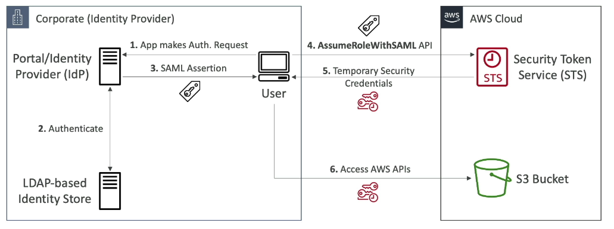 

### Usando o Cognito

É possível realizar a integração do Identity Federation na AWS com e sem o Cognito.

> **Mas atenção!** Atualmente a AWS **não** recomenda mais o cenário sem o Cognito.

A opção antiga (não recomendada) sem o Cognito consiste basicamente na utilização de um 3ʳᵈ Party Identity Provider como, por exemplo, Google, Facebook ou qualquer OpenID Connect compatível com IdP.

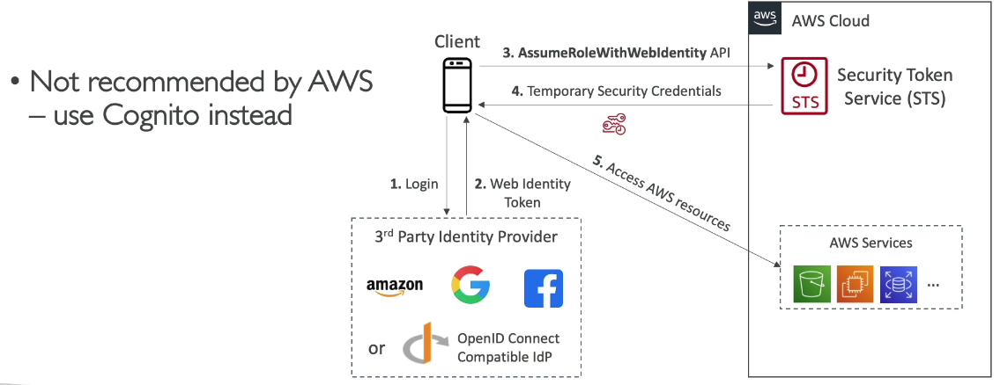 

Para o cenário recomendado, a diferença principal está na utilização do Cognito como intermediador após o processo de autenticação no 3ʳᵈ Party Identity Provider. O Cognito é capaz de criar uma camada de abstração e segurança entre o dispositivo móvel/web e os recursos na AWS. Sua principal função é gear um token que deve ser utilizado em conjunto com o STS.

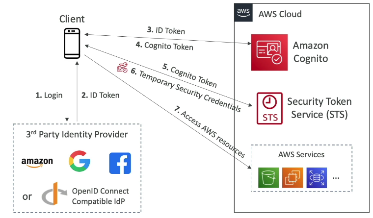 

## AWS Directory Services

Este serviço está fortemente relacionado com o serviço fornecido pela Microsoft chamado "Microsoft Active Directory" ou popularmente conhecido como AD. Em resumo, o AD é:

- Encontrado em qualquer Windows Server que possua o AD Domain Services;
- Um banco de dados de "objetos" que podem representar usuários, contas, computadores, impressoras, File Shares, Security Groups, etc;
- Uma forma de realizar a gestão de segurança centralizada, criação de contas, associação de políticas e permissões, etc;
- Os objetos são organizados em "trees" e o conjunto de "trees" é chamado de "forest".

A gestão dos objetos dentro do AD é realizada por meio do Domain Controller, cuja responsabilidade é ser o servidor que roda o AD DS (Active Directory Domain Services). Ele guarda a base de identidades do domínio e responde por toda autenticação e autorização dentro dele. Na prática, "o AD" que os clientes e aplicações acessam é um ou mais DCs.

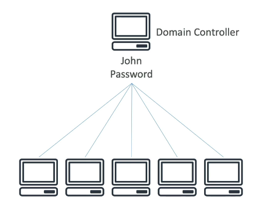 

### AD Federation Service (ADFS)

O ADFS é o serviço da microsoft que permite a integração Sigle Sign-On entre aplicações e o Active Directory. Além disso, também permite realizar a integração via SAML entre sistemas terceiros (ex: AWS, Dropbox, Office365, etc).

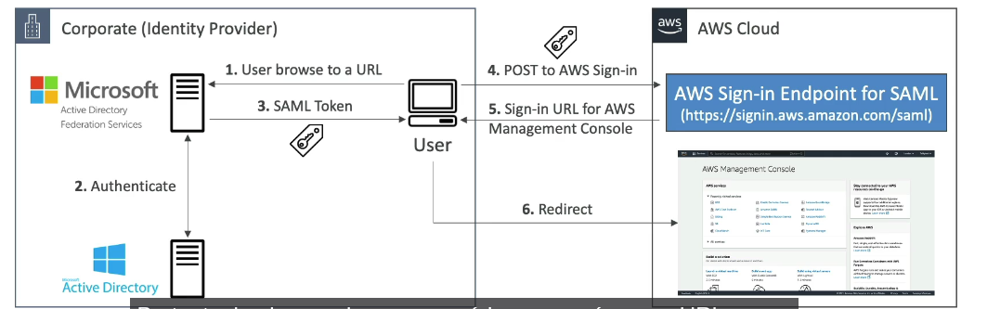 

### Tipos de AWS Directory Services

O AWS Directory Service tem três tipos principais: **AWS Managed Microsoft AD, AD Connector e Simple AD.**

#### AWS Managed Microsoft AD

Um **Active Directory real (Windows Server)** gerenciado pela AWS.

- Provisiona **2 Domain Controllers em AZs diferentes**, e você pode adicionar mais. A AWS cuida de patching, backup, replicação e monitoramento.
- Tem duas edições:
  - **Standard:** até cerca de 30 mil objetos.
  - **Enterprise:** até cerca de 500 mil objetos. Suporta **multi-Region replication.**
- Suporta **trust** (one-way ou two-way, forest ou external) com o **AD on-premises**. Os usuários continuam on-prem e acessam recursos na AWS.
- Suporta MFA via **RADIUS, LDAPS**, extensões de schema e **compartilhamento do diretório com outras contas**.
- Você **não tem Domain Admin**. Recebe um grupo de administração delegada.
- Integrações: **RDS for SQL Server, FSx for Windows, WorkSpaces, IAM Identity Center**, QuickSight, seamless domain join de EC2 etc.

**Quando usar:** você precisa de um AD de verdade na AWS, quer trust com o AD on-prem ou quer que a autenticação **funcione mesmo se o link com o datacenter cair.**

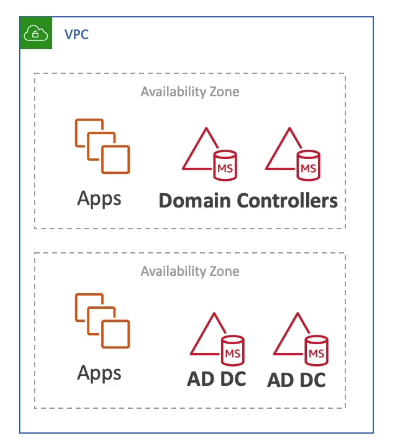 

**Integrações Possíveis no AWS Managed Microsoft AD**

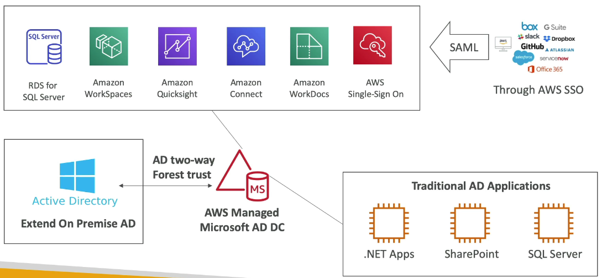

**Conexão com On Premises AD**: A conexão com o AD que se encontra na rede interna (On Premises) de uma empresa com o AWS Managed Microsoft AD pode ocorrer por meio de duas formas:

- VPN Site-to-Site;
- AWS Direct Connect.

Neste processo, temos 3 tipos de trust's possíveis:

- **One-way trust:** AWS -> On-Premise
- **One-way trust:** On-Premise -> AWS
- **Two-way trust:** AWS <-> On-Premise

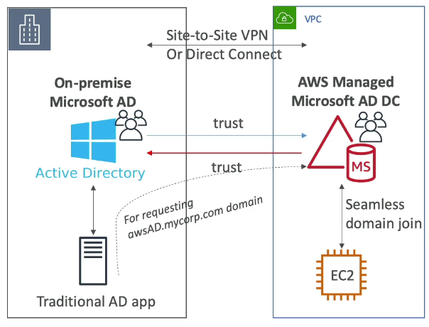

#### AD Connector

Um **proxy** (gateway) que redireciona as requisições para o **AD on-premises existente.**

- **Não armazena nem faz cache** de nada na AWS. Toda autenticação vai para os DCs on-prem.
- Exige **VPN ou Direct Connect**. Se o link cair, a autenticação para.
- Tamanhos: **Small e Large**, que definem a capacidade de requisições e não um limite rígido de usuários.
- Suporta MFA via **RADIUS** on-prem.
- **Não suporta trust** e não é um diretório "de verdade".
- Integrações: **IAM Identity Center, WorkSpaces**, console da AWS, seamless domain join de EC2. **Não funciona com RDS for SQL Server**, que exige Managed AD.

**Quando usar:** os usuários devem continuar **só no AD on-prem**, sem sincronizar ou replicar nada para a AWS, e com **o menor esforço possível.**

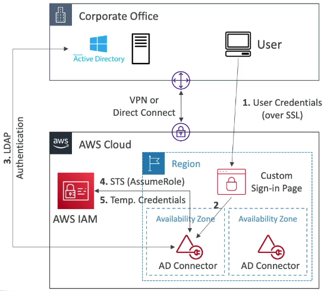

#### Simple AD

Um **diretório leve e barato, compatível com AD**, baseado em **Samba 4.**

- Tamanhos: **Small** (até cerca de 500 usuários) e **Large** (até cerca de 5 mil usuários).
- Suporta usuários, grupos, Kerberos, GPOs básicas e domain join de EC2.
- **Não suporta** trust com outros domínios, **MFA**, extensões de schema e várias integrações (RDS SQL Server e IAM Identity Center, por exemplo).

**Quando usar:** um ambiente pequeno, **standalone** na AWS, que precisa de recursos básicos de AD e onde o **custo** é o principal critério.

## AWS Organizations

O AWS Organizations permite **gerenciar múltiplas contas AWS de forma centralizada**, a partir de uma única organização. Além de organizar as contas, ele oferece **faturamento consolidado** e **políticas centralizadas** (como as SCPs) para governar o que cada conta pode fazer.

#### Estrutura

- **Root:** o contêiner de nível mais alto da organização. Ele abriga todas as contas e OUs. Políticas aplicadas no Root valem para toda a organização.
- **Organizational Units (OUs):** agrupamentos lógicos de contas, criados conforme a necessidade da empresa. Uma OU pode conter contas e outras OUs (até **5 níveis** de aninhamento abaixo do Root). As políticas aplicadas a uma OU são **herdadas** pelas contas e OUs abaixo dela.
- **Management Account:** a conta que cria e administra a organização. É responsável por criar ou convidar contas, gerenciar OUs e políticas e pagar a fatura consolidada. Ela **não é afetada por SCPs**, por isso a boa prática é não executar workloads nela.
- **Member Accounts:** as demais contas da organização. Cada conta pertence a **uma única organização** e fica no Root ou em **uma única OU** por vez.

Exemplos de estratégias de agrupamento em OUs:

- **Por ambiente:** dev, hom e prod
- **Por domínio de negócio:** RH, Financeiro, Marketing etc.
- **Por função:** Security (contas de log e auditoria), Infrastructure (rede compartilhada), Workloads, Sandbox

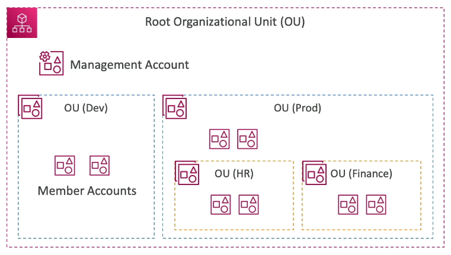


#### Organization Account Access Role

Para que uma Management Account consiga ter o controle sobre as Members Accounts, ela realiza o processo de Assume Role nas contas a qual estão debaixo de sua hierarquia.

Cada conta criada possui uma role chamada "OrganizationAccountAccessRole" que garante as permissões de admistrador à conta Management que realizou o assume dessa role.

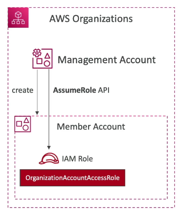

### Organizations Policies

O AWS Organizations permite aplicar **políticas centralizadas** no **Root**, em **OUs** ou em **contas** específicas. Essas políticas são **herdadas** pelos níveis abaixo de onde foram anexadas.

> **Obs:** Cada tipo de política precisa ser **habilitado no Root** antes do uso, e a organização precisa estar com **All features** habilitado (não apenas Consolidated Billing).

Os tipos de política se dividem em dois grupos:

| Grupo | Tipo | O que controla |
|---|---|---|
| **Authorization policies** | Service Control Policies (SCP) | Permissões máximas dos **principals** (users e roles) das contas |
| | Resource Control Policies (RCP) | Permissões máximas sobre os **recursos** das contas |
| **Management policies** | Declarative Policies | Configuração base obrigatória de serviços (ex: EC2, VPC, EBS) |
| | Backup Policies | Planos do AWS Backup aplicados em todas as contas |
| | Tag Policies | Padronização de tags |
| | AI Services Opt-out Policies | Uso dos seus dados pelos serviços de IA da AWS |
| | Chat Applications Policies | Acesso via Amazon Q Developer in chat applications (antigo AWS Chatbot) |

> **Obs:** A AWS adiciona novos tipos de política com frequência. Vale conferir a documentação para a lista atualizada.

#### Service Control Policies - SCP

A SCP define as **permissões máximas** disponíveis para os users e roles de uma conta. Ela **não concede permissões**: funciona como um **guardrail**. Para uma ação ser permitida, ela precisa ser liberada **tanto pela SCP quanto pela policy IAM** do principal.

**Nível de aplicabilidade**
- Root (toda a organização)
- Organizational Unit (OU)
- Conta

**Estratégias**
- **Deny list (blocklist):** mantém a SCP padrão `FullAWSAccess` e adiciona SCPs com `Deny` para o que deve ser bloqueado. É a estratégia mais comum e de menor manutenção.
- **Allow list:** remove a `FullAWSAccess` e libera explicitamente apenas os serviços e ações permitidos. Para uma ação ser permitida, ela precisa estar liberada em **todos os níveis** da hierarquia (Root → OU → conta).

> **Obs:** Um `Deny` explícito em qualquer nível da hierarquia **sempre prevalece**.

**Quem é afetado**
- Todos os users e roles das member accounts, **incluindo o Root User** da conta.
- **Não** afeta a **Management Account**, que precisa manter acesso completo para administrar a organização.
- **Não** afeta **service-linked roles**.

Casos de uso comuns:

- Restringir o uso de determinados serviços (ex: bloqueio do EMR)
- Garantir aderência a padrões como PCI, desabilitando serviços não conformes em uma conta
- Restringir as regiões permitidas (condition `aws:RequestedRegion`)
- Impedir que as contas saiam da organização (`organizations:LeaveOrganization`)
- Impedir a desativação de serviços de segurança (CloudTrail, GuardDuty, Config)
- Exigir tags na criação de recursos (condition `aws:RequestTag`)

Exemplo de SCP que restringe as regiões permitidas:

```json
{
  "Version": "2012-10-17",
  "Statement": [{
    "Sid": "DenyOutsideAllowedRegions",
    "Effect": "Deny",
    "NotAction": ["iam:*", "organizations:*", "sts:*", "support:*"],
    "Resource": "*",
    "Condition": {
      "StringNotEquals": {
        "aws:RequestedRegion": ["us-east-1", "sa-east-1"]
      }
    }
  }]
}
```

> **Obs:** Serviços globais (IAM, Organizations, STS etc.) ficam no `NotAction` porque seus endpoints ficam em `us-east-1`.

#### Resource Control Policies - RCP

A RCP é o "espelho" da SCP para **recursos**. Ela define as **permissões máximas sobre os recursos** das member accounts, **independentemente de quem faz a requisição**, inclusive principals de **fora da organização**.

- Assim como a SCP, **não concede permissões**. A política padrão é a `RCPFullAWSAccess`, e na prática as RCPs são usadas com `Deny`.
- Suporta um conjunto específico de serviços (ex: S3, STS, KMS, SQS, Secrets Manager).
- **Não** afeta recursos da **Management Account** nem de service-linked roles.

**Caso de uso principal:** construir um **data perimeter**. Por exemplo: "nenhum bucket S3 da organização pode ser acessado por principals de fora da organização", mesmo que alguém configure uma bucket policy pública por engano.

| | SCP | RCP |
|---|---|---|
| Limita | O que os **meus principals** podem fazer | O que pode ser feito **nos meus recursos** |
| Protege contra | Usuários internos fazendo o que não devem | Acesso externo indevido aos recursos |

#### Declarative Policies

Definem uma **configuração base obrigatória** para um serviço em todas as contas. A configuração é aplicada no **control plane** do serviço e continua valendo mesmo quando o serviço lança novas APIs ou funcionalidades.

Exemplos (EC2, VPC e EBS):
- Exigir **IMDSv2** nas instâncias EC2
- Bloquear o compartilhamento público de **AMIs** e **snapshots EBS**
- Aplicar o **VPC Block Public Access**
- Restringir quais AMIs podem ser usadas (**Allowed AMIs**)

> **Obs:** Diferente da SCP, que bloqueia **chamadas de API**, a declarative policy garante o **estado da configuração**. É possível definir uma mensagem de erro customizada para os usuários.

#### Backup Policies

Permitem criar e aplicar **planos do AWS Backup** (frequência, retenção, vault, cópia cross-region/cross-account) de forma centralizada em todas as contas da organização.

**Caso de uso:** garantir que todos os recursos com uma tag (ex: `backup=diario`) sejam copiados seguindo a mesma política, sem configurar conta a conta.

#### Tag Policies

Padronizam as **tags** usadas na organização: chaves permitidas, **capitalização** (ex: `CostCenter` vs `costcenter`) e **valores permitidos**.

- Geram **relatórios de conformidade** das tags dos recursos.
- Podem ser **enforced** para tipos de recurso específicos, bloqueando operações de tagging fora do padrão.

> **Obs:** A tag policy **não obriga** que um recurso tenha uma tag. Para exigir tags na criação de um recurso, use uma **SCP** com a condition `aws:RequestTag`.

#### AI Services Opt-out Policies

Por padrão, alguns serviços de IA da AWS (ex: Rekognition, Comprehend, Transcribe, Lex) podem armazenar e usar o conteúdo processado para melhorar os serviços. Esta política faz o **opt-out** desse uso para **todas as contas** da organização de uma vez.

**Caso de uso:** requisitos de **privacidade e compliance** (ex: LGPD) que proíbem o uso dos dados da empresa para treinar os serviços da AWS.

#### Chat Applications Policies

Controlam o acesso às contas via **Amazon Q Developer in chat applications** (antigo AWS Chatbot) a partir de ferramentas como Slack e Microsoft Teams. Por exemplo: quais workspaces podem ser usados e quais permissões são permitidas.

## AWS IAM Identity Center (Sucessor do AWS Single Sign-On)

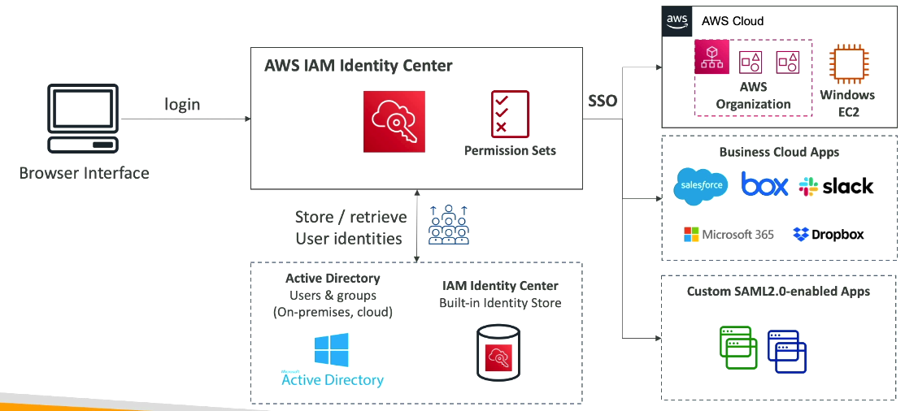

O IAM Identity Center é o serviço **recomendado pela AWS para gerenciar o acesso da força de trabalho** (funcionários, terceiros) a **múltiplas contas AWS** e **aplicações** a partir de um único lugar. O usuário faz login **uma única vez** no **AWS access portal** e vê todas as contas, roles e aplicações a que tem acesso (Single Sign-On).

Ele é integrado ao **AWS Organizations**. Em vez de configurar federação SAML **conta a conta** (um IAM Identity Provider e várias roles em cada conta), a trust relationship com o IdP é configurada **uma única vez** no Identity Center, que cuida de criar as roles nas contas.

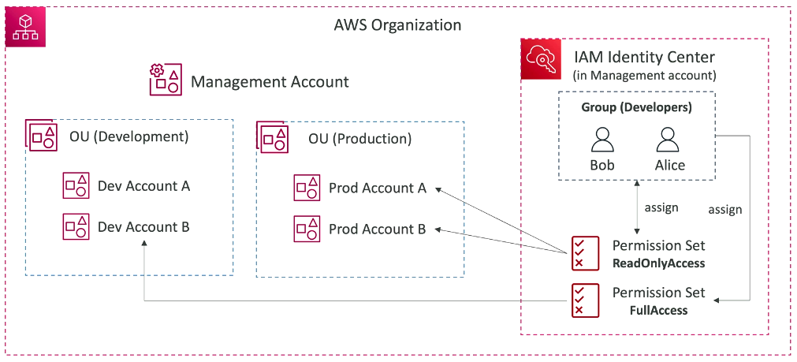

#### Identity Source

É de onde vêm os usuários e grupos. Só é possível ter **uma identity source por vez**:

- **Identity Center directory:** diretório interno do próprio serviço. Usuários e grupos são criados direto no Identity Center. Indicado para ambientes sem IdP corporativo.
- **Active Directory:** um AD via **AWS Managed Microsoft AD** ou um AD on-premises via **AD Connector**. Usuários e grupos são sincronizados a partir do AD.
- **External IdP:** Okta, Entra ID, Ping, Google Workspace etc. A autenticação é feita via **SAML 2.0**, e o provisionamento de usuários e grupos é feito via **SCIM**.

> **Obs:** O **SCIM** (*System for Cross-domain Identity Management*) sincroniza automaticamente usuários e grupos do IdP externo para o Identity Center. Sem ele, os usuários precisam ser criados manualmente no Identity Center (com o mesmo username do IdP).

#### Permission Sets

Um permission set é um **modelo de permissões** (AWS managed policies, customer managed policies, inline policy e permissions boundary) que define o que o usuário pode fazer em uma conta.

- Quando um permission set é atribuído a uma conta, o Identity Center **cria automaticamente uma IAM Role** nela, com o nome `AWSReservedSSO_<PermissionSet>_<hash>`.
- Essa role confia no Identity Center (via SAML provider criado na conta). **Não se deve editar essas roles manualmente**: qualquer alteração deve ser feita no permission set.
- Define a **duração da sessão** (de 1 a 12 horas).

> **Obs:** Para usar **customer managed policies** em um permission set, a policy precisa existir **com o mesmo nome em cada conta** de destino.

#### Assignments

O acesso é concedido por meio de uma **atribuição** que combina três elementos:

**Usuário ou Grupo** + **Permission Set** + **Conta AWS**

Exemplo: o grupo `Devs` recebe o permission set `PowerUserAccess` nas contas `dev` e `hom`, e o permission set `ReadOnlyAccess` na conta `prod`.

> **Boa prática:** atribuir permissões a **grupos**, e não a usuários individuais.

#### Aplicações

Além das contas AWS, o Identity Center também oferece SSO para aplicações:

- **AWS managed applications:** QuickSight, Amazon Q, SageMaker Studio, Redshift etc.
- **Aplicações SAML 2.0 de terceiros:** Salesforce, Microsoft 365, Slack etc.
- **Aplicações customizadas** compatíveis com SAML 2.0 ou OAuth 2.0.

> **Obs:** O **Trusted Identity Propagation** permite que a identidade do usuário do Identity Center seja repassada entre serviços (ex: do QuickSight para o Redshift ou o Lake Formation). Assim, o acesso aos dados é auditado e controlado **por usuário**, e não por role.

#### ABAC (Attribute-Based Access Control)

O Identity Center pode repassar **atributos do usuário** (ex: departamento, centro de custo, cargo), vindos da identity source, como **session tags**. As policies dos permission sets podem usá-los em conditions com `aws:PrincipalTag`.

Isso permite ter **um único permission set** cujas permissões variam conforme o atributo do usuário. Por exemplo, cada usuário só acessa os recursos com a tag `CostCenter` igual à sua.

#### Outros pontos importantes

- **Organization instance vs. Account instance:** a instância de organização é criada na management account e gerencia o acesso a todas as contas. A instância de conta é criada em uma conta isolada e serve apenas para aplicações AWS (não gerencia acesso a contas).
- **Delegated administrator:** a administração do Identity Center pode ser delegada a uma **member account**. É uma boa prática evitar o uso da management account no dia a dia.
- **MFA:** pode ser exigido no próprio Identity Center ou ficar a cargo do IdP externo.
- **CLI:** a AWS CLI v2 suporta login via `aws sso login`, com credenciais temporárias e sem access keys de longo prazo.
- **Auditoria:** as ações feitas com os permission sets aparecem no CloudTrail com a identidade do usuário no `RoleSessionName` da role `AWSReservedSSO_*`.

#### Dicas para a prova

- "Funcionários precisam acessar **várias contas** da Organization com **SSO** e **menor esforço operacional**" → **IAM Identity Center**.
- "A empresa já usa **Okta / Entra ID** e quer **sincronizar automaticamente** usuários e grupos" → External IdP via **SAML 2.0 + SCIM**.
- "Usar o **AD on-premises** existente como fonte de identidade" → Identity Center + **AD Connector** (ou AWS Managed AD com trust).
- "Permissões devem variar conforme o **departamento** do usuário, sem criar um permission set para cada um" → **ABAC** com atributos do usuário.
- "Federação SAML direto no IAM de cada conta" ainda é válida, mas em cenários multi-account o Identity Center é a resposta preferida.

## AWS Control Tower

O AWS Control Tower é a forma mais simples de **criar e governar um ambiente multi-account** seguindo as **boas práticas da AWS**. Ele cria automaticamente uma **landing zone**: uma estrutura base de contas, OUs, logs centralizados, controle de acesso e políticas de segurança.

O Control Tower **não substitui** os outros serviços: ele os **orquestra**. Por baixo, ele usa:

- **AWS Organizations:** contas, OUs e políticas (SCPs, RCPs)
- **IAM Identity Center:** acesso dos usuários às contas
- **AWS CloudTrail e AWS Config:** auditoria e conformidade dos recursos
- **AWS Service Catalog e CloudFormation StackSets:** provisionamento padronizado de contas e recursos
- **Amazon S3:** armazenamento centralizado dos logs

#### Landing Zone

Ao configurar o Control Tower, ele cria a seguinte estrutura:

- **Management Account:** a conta onde o Control Tower é configurado. Ela administra a landing zone e a organização.
- **Security OU**, com duas contas compartilhadas:
  - **Log Archive Account:** recebe e armazena de forma centralizada os logs do **CloudTrail** e do **Config** de todas as contas.
  - **Audit Account:** conta do time de segurança. Tem acesso **cross-account** (somente leitura ou administrativo) às demais contas e recebe as notificações de conformidade via **SNS**.
- **Sandbox OU** (opcional): OU para as contas de workloads e experimentação. Outras OUs podem ser criadas conforme a necessidade.

> **Obs:** O Control Tower pode ser configurado sobre uma **Organization existente**. Contas e OUs que já existiam podem ser **registradas (enroll)** para passar a ser governadas por ele.

#### Controls (antigos Guardrails)

Controls são **regras de governança** aplicadas às OUs. Eles são classificados por **comportamento**:

| Comportamento | O que faz | Implementado com |
|---|---|---|
| **Preventive** | **Impede** que uma ação não conforme aconteça | SCPs, RCPs e Declarative Policies |
| **Detective** | **Detecta** recursos não conformes após a criação e reporta no dashboard | Regras do AWS Config |
| **Proactive** | **Verifica** recursos **antes** do provisionamento e bloqueia os não conformes | CloudFormation Hooks |

E por **orientação**:

- **Mandatory:** sempre habilitados e não podem ser desativados (ex: proteger os logs do CloudTrail na Log Archive account contra exclusão).
- **Strongly recommended:** boas práticas que a AWS recomenda habilitar (ex: impedir o uso de access keys do root user).
- **Elective:** controles opcionais para casos específicos (ex: bloquear a exclusão de objetos em buckets S3 sem MFA).

Exemplos de controls:
- Impedir alterações nas configurações do CloudTrail e do Config
- Detectar se o MFA está habilitado para o root user
- Detectar volumes EBS não criptografados
- **Region deny:** bloquear o uso de regiões não governadas pelo Control Tower

#### Account Factory

O **Account Factory** permite **provisionar novas contas padronizadas** já com a configuração de rede, os controls e o acesso via Identity Center. Ele é exposto como um produto do **Service Catalog**, então até usuários sem acesso de administrador podem solicitar contas.

Opções de customização:

- **Account Factory Customization (AFC):** aplica **blueprints** (templates CloudFormation ou Terraform) nas contas durante o provisionamento.
- **Account Factory for Terraform (AFT):** provisiona e customiza as contas via **pipeline GitOps com Terraform**.
- **Customizations for AWS Control Tower (CfCT):** solução que usa CloudFormation e SCPs para aplicar customizações automaticamente sempre que uma conta é criada ou atualizada.

#### Dashboard e Drift Detection

- **Dashboard:** mostra de forma centralizada as contas, OUs, controls habilitados e **recursos não conformes**.
- **Drift detection:** identifica alterações feitas **fora do Control Tower** que divergem da landing zone. Exemplos: mover uma conta entre OUs direto no Organizations ou editar uma SCP gerenciada pelo Control Tower. O drift deve ser corrigido com o **Repair** da landing zone ou re-registrando a OU/conta.

> **Boa prática:** depois de adotar o Control Tower, faça as alterações de contas, OUs e controls **pelo Control Tower**, e não direto no Organizations.

#### Control Tower vs. Organizations

| | AWS Organizations | AWS Control Tower |
|---|---|---|
| O que é | Serviço base para agrupar contas e aplicar políticas | Orquestrador de uma landing zone completa |
| Configuração | Manual: você cria OUs, SCPs, logs e acessos | Automatizada, seguindo boas práticas |
| Governança | SCPs e outras políticas | Controls preventivos, detectivos e proativos + dashboard |
| Novas contas | Criadas via API ou console, sem padrão | Account Factory, com baseline padronizado |

#### Dicas para a prova

- "Configurar rapidamente um **ambiente multi-account seguindo boas práticas**, com **menor esforço operacional**" → **Control Tower**.
- "**Provisionar novas contas** de forma padronizada e automatizada" → **Account Factory** (ou **AFT**, se a questão mencionar Terraform).
- "Detectar recursos não conformes em todas as contas" → **detective controls** (AWS Config).
- "Impedir ações não conformes" → **preventive controls** (SCPs).
- "Bloquear recursos não conformes **antes** de serem criados via CloudFormation" → **proactive controls**.
- "Alguém alterou uma SCP ou moveu uma conta fora do Control Tower" → **drift**, corrigido com o **Repair** da landing zone.
- "Logs centralizados de todas as contas" → **Log Archive account**. "Time de segurança precisa de acesso a todas as contas" → **Audit account**.

## AWS Resource Access Manager - RAM

O AWS Resource Access Manager (RAM) permite **compartilhar recursos de uma conta com outras contas** sem precisar duplicá-los. O recurso continua tendo **um único dono** (a conta que o criou), mas pode ser usado por outras contas, por OUs ou pela organização inteira.

**Benefícios**
- **Evita duplicação** de recursos em cada conta (ex: uma única Transit Gateway para toda a organização).
- **Reduz custos** e **esforço operacional**.
- **Centraliza o controle**: a conta dona mantém a gestão do recurso, e as demais só o consomem.
- Não tem custo adicional: paga-se apenas pelos recursos compartilhados.

#### Como funciona

O compartilhamento é feito por meio de um **Resource Share**, que reúne:

- **Resources:** os recursos que serão compartilhados (ex: subnets, Transit Gateway).
- **Principals:** com quem serão compartilhados. Podem ser **contas AWS**, **OUs**, a **organização inteira** e, para alguns tipos de recurso, **IAM roles e users**.
- **Managed Permissions:** o que os principals podem fazer com o recurso. Podem ser **AWS managed** (padrão) ou **customer managed**, para restringir ainda mais as ações permitidas.

> **Obs:** Com o compartilhamento integrado ao **AWS Organizations** habilitado, os recursos são compartilhados com contas da organização **sem convite**. Com contas **fora da organização**, a conta destino precisa **aceitar um convite**.

#### Recursos que podem ser compartilhados (principais)

| Categoria | Recursos |
|---|---|
| **Rede** | **VPC Subnets**, **Transit Gateway**, **Route 53 Resolver Rules**, **Prefix Lists**, **IPAM Pools**, Cloud WAN, VPC Lattice service networks, Network Firewall policies |
| **Compute** | EC2 Capacity Reservations, Dedicated Hosts, Image Builder, Outposts |
| **Banco de dados** | **Aurora DB clusters** (para cloning cross-account) |
| **Segurança e licenças** | **License Manager configurations**, AWS Private CA, Glue Data Catalog (via Lake Formation) |

> **Obs:** A lista de recursos suportados cresce com frequência. Vale conferir a documentação para a lista atualizada.

#### VPC Sharing

É o caso de uso mais cobrado na prova. A conta dona da VPC (**owner**) compartilha **subnets** com outras contas (**participants**) da **mesma organização**.

- **Owner:** cria e gerencia a VPC, as subnets, route tables, NACLs, Internet Gateway, NAT Gateways, VPC Endpoints, Transit Gateway attachments etc.
- **Participants:** criam seus **próprios recursos** (EC2, RDS, Lambda, ELB etc.) dentro das subnets compartilhadas, mas **não podem alterar** a VPC nem as subnets.
- Cada conta **só vê e gerencia os próprios recursos**. Um participant não consegue ver nem modificar os recursos do owner ou de outros participants.
- **Security Groups** pertencem à conta que os criou. Dentro da mesma VPC compartilhada, é possível **referenciar o security group** de outra conta pelo ID.
- **Billing:** cada participant paga pelos seus recursos. O owner paga pelos recursos de rede que criou (ex: NAT Gateway, VPC Endpoints).
- **Não é possível** compartilhar subnets da **default VPC**.

> **Obs:** As subnets são mapeadas pelo **AZ ID** (ex: `use1-az1`), e não pelo nome da AZ (ex: `us-east-1a`), porque o nome de uma AZ pode apontar para AZs físicas diferentes em cada conta.

**Vantagens do VPC Sharing**
- Separa as responsabilidades: o time de **rede** gerencia a VPC, e os times de **aplicação** gerenciam seus recursos em contas próprias (billing e permissões separados).
- **Menos VPCs** para gerenciar e menos consumo de **IPs**.
- Recursos de contas diferentes se comunicam diretamente pela mesma VPC, **sem VPC Peering ou Transit Gateway**.

#### Outros casos de uso comuns

- **Transit Gateway:** uma conta de rede central cria a TGW e a compartilha para que as demais contas façam attachments das suas VPCs.
- **Route 53 Resolver Rules:** regras de encaminhamento de DNS (ex: para o DNS on-premises) criadas uma vez e compartilhadas com todas as VPCs da organização.
- **Prefix Lists:** listas de CIDRs gerenciadas centralmente e usadas em security groups e route tables de várias contas.
- **License Manager:** regras de licenciamento (ex: Windows, SQL Server, Oracle) aplicadas em todas as contas.
- **Aurora:** compartilhar um cluster para que outra conta crie um **clone** dele (ex: copiar dados de prod para análise).

#### RAM vs. outras formas de acesso cross-account

| Mecanismo | Quando usar |
|---|---|
| **AWS RAM** | Compartilhar recursos de **infraestrutura** (subnets, TGW, resolver rules) para que outras contas os **usem** como se fossem seus |
| **Resource-based policies** | Liberar acesso cross-account a recursos como **S3, KMS, SQS, SNS, Lambda**. Esses recursos **não** usam RAM |
| **Cross-account IAM Role** | Um principal de outra conta precisa **assumir permissões** para operar na conta de destino |

#### Dicas para a prova

- "Várias contas precisam usar a **mesma VPC**, com o time de rede gerenciando a rede de forma centralizada" → **VPC Sharing via RAM**.
- "Conectar as VPCs de todas as contas a uma **Transit Gateway central**" → compartilhar a TGW via **RAM**.
- "Todas as VPCs da organização devem resolver o **DNS on-premises**" → compartilhar as **Route 53 Resolver Rules** via **RAM**.
- "Compartilhar um bucket S3 ou uma chave KMS entre contas" → **resource-based policy**, e não RAM.
- "Compartilhar recursos sem convite entre as contas da organização" → habilitar o **compartilhamento com o AWS Organizations** no RAM.
