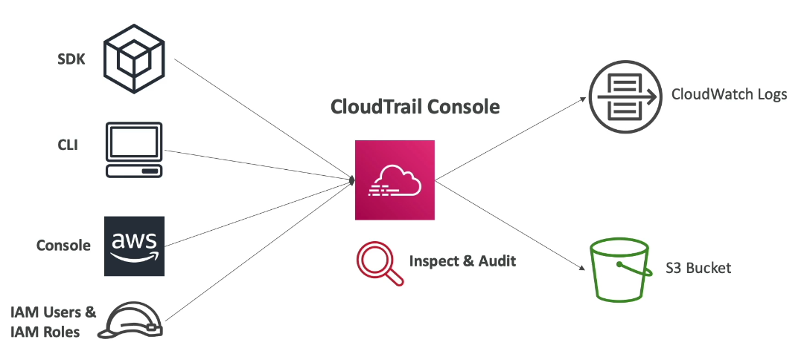
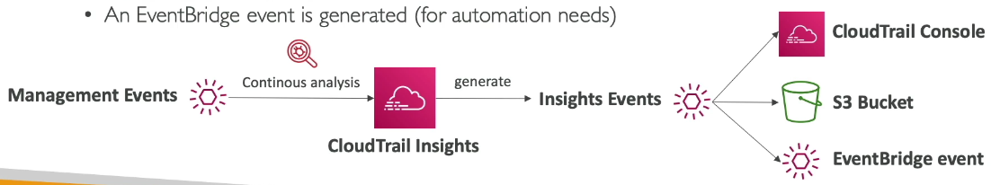

# Security

## CloudTrail

O AWS CloudTrail fornece **governança, auditoria e compliance** para a sua conta AWS. Ele vem **habilitado por padrão** em todas as contas e registra o histórico de **eventos e chamadas de API** feitas na conta, a partir de origens como:

- Console
- AWS SDK
- CLI
- Os próprios serviços da AWS (ex: um Auto Scaling Group que lança instâncias EC2)

Cada evento responde às perguntas:

- **Quem** fez? (user, role, serviço, conta)
- **O quê?** (ação/API chamada e parâmetros)
- **Quando?** (data e hora)
- **De onde?** (IP de origem, user agent, região)
- **Qual foi o resultado?** (sucesso ou código de erro)

**Casos de uso:** auditoria e compliance, investigação de incidentes de segurança ("quem apagou este recurso?") e troubleshooting operacional.

Os eventos podem ser enviados para o **S3** e/ou para o **CloudWatch Logs** por meio de um **trail**. Um trail pode ser aplicado a **todas as regiões** (configuração padrão) ou a **uma única região**.

### CloudTrail Events

Existem 4 tipos de eventos no CloudTrail:

| Tipo | O que registra | Habilitado por padrão? |
|---|---|---|
| **Management Events** | Operações realizadas sobre os **recursos** da conta, no **control plane** (ex: `CreateBucket`, `RunInstances`, `AttachRolePolicy`, `ConsoleLogin`) | ✅ |
| **Data Events** | Operações de **data plane**, de alto volume (ex: atividade em nível de objeto no S3, como `GetObject`, `PutObject` e `DeleteObject`; `Invoke` no Lambda; operações de item no DynamoDB) | ❌ (custo adicional) |
| **Network Activity Events** | Chamadas de API feitas **através de VPC Endpoints** (inclusive as negadas pela endpoint policy) | ❌ |
| **CloudTrail Insights Events** | **Comportamento anômalo**: picos no volume de chamadas de API de escrita ou na taxa de erros, comparados com o histórico da conta | ❌ (custo adicional) |

- **Management Events** e **Data Events** podem ser separados em eventos de **leitura (Read Events)** e de **escrita (Write Events)**. Isso permite registrar só o que interessa (ex: apenas as escritas) e reduzir volume e custo.
- Os **Data Events** não são registrados por padrão justamente pelo **alto volume** de operações. Eles podem ser filtrados com **advanced event selectors** (ex: registrar apenas os eventos de escrita de um bucket específico).
- O **CloudTrail Insights** analisa continuamente os management events de escrita para estabelecer uma **linha de base** do comportamento normal da conta. Quando detecta algo fora do padrão (ex: um pico de `TerminateInstances` ou de erros `AccessDenied`), gera um **Insights event**. Esses eventos podem ser entregues ao **S3** e ao **EventBridge**, o que permite criar **fluxos e automações** a partir deles (ex: notificar o time de segurança via SNS).

### CloudTrail Events Retention

Por padrão, os eventos ficam disponíveis no **Event History** do CloudTrail por **90 dias**. Para manter um histórico maior que esse período, é preciso criar um **trail** que armazene os eventos no **S3**.

- **Event History:** habilitado automaticamente em todas as contas, sem configuração. Mostra os **management events dos últimos 90 dias**, por região. Não inclui data events nem insights.
- **Trail:** configuração que **entrega continuamente** os eventos para um **bucket S3** (e, opcionalmente, para o **CloudWatch Logs**). É necessário para **reter os logs por mais de 90 dias** e para registrar data events e insights.

> **Obs:** No S3, é possível aplicar **lifecycle policies** para mover os logs antigos para classes mais baratas (ex: S3 Glacier) e consultá-los com o **Athena** quando necessário. Outra opção para retenção longa com consultas SQL é o **CloudTrail Lake**.

### Tipos de trail

- **Multi-Region:** registra os eventos de **todas as regiões** (inclusive as que forem habilitadas no futuro). É o padrão e a boa prática.
- **Single-Region:** registra os eventos de uma única região.
- **Organization trail:** criado na **management account** (ou na conta de delegated administrator) e aplicado a **todas as contas da organização**. As member accounts **conseguem ver** o trail, mas **não conseguem alterá-lo ou excluí-lo**.

> **Obs:** Os serviços globais (ex: IAM, STS, CloudFront) registram seus eventos em **us-east-1**. Um trail multi-region captura esses eventos automaticamente.

**Custos:** a **primeira cópia** dos management events entregue por um trail é gratuita. Cópias adicionais (outros trails registrando os mesmos management events), data events, network activity events e insights são cobrados.

### Segurança dos logs

Como os logs do CloudTrail são a base da auditoria, eles também precisam ser protegidos:

- **Criptografia:** por padrão os logs são criptografados com **SSE-S3**. É possível usar **SSE-KMS** com uma chave gerenciada pelo cliente, para controlar quem pode ler os logs.
- **Log file integrity validation:** o CloudTrail gera, a cada hora, um **digest file** com hashes (SHA-256) dos arquivos de log, assinado digitalmente (RSA). Com ele é possível provar que os logs **não foram alterados ou excluídos** após a entrega (`aws cloudtrail validate-logs`).
- **Proteção do bucket:** centralizar os logs em uma **conta separada** (ex: Log Archive do Control Tower), restringir a bucket policy, habilitar **S3 Object Lock** (WORM) e/ou **MFA Delete**.
- **Impedir a desativação:** usar uma **SCP** que bloqueie `cloudtrail:StopLogging`, `cloudtrail:DeleteTrail` e `cloudtrail:UpdateTrail` nas member accounts.

> **Obs:** A entrega dos logs no S3 **não é em tempo real**. Os eventos costumam ser entregues em até cerca de **15 minutos** após a chamada da API.

### Integrações e análise dos logs

- **Amazon EventBridge:** recebe os eventos do CloudTrail e permite **reagir em tempo quase real**. Exemplo: quando alguém chamar `DeleteTrail` ou criar um IAM user, disparar uma Lambda de remediação ou uma notificação SNS.
- **CloudWatch Logs:** o trail pode enviar os eventos para um log group. Com **metric filters** + **alarms** é possível alertar sobre eventos específicos (ex: login do root user, falhas de `ConsoleLogin`, alterações em security groups).
- **Amazon Athena:** consultas SQL diretamente sobre os logs armazenados no S3. Uma opção barata para investigações pontuais.
- **CloudTrail Lake:** data lake gerenciado que armazena os eventos em **event data stores** (com retenção configurável por anos) e permite consultas **SQL** direto no CloudTrail, sem precisar montar a estrutura com S3 + Athena. Pode também receber eventos de fontes **fora da AWS**.

> **Obs:** Por padrão, as regras do EventBridge recebem os eventos de **escrita**. Para receber também os eventos de leitura (`Get*`, `List*`, `Describe*`), é preciso habilitar isso explicitamente na regra.

### CloudTrail vs. Config vs. CloudWatch

| Serviço | Responde | Exemplo |
|---|---|---|
| **CloudTrail** | **Quem fez o quê** e quando (chamadas de API) | "Quem alterou o security group às 14h?" |
| **AWS Config** | **Como está (e como estava)** a configuração dos recursos e se ela está em conformidade | "Este security group permite 0.0.0.0/0 na porta 22? Desde quando?" |
| **CloudWatch** | **Como está o desempenho** (métricas, logs de aplicação, alarmes) | "A CPU da instância passou de 80%?" |

### Dicas para a prova

- "**Quem** apagou/alterou um recurso?" → **CloudTrail**.
- "Auditar a atividade de **todas as contas** da organização de forma centralizada" → **Organization trail** entregando em um bucket de uma **conta de log separada**.
- "Garantir que os logs **não foram adulterados**" → **log file integrity validation** (+ S3 Object Lock).
- "**Reagir automaticamente** a uma chamada de API específica" → **CloudTrail + EventBridge** (+ Lambda/SNS).
- "Detectar **volume anormal** de chamadas de API ou de erros" → **CloudTrail Insights**.
- "Auditar **quem acessou objetos** de um bucket S3" → **data events** do CloudTrail (ou S3 server access logs).
- "Reter logs de auditoria por **anos**" → trail para o **S3** (com lifecycle para Glacier) ou **CloudTrail Lake**. O Event History guarda apenas **90 dias**.
- "Fazer consultas **SQL** nos eventos" → **Athena** sobre o S3 ou **CloudTrail Lake**.
- "Impedir que as member accounts desativem o CloudTrail" → **Organization trail** e/ou **SCP**.
