# Security

## CloudTrail

O AWS CloudTrail fornece **governança, auditoria e compliance** para a sua conta AWS. Ele vem **habilitado por padrão** em todas as contas e registra o histórico de **eventos e chamadas de API** feitas na conta, a partir de origens como:

- Console
- AWS SDK
- CLI
- Os próprios serviços da AWS (ex: um Auto Scaling Group que lança instâncias EC2)

Cada evento responde às perguntas:

- **Quem** fez? (user, role, serviço, conta)
- **O quê?** (ação/API chamada e parâmetros)
- **Quando?** (data e hora)
- **De onde?** (IP de origem, user agent, região)
- **Qual foi o resultado?** (sucesso ou código de erro)

**Casos de uso:** auditoria e compliance, investigação de incidentes de segurança ("quem apagou este recurso?") e troubleshooting operacional.

Os eventos podem ser enviados para o **S3** e/ou para o **CloudWatch Logs** por meio de um **trail**. Um trail pode ser aplicado a **todas as regiões** (configuração padrão) ou a **uma única região**.

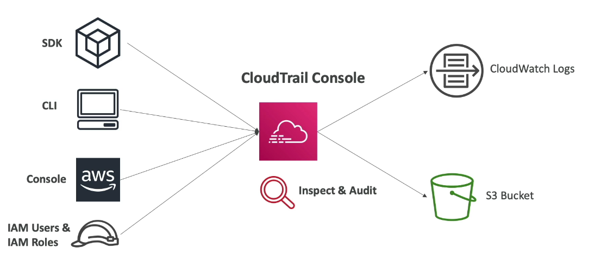

### CloudTrail Events

Existem 4 tipos de eventos no CloudTrail:

| Tipo | O que registra | Habilitado por padrão? |
|---|---|---|
| **Management Events** | Operações realizadas sobre os **recursos** da conta, no **control plane** (ex: `CreateBucket`, `RunInstances`, `AttachRolePolicy`, `ConsoleLogin`) | ✅ |
| **Data Events** | Operações de **data plane**, de alto volume (ex: atividade em nível de objeto no S3, como `GetObject`, `PutObject` e `DeleteObject`; `Invoke` no Lambda; operações de item no DynamoDB) | ❌ (custo adicional) |
| **Network Activity Events** | Chamadas de API feitas **através de VPC Endpoints** (inclusive as negadas pela endpoint policy) | ❌ |
| **CloudTrail Insights Events** | **Comportamento anômalo**: picos no volume de chamadas de API de escrita ou na taxa de erros, comparados com o histórico da conta | ❌ (custo adicional) |

- **Management Events** e **Data Events** podem ser separados em eventos de **leitura (Read Events)** e de **escrita (Write Events)**. Isso permite registrar só o que interessa (ex: apenas as escritas) e reduzir volume e custo.
- Os **Data Events** não são registrados por padrão justamente pelo **alto volume** de operações. Eles podem ser filtrados com **advanced event selectors** (ex: registrar apenas os eventos de escrita de um bucket específico).
- O **CloudTrail Insights** analisa continuamente os management events de escrita para estabelecer uma **linha de base** do comportamento normal da conta. Quando detecta algo fora do padrão (ex: um pico de `TerminateInstances` ou de erros `AccessDenied`), gera um **Insights event**. Esses eventos podem ser entregues ao **S3** e ao **EventBridge**, o que permite criar **fluxos e automações** a partir deles (ex: notificar o time de segurança via SNS).

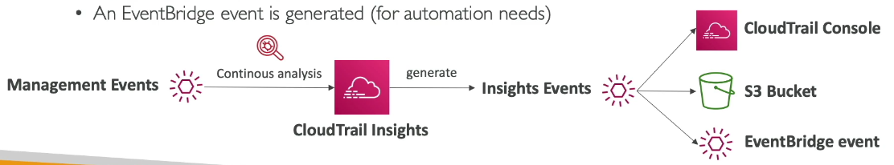

### CloudTrail Events Retention

Por padrão, os eventos ficam disponíveis no **Event History** do CloudTrail por **90 dias**. Para manter um histórico maior que esse período, é preciso criar um **trail** que armazene os eventos no **S3**.

- **Event History:** habilitado automaticamente em todas as contas, sem configuração. Mostra os **management events dos últimos 90 dias**, por região. Não inclui data events nem insights.
- **Trail:** configuração que **entrega continuamente** os eventos para um **bucket S3** (e, opcionalmente, para o **CloudWatch Logs**). É necessário para **reter os logs por mais de 90 dias** e para registrar data events e insights.

> **Obs:** No S3, é possível aplicar **lifecycle policies** para mover os logs antigos para classes mais baratas (ex: S3 Glacier) e consultá-los com o **Athena** quando necessário. Outra opção para retenção longa com consultas SQL é o **CloudTrail Lake**.

### Tipos de trail

- **Multi-Region:** registra os eventos de **todas as regiões** (inclusive as que forem habilitadas no futuro). É o padrão e a boa prática.
- **Single-Region:** registra os eventos de uma única região.
- **Organization trail:** criado na **management account** (ou na conta de delegated administrator) e aplicado a **todas as contas da organização**. As member accounts **conseguem ver** o trail, mas **não conseguem alterá-lo ou excluí-lo**.

> **Obs:** Os serviços globais (ex: IAM, STS, CloudFront) registram seus eventos em **us-east-1**. Um trail multi-region captura esses eventos automaticamente.

**Custos:** a **primeira cópia** dos management events entregue por um trail é gratuita. Cópias adicionais (outros trails registrando os mesmos management events), data events, network activity events e insights são cobrados.

### Segurança dos logs

Como os logs do CloudTrail são a base da auditoria, eles também precisam ser protegidos:

- **Criptografia:** por padrão os logs são criptografados com **SSE-S3**. É possível usar **SSE-KMS** com uma chave gerenciada pelo cliente, para controlar quem pode ler os logs.
- **Log file integrity validation:** o CloudTrail gera, a cada hora, um **digest file** com hashes (SHA-256) dos arquivos de log, assinado digitalmente (RSA). Com ele é possível provar que os logs **não foram alterados ou excluídos** após a entrega (`aws cloudtrail validate-logs`).
- **Proteção do bucket:** centralizar os logs em uma **conta separada** (ex: Log Archive do Control Tower), restringir a bucket policy, habilitar **S3 Object Lock** (WORM) e/ou **MFA Delete**.
- **Impedir a desativação:** usar uma **SCP** que bloqueie `cloudtrail:StopLogging`, `cloudtrail:DeleteTrail` e `cloudtrail:UpdateTrail` nas member accounts.

> **Obs:** A entrega dos logs no S3 **não é em tempo real**. Os eventos costumam ser entregues em até cerca de **15 minutos** após a chamada da API.

### Integrações e análise dos logs

- **Amazon EventBridge:** recebe os eventos do CloudTrail e permite **reagir em tempo quase real**. Exemplo: quando alguém chamar `DeleteTrail` ou criar um IAM user, disparar uma Lambda de remediação ou uma notificação SNS.
- **CloudWatch Logs:** o trail pode enviar os eventos para um log group. Com **metric filters** + **alarms** é possível alertar sobre eventos específicos (ex: login do root user, falhas de `ConsoleLogin`, alterações em security groups).
- **Amazon Athena:** consultas SQL diretamente sobre os logs armazenados no S3. Uma opção barata para investigações pontuais.
- **CloudTrail Lake:** data lake gerenciado que armazena os eventos em **event data stores** (com retenção configurável por anos) e permite consultas **SQL** direto no CloudTrail, sem precisar montar a estrutura com S3 + Athena. Pode também receber eventos de fontes **fora da AWS**.

> **Obs:** Por padrão, as regras do EventBridge recebem os eventos de **escrita**. Para receber também os eventos de leitura (`Get*`, `List*`, `Describe*`), é preciso habilitar isso explicitamente na regra.

### CloudTrail vs. Config vs. CloudWatch

| Serviço | Responde | Exemplo |
|---|---|---|
| **CloudTrail** | **Quem fez o quê** e quando (chamadas de API) | "Quem alterou o security group às 14h?" |
| **AWS Config** | **Como está (e como estava)** a configuração dos recursos e se ela está em conformidade | "Este security group permite 0.0.0.0/0 na porta 22? Desde quando?" |
| **CloudWatch** | **Como está o desempenho** (métricas, logs de aplicação, alarmes) | "A CPU da instância passou de 80%?" |

### Dicas para a prova

- "**Quem** apagou/alterou um recurso?" → **CloudTrail**.
- "Auditar a atividade de **todas as contas** da organização de forma centralizada" → **Organization trail** entregando em um bucket de uma **conta de log separada**.
- "Garantir que os logs **não foram adulterados**" → **log file integrity validation** (+ S3 Object Lock).
- "**Reagir automaticamente** a uma chamada de API específica" → **CloudTrail + EventBridge** (+ Lambda/SNS).
- "Detectar **volume anormal** de chamadas de API ou de erros" → **CloudTrail Insights**.
- "Auditar **quem acessou objetos** de um bucket S3" → **data events** do CloudTrail (ou S3 server access logs).
- "Reter logs de auditoria por **anos**" → trail para o **S3** (com lifecycle para Glacier) ou **CloudTrail Lake**. O Event History guarda apenas **90 dias**.
- "Fazer consultas **SQL** nos eventos" → **Athena** sobre o S3 ou **CloudTrail Lake**.
- "Impedir que as member accounts desativem o CloudTrail" → **Organization trail** e/ou **SCP**.


## AWS KMS (Key Management Service)

O AWS Key Management Service (KMS) é o serviço gerenciado para **criar e controlar as chaves criptográficas** usadas para proteger os dados. Ele é integrado à grande maioria dos serviços da AWS (S3, EBS, RDS, DynamoDB, Secrets Manager, CloudTrail etc.), o que torna a criptografia de dados em repouso praticamente transparente.

- As chaves ficam armazenadas em **HSMs** (*Hardware Security Modules*) gerenciados pela AWS e validados pelo **FIPS 140-3**. O material das chaves **nunca sai do KMS sem criptografia**.
- O acesso às chaves é controlado por **key policies** e **IAM policies**.
- Todas as chamadas de API ao KMS (ex: `Encrypt`, `Decrypt`, `GenerateDataKey`) são **registradas no CloudTrail**, o que permite auditar quem usou cada chave.
- As chaves são **regionais**: uma chave existe apenas na região em que foi criada (exceto as multi-region keys).

### Tipos de chave

**Por tipo de criptografia:**

| Tipo | Como funciona | Casos de uso |
|---|---|---|
| **Symmetric** (padrão) | Uma única chave **AES-256** para criptografar e descriptografar. A chave nunca sai do KMS: é preciso chamar a API do KMS para usá-la | Criptografia de dados em repouso nos serviços AWS. É o tipo usado pela maioria das integrações |
| **Asymmetric** | Par de chaves **RSA** ou **ECC**. A **chave pública pode ser baixada**, e a privada nunca sai do KMS | Criptografia por quem **não pode chamar a API do KMS** (ex: clientes fora da AWS), **assinatura digital** e verificação |
| **HMAC** | Chave usada para gerar e verificar códigos HMAC | Verificar integridade e autenticidade de mensagens e tokens |

**Por propriedade/gerenciamento:**

| Tipo | Quem gerencia | Rotação | Custo |
|---|---|---|---|
| **AWS owned keys** | A AWS, usadas internamente em várias contas. Não aparecem na sua conta | Gerenciada pela AWS | Gratuita |
| **AWS managed keys** | A AWS, mas **ficam na sua conta** (ex: `aws/s3`, `aws/ebs`, `aws/rds`). A key policy **não pode ser alterada** | **Automática e obrigatória** (anual) | Sem custo mensal (paga-se pelas chamadas de API) |
| **Customer managed keys** | **Você**: cria, define a key policy, habilita/desabilita e agenda a exclusão | **Opcional**: automática (período configurável de 90 a 2560 dias, padrão de 1 ano) ou **on-demand** | **US$ 1/mês** por chave + chamadas de API |

> **Obs:** Na rotação automática, a chave mantém o **mesmo key ID e ARN**. O KMS guarda o material das versões anteriores para continuar **descriptografando** os dados antigos, e usa o material novo para as novas criptografias. Não é preciso recriptografar nada.

**Imported key material (BYOK):** é possível criar uma customer managed key **sem material** e **importar o seu próprio material** de chave, gerado fora da AWS.
- Você é responsável pela **durabilidade** do material (deve manter uma cópia fora da AWS) e pode definir uma **data de expiração**.
- **Rotação manual:** cria-se uma nova chave com o novo material e atualiza-se o **alias** para apontar para ela.

> **Obs:** Um **alias** (ex: `alias/app-prod`) é um nome amigável que aponta para uma chave. As aplicações devem referenciar o alias, e não o key ID. Assim, a troca da chave (rotação manual) não exige mudança no código.

### Envelope Encryption

A API `Encrypt` do KMS criptografa diretamente no máximo **4 KB** de dados. Para dados maiores, usa-se o **envelope encryption**:

1. A aplicação chama `GenerateDataKey`. O KMS retorna uma **data key** (DEK) em duas versões: **em texto claro** e **criptografada** pela KMS key.
2. A aplicação **criptografa os dados localmente** com a data key em texto claro e a descarta da memória.
3. A aplicação armazena a **data key criptografada junto com os dados** (o "envelope").
4. Para descriptografar, a aplicação envia a data key criptografada ao KMS (`Decrypt`), recebe a data key em texto claro e descriptografa os dados localmente.

Benefícios: os dados **não trafegam até o KMS** (apenas a data key), há melhor desempenho e a KMS key nunca sai do KMS. É assim que os serviços AWS (S3, EBS etc.) usam o KMS por baixo.

> **Obs:** O **AWS Encryption SDK** implementa o envelope encryption e oferece **data key caching**, que reutiliza data keys por um período e **reduz o número de chamadas** ao KMS.

### Key Policies e controle de acesso

Toda KMS key tem **exatamente uma key policy**, que é a principal forma de controlar o acesso a ela. **Sem permissão na key policy, nenhum principal consegue usar a chave**, nem mesmo o root user da conta.

- **Default key policy:** concede acesso total à **conta** (`arn:aws:iam::<account-id>:root`). Isso **habilita o uso de IAM policies** para controlar o acesso à chave dentro da conta.
- **Custom key policy:** define explicitamente quem administra a chave (*key administrators*) e quem pode usá-la (*key users*). É necessária para **acesso cross-account**.
- **Grants:** permissões **temporárias e programáticas** para usar uma chave, muito usadas pelos serviços AWS. Exemplo: o EBS cria um grant para que o EC2 descriptografe um volume.

**Condições úteis:**
- `kms:ViaService`: permite usar a chave **somente por meio de um serviço específico** (ex: só via S3).
- `kms:EncryptionContext`: o **encryption context** é um conjunto de pares chave-valor não secretos enviados na criptografia. Ele precisa ser **idêntico na descriptografia** e aparece no CloudTrail, o que ajuda na auditoria e no controle de acesso.
- `kms:CallerAccount`: restringe o uso da chave a uma conta específica.

**Acesso cross-account** exige duas configurações:
1. A **key policy** da chave (conta A) deve permitir o principal da conta B.
2. Uma **IAM policy** na conta B deve permitir que o principal use a chave da conta A.

### Compartilhamento de recursos criptografados

**Entre contas (ex: snapshot EBS ou RDS):**
1. O snapshot precisa estar criptografado com uma **customer managed key**. Snapshots criptografados com **AWS managed keys não podem ser compartilhados** com outras contas.
2. Na conta de origem, compartilhar o snapshot e **liberar a chave na key policy** para a conta de destino.
3. Na conta de destino, **copiar o snapshot**, recriptografando-o com uma chave **própria**.

**Entre regiões:** como as chaves são regionais, ao **copiar um snapshot ou AMI criptografado para outra região** é preciso informar uma **chave da região de destino**. A AWS recriptografa os dados durante a cópia.

### Multi-Region Keys

São chaves com o **mesmo key ID e o mesmo material** replicadas em várias regiões. Assim, um dado criptografado em uma região pode ser **descriptografado em outra sem chamadas cross-region** e sem recriptografia.

- Existe uma chave **primary** e uma ou mais **replicas**. Cada uma é um recurso **independente**, com **sua própria key policy**.
- A rotação automática é feita na primary e **propagada** para as replicas.
- **Não são chaves globais**: cada réplica é gerenciada separadamente em sua região.

Casos de uso:
- **Client-side encryption** de dados replicados entre regiões (ex: atributos criptografados em **DynamoDB Global Tables** ou **Aurora Global Database**).
- **Disaster recovery** e aplicações **ativo-ativo** multi-região.
- **Assinatura digital** com chaves assimétricas, verificada em várias regiões.

> **Obs:** A AWS **não recomenda** usar multi-region keys por padrão. Elas devem ser usadas apenas quando houver real necessidade de descriptografar os mesmos dados em várias regiões, já que ampliam a superfície de exposição da chave.

### Exclusão de chaves

- Uma chave **não é excluída imediatamente**: é preciso agendar a exclusão com um **período de espera de 7 a 30 dias** (padrão de 30). Durante esse período, a chave fica **inutilizável** e a exclusão pode ser **cancelada**.
- Depois de excluída, **todos os dados criptografados com ela ficam irrecuperáveis**.
- Alternativa mais segura: **desabilitar** a chave, o que é reversível.

> **Boa prática:** criar um alarme (CloudTrail + EventBridge ou CloudWatch metric filter) que dispare se alguém **tentar usar uma chave com exclusão agendada**. Isso indica que a chave ainda está em uso e a exclusão deve ser cancelada.

### Limites de requisições

O KMS tem **quotas de requisições por segundo** (compartilhadas entre as operações criptográficas, por conta e região). Ao ultrapassá-las, as chamadas recebem `ThrottlingException`.

Soluções:
- **Exponential backoff** nas chamadas.
- **Data key caching** (AWS Encryption SDK).
- **S3 Bucket Keys:** para SSE-KMS no S3, gera uma chave no nível do bucket e **reduz as chamadas ao KMS em até 99%**, o que também diminui o custo.
- Solicitar **aumento da quota** via Service Quotas.

### Custom Key Stores

Para requisitos de compliance que exigem **controle total do hardware** onde as chaves ficam:

- **AWS CloudHSM key store:** as chaves do KMS ficam em um **cluster CloudHSM** que você controla, mas continuam sendo usadas pela API do KMS e pelas integrações com os serviços AWS.
- **External key store (XKS):** as chaves ficam em um **HSM fora da AWS** (ex: on-premises). O KMS chama o seu HSM externo a cada operação. Usado em requisitos regulatórios do tipo "*hold your own key*".

### KMS vs. CloudHSM

| | AWS KMS | AWS CloudHSM |
|---|---|---|
| Modelo | Serviço gerenciado, **multi-tenant** | HSM **dedicado** (single-tenant) na sua VPC |
| Controle das chaves | AWS gerencia o hardware, você controla o acesso | **Você gerencia** as chaves e os usuários do HSM. A AWS **não tem acesso** às chaves |
| Integração com serviços AWS | Nativa | Via **custom key store** do KMS |
| Padrões | PKCS#11 não suportado | Suporta **PKCS#11, JCE, CNG/KSP** (ex: Oracle TDE, SSL offload) |
| Alta disponibilidade | Gerenciada pela AWS | Você monta o **cluster em várias AZs** |
| Custo | Baixo (por chave e por chamada) | Alto (por HSM por hora) |

### Dicas para a prova

- "Criptografar dados em repouso nos serviços AWS com **menor esforço operacional**" → **KMS** (AWS managed key ou customer managed key).
- "Controlar **quem pode usar** a chave, **auditar** o uso e **rotacionar** com período definido" → **Customer managed key**.
- "A chave precisa ser **gerada fora da AWS** / a empresa precisa **controlar o material** da chave" → **Imported key material (BYOK)**. Lembrar que a rotação é **manual** (nova chave + alias).
- "**Hardware dedicado**, single-tenant, FIPS 140 nível 3, AWS sem acesso às chaves, PKCS#11" → **CloudHSM** (ou CloudHSM key store, se precisar integrar com os serviços AWS).
- "Chaves devem ficar **fora da AWS**" → **External key store (XKS)**.
- "Criptografar arquivos **maiores que 4 KB**" → **envelope encryption** (`GenerateDataKey`).
- "Clientes **fora da AWS** precisam criptografar dados ou verificar assinaturas" → **chave assimétrica** (chave pública baixável).
- "Compartilhar um **snapshot criptografado** com outra conta" → snapshot com **customer managed key** + **key policy** liberando a outra conta. AWS managed keys **não** podem ser compartilhadas.
- "Copiar snapshot criptografado para **outra região**" → informar uma **chave da região de destino**.
- "Descriptografar os mesmos dados em **várias regiões** sem recriptografar" → **Multi-Region Keys**.
- "`ThrottlingException` no KMS com muitas requisições ao S3" → **S3 Bucket Keys** (ou data key caching / aumento de quota).
- "Evitar perder dados ao excluir uma chave" → **desabilitar** em vez de excluir, ou usar o **período de espera** + alarme de uso.

## AWS SSM Parameter Store

O AWS Systems Manager Parameter Store é um serviço **serverless** para **armazenar de forma centralizada e segura** dados de **configuração** e **secrets** (ex: URLs de endpoints, nomes de buckets, feature flags, senhas de banco de dados, API keys). Ele faz parte do **AWS Systems Manager (SSM)**.

- Os parâmetros podem ser guardados em **texto claro** ou **criptografados com o KMS**.
- O acesso é controlado com **IAM policies**, inclusive por **caminho** da hierarquia.
- Mantém o **histórico de versões** de cada parâmetro.
- Todas as chamadas de API são **auditadas no CloudTrail**, e as alterações nos parâmetros geram eventos no **EventBridge**.
- É integrado a vários serviços: **Lambda, ECS, EC2, CodeBuild, CodePipeline, CloudFormation** etc.

**Casos de uso:** separar configuração do código (*externalized configuration*), guardar parâmetros diferentes por ambiente (dev, hom, prod) e armazenar secrets simples sem custo adicional.

### Tipos de parâmetro

| Tipo | Descrição | Exemplo |
|---|---|---|
| **String** | Texto simples | `https://api.empresa.com` |
| **StringList** | Lista de valores separados por vírgula | `us-east-1,sa-east-1` |
| **SecureString** | Valor **criptografado com o KMS** | Senha do banco de dados |

Detalhes do **SecureString**:
- Pode usar a AWS managed key `aws/ssm` (padrão) ou uma **customer managed key**.
- Para ler o valor descriptografado, a chamada precisa usar `WithDecryption=true`, e o principal precisa de permissão `ssm:GetParameter` **e** `kms:Decrypt` na chave.
- Com uma customer managed key, é possível controlar **quem pode descriptografar** o parâmetro pela key policy.

### Hierarquia

Os parâmetros podem ser organizados em uma **hierarquia de caminhos**, como pastas:

```
/minha-app/dev/db-url
/minha-app/dev/db-password
/minha-app/prod/db-url
/minha-app/prod/db-password
/outra-app/...
```

- `GetParametersByPath` retorna todos os parâmetros de um caminho (ex: toda a configuração de `/minha-app/prod/`) em uma única chamada.
- As **IAM policies** podem liberar acesso por caminho. Por exemplo, a role da aplicação de dev só lê `arn:aws:ssm:<region>:<account>:parameter/minha-app/dev/*`.

### Tiers: Standard vs. Advanced

| | Standard | Advanced |
|---|---|---|
| Quantidade de parâmetros (por conta/região) | 10.000 | 100.000 |
| Tamanho máximo do valor | **4 KB** | **8 KB** |
| Parameter Policies | ❌ | ✅ |
| Compartilhamento com outras contas (via RAM) | ❌ | ✅ |
| Custo de armazenamento | **Gratuito** | **US$ 0,05** por parâmetro/mês |

> **Obs:** Um parâmetro Standard pode ser **convertido para Advanced** a qualquer momento, mas o contrário **não é possível**: seria preciso excluir e recriar o parâmetro.

**Throughput:** por padrão, a quota é de cerca de **40 transações por segundo**. É possível habilitar o **higher throughput**, que aumenta o limite (até 10.000 TPS) mediante cobrança por chamada de API.

### Parameter Policies (somente Advanced)

Permitem definir regras de ciclo de vida para um parâmetro:

- **Expiration:** **exclui** o parâmetro em uma data/hora definida (ex: uma senha temporária).
- **ExpirationNotification:** envia um evento ao **EventBridge** antes da expiração (ex: 15 dias antes).
- **NoChangeNotification:** envia um evento ao **EventBridge** se o parâmetro **não for alterado** por um período (ex: lembrar de trocar uma senha a cada 90 dias).

> **Obs:** O Parameter Store **não tem rotação automática** de secrets. As parameter policies apenas **notificam**. Para rotacionar, é preciso montar uma automação própria (ex: EventBridge + Lambda) ou usar o **Secrets Manager**.

### Versionamento e labels

- Cada alteração em um parâmetro cria uma **nova versão**. É possível ler uma versão específica (ex: `/minha-app/prod/db-url:3`).
- **Labels** são apelidos para uma versão (ex: `producao`, `v1`), referenciados como `/minha-app/prod/db-url:producao`.

### Parâmetros públicos e referência ao Secrets Manager

- **Public parameters:** a AWS publica parâmetros com informações atualizadas, como o **ID da AMI mais recente** de cada sistema operacional:
  `/aws/service/ami-amazon-linux-latest/al2023-ami-kernel-default-x86_64`
  Muito útil em templates CloudFormation e Launch Templates para sempre usar a AMI mais recente.
- **Referência ao Secrets Manager:** um secret do Secrets Manager pode ser lido pela API do Parameter Store usando o caminho `/aws/reference/secretsmanager/<nome-do-secret>`.

### Integração com CloudFormation

- **Parameter types:** um parâmetro do template pode ser do tipo `AWS::SSM::Parameter::Value<String>`, e o CloudFormation resolve o valor no Parameter Store durante o deploy (ex: a AMI mais recente via public parameter).
- **Dynamic references:** valores podem ser referenciados diretamente nas propriedades dos recursos:
  - `{{resolve:ssm:/minha-app/prod/db-url}}` para String/StringList.
  - `{{resolve:ssm-secure:/minha-app/prod/db-password}}` para SecureString (suportado apenas por alguns recursos e propriedades).

### Parameter Store vs. Secrets Manager

| | SSM Parameter Store | AWS Secrets Manager |
|---|---|---|
| Foco | **Configuração** em geral e secrets simples | **Secrets** (credenciais, API keys) |
| Criptografia | Opcional (SecureString) | **Sempre** criptografado com KMS |
| **Rotação automática** | ❌ (precisa de automação própria) | ✅ Nativa (Lambda), com integração pronta para **RDS, Aurora, Redshift, DocumentDB** |
| Replicação multi-região | ❌ | ✅ |
| Tamanho máximo | 4 KB (Standard) / 8 KB (Advanced) | 64 KB |
| Custo | **Gratuito** (Standard) | US$ 0,40 por secret/mês + chamadas de API |

### Dicas para a prova

- "Armazenar **configurações** da aplicação de forma centralizada, por ambiente, com **menor custo**" → **Parameter Store** (Standard, hierarquia por caminho).
- "Armazenar uma senha **criptografada** sem custo adicional" → **SecureString** no Parameter Store.
- "Credenciais de banco de dados com **rotação automática**" → **Secrets Manager**, e não o Parameter Store.
- "Garantir que cada aplicação só leia a **sua própria configuração**" → hierarquia + **IAM policy por caminho**.
- "Ser **notificado** quando um parâmetro estiver para expirar ou não for alterado há muito tempo" → **Parameter Policies** (Advanced tier) + **EventBridge**.
- "Parâmetro **maior que 4 KB**" → **Advanced tier** (até 8 KB). Acima disso, Secrets Manager (até 64 KB) ou S3.
- "Sempre usar a **AMI mais recente** do Amazon Linux no CloudFormation" → **public parameter** `/aws/service/ami-amazon-linux-latest/...`.
- "`ThrottlingException` ao ler parâmetros com alto volume" → habilitar **higher throughput** ou fazer **cache** dos valores na aplicação.
- "Compartilhar parâmetros com outras contas" → **Advanced tier** + **AWS RAM**.

## AWS Secrets Manager

O AWS Secrets Manager é o serviço para **armazenar, gerenciar e rotacionar secrets**, como credenciais de banco de dados, API keys, tokens OAuth e chaves SSH. A ideia é **eliminar secrets fixos no código** (*hardcoded*): a aplicação busca o secret via API em tempo de execução.

- Os secrets são **sempre criptografados com o KMS**: com a AWS managed key `aws/secretsmanager` (padrão) ou com uma **customer managed key**.
- Oferece **rotação automática** nativa, com integração pronta para **RDS, Aurora, Redshift e DocumentDB**.
- O acesso é controlado por **IAM policies** e por **resource-based policies** no próprio secret.
- Suporta **replicação multi-região**.
- Todas as chamadas de API são **auditadas no CloudTrail**.
- Um secret pode ter até **64 KB** e normalmente é armazenado como **JSON** (ex: `{"username": "admin", "password": "...", "host": "..."}`).

**Custo:** **US$ 0,40** por secret/mês + **US$ 0,05** a cada 10.000 chamadas de API.

### Rotação automática

A rotação troca o valor do secret **periodicamente e sem intervenção manual**, atualizando ao mesmo tempo o secret e a credencial no banco ou serviço de destino. O agendamento pode ser feito por **frequência** (ex: a cada 30 dias) ou por **expressão cron**, com intervalo mínimo de **4 horas**.

Existem duas formas de rotação:

- **Managed rotation:** a rotação é feita **pelo próprio serviço** dono da credencial, sem Lambda. Exemplo: o **RDS/Aurora** pode gerenciar a senha do usuário master no Secrets Manager (`ManageMasterUserPassword`), com rotação automática a cada **7 dias** por padrão.
- **Rotação via Lambda:** o Secrets Manager invoca uma **função Lambda** que executa a troca. A AWS fornece **templates prontos** para RDS, Aurora, Redshift e DocumentDB. Para outros casos (ex: API key de um serviço terceiro), é preciso escrever uma Lambda própria.

**Etapas da Lambda de rotação:**

1. **`createSecret`:** gera um novo valor e o grava como uma nova versão com o label `AWSPENDING`.
2. **`setSecret`:** aplica o novo valor no banco/serviço de destino.
3. **`testSecret`:** testa se a nova credencial funciona.
4. **`finishSecret`:** move o label `AWSCURRENT` para a nova versão. A versão antiga recebe o label `AWSPREVIOUS`.

> **Obs:** Os **staging labels** identificam as versões do secret: `AWSCURRENT` (versão atual, retornada por padrão), `AWSPENDING` (em rotação) e `AWSPREVIOUS` (anterior, útil para rollback).

**Estratégias de rotação:**

| Estratégia | Como funciona | Quando usar |
|---|---|---|
| **Single user** | Troca a senha do **mesmo usuário** | Mais simples. Pode haver uma breve janela em que conexões com a senha antiga falham |
| **Alternating users** | Mantém **dois usuários** e alterna entre eles a cada rotação. Um terceiro secret (de um superusuário) é usado para alterar as senhas | Aplicações com **alta disponibilidade**, que não toleram falhas de conexão durante a rotação |

> **Obs:** A Lambda de rotação precisa de **acesso de rede** ao banco de dados (normalmente rodando **na mesma VPC**) **e** ao endpoint do Secrets Manager (via **VPC Interface Endpoint** ou **NAT Gateway**). Esse é um ponto comum de falha da rotação.

### Acesso cross-account

Para que uma conta B leia um secret da conta A:

1. **Resource policy** no secret (conta A) permitindo o principal da conta B (`secretsmanager:GetSecretValue`).
2. O secret precisa estar criptografado com uma **customer managed key**, com a **key policy** permitindo `kms:Decrypt` para a conta B. Secrets criptografados com a `aws/secretsmanager` **não podem** ser lidos por outras contas.
3. **IAM policy** na conta B permitindo o principal acessar o secret e a chave KMS da conta A.

> **Obs:** A resource policy também pode ser usada para **bloquear** acessos. Por exemplo, negar o acesso a qualquer principal que não venha da VPC da aplicação (condition `aws:SourceVpc` ou `aws:SourceVpce`).

### Replicação Multi-Region

Um secret pode ser **replicado para outras regiões**. O Secrets Manager mantém as réplicas **sincronizadas** com o secret primário, inclusive após as rotações.

- As réplicas são **somente leitura**. Cada uma é criptografada com uma chave KMS da sua própria região.
- Em um cenário de **disaster recovery**, uma réplica pode ser **promovida a secret independente** (*standalone*).

**Casos de uso:** aplicações **multi-região** (ex: com **Aurora Global Database** ou **DynamoDB Global Tables**) e DR, em que a aplicação na região secundária precisa das mesmas credenciais sem depender da região primária.

### Como as aplicações consomem os secrets

- **SDK/API:** `GetSecretValue` (ou `BatchGetSecretValue` para vários secrets de uma vez). As **bibliotecas de cache** do Secrets Manager (Java, Python, .NET, Go) reduzem a latência e o número de chamadas.
- **Lambda:** a **AWS Parameters and Secrets Lambda Extension** faz cache dos secrets localmente na função.
- **ECS:** a task definition referencia o secret no campo `secrets` (`valueFrom` com o ARN). O valor é injetado como **variável de ambiente** no container. A **task execution role** precisa de permissão para ler o secret.
- **EKS:** **Secrets Store CSI Driver** com o provider da AWS, montando os secrets como volumes ou sincronizando com Kubernetes Secrets.
- **CloudFormation:**
  - **Dynamic reference:** `{{resolve:secretsmanager:MeuSecret:SecretString:password}}`.
  - `AWS::SecretsManager::Secret` com `GenerateSecretString` para **gerar uma senha aleatória** durante o deploy, sem expô-la no template.
  - `AWS::SecretsManager::SecretTargetAttachment` para associar o secret a uma instância RDS.

### Exclusão de secrets

- A exclusão tem um **recovery window** de **7 a 30 dias** (padrão de 30). Durante esse período, o secret não pode ser usado, mas a exclusão pode ser **cancelada**.
- Com `ForceDeleteWithoutRecovery`, o secret é excluído **imediatamente**, sem possibilidade de recuperação.

### Monitoramento e compliance

- **CloudTrail:** registra quem acessou ou alterou cada secret.
- **AWS Config:** regras gerenciadas como `secretsmanager-rotation-enabled-check` (rotação habilitada), `secretsmanager-secret-periodic-rotation` (rotação ocorrendo no prazo) e `secretsmanager-secret-unused` (secrets sem uso).
- **EventBridge:** eventos de rotação (sucesso ou falha) podem disparar notificações ou automações.

### Secrets Manager vs. Parameter Store

| | AWS Secrets Manager | SSM Parameter Store |
|---|---|---|
| Foco | **Secrets** (credenciais, API keys) | **Configuração** em geral e secrets simples |
| Criptografia | **Sempre** criptografado com KMS | Opcional (SecureString) |
| **Rotação automática** | ✅ Nativa (managed rotation ou Lambda) | ❌ (precisa de automação própria) |
| Replicação multi-região | ✅ | ❌ |
| Cross-account | ✅ Resource policy | Advanced tier + RAM |
| Tamanho máximo | 64 KB | 4 KB (Standard) / 8 KB (Advanced) |
| Custo | US$ 0,40 por secret/mês + chamadas de API | **Gratuito** (Standard) |

### Dicas para a prova

- "Credenciais de banco de dados com **rotação automática**" → **Secrets Manager**.
- "Rotacionar a senha do master user do **RDS/Aurora** com **menor esforço operacional**" → **managed rotation** do RDS com Secrets Manager (`ManageMasterUserPassword`).
- "Rotacionar uma **API key de um serviço terceiro**" → Secrets Manager com **Lambda de rotação customizada**.
- "A rotação está **falhando** com timeout" → a Lambda de rotação não tem **acesso de rede** ao banco ou ao endpoint do Secrets Manager (falta **VPC endpoint** ou **NAT Gateway**).
- "A aplicação **não pode ter falhas de conexão** durante a rotação" → estratégia **alternating users**.
- "Remover senhas **hardcoded** do código ou das variáveis de ambiente" → Secrets Manager (ou Parameter Store SecureString, se não houver necessidade de rotação).
- "Compartilhar um secret com **outra conta**" → **resource policy** no secret + **customer managed key** com key policy liberando a outra conta.
- "A aplicação na **região de DR** precisa das mesmas credenciais" → **replicação multi-região** do secret.
- "Injetar o secret em um **container ECS**" → campo `secrets` da task definition + permissão na **task execution role**.
- "Gerar a senha do banco no **CloudFormation** sem expô-la no template" → `GenerateSecretString` + **dynamic reference**.
- "Armazenar configurações **simples e baratas**, sem rotação" → **Parameter Store**, e não Secrets Manager.

## AWS Certificate Manager - ACM

O AWS Certificate Manager (ACM) é o serviço para **provisionar, gerenciar e implantar certificados SSL/TLS** usados para habilitar **HTTPS** (criptografia em trânsito) nos serviços da AWS.

- Emite **certificados públicos gratuitamente** (paga-se apenas pelos recursos que os utilizam).
- Faz a **renovação automática** dos certificados emitidos por ele.
- Permite **importar certificados** emitidos por CAs de terceiros.
- Suporta certificados **wildcard** (ex: `*.example.com`) e com múltiplos domínios (**SANs**).
- As chaves privadas são protegidas pelo KMS e **nunca podem ser exportadas** dos certificados públicos emitidos pelo ACM.
- É um serviço **regional**.

### Integrações

Os certificados do ACM só podem ser usados em **serviços integrados**:

- **Elastic Load Balancing** (ALB, NLB e Classic LB).
- **CloudFront** (o certificado precisa estar em **`us-east-1`**).
- **API Gateway** (custom domain names).
- **AWS App Runner**, **Elastic Beanstalk** (via ELB), **Cognito** (custom domain), **AWS Amplify**, **Verified Access**, entre outros.

> **Obs:** Certificados públicos do ACM **não podem ser instalados diretamente em instâncias EC2**, porque a chave privada não é exportável. Para ter TLS dentro da EC2, a alternativa é terminar o TLS no load balancer, usar um certificado de terceiro (ex: Let's Encrypt) ou usar **certificados exportáveis** (ver abaixo). A exceção são os **Nitro Enclaves**, que suportam certificados do ACM via **ACM for Nitro Enclaves**.

### Solicitando certificados públicos

1. Informar os domínios do certificado (FQDN ou wildcard).
2. Escolher o método de validação:
   - **DNS Validation (recomendado):** cria-se um registro **CNAME** no DNS. Se o domínio estiver no **Route 53**, o ACM cria o registro automaticamente. Necessário para que a **renovação automática** funcione sem intervenção.
   - **Email Validation:** um email é enviado aos contatos do domínio (WHOIS e endereços como `admin@`, `webmaster@`), que precisam aprovar manualmente.
3. A validação pode levar algumas horas.
4. Após emitido, o certificado entra na **renovação automática**: o ACM renova **60 dias antes** da expiração, sem nenhuma ação manual.

> **Obs:** Na validação por DNS, o registro CNAME deve **permanecer** no DNS. Se ele for removido, a renovação automática falha.

### Certificados importados

- Gerados fora da AWS e importados no ACM (certificado, chave privada e chain).
- **Não têm renovação automática**: é preciso importar um novo certificado antes da expiração.
- O ACM envia **eventos diários de expiração** para o **EventBridge** a partir de **45 dias** antes do vencimento (o número de dias é configurável).
- A regra gerenciada do **AWS Config** `acm-certificate-expiration-check` verifica certificados próximos da expiração e pode disparar notificações (SNS) ou automações.

### Certificados exportáveis

- O ACM passou a oferecer **certificados públicos exportáveis** (*exportable public certificates*), **pagos**, que permitem exportar o certificado e a chave privada.
- Úteis para instalar o certificado em **EC2, containers ou servidores on-premises**, mantendo o ACM como ponto central de gestão e renovação.

### AWS Private CA

O **AWS Private Certificate Authority** permite criar uma **CA privada** (root e subordinadas) gerenciada pela AWS para emitir **certificados privados**.

- Usada para **comunicação interna**: serviços internos, microsserviços, **mTLS**, dispositivos IoT, VPN, identificação de usuários e dispositivos.
- Certificados privados são confiáveis **apenas dentro da organização** (os clientes precisam confiar na CA raiz), não pelos navegadores públicos.
- Os certificados privados emitidos via ACM podem ser **exportados** e instalados em qualquer lugar (EC2, on-premises, containers).
- Integra-se com **EKS** (via cert-manager), **App Mesh/Service Connect**, **IAM Roles Anywhere** e outros.
- Pode ser **compartilhada entre contas** via **AWS RAM**.
- Tem custo mensal por CA (modo *general-purpose*) e por certificado emitido. Existe o modo **short-lived certificate**, mais barato, para certificados de até 7 dias.

### ACM com Load Balancers

- O ALB/NLB faz a **terminação do TLS** (*SSL offloading*) usando o certificado do ACM, reduzindo o processamento nas instâncias.
- Com **SNI** (Server Name Indication), um único listener HTTPS do ALB/NLB pode servir **múltiplos certificados** para **múltiplos domínios**. O Classic Load Balancer **não suporta** SNI (um certificado por CLB).
- Uma regra comum é redirecionar **HTTP → HTTPS** no listener da porta 80 do ALB.
- Se for necessária criptografia **ponta a ponta** (*end-to-end*), o tráfego entre o LB e os targets também deve usar HTTPS/TLS, com certificados instalados nos targets (ex: certificados privados ou exportáveis).

### ACM com API Gateway

Para usar um **custom domain name** no API Gateway:

- **Edge-Optimized:** as requisições passam por uma distribuição CloudFront gerenciada → o certificado deve estar em **`us-east-1`**.
- **Regional:** o certificado deve estar **na mesma região** do API Gateway.
- **Private:** acessível somente via VPC Interface Endpoint.

Depois, cria-se um registro **CNAME ou Alias (A)** no Route 53 apontando para o domínio do API Gateway.

> **Obs:** O API Gateway também suporta **mTLS** em custom domains (regionais), com um **truststore** armazenado no S3 contendo as CAs dos clientes.

### Dicas para a prova

- "Habilitar HTTPS em um ALB/CloudFront com **menor esforço operacional** e renovação automática" → certificado **público do ACM** com **DNS validation**.
- "Certificado para o **CloudFront**" ou "API Gateway **Edge-Optimized**" → certificado no ACM em **`us-east-1`**.
- "Certificado para API Gateway **Regional**" → certificado na **mesma região** da API.
- "A renovação automática do ACM **falhou**" → o registro **CNAME de validação** foi removido do DNS, ou a validação foi feita por **email** e não foi aprovada.
- "Ser notificado sobre a **expiração de certificados importados**" → eventos do ACM no **EventBridge** ou regra do **AWS Config** `acm-certificate-expiration-check` + SNS.
- "**Vários domínios** em um único ALB" → múltiplos certificados no listener usando **SNI**.
- "Instalar o certificado do ACM **diretamente na EC2**" → não é possível com certificados públicos padrão. Terminar o TLS no **ALB/NLB**, usar **certificados exportáveis** ou **Nitro Enclaves**.
- "Certificados para **comunicação interna** entre serviços / **mTLS**" → **AWS Private CA**.
- "Compartilhar a CA privada com **outras contas** da organização" → **AWS RAM**.
- "Criptografia em trânsito **até a instância**" → TLS também entre o LB e os targets (end-to-end), não apenas a terminação no LB.

## CloudHSM

O AWS CloudHSM fornece **HSMs (Hardware Security Modules) dedicados** na nuvem AWS, usados para **gerar, armazenar e usar chaves criptográficas** em hardware validado no **FIPS 140 nível 3**.

- O HSM é **single-tenant**: o hardware é dedicado a você.
- **Você gerencia** as chaves e os usuários do HSM. A AWS gerencia apenas o hardware (provisionamento, patches, backups) e **não tem acesso às chaves**. Se as credenciais do HSM forem perdidas, as chaves **não podem ser recuperadas** pela AWS.
- Os HSMs ficam em uma **subnet da sua VPC**, acessados por meio de uma **ENI**.
- Suporta **chaves simétricas e assimétricas**.
- Suporta APIs padrão da indústria: **PKCS#11**, **JCE** (Java Cryptography Extensions), **OpenSSL Dynamic Engine** e **Microsoft CNG/KSP**.
- **Não há free tier**. O custo é **por HSM por hora**, bem mais alto que o KMS.

### Arquitetura e alta disponibilidade

- Os HSMs são organizados em um **cluster**. A AWS **sincroniza automaticamente** as chaves e usuários entre os HSMs do cluster.
- Para alta disponibilidade, o cluster deve ter **HSMs em várias AZs** (mínimo recomendado de **2 HSMs em AZs diferentes**). O client faz o **balanceamento de carga** entre eles.
- Adicionar HSMs ao cluster também aumenta a **performance** (escala horizontal).
- **Backups** do cluster são feitos automaticamente pela AWS (pelo menos uma vez a cada 24h), **criptografados** e armazenados no S3 gerenciado pela AWS. Os backups podem ser **copiados para outras regiões** para DR, e um novo cluster pode ser criado a partir de um backup.

> **Obs:** O CloudHSM **não é replicado entre regiões** automaticamente. Para DR multi-região, copia-se o backup para a região de destino e cria-se um cluster a partir dele.

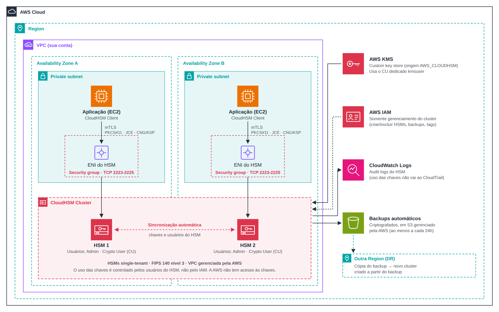

### Usuários do HSM

O controle de acesso às chaves é feito **dentro do HSM**, com usuários próprios (não é IAM):

- **Admin** (antigo **Crypto Officer - CO**): gerencia os usuários do HSM.
- **Crypto User (CU)**: cria, gerencia e usa as chaves para operações criptográficas.
- **Appliance User (AU)**: usuário usado pela AWS para sincronizar e clonar os HSMs. Não tem acesso às chaves.

> **Obs:** O **IAM** controla apenas as operações de **gerenciamento do cluster** (criar/excluir cluster e HSMs, backups, tags). O uso das chaves é controlado **exclusivamente pelos usuários do HSM**.

### Segurança de rede

- O acesso ao HSM é feito pelo **CloudHSM client** instalado na instância EC2 (ou servidor on-premises com conectividade via VPN/Direct Connect).
- O cluster tem um **security group** associado às ENIs. É preciso liberar as portas **2223-2225** a partir dos clients.
- A comunicação entre client e HSM é **criptografada ponta a ponta** (TLS mútuo). Na inicialização do cluster, você assina o certificado do cluster com a **sua própria CA**, estabelecendo a confiança.

### Casos de uso

- **Requisitos de compliance** que exigem HSM dedicado, controle exclusivo das chaves ou FIPS 140 nível 3.
- **SSL/TLS offloading** em servidores web (NGINX, Apache, IIS): a chave privada fica no HSM e as operações TLS são feitas por ele.
- **Oracle TDE** (Transparent Data Encryption) em bancos Oracle **na EC2** (o RDS for Oracle **não** suporta CloudHSM; nele, o TDE usa chaves do próprio Oracle Wallet).
- **Microsoft SQL Server TDE** via EKM (Extensible Key Management).
- **Certificate Authority**: proteger a chave privada de uma **CA própria** (ex: Microsoft AD CS).
- **Assinatura de código e documentos**, aplicações de pagamento e blockchain.
- **Custom key store do KMS**: usar as integrações nativas do KMS com os serviços AWS (S3, EBS, RDS...) com as chaves armazenadas no seu cluster CloudHSM.

### CloudHSM como Custom Key Store do KMS

- O KMS usa o cluster CloudHSM como armazenamento das chaves. As **KMS keys** são criadas com origem `AWS_CLOUDHSM`.
- Os serviços AWS continuam usando a **API do KMS** normalmente, e as operações criptográficas acontecem **no seu HSM**.
- O **CloudTrail** registra o uso das chaves (via KMS), algo que não acontece no uso direto do CloudHSM.
- Requisitos: o cluster precisa ter **pelo menos 2 HSMs ativos em AZs diferentes** e um usuário CU dedicado `kmsuser`.
- Suporta apenas **chaves simétricas** de criptografia.

> **Obs:** Se o cluster CloudHSM ficar indisponível ou for desconectado do KMS, os serviços que dependem dessas chaves **param de conseguir criptografar/descriptografar**.

### Compartilhamento e integrações

- Um cluster CloudHSM **não pode ser compartilhado** entre contas via AWS RAM. As aplicações de outras contas podem acessá-lo por **VPC peering** ou **Transit Gateway**, desde que tenham credenciais de usuário do HSM.
- O uso das chaves no HSM **não é registrado no CloudTrail** (só as chamadas de gerenciamento). Os **audit logs** do HSM são enviados para o **CloudWatch Logs**.

### Dicas para a prova

- "**HSM dedicado**", "**single-tenant**", "**FIPS 140 nível 3**" ou "a AWS **não pode ter acesso** às chaves" → **CloudHSM**.
- "Usar as chaves no HSM com **integração nativa** com S3, EBS, RDS..." → **KMS com custom key store** do CloudHSM.
- "**SSL offloading** mantendo a chave privada em um HSM" → **CloudHSM**.
- "**Oracle TDE** com chaves em HSM" → Oracle na **EC2** + CloudHSM.
- "Aplicação precisa usar **PKCS#11, JCE ou CNG**" → **CloudHSM** (o KMS não suporta essas interfaces).
- "Alta disponibilidade do CloudHSM" → cluster com **HSMs em várias AZs**.
- "DR do CloudHSM em **outra região**" → **copiar o backup** do cluster para a região de destino e criar um novo cluster a partir dele.
- "Controle de acesso às chaves do CloudHSM" → **usuários do HSM** (CU/Admin), e não IAM.
- "Chaves armazenadas **fora da AWS** (on-premises)" → **External Key Store (XKS)** do KMS, e não CloudHSM.
- "Criptografia gerenciada com **menor custo e esforço operacional**" → **KMS**, e não CloudHSM.


## S3 Security

A segurança no S3 combina vários mecanismos: **controle de acesso** (quem pode fazer o quê), **criptografia** (em repouso e em trânsito), **controles de rede** (de onde o acesso pode vir), **proteção de dados** (contra exclusão ou alteração) e **auditoria/monitoramento**.

### Mecanismos de controle de acesso

| Mecanismo | Tipo | Uso principal |
|---|---|---|
| **IAM policies** | Identity-based | O que um usuário/role **da sua conta** pode fazer no S3 |
| **Bucket policies** | Resource-based (JSON no bucket) | Acesso **cross-account**, acesso público, condições de rede/criptografia para **todos** os principals |
| **ACLs** (bucket e objeto) | Legado | Desabilitadas por padrão. Usar apenas em casos muito específicos |
| **Block Public Access** | Guardrail | Impede que o bucket/objetos fiquem **públicos**, mesmo que uma policy permita |
| **S3 Access Points** | Resource-based por aplicação | Simplificar o acesso de **várias aplicações/times** a um bucket compartilhado |
| **Pre-signed URLs** | Temporário | Dar acesso **temporário** a um objeto específico para quem não tem credenciais AWS |
| **S3 Access Grants** | Mapeamento de identidades | Conceder acesso a **prefixos** para identidades corporativas (IAM Identity Center / diretório) |

#### Avaliação de acesso

Um principal pode acessar um objeto se:

- **Mesma conta:** a **IAM policy OU** a **bucket policy** permite a ação, e **não existe nenhum Deny explícito**.
- **Cross-account:** a **IAM policy** (na conta do principal) **E** a **bucket policy** (na conta do bucket) permitem a ação.

Um **Deny explícito** em qualquer policy (SCP, RCP, IAM policy, bucket policy) sempre prevalece.

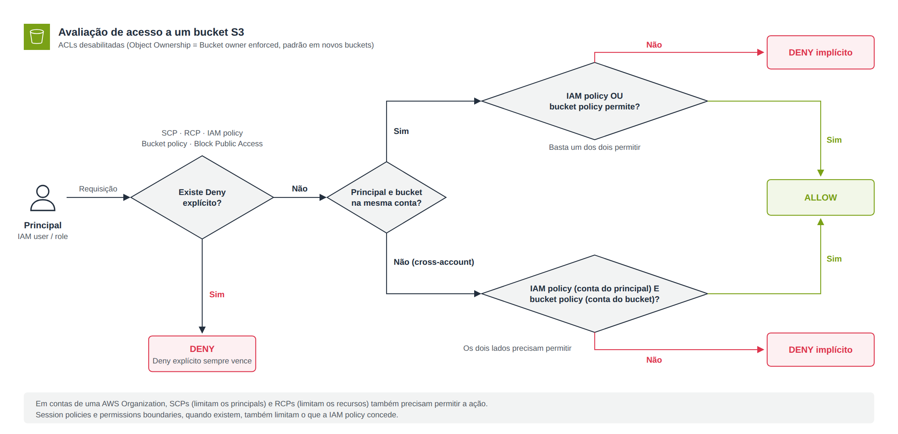

#### Bucket policies

Policies JSON anexadas ao bucket, com `Principal`, `Action`, `Resource` e `Condition`. São usadas para:

- Conceder acesso **cross-account** ou **público** (ex: site estático).
- **Forçar requisições seguras** e restringir a origem do acesso para **qualquer** principal.

**Conditions mais cobradas:**

| Condition | Uso |
|---|---|
| `aws:SecureTransport` | Negar requisições **sem HTTPS** (`"Bool": {"aws:SecureTransport": "false"}` com `Deny`) |
| `s3:TlsVersion` | Exigir uma versão mínima de TLS (ex: 1.2) |
| `s3:x-amz-server-side-encryption` | Exigir um tipo de criptografia no upload (ex: `aws:kms`) |
| `s3:x-amz-server-side-encryption-aws-kms-key-id` | Exigir uma **chave KMS específica** |
| `aws:SourceVpce` / `aws:SourceVpc` | Permitir acesso **somente via um VPC endpoint** / VPC |
| `aws:SourceIp` | Restringir por **IP público** (não funciona para tráfego via VPC endpoint) |
| `aws:PrincipalOrgID` | Permitir acesso a **todas as contas da Organization** sem listar cada conta |
| `aws:MultiFactorAuthPresent` | Exigir **MFA** para determinadas ações |
| `aws:SourceArn` / `aws:SourceAccount` | Restringir qual recurso de um **serviço AWS** pode acessar (ex: distribuição CloudFront) |

> **Obs:** Para negar uploads sem criptografia, o mais comum hoje é usar a **default encryption** do bucket (que criptografa tudo automaticamente). A bucket policy com `s3:x-amz-server-side-encryption` serve para **exigir um tipo específico** (ex: SSE-KMS com uma chave específica).

#### Object Ownership e ACLs

O **S3 Object Ownership** define quem é dono dos objetos enviados ao bucket:

- **Bucket owner enforced (padrão, recomendado):** **ACLs desabilitadas**. O dono do bucket é dono de **todos os objetos**, inclusive os enviados por outras contas. O acesso é controlado só por policies.
- **Bucket owner preferred:** ACLs ativas. O dono do bucket passa a ser dono do objeto se o upload incluir a ACL `bucket-owner-full-control`.
- **Object writer:** ACLs ativas. A conta que fez o upload é dona do objeto (comportamento legado, causava problemas de acesso cross-account).

> **Obs:** Desde **abril de 2023**, buckets novos são criados com **ACLs desabilitadas** e **Block Public Access habilitado** por padrão.

#### Block Public Access

Camada extra que **sobrepõe** policies e ACLs para impedir exposição pública. Pode ser configurado no **bucket** ou na **conta** (vale para todos os buckets). Tem 4 configurações:

- `BlockPublicAcls`: bloqueia novas ACLs públicas.
- `IgnorePublicAcls`: ignora ACLs públicas existentes.
- `BlockPublicPolicy`: bloqueia bucket policies que concedam acesso público.
- `RestrictPublicBuckets`: restringe buckets com policy pública ao acesso de serviços AWS e principals da própria conta.

> **Obs:** Para garantir que ninguém desabilite o Block Public Access, habilite-o **no nível da conta** e use uma **SCP** negando `s3:PutAccountPublicAccessBlock` / `s3:PutBucketPublicAccessBlock`.

#### Acesso cross-account

Três formas de dar acesso a outra conta:

1. **Bucket policy + IAM policy:** a bucket policy permite o principal da outra conta, e a outra conta concede permissão ao seu usuário/role via IAM policy.
2. **IAM role cross-account:** a outra conta assume uma role na conta do bucket (`sts:AssumeRole`). Útil quando o acesso envolve vários buckets/serviços.
3. **ACLs:** legado, não recomendado.

> **Obs:** Se os objetos estiverem criptografados com **SSE-KMS**, a **key policy** também precisa permitir `kms:Decrypt` (e `kms:GenerateDataKey` para uploads) para a outra conta. Isso só é possível com **customer managed key**. A chave `aws/s3` **não pode** ser compartilhada.

#### S3 Access Points (resumo)

Cada access point tem **nome, DNS e policy próprios**, apontando para um bucket (ou um prefixo). Em vez de uma bucket policy gigante, cada aplicação/time recebe seu access point com permissões específicas.

- **Network origin:** `Internet` ou **`VPC`** (só aceita requisições daquela VPC, via VPC endpoint).
- A bucket policy pode **delegar** o controle de acesso para os access points (condition `s3:DataAccessPointAccount`).
- **Multi-Region Access Points:** endpoint global que roteia para buckets em várias regiões (com replicação), com failover.

> **Obs:** Mais detalhes na seção [S3 Access Points](#s3-access-points).

#### Pre-signed URLs

URL com **assinatura e validade** que dá acesso temporário a um objeto (download com `GET` ou upload com `PUT`).

- Herda as **permissões de quem gerou** a URL.
- Validade: até **12 horas** pelo console e até **7 dias** via CLI/SDK (SigV4). Se gerada com credenciais temporárias (role), expira quando as credenciais expirarem.
- Casos de uso: download de conteúdo privado por usuários de uma aplicação, upload direto do browser para o S3.

### Criptografia

#### Criptografia em repouso

| Tipo | Quem gerencia a chave | Detalhes |
|---|---|---|
| **SSE-S3** | AWS (S3) | AES-256. **Padrão** para todos os objetos novos desde **janeiro de 2023**. Header `x-amz-server-side-encryption: AES256` |
| **SSE-KMS** | KMS (AWS managed `aws/s3` ou **customer managed key**) | **Auditoria no CloudTrail**, controle de acesso pela key policy, rotação. Header `aws:kms` |
| **DSSE-KMS** | KMS | **Dupla camada** de criptografia, para requisitos de compliance específicos. Header `aws:kms:dsse` |
| **SSE-C** | **Cliente** (enviada em cada requisição) | O S3 não armazena a chave. **Exige HTTPS**. Só via CLI/SDK/API |
| **Client-side** | **Cliente** | Os dados são criptografados **antes** do upload (ex: AWS Encryption SDK) |

**Limites do SSE-KMS:** cada upload chama `GenerateDataKey` e cada download chama `Decrypt` no KMS, o que conta para a **quota de requisições do KMS** por região. Com alto volume, pode ocorrer **throttling**. Soluções:

- **S3 Bucket Key:** o S3 gera uma chave intermediária no nível do bucket, reduzindo as chamadas ao KMS em **até 99%** (e o custo).
- Solicitar aumento da quota do KMS (Service Quotas).

> **Obs:** A **default encryption** do bucket define a criptografia aplicada quando o upload não especifica nenhuma. Alterar a default encryption **não recriptografa** objetos existentes. Para isso, use **S3 Batch Operations** (copiando os objetos) ou copie-os novamente.

#### Criptografia em trânsito

- O S3 expõe endpoints **HTTP e HTTPS**. Para forçar HTTPS, use a bucket policy com **`aws:SecureTransport = false` → Deny**.
- **SSE-C exige HTTPS**.

### Controles de rede

#### VPC Endpoints

| | **Gateway endpoint** | **Interface endpoint** (PrivateLink) |
|---|---|---|
| Como funciona | Entrada na **route table** (prefix list do S3) | **ENI** com IP privado na subnet |
| Custo | **Gratuito** | Pago (por hora + por GB) |
| Acesso de **on-premises**, peering, TGW ou outra região | ❌ | ✅ |
| DNS | Usa o DNS público do S3 | DNS específico do endpoint (ou private DNS) |

- A **bucket policy** restringe o acesso com `aws:SourceVpce` (endpoint específico) ou `aws:SourceVpc` (VPC).
- A **endpoint policy** (no VPC endpoint) restringe **quais buckets** podem ser acessados a partir da VPC, prevenindo exfiltração de dados (ex: `aws:ResourceOrgID` para permitir só buckets da sua Organization).

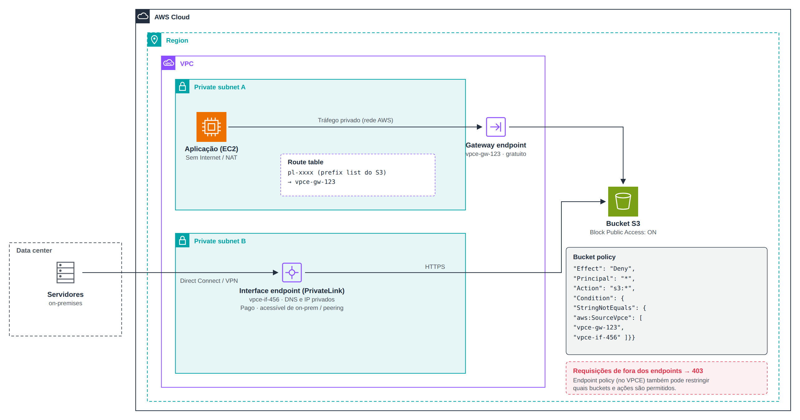

> **Obs:** `aws:SourceIp` **não funciona** com tráfego via VPC endpoint, porque as requisições usam IPs privados. Nesse caso use `aws:SourceVpce` ou `aws:SourceVpc`.

#### CloudFront com Origin Access Control (OAC)

Para servir conteúdo de um bucket **privado** via CloudFront:

- O **OAC** assina as requisições do CloudFront para o S3 com **SigV4**.
- A bucket policy permite somente o principal `cloudfront.amazonaws.com` com condition **`AWS:SourceArn`** igual ao ARN da distribuição.
- O bucket permanece com **Block Public Access** habilitado. Acessos diretos ao S3 recebem **403**.
- O OAC **substitui o OAI** (Origin Access Identity, legado). Diferente do OAI, o OAC suporta **SSE-KMS**, todas as regiões e requisições `PUT`/`DELETE`.

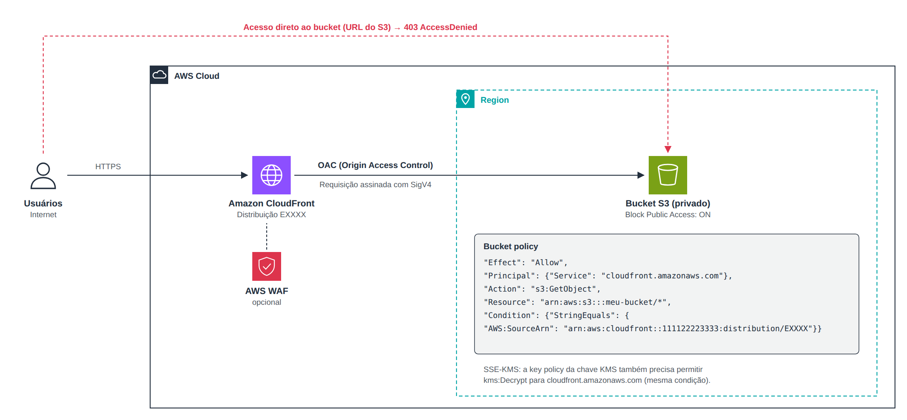

> **Obs:** Se o bucket usa **SSE-KMS**, a **key policy** também precisa permitir `kms:Decrypt` para o CloudFront. O OAC **não funciona** com o endpoint de **website** do S3 (nesse caso a origem é tratada como custom origin).

### Proteção de dados

#### Versioning

- Mantém **todas as versões** de um objeto. Protege contra sobrescrita e exclusão acidental (a exclusão cria um **delete marker**).
- É pré-requisito para **MFA Delete**, **Object Lock** e **replicação**.

#### MFA Delete

- Exige **MFA** para **excluir permanentemente uma versão** de objeto e para **suspender o versioning**.
- Só pode ser habilitado pelo **root user** e somente via **CLI/SDK/API**.

#### S3 Object Lock (WORM)

Modelo **Write Once Read Many**: impede que objetos sejam excluídos ou sobrescritos por um período. Exige **versioning**.

| Modo | Comportamento |
|---|---|
| **Governance** | A maioria dos usuários não pode excluir/alterar. Usuários com permissão `s3:BypassGovernanceRetention` **podem** contornar |
| **Compliance** | **Ninguém** pode excluir ou alterar a versão do objeto, **nem o root**, até o fim do período de retenção. O modo e o período não podem ser reduzidos |

- **Retention period:** período fixo de proteção.
- **Legal hold:** proteção **sem data de expiração**, independente da retenção. Aplicada/removida por quem tem `s3:PutObjectLegalHold`.
- **Glacier Vault Lock:** equivalente para vaults do S3 Glacier (policy imutável depois de travada).

#### Replicação

- **CRR/SRR** com replicação para um bucket em **outra conta** (com **ownership override** para a conta de destino) protege contra exclusão maliciosa na conta de origem.
- Objetos com **SSE-KMS** só são replicados se isso for configurado explicitamente na regra (informando a chave KMS de destino).

### Auditoria e monitoramento

- **S3 Server Access Logs:** registram **todas as requisições** ao bucket, entregues em **outro bucket** da mesma região (nunca no mesmo bucket, para evitar loop). Best effort.
- **CloudTrail:** management events (operações de bucket) por padrão. Operações em objetos (`GetObject`, `PutObject`...) exigem **data events** (pagos).
- **Amazon GuardDuty (S3 Protection):** detecta atividades suspeitas (acesso de IPs maliciosos, padrões anômalos de exfiltração) usando os data events do CloudTrail.
- **Amazon Macie:** descobre e classifica **dados sensíveis** (PII, dados financeiros) nos buckets.
- **IAM Access Analyzer for S3:** identifica buckets com **acesso público** ou **compartilhados com outras contas**.
- **AWS Config:** regras gerenciadas como `s3-bucket-public-read-prohibited`, `s3-bucket-ssl-requests-only`, `s3-bucket-server-side-encryption-enabled` e `s3-bucket-logging-enabled`, com remediação automática via SSM Automation.
- **S3 Event Notifications / EventBridge:** reagir a eventos nos objetos (ex: escanear arquivos enviados).

### CORS

O **CORS** (Cross-Origin Resource Sharing) é uma configuração do bucket que permite que páginas de **outra origem** (domínio) façam requisições ao bucket a partir do browser. Não é um mecanismo de autorização: ele apenas informa ao browser quais origens, métodos e headers são aceitos.

### Dicas para a prova

- "Garantir que **nenhum bucket** da conta fique público" → **Block Public Access no nível da conta** + **SCP** impedindo a alteração.
- "Forçar **HTTPS** no acesso ao bucket" → bucket policy com **Deny** quando `aws:SecureTransport = false`.
- "Exigir criptografia com uma **chave KMS específica**" → default encryption SSE-KMS + bucket policy com `s3:x-amz-server-side-encryption-aws-kms-key-id`.
- "Precisa **auditar o uso da chave** de criptografia" ou "controlar quem pode descriptografar" → **SSE-KMS** com customer managed key.
- "**Throttling** do KMS com alto volume de requisições no S3" → habilitar **S3 Bucket Key**.
- "A empresa precisa **gerenciar as próprias chaves** fora da AWS e não quer criptografar no cliente" → **SSE-C**.
- "Dados criptografados **antes** de sair da aplicação" → **client-side encryption**.
- "Permitir acesso ao bucket **somente a partir da VPC**" → **VPC endpoint** + bucket policy com `aws:SourceVpce`.
- "Acesso privado ao S3 a partir de **on-premises** (Direct Connect/VPN)" → **interface endpoint** (o gateway endpoint não suporta).
- "Acesso privado ao S3 a partir da VPC com **menor custo**" → **gateway endpoint**.
- "Evitar **exfiltração de dados** para buckets de outras contas" → **endpoint policy** no VPC endpoint (ex: `aws:ResourceOrgID`).
- "Permitir acesso a **todas as contas da Organization**" → bucket policy com `aws:PrincipalOrgID`.
- "Conteúdo do bucket acessível **somente pelo CloudFront**" → **OAC** + bucket policy com `AWS:SourceArn` da distribuição.
- "Objetos enviados por **outra conta** não podem ser lidos pelo dono do bucket" → **Object Ownership = Bucket owner enforced**.
- "Acesso cross-account a objetos com **SSE-KMS**" → bucket policy + IAM policy + **key policy** da **customer managed key** liberando a outra conta.
- "Várias aplicações acessando o mesmo bucket com **permissões diferentes**" → **S3 Access Points**.
- "Dar acesso **temporário** a um objeto privado para um usuário sem credenciais AWS" → **pre-signed URL**.
- "Dados **imutáveis** por exigência regulatória, nem o root pode apagar" → **Object Lock em Compliance mode**.
- "Proteção WORM, mas **administradores podem** remover em casos excepcionais" → **Object Lock em Governance mode**.
- "Reter um objeto **por tempo indeterminado** por causa de um processo judicial" → **Legal hold**.
- "Proteger contra **exclusão permanente** de versões" → **Versioning + MFA Delete**.
- "Descobrir **dados sensíveis (PII)** nos buckets" → **Amazon Macie**.
- "Detectar **acessos suspeitos** aos dados do S3" → **GuardDuty S3 Protection**.
- "Identificar buckets **compartilhados com contas externas** ou públicos" → **IAM Access Analyzer for S3**.
- "Registrar **quem acessou cada objeto**" → **CloudTrail data events** (ou Server Access Logs).
- "Criptografar **objetos já existentes** após mudar a default encryption" → **S3 Batch Operations**.

## S3 Access Points

Os S3 Access Points são **pontos de acesso nomeados** associados a um bucket, cada um com **policy, configurações de rede e Block Public Access próprios**. O objetivo é **simplificar o gerenciamento de acesso** a buckets compartilhados por muitas aplicações, times ou contas.

**O problema que resolvem:** em um data lake ou bucket compartilhado, a bucket policy acumula regras de dezenas de aplicações e times, fica difícil de manter e pode atingir o **limite de 20 KB**. Uma mudança errada nela afeta todos os consumidores. Com access points, cada consumidor tem **o seu próprio ponto de entrada**, com uma policy pequena e isolada.

### Características

- Cada access point tem:
  - **Nome** e **ARN** próprios: `arn:aws:s3:us-east-1:111122223333:accesspoint/finance-ap`.
  - **DNS** próprio: `finance-ap-111122223333.s3-accesspoint.us-east-1.amazonaws.com`.
  - **Alias** (`finance-ap-abc123...-s3alias`), que pode ser usado **no lugar do nome do bucket** em qualquer aplicação ou serviço que espera um nome de bucket.
  - **Access point policy** (resource-based), que normalmente restringe o acesso a um **prefixo** do bucket.
  - **Block Public Access** próprio.
  - **Network origin**: `Internet` ou `VPC`.
- Um bucket pode ter **milhares de access points** (quota padrão de 10.000 por região por conta, ajustável).
- Suporta as **operações de objeto** (`GetObject`, `PutObject`, `ListObjects`...). Operações de configuração do bucket (ex: excluir o bucket, alterar versioning) continuam sendo feitas no bucket.
- As requisições feitas via access point aparecem no **CloudTrail** com o ARN do access point, facilitando a auditoria por aplicação.

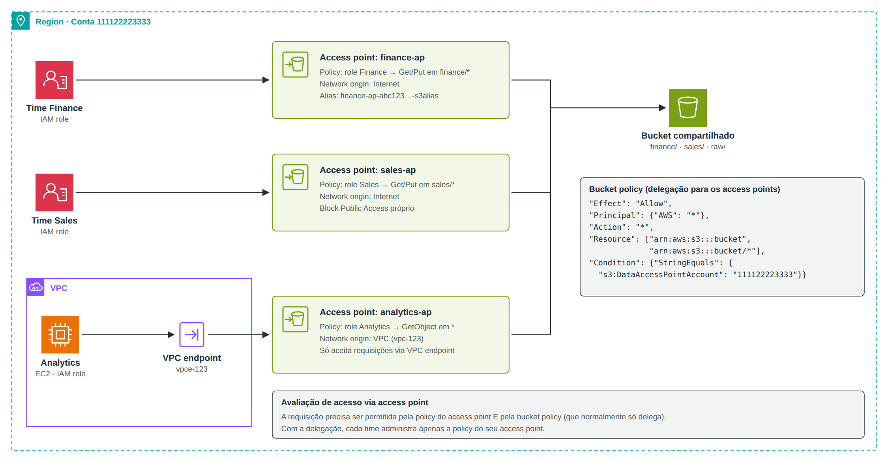

### Policies e delegação

Uma requisição feita por um access point precisa ser permitida pela **policy do access point E pela bucket policy**. Para não ter que repetir as permissões nos dois lugares, a bucket policy **delega** o controle de acesso para os access points da conta:

```json
{
  "Effect": "Allow",
  "Principal": { "AWS": "*" },
  "Action": "*",
  "Resource": ["arn:aws:s3:::meu-bucket", "arn:aws:s3:::meu-bucket/*"],
  "Condition": {
    "StringEquals": { "s3:DataAccessPointAccount": "111122223333" }
  }
}
```

A policy do access point concede as permissões de cada consumidor. Note que o recurso é referenciado **pelo ARN do access point**, com o prefixo `object/`:

```json
{
  "Effect": "Allow",
  "Principal": { "AWS": "arn:aws:iam::111122223333:role/Finance" },
  "Action": ["s3:GetObject", "s3:PutObject"],
  "Resource": "arn:aws:s3:us-east-1:111122223333:accesspoint/finance-ap/object/finance/*"
}
```

> **Obs:** Para **forçar** que todo acesso ao bucket passe por access points, use uma bucket policy com `Deny` quando a condition `s3:DataAccessPointArn` não existir (ou não for de um access point aprovado). Para impedir a criação de access points com origem Internet, use uma **SCP** com a condition `s3:AccessPointNetworkOrigin`.

### Network origin: VPC

- Um access point com network origin **VPC** só aceita requisições **vindas daquela VPC**, através de um **VPC endpoint** (gateway ou interface) do S3.
- A network origin é definida **na criação** e **não pode ser alterada** depois.
- A **endpoint policy** do VPC endpoint precisa permitir o acesso ao **access point** e ao **bucket** de destino.
- É uma forma simples de garantir que dados sensíveis só sejam acessados de dentro de uma rede privada, **sem mexer na bucket policy**.

### Access points cross-account

- Um access point pode ser criado em uma **conta diferente** da conta dona do bucket.
- O **dono do bucket** precisa autorizar, com a bucket policy delegando para a conta do access point (`s3:DataAccessPointAccount`), ou permitindo o ARN do access point.
- Útil quando a conta consumidora quer **gerenciar o próprio acesso** (policy, rede) a um bucket central, como em arquiteturas de **data mesh** ou data lake multi-account.

### Multi-Region Access Points

Um **Multi-Region Access Point (MRAP)** fornece um **endpoint global único** que roteia as requisições para buckets em **várias regiões**.

- O tráfego é roteado pela **rede global da AWS** (tecnologia do **AWS Global Accelerator**) para o bucket com **menor latência** para o cliente.
- Os buckets são mantidos sincronizados com **S3 Cross-Region Replication** (normalmente **bidirecional**), configurada à parte.
- **Failover controls:** a configuração de roteamento pode ser **ativo/ativo** ou **ativo/passivo**. Em um incidente, é possível mover o tráfego para outra região **em minutos**, sem alterar a aplicação.
- As requisições são assinadas com **SigV4A** (assinatura válida para várias regiões). Os SDKs atuais suportam esse tipo de assinatura.
- Suporta buckets em **outras contas** e tem policy própria, avaliada junto com a bucket policy de cada bucket.
- O **Block Public Access** é sempre habilitado em um MRAP e não pode ser alterado.
- Custo: taxa de **roteamento de dados** por GB, mais o custo de transferência e replicação entre regiões.

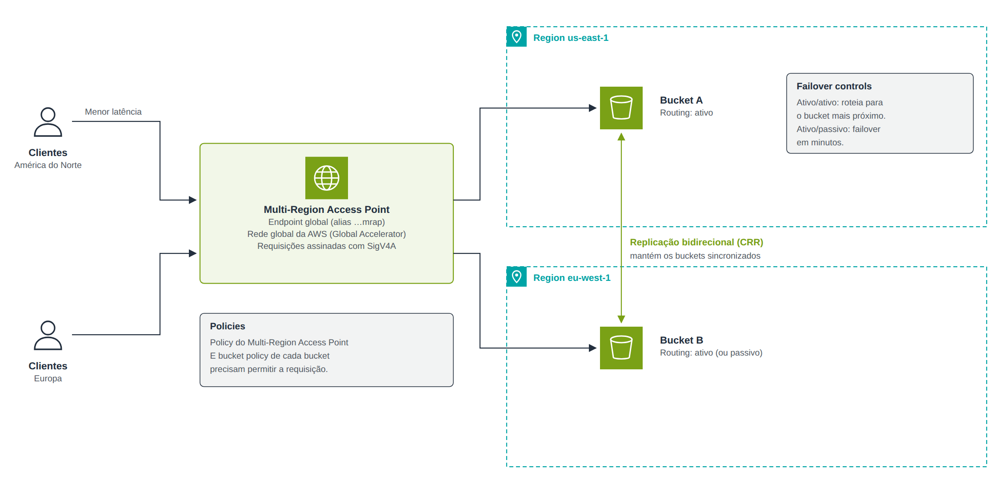

**Casos de uso:** aplicações **multi-região** com usuários espalhados globalmente, **disaster recovery** ativo/passivo do armazenamento e simplificação da configuração das aplicações (um único endpoint, independente de região).

### S3 Object Lambda Access Points

Um **Object Lambda Access Point** invoca uma **função Lambda** para **transformar o objeto** no momento da leitura (`GetObject`, `HeadObject`, `ListObjects`), sem precisar armazenar cópias modificadas.

- A aplicação faz a requisição ao Object Lambda Access Point, que invoca a Lambda.
- A Lambda busca o objeto original por um **supporting access point** (um access point comum do bucket), aplica a transformação e devolve o resultado com `WriteGetObjectResponse`.
- Exemplos: **mascarar PII** para aplicações sem permissão de ver dados sensíveis, converter formatos (ex: XML → JSON), redimensionar imagens ou adicionar marca d'água, enriquecer dados consultando outra fonte.

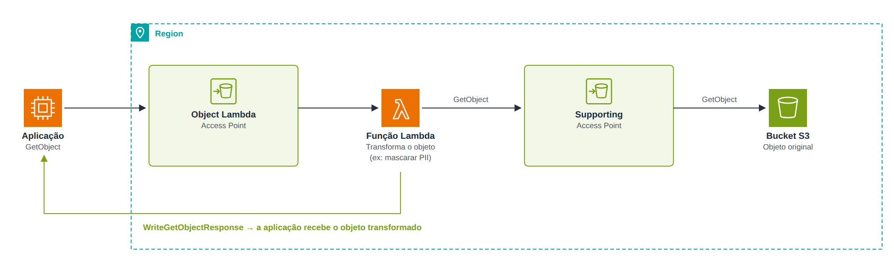

> **Obs:** A AWS anunciou que o S3 Object Lambda **não aceita mais novos clientes**. Contas que já usavam o recurso continuam com acesso. Confirme a situação atual na documentação. O tema ainda pode aparecer na prova.

### Access Points vs. outras formas de controle de acesso

| | Bucket policy | S3 Access Points | S3 Access Grants |
|---|---|---|---|
| Escopo | Uma policy para o bucket inteiro | Uma policy **por aplicação/time** | Concessões por **prefixo** para identidades |
| Identidades | IAM principals | IAM principals | IAM principals **e** usuários/grupos corporativos (IAM Identity Center / diretório) |
| Controle de rede | Via conditions (`aws:SourceVpce`) | **Network origin VPC** nativo | ❌ |
| Melhor para | Poucos consumidores, regras globais (ex: forçar HTTPS) | **Muitas aplicações** acessando um bucket compartilhado | Acesso de **usuários corporativos** em escala a data lakes |

### Dicas para a prova

- "Bucket compartilhado por **muitos times/aplicações** e a bucket policy está **complexa** ou atingindo o **limite de tamanho**" → **S3 Access Points**, um por aplicação, com delegação na bucket policy.
- "Cada time deve acessar **somente o seu prefixo**" → access point por time com policy restrita ao prefixo.
- "Garantir que um conjunto de dados só seja acessado **de dentro de uma VPC**, sem alterar a bucket policy" → access point com **network origin VPC**.
- "Obrigar todo acesso ao bucket a passar por access points" → bucket policy com Deny baseado em `s3:DataAccessPointArn`.
- "Impedir que alguém crie access points **acessíveis pela Internet**" → **SCP** com `s3:AccessPointNetworkOrigin`.
- "Uma aplicação espera um **nome de bucket**, mas o acesso deve passar pelo access point" → **access point alias**.
- "Endpoint **global único** para buckets em várias regiões com **menor latência**" → **Multi-Region Access Point** + CRR.
- "**Failover** do S3 entre regiões em minutos, **sem alterar a aplicação**" → **MRAP com failover controls** (ativo/passivo).
- "Remover **PII** dos objetos para algumas aplicações **sem manter cópias** dos dados" → **S3 Object Lambda Access Point**.
- "Dar acesso a dados do S3 para **usuários do diretório corporativo** em escala" → **S3 Access Grants**, e não access points.

## DDoS Attacks

Um ataque de **negação de serviço (DoS - Denial of Service)** tenta deixar uma aplicação, servidor ou rede **indisponível para os usuários legítimos**, esgotando algum recurso do alvo: banda de rede, conexões, CPU, memória, threads ou limites de uma API.

Em um **DDoS (Distributed Denial of Service)**, o ataque parte de **milhares ou milhões de origens ao mesmo tempo**. Isso torna o ataque muito maior e muito mais difícil de bloquear, porque não basta bloquear um IP.

### Como um DDoS é executado

A forma mais comum é por meio de uma **botnet**: uma rede de dispositivos comprometidos por malware (PCs, câmeras IP, roteadores, servidores mal configurados) controlada pelo atacante através de servidores de **Command & Control (C&C)**. Quando o atacante dá a ordem, todos os bots enviam tráfego para o alvo ao mesmo tempo.

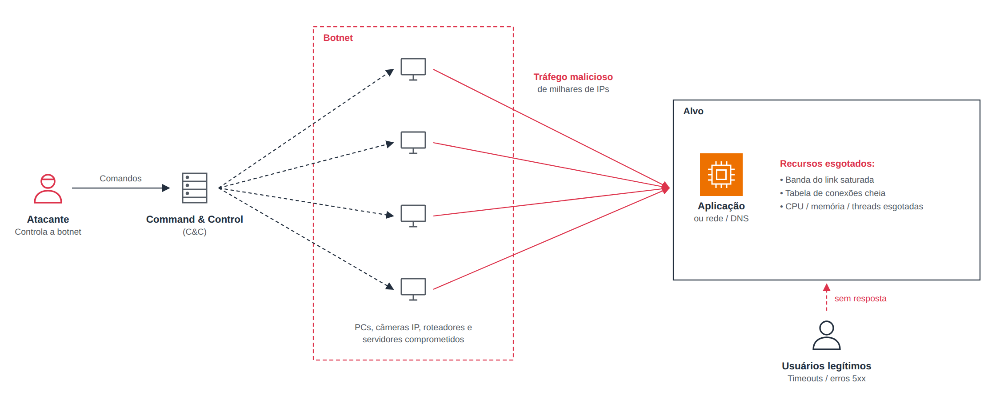

- Botnets formadas por dispositivos **IoT** mal protegidos (ex: Mirai, em 2016) geram ataques enormes, porque existem milhões desses dispositivos conectados.
- Existem serviços de "**DDoS de aluguel**" (*booters/stressers*), o que torna esse tipo de ataque barato e acessível.

**Motivações:** extorsão (pedido de resgate para parar o ataque), concorrência, ativismo (*hacktivism*), vingança e **cortina de fumaça** para desviar a atenção do time de segurança enquanto outro ataque acontece (ex: exfiltração de dados).

### Métricas de um ataque

| Métrica | Mede | Tipo de ataque |
|---|---|---|
| **bps** (bits por segundo) | Volume de tráfego | Volumétricos: saturam o link |
| **pps** (pacotes por segundo) | Quantidade de pacotes | Protocolo: esgotam a capacidade de processamento de roteadores, firewalls e load balancers |
| **rps** (requisições por segundo) | Requisições HTTP/DNS | Camada de aplicação: esgotam os servidores da aplicação |

> **Obs:** Os ataques crescem a cada ano. Em fevereiro de 2020, a AWS reportou ter mitigado com o **AWS Shield** um ataque de **2,3 Tbps** (reflexão CLDAP). Desde então, provedores de CDN já reportaram ataques bem maiores. Não é viável dimensionar uma infraestrutura própria para absorver ataques desse tamanho, por isso a mitigação acontece na **borda** de redes globais.

### Tipos de ataque

Os ataques são normalmente classificados pela **camada do modelo OSI** que atingem.

#### Camada 3 e 4: Ataques volumétricos

Tentam **saturar a banda** do alvo com um volume enorme de tráfego. São os ataques mais comuns.

- **UDP flood:** grande volume de pacotes UDP para portas aleatórias. O servidor gasta recursos verificando as portas e respondendo com ICMP "destination unreachable".
- **ICMP flood:** grande volume de pacotes ICMP (ex: ping).
- **Reflexão e amplificação:** o tipo de ataque volumétrico mais eficiente (detalhado abaixo).

#### Reflexão e amplificação

O atacante envia **requisições pequenas** para servidores abertos na Internet (DNS, NTP, Memcached, SSDP, CLDAP...), **falsificando o IP de origem** com o IP da vítima (*IP spoofing*). Os servidores respondem para a vítima com respostas **muito maiores** que as requisições.

- **Reflexão:** o tráfego chega à vítima a partir de servidores legítimos, escondendo a origem real do ataque.
- **Amplificação:** cada byte enviado pelo atacante vira dezenas, centenas ou milhares de bytes na vítima.
- Esses ataques usam **UDP**, porque o protocolo não tem handshake. Assim, o servidor responde sem validar se a origem é verdadeira.

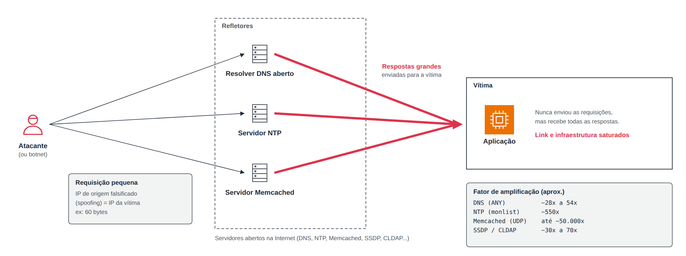

#### Camada 4: Ataques de protocolo (*state exhaustion*)

Exploram o funcionamento dos protocolos para **esgotar tabelas de estado** de servidores, firewalls e load balancers, mesmo com pouco volume de tráfego.

- **SYN flood:** o atacante envia milhares de pacotes `SYN` (início do handshake TCP) com IPs falsificados. O servidor responde com `SYN-ACK` e **reserva recursos** para cada conexão, aguardando um `ACK` que nunca chega. A fila de conexões *half-open* (backlog) enche e novas conexões legítimas são descartadas.
- **ACK/RST flood:** pacotes TCP fora de contexto que obrigam firewalls *stateful* a consultar suas tabelas.
- **Ataques de fragmentação:** pacotes fragmentados que consomem recursos na remontagem.

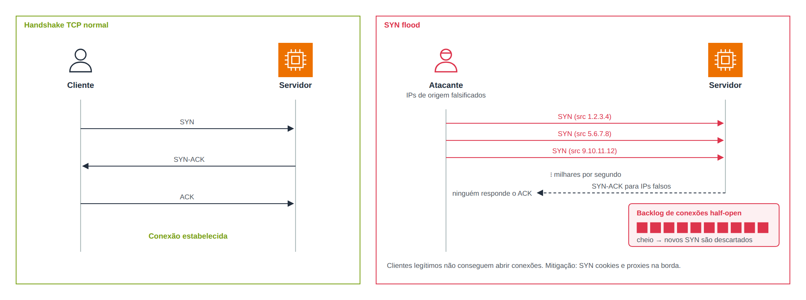

> **Obs:** A defesa clássica contra SYN flood são os **SYN cookies**: o servidor não reserva recursos até receber o `ACK` final. Na AWS, o Shield e serviços de borda (CloudFront, Global Accelerator, ELB) absorvem esses ataques antes que eles cheguem às instâncias.

#### Camada 7: Ataques à aplicação

Imitam o comportamento de **usuários legítimos** para esgotar os recursos da aplicação (servidores web, banco de dados, APIs). Usam muito menos tráfego que os volumétricos, mas são **mais difíceis de detectar**, porque cada requisição isolada parece normal.

- **HTTP flood:** grande volume de requisições `GET`/`POST`, frequentemente para páginas "caras" (busca, login, relatórios) que consomem banco de dados e CPU.
- **Cache-busting:** variações na query string (`?x=123`) para que as requisições **não sejam atendidas pelo cache** da CDN e cheguem à origem.
- **Slowloris / slow POST:** abre muitas conexões e envia dados **muito devagar**, mantendo-as abertas para esgotar o limite de conexões do servidor.
- **DNS query flood:** grande volume de consultas para domínios inexistentes ou aleatórios, sobrecarregando o servidor DNS autoritativo.
- **Abuso de vulnerabilidades de protocolo:** ex: **HTTP/2 Rapid Reset** (2023), que abre e cancela streams em sequência para gerar centenas de milhões de requisições por segundo.
- **Bots e scraping agressivo, credential stuffing e abuso de APIs** também podem causar indisponibilidade.

### Resumo das categorias

| Categoria | Camada | Exemplos | Alvo | Medido em |
|---|---|---|---|---|
| **Volumétrico** | 3/4 | UDP flood, reflexão/amplificação (DNS, NTP, Memcached) | Banda do link | bps |
| **Protocolo** | 3/4 | SYN flood, ACK flood, fragmentação | Tabelas de estado, firewalls, LBs | pps |
| **Aplicação** | 7 | HTTP flood, cache-busting, Slowloris, DNS query flood | Servidores e banco de dados | rps |

### DDoS na nuvem: impacto financeiro

Na nuvem, uma arquitetura com **Auto Scaling** pode **absorver** parte de um ataque escalando a infraestrutura, mas isso gera **custo**. Esse risco é chamado de **EDoS (Economic Denial of Sustainability)**: o serviço continua no ar, mas a conta explode (instâncias, transferência de dados, requisições ao CloudFront/API Gateway, invocações Lambda).

> **Obs:** O **AWS Shield Advanced** oferece **proteção de custo** (*cost protection*): créditos para os aumentos de cobrança causados por um ataque DDoS em recursos protegidos.

### Princípios de mitigação

As boas práticas de resiliência a DDoS da AWS seguem alguns princípios:

1. **Reduzir a superfície de ataque:** expor à Internet só o necessário. Instâncias e bancos em **subnets privadas**, acesso apenas via load balancer ou CDN, **security groups** e **NACLs** restritivos, origens acessíveis somente pelo CloudFront.
2. **Absorver o ataque na borda:** usar serviços com capacidade global (**CloudFront**, **Route 53**, **Global Accelerator**) para que o tráfego malicioso seja absorvido nas **edge locations**, longe da aplicação.
3. **Escalar para absorver:** **ELB** e **Auto Scaling** distribuem a carga e aumentam a capacidade durante picos. Arquiteturas **serverless** escalam automaticamente.
4. **Detectar e filtrar requisições maliciosas na camada 7:** **AWS WAF** com rate-based rules, managed rules e controle de bots. **Cache** agressivo no CloudFront para que menos requisições cheguem à origem.
5. **Monitorar e ter um plano de resposta:** métricas e alarmes no **CloudWatch** (picos de requisições, erros 5xx, latência), runbook de resposta a incidentes e, com o Shield Advanced, suporte do **Shield Response Team (SRT)**.

### Serviços AWS envolvidos

| Camada | Serviços AWS |
|---|---|
| 3/4 (volumétrico e protocolo) | **AWS Shield Standard** (automático e gratuito para todos), **Shield Advanced**, CloudFront, Route 53, Global Accelerator, ELB |
| 7 (aplicação) | **AWS WAF**, **Shield Advanced** (mitigação automática na camada 7), CloudFront (cache), API Gateway (throttling) |
| Rede da VPC | Security Groups, NACLs, **AWS Network Firewall**, subnets privadas |
| Escalabilidade | ELB, Auto Scaling, serviços serverless |
| Monitoramento | CloudWatch, Shield Advanced (métricas e notificações de ataques), Firewall Manager (gestão centralizada) |

### Dicas para a prova

- "Tráfego vindo de **milhares de IPs diferentes**" → é um **DDoS**. Bloquear IPs com NACL ou security group **não resolve**, porque a NACL tem limite de regras e os IPs mudam o tempo todo.
- "Ataque de **reflexão/amplificação UDP**" ou "**SYN flood**" → camadas 3/4: **AWS Shield** (o Standard já protege automaticamente) + serviços de borda.
- "Ataque com requisições HTTP que **parecem legítimas**", "**HTTP flood**" → camada 7: **AWS WAF** com **rate-based rules**, de preferência no **CloudFront**.
- "Proteger a origem contra **cache-busting**" → ajustar o cache no CloudFront (ignorar query strings desnecessárias) + WAF.
- "Reduzir a **superfície de ataque**" → recursos em **subnets privadas**, exposição apenas via **ALB/CloudFront**, origem acessível somente pelo CloudFront.
- "Evitar **aumento de custo** causado por um ataque DDoS" → **Shield Advanced** (cost protection).
- "Precisa de **suporte especializado 24/7** durante um ataque" → **Shield Advanced** + **Shield Response Team (SRT)**.

## AWS Shield

O AWS Shield é o serviço gerenciado de **proteção contra ataques DDoS** da AWS. Ele tem dois níveis: **Shield Standard**, gratuito e automático para todos os clientes, e **Shield Advanced**, pago, com proteções e suporte adicionais.

### Shield Standard

- **Gratuito** e **habilitado automaticamente** para todos os clientes da AWS, sem nenhuma configuração.
- Protege contra os ataques mais comuns das **camadas 3 e 4**: SYN/UDP floods, ataques de reflexão e amplificação e outros ataques de rede e transporte.
- Detecção **always-on** e mitigação **inline**, sem impacto perceptível na latência.
- A proteção é mais forte nos serviços de **borda** (**CloudFront**, **Route 53** e **Global Accelerator**), que absorvem os ataques nas edge locations, longe da aplicação.
- **Não** protege contra ataques de **camada 7** (HTTP flood, por exemplo). Para isso é preciso usar o **AWS WAF** ou o Shield Advanced.

### Shield Advanced

Serviço pago que adiciona proteção mais sofisticada, visibilidade e suporte especializado para **recursos específicos** que você escolhe proteger.

**Recursos que podem ser protegidos:**

- Distribuições **CloudFront**.
- Hosted zones do **Route 53**.
- Accelerators do **Global Accelerator**.
- **Elastic Load Balancers** (ALB, NLB e Classic Load Balancer).
- **Elastic IPs** de instâncias EC2 (e, por consequência, NLBs e outros recursos expostos via EIP).

**Custo:** **US$ 3.000 por mês por organização** (o valor cobre todas as contas da AWS Organization sob o mesmo payer), com **compromisso de 1 ano**, mais uma taxa de **transferência de dados (data transfer out)** dos recursos protegidos.

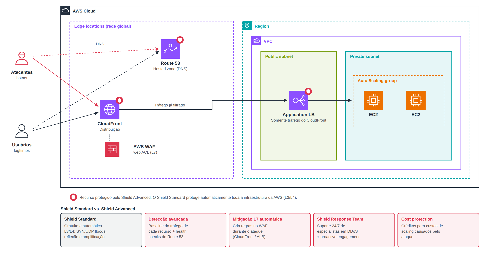

#### Funcionalidades do Shield Advanced

- **Detecção personalizada:** o Shield aprende o **baseline** do tráfego de cada recurso protegido e detecta anomalias com mais precisão. Também detecta ataques **L3/L4/L7** que o Standard não trata.
- **Detecção baseada em saúde (health-based detection):** ao associar **health checks do Route 53** aos recursos protegidos, o Shield usa a saúde da aplicação para detectar ataques **mais rápido** e reduzir falsos positivos. É **pré-requisito** para o proactive engagement.
- **Mitigação automática na camada 7:** o Shield Advanced cria e gerencia **regras do AWS WAF** em um **rule group** dentro da sua web ACL quando detecta um ataque HTTP, e as remove quando o ataque termina. As regras podem ficar em modo **Count** (só monitorar) ou **Block**. Exige uma **web ACL** associada ao recurso (CloudFront ou ALB).
- **Shield Response Team (SRT):** time de especialistas da AWS em DDoS, disponível **24/7** durante ataques. O SRT pode analisar o tráfego e **criar regras no WAF por você**, desde que você conceda uma **IAM role** de acesso (e, opcionalmente, acesso aos logs no S3). Exige plano de suporte **Business** ou **Enterprise**.
- **Proactive engagement:** o SRT **entra em contato com você** (contatos de emergência cadastrados) quando um ataque afeta a saúde da aplicação, em vez de esperar você abrir um caso. Exige health checks do Route 53 associados aos recursos.
- **Proteção de custo (cost protection):** créditos para os aumentos de cobrança causados por um ataque DDoS (scaling de EC2, ELB, CloudFront, Route 53, Global Accelerator). É solicitada abrindo um caso no suporte.
- **Visibilidade:** métricas no **CloudWatch** (`DDoSDetected`, `DDoSAttackBitsPerSecond`, `DDoSAttackPacketsPerSecond`, `DDoSAttackRequestsPerSecond`), diagnóstico detalhado dos ataques e histórico no console.
- **AWS WAF e Firewall Manager sem custo adicional** para os recursos protegidos pelo Shield Advanced.
- **Protection groups:** agrupam recursos (ex: todos os ALBs de uma aplicação) para que o Shield trate o grupo como **uma unidade**, melhorando a precisão da detecção.
- **Mitigação de borda para Elastic IPs:** para recursos protegidos via EIP, o Shield Advanced pode aplicar as **NACLs** da VPC **na borda da rede AWS**, bloqueando o tráfego antes de ele chegar à VPC.

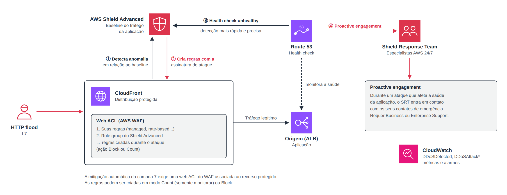

### Shield Standard vs. Shield Advanced

| | Shield Standard | Shield Advanced |
|---|---|---|
| Custo | **Gratuito** | **US$ 3.000/mês por organização** + data transfer, compromisso de 1 ano |
| Ativação | Automática | Assinatura + escolha dos recursos protegidos |
| Camadas | 3 e 4 | 3, 4 e **7** |
| Recursos | Toda a infraestrutura AWS | CloudFront, Route 53, Global Accelerator, ELB, Elastic IP |
| Detecção | Assinaturas de ataques comuns | Baseline por recurso + **health checks** |
| Mitigação L7 | ❌ (usar WAF manualmente) | ✅ **Automática** via regras no WAF |
| Suporte especializado | ❌ | ✅ **SRT 24/7** (com Business/Enterprise Support) |
| Proactive engagement | ❌ | ✅ |
| Proteção de custo | ❌ | ✅ |
| WAF e Firewall Manager | Cobrados normalmente | **Sem custo adicional** nos recursos protegidos |
| Métricas e relatórios | Básicos | Métricas no CloudWatch e diagnóstico detalhado |

### Shield Advanced em ambientes multi-account

- A assinatura é feita **por conta**, mas o valor mensal é cobrado **uma única vez por organização** (consolidated billing).
- O **AWS Firewall Manager** permite criar **políticas de Shield Advanced** que aplicam a proteção **automaticamente** a todos os recursos (e aos novos recursos criados) em todas as contas da Organization, garantindo que nenhum recurso exposto fique sem proteção.

### Boas práticas com o Shield

- Colocar a aplicação atrás de **CloudFront** e usar **Route 53** para o DNS: são os serviços com a maior capacidade de absorção.
- Associar uma **web ACL do WAF** com **rate-based rules** aos recursos expostos.
- Associar **health checks do Route 53** aos recursos protegidos para habilitar a detecção baseada em saúde e o proactive engagement.
- Conceder ao **SRT** uma IAM role de acesso **antes** de um ataque acontecer.
- Criar **alarmes no CloudWatch** para as métricas `DDoSDetected`.
- Restringir o acesso à origem (ALB/S3) para que ela só aceite tráfego do CloudFront.

### Dicas para a prova

- "Proteção contra DDoS **sem custo adicional**" ou "ataques **SYN/UDP flood** e **reflexão**" → **Shield Standard** (já está ativo).
- "Proteção contra ataques **de camada 7** com **menor esforço operacional**" → **Shield Advanced** com **mitigação automática L7** (ou **WAF** com rate-based rules, se o requisito for custo).
- "Acesso a **especialistas da AWS 24/7** durante um ataque" → **Shield Advanced + SRT** (exige **Business/Enterprise Support**).
- "Ser **contatado proativamente** pela AWS durante um ataque" → **proactive engagement** + **health checks do Route 53**.
- "Evitar **custos inesperados** de scaling causados por DDoS" → **Shield Advanced cost protection**.
- "Detecção de ataques **mais rápida e precisa**" → **health-based detection** com Route 53 health checks.
- "Aplicar o Shield Advanced automaticamente a **todos os recursos** de **todas as contas** da Organization" → **AWS Firewall Manager** com políticas de Shield Advanced.
- "Proteger uma aplicação em **EC2 exposta diretamente** (sem ELB/CloudFront)" → Shield Advanced no **Elastic IP** da instância.
- "**Visibilidade e métricas** detalhadas sobre ataques DDoS" → **Shield Advanced** + métricas no **CloudWatch**.
- "O SRT precisa **criar regras no WAF** em nome da empresa" → conceder uma **IAM role** de acesso ao SRT.

## AWS Web Application Firewall (WAF)

O AWS WAF é um **firewall de aplicação web** que protege aplicações contra ataques e explorações na **camada 7 (HTTP/HTTPS)**: SQL injection, cross-site scripting (XSS), bots, abuso de APIs e ataques DDoS de camada de aplicação (HTTP flood).

Ele inspeciona cada requisição HTTP (IP de origem, país, headers, query string, URI, cookies, body) e decide se ela deve ser **permitida, bloqueada, contada ou desafiada**.

### Onde o WAF pode ser usado

O WAF é associado a recursos específicos, e **não** a uma VPC ou instância:

- **Amazon CloudFront** (escopo **global**: a web ACL é criada em **`us-east-1`**).
- **Application Load Balancer**.
- **Amazon API Gateway** (REST APIs).
- **AWS AppSync** (GraphQL APIs).
- **Amazon Cognito** (user pools).
- **AWS App Runner** e **AWS Verified Access**.

Para os recursos regionais, a web ACL deve estar **na mesma região** do recurso. Uma web ACL pode ser associada a **vários recursos**, mas cada recurso tem **no máximo uma** web ACL.

> **Obs:** O WAF **não** pode ser associado a **Network Load Balancer**, Gateway Load Balancer ou **instâncias EC2** diretamente, porque eles operam na camada 4. Para proteger esses casos, coloque um **ALB** ou o **CloudFront** na frente, ou use o **AWS Network Firewall** dentro da VPC.

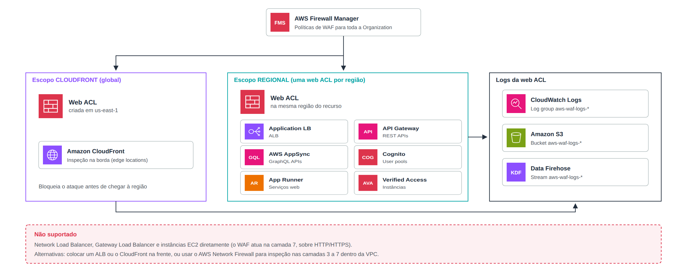

### Componentes

- **Web ACL (Web Access Control List):** o conjunto de **regras** associado aos recursos protegidos, com uma **default action** (Allow ou Block) aplicada quando nenhuma regra termina a avaliação.
- **Rules:** cada regra tem uma **condição** (statement) e uma **ação**. As regras são avaliadas em ordem de **prioridade**.
- **Rule groups:** conjuntos reutilizáveis de regras. Podem ser **próprios**, **AWS Managed Rules** ou do **AWS Marketplace**.
- **IP sets** e **regex pattern sets:** listas reutilizáveis de IPs/CIDRs (até **10.000** por IP set) e de expressões regulares.
- **WCU (Web ACL Capacity Units):** cada regra consome capacidade de acordo com a complexidade. Uma web ACL pode usar até **5.000 WCUs** (acima de **1.500** há custo adicional).

### Statements (condições)

| Statement | O que inspeciona |
|---|---|
| **IP set match** | IP de origem (ou IP de um header, como `X-Forwarded-For`) |
| **Geo match** | País/região de origem da requisição |
| **String / regex match** | Texto em headers, URI, query string, body, cookies |
| **Size constraint** | Tamanho de partes da requisição (ex: body muito grande) |
| **SQL injection / XSS** | Padrões de **SQLi** e **cross-site scripting** |
| **Rate-based** | Quantidade de requisições por chave em uma janela de tempo |
| **Label match** | Labels adicionadas por regras avaliadas antes |
| **AND / OR / NOT** | Combinação de statements |

> **Obs:** O WAF inspeciona apenas os **primeiros bytes do body**: **8 KB** no ALB e no AppSync, e **16 KB por padrão** no CloudFront, API Gateway, Cognito, App Runner e Verified Access (configurável até **64 KB**, com custo adicional). É preciso definir o que fazer com o restante (*oversize handling*: continuar, permitir ou bloquear).

### Ações

| Ação | Tipo | Comportamento |
|---|---|---|
| **Allow** | Terminativa | Encaminha a requisição para o recurso protegido (pode inserir headers customizados) |
| **Block** | Terminativa | Retorna **HTTP 403** ou uma **resposta customizada** (status code, headers e body próprios) |
| **Count** | **Não terminativa** | Só **conta** e registra a requisição, e a avaliação continua. Usado para **testar regras** antes de bloquear |
| **CAPTCHA** | Terminativa* | Exige que o usuário resolva um **quebra-cabeça**. Com token válido, a requisição segue |
| **Challenge** | Terminativa* | Desafio **silencioso** (JavaScript) para verificar se o cliente é um navegador. Com token válido, a requisição segue |

\* Quando o cliente já tem um **token válido**, CAPTCHA e Challenge funcionam como Count e a avaliação continua.

**Labels:** qualquer regra pode adicionar **labels** à requisição (ex: `awswaf:managed:aws:bot-control:bot:category:scraper`). Regras com prioridade maior podem usar essas labels para tomar decisões, combinando várias regras. Exemplo: um managed rule group em modo Count adiciona a label, e uma regra própria bloqueia só quando a label aparece em uma rota específica.

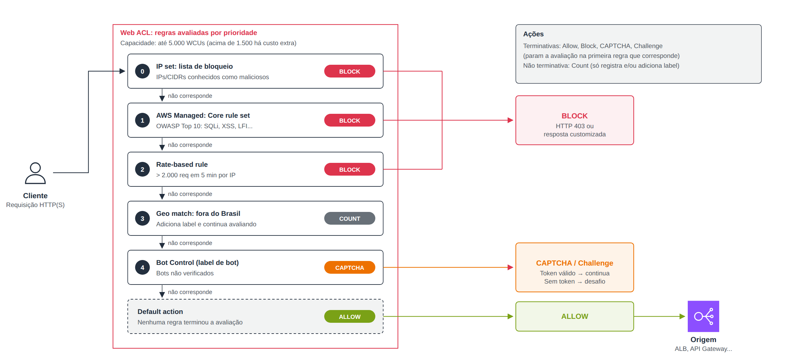

### Rate-based rules

Contam as requisições de cada **chave de agregação** em uma **janela de tempo** e aplicam a ação quando o limite é ultrapassado. São a principal proteção do WAF contra **HTTP flood**, **brute force** e **scraping**.

- **Chave de agregação:** **IP de origem** (padrão), IP de um header (`X-Forwarded-For`), ou **chaves customizadas** combinando headers, cookies, query args, método HTTP, URI ou labels (ex: limite por **API key** ou por **usuário**).
- **Janela de avaliação:** **1, 2, 5 ou 10 minutos** (padrão de 5 minutos).
- **Escopo:** o limite pode valer para **todas as requisições** ou só para as que atendem a uma condição (ex: só o endpoint `/login`).
- Quando a taxa volta a ficar abaixo do limite, as requisições voltam a ser permitidas automaticamente.

### Managed rule groups

Conjuntos de regras prontos, mantidos e atualizados pela AWS ou por vendors do Marketplace, sem que você precise escrever as regras.

**AWS Managed Rules (gratuitas, exceto as marcadas):**

| Rule group | Protege contra |
|---|---|
| **Core rule set (CRS)** | Vulnerabilidades comuns do **OWASP Top 10** |
| **Known bad inputs** | Padrões de requisição sabidamente maliciosos (ex: Log4j) |
| **SQL database** | SQL injection |
| **Linux / Windows / PHP / WordPress / POSIX** | Explorações específicas de sistemas e plataformas |
| **Amazon IP reputation list** | IPs com má reputação, identificados pela inteligência de ameaças da AWS |
| **Anonymous IP list** | Requisições de VPNs, proxies, Tor e provedores de hospedagem |
| **Bot Control** (pago) | Bots comuns (crawlers, scrapers) e, no nível *targeted*, bots sofisticados |
| **Fraud Control: Account Takeover Prevention (ATP)** (pago) | Ataques de **credential stuffing** e brute force na página de **login** |
| **Fraud Control: Account Creation Fraud Prevention (ACFP)** (pago) | Criação de **contas falsas** em massa |
| **Anti-DDoS** (pago) | Ataques DDoS de camada 7, com detecção baseada em baseline |

> **Obs:** Uma boa prática é adicionar um managed rule group em modo **Count** primeiro, analisar os logs para identificar **falsos positivos** e só então mudar para Block. Também é possível sobrescrever a ação de regras individuais dentro do rule group.

### Logging e monitoramento

- **Logs completos** das requisições inspecionadas (regra que correspondeu, ação, headers...) podem ser enviados para:
  - **CloudWatch Logs** (log group com nome iniciando em **`aws-waf-logs-`**);
  - **Amazon S3** (bucket com nome iniciando em **`aws-waf-logs-`**);
  - **Amazon Data Firehose** (stream com nome iniciando em **`aws-waf-logs-`**), para enviar a ferramentas de terceiros (SIEM).
- **Filtros de log** permitem registrar só algumas requisições (ex: só as bloqueadas), e **campos sensíveis podem ser omitidos** (*redacted*, ex: header `Authorization`).
- **Métricas no CloudWatch** por regra e por web ACL (`AllowedRequests`, `BlockedRequests`, `CountedRequests`).
- **Sampled requests:** amostra das requisições recentes no console, útil para depuração rápida.
- **Análise:** consultas nos logs do S3 com **Athena**, ou com o **CloudWatch Logs Insights**.

### Gerenciamento centralizado: AWS Firewall Manager

Em ambientes **multi-account**, o **AWS Firewall Manager** permite criar **políticas de WAF** aplicadas automaticamente a todas as contas da **AWS Organization**:

- Define regras **obrigatórias** (rule groups aplicados primeiro e por último na web ACL) que os times das contas não podem remover.
- Aplica a política automaticamente a **novos recursos** (ex: todo ALB ou CloudFront criado).
- Exige **AWS Organizations** e **AWS Config** habilitado nas contas.

### Padrões de arquitetura comuns

- **Proteger a origem do CloudFront:** para que o ALB só aceite requisições vindas do CloudFront, configure o CloudFront para enviar um **header customizado secreto** e crie uma regra no **WAF do ALB** que bloqueia requisições sem esse header. Complemente com o **security group** do ALB liberando apenas a **managed prefix list** do CloudFront. Alternativamente, use **CloudFront VPC origins** para manter o ALB em subnet privada.
- **IP real do cliente:** quando há um proxy ou CDN na frente, o IP de origem visto pelo WAF é o do proxy. Configure os statements para usar o IP do header **`X-Forwarded-For`**. Com o CloudFront na frente, o ideal é aplicar o WAF **no CloudFront**, que vê o IP real.
- **WAF no CloudFront vs. no ALB:** no CloudFront o ataque é bloqueado **na borda**, antes de consumir recursos na região, e a web ACL protege a aplicação globalmente. No ALB, a proteção é regional.
- **Bloquear países:** **geo match** no WAF (ou **geo restriction** do próprio CloudFront, mais simples, mas sem as outras condições).

### Custo

- **US$ 5** por web ACL por mês.
- **US$ 1** por regra (ou rule group) por mês.
- **US$ 0,60** por milhão de requisições inspecionadas.
- Custos adicionais para **Bot Control**, **Fraud Control**, **Anti-DDoS**, **CAPTCHA/Challenge** e inspeção de body acima do padrão.
- Recursos protegidos pelo **Shield Advanced** não pagam o WAF.

### WAF vs. outros controles de rede

| | AWS WAF | Security Groups / NACLs | AWS Network Firewall | AWS Shield |
|---|---|---|---|---|
| Camada | **7** (HTTP/HTTPS) | 3/4 | 3 a 7 | 3/4 (Standard), 3 a 7 (Advanced) |
| Onde atua | CloudFront, ALB, API Gateway, AppSync, Cognito... | ENI / subnet | Na **VPC** (subnets de firewall) | Infraestrutura AWS e recursos protegidos |
| Inspeciona | Conteúdo HTTP (headers, body, URI) | IP, porta, protocolo | Pacotes, domínios (SNI), assinaturas IPS | Padrões de tráfego DDoS |
| Uso típico | SQLi, XSS, bots, rate limit | Controle de acesso de rede | Filtro de saída, IPS, tráfego entre VPCs | Ataques DDoS |

### Dicas para a prova

- "Proteger contra **SQL injection** e **XSS**" → **AWS WAF** (managed rules **Core rule set** e **SQL database**).
- "Bloquear IPs que fazem **muitas requisições**", "**HTTP flood**" ou "**brute force** no login" → **rate-based rule**.
- "Limitar requisições **por API key/usuário**, e não por IP" → rate-based rule com **chave de agregação customizada** (header).
- "Bloquear acesso de **determinados países**" → **geo match** no WAF (ou geo restriction do CloudFront).
- "Bloquear uma **lista de IPs** maliciosos" → **IP set** com ação Block. Com o CloudFront ou proxy na frente, use o IP do **`X-Forwarded-For`**.
- "Proteção contra vulnerabilidades comuns **com menor esforço operacional**" → **AWS Managed Rules**.
- "Testar regras **sem impactar os usuários**" → ação **Count**, depois analisar os logs.
- "Bloquear **bots**/scrapers" → **Bot Control**. "**Credential stuffing**" → **Account Takeover Prevention (ATP)**. "Criação de **contas falsas**" → **ACFP**.
- "Diferenciar humanos de bots **sem bloquear**" → **CAPTCHA** ou **Challenge**.
- "Proteger uma aplicação atrás de um **NLB**" → o WAF **não suporta** NLB: usar **ALB** ou **CloudFront** na frente.
- "Garantir que o ALB só receba tráfego **vindo do CloudFront**" → **header customizado secreto** + regra no WAF do ALB (e prefix list do CloudFront no security group).
- "Web ACL para o **CloudFront**" → criada em **`us-east-1`** (escopo CLOUDFRONT).
- "Aplicar as mesmas regras de WAF em **todas as contas** da Organization" → **AWS Firewall Manager**.
- "Analisar os logs do WAF com **SQL**" → logs no **S3** + **Athena**. "Enviar para um **SIEM**" → **Data Firehose**.
- "Retornar uma **página customizada** quando a requisição é bloqueada" → **custom response** na ação Block.


## AWS Firewall Manager

O AWS Firewall Manager (FMS) é o serviço para **gerenciar regras de firewall e proteções de segurança de forma centralizada** em **todas as contas e recursos de uma AWS Organization**.

Em vez de configurar WAF, Shield Advanced, security groups e Network Firewall conta por conta, o time de segurança define **políticas** uma única vez, e o FMS as aplica automaticamente às contas, OUs e recursos que estão no escopo, **inclusive contas e recursos criados depois**.

### Pré-requisitos

- **AWS Organizations** com **all features** habilitado.
- Uma **conta administradora do FMS**, definida pela management account. A boa prática é delegar para uma conta de **segurança** dedicada, e não usar a management account.
- **AWS Config** habilitado em **todas as contas e regiões** onde as políticas serão aplicadas. O FMS usa o Config para descobrir os recursos e avaliar a conformidade.
- Para políticas de Shield Advanced, a assinatura do **Shield Advanced**. Para Network Firewall e DNS Firewall, os respectivos serviços disponíveis nas contas.

> **Obs:** É possível ter **várias contas administradoras** do FMS, cada uma com um **escopo administrativo** (contas, OUs, regiões e tipos de política). Exemplo: o time de rede administra as políticas de Network Firewall e o time de AppSec administra as de WAF.

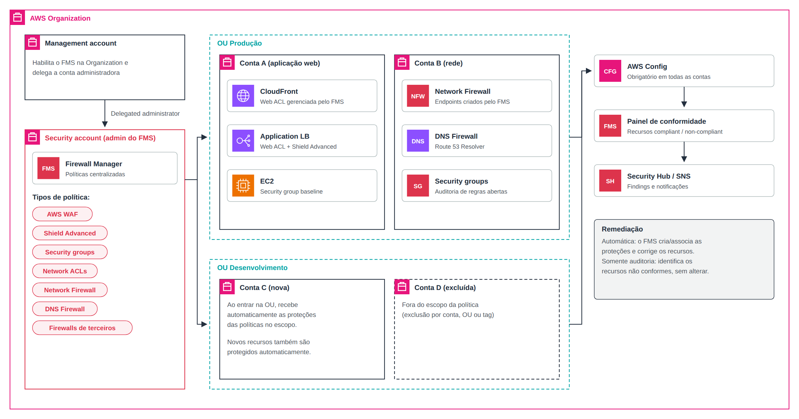

### Tipos de política

| Tipo | O que o FMS faz |
|---|---|
| **AWS WAF** | Cria e associa **web ACLs** aos recursos (CloudFront, ALB, API Gateway, AppSync...), com rule groups obrigatórios |
| **Shield Advanced** | Habilita a proteção do **Shield Advanced** nos recursos (e, opcionalmente, a mitigação automática na camada 7) |
| **Security groups** | Aplica security groups **baseline**, **audita** regras permissivas e identifica security groups **não usados ou redundantes** |
| **Network ACLs** | Garante que as subnets tenham entradas **obrigatórias** nas NACLs (primeiras e últimas regras) |
| **AWS Network Firewall** | Cria **firewall endpoints** nas VPCs e aplica as políticas de firewall (modelo **distribuído** ou **centralizado**) |
| **Route 53 Resolver DNS Firewall** | Associa **rule groups de DNS Firewall** às VPCs, bloqueando consultas a domínios maliciosos |
| **Firewalls de terceiros** | Gerencia firewalls do Marketplace, como Palo Alto Cloud NGFW e Fortigate Cloud-Native Firewall |

### Escopo das políticas

Cada política define **onde** ela é aplicada:

- **Contas e OUs:** incluir ou excluir contas e OUs específicas.
- **Tipos de recurso:** ex: só ALBs, só distribuições CloudFront.
- **Tags:** incluir ou excluir recursos com determinadas tags.
- **Região:** as políticas são **regionais**. Para CloudFront, a política de WAF é criada em **`us-east-1`**.

Quando uma conta entra em uma OU no escopo, ou quando um recurso novo é criado, o FMS aplica a política **automaticamente**.

### Remediação

- **Remediação automática:** o FMS **cria, associa ou corrige** as proteções nos recursos não conformes (ex: associa a web ACL a um ALB novo).
- **Somente identificação (audit):** o FMS **apenas reporta** os recursos não conformes, sem alterá-los. Útil para avaliar o impacto antes de aplicar.

A conformidade aparece no **painel do FMS**, e as violações podem ser enviadas como **findings para o Security Hub** e como **notificações via SNS**.

### Políticas de WAF

A web ACL criada pelo FMS em cada conta tem uma estrutura em camadas:

1. **First rule groups:** definidos pelo admin do FMS, avaliados **primeiro** (ex: AWS Managed Rules, IP reputation).
2. **Regras da conta:** o time da aplicação pode adicionar regras **próprias** no meio.
3. **Last rule groups:** definidos pelo admin do FMS, avaliados **por último** (ex: rate-based rule padrão).
4. **Default action:** definida na política.

O time da conta **não consegue remover** os rule groups do FMS. Com a opção de **retrofit**, o FMS também passa a gerenciar **web ACLs que já existiam** nas contas, adicionando os rule groups obrigatórios a elas. A política também pode definir uma configuração **centralizada de logs** do WAF.

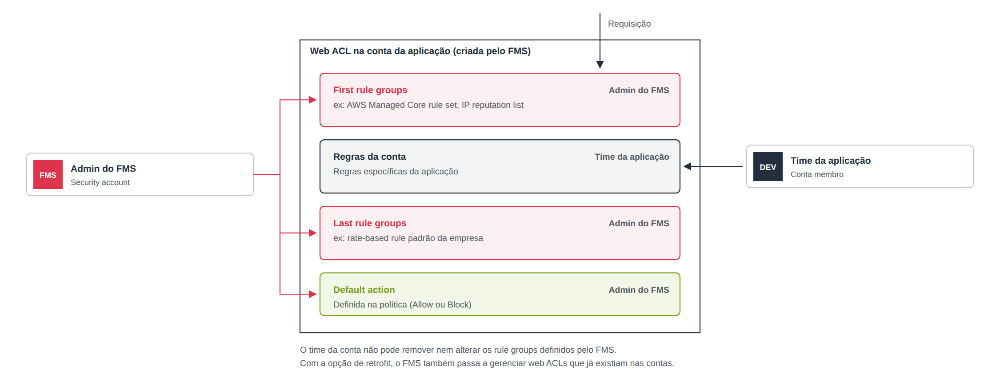

### Políticas de Security Groups

Três tipos:

- **Common security groups:** associa security groups **padrão** (definidos na conta admin) às ENIs, instâncias EC2 e load balancers das contas. Ex: um SG que libera o acesso dos servidores de monitoramento a todas as instâncias.
- **Content audit:** compara as regras dos security groups com **regras proibidas ou permitidas**. Ex: identificar e remover regras que liberam **SSH/RDP para `0.0.0.0/0`**.
- **Usage audit:** identifica security groups **não utilizados** ou **redundantes** e pode removê-los ou consolidá-los.

### Políticas de Network Firewall

- **Modelo distribuído:** o FMS cria um **firewall endpoint em cada VPC** no escopo.
- **Modelo centralizado:** o firewall fica em uma **VPC de inspeção** central, normalmente ligada às outras VPCs por **Transit Gateway**.
- O FMS também pode gerenciar as **rotas** necessárias para enviar o tráfego pelo firewall, ou apenas monitorar se elas estão configuradas.

### Custo

- **US$ 100** por política de proteção por região por mês.
- Mais o custo dos serviços envolvidos (WAF, Network Firewall, DNS Firewall) e do **AWS Config**.
- Para assinantes do **Shield Advanced**, as políticas de **WAF** e **Shield Advanced** do FMS **não têm custo adicional**.

### Firewall Manager vs. outros serviços

| | Firewall Manager | AWS WAF / Shield / Network Firewall | AWS Config | SCPs |
|---|---|---|---|---|
| Função | **Orquestra** proteções em várias contas | **Executam** a proteção | **Avalia** a conformidade das configurações | **Limitam** as ações permitidas nas contas |
| Escopo | Organization inteira | Recurso ou conta | Conta (ou Organization com aggregator e conformance packs) | Organization |
| Exemplo | "Todo ALB deve ter esta web ACL" | A web ACL em si | "Existe ALB sem web ACL?" | "Ninguém pode desassociar web ACLs" |

### Dicas para a prova

- "Aplicar regras de **WAF** de forma **consistente em todas as contas** da Organization" → **Firewall Manager** com política de WAF.
- "Garantir que **novos recursos** (ALB, CloudFront) e **novas contas** recebam a proteção **automaticamente**" → **Firewall Manager**.
- "Habilitar o **Shield Advanced** em todos os recursos expostos de todas as contas" → **Firewall Manager** com política de Shield Advanced.
- "Regras de segurança **obrigatórias** que os times das aplicações **não podem remover**, mas que permitem regras próprias" → política de WAF do FMS com **first/last rule groups**.
- "Identificar e corrigir security groups com **SSH aberto para a Internet** em todas as contas" → política de **security group content audit**.
- "Remover security groups **não utilizados** em várias contas" → política de **usage audit**.
- "Implantar o **Network Firewall** em todas as VPCs da Organization" → política de **Network Firewall** do FMS.
- "Bloquear consultas DNS a **domínios maliciosos** em todas as VPCs" → política de **Route 53 Resolver DNS Firewall** do FMS.
- "**Pré-requisitos** do Firewall Manager" → **AWS Organizations** (all features), **conta administradora** e **AWS Config** habilitado.
- "Times diferentes devem administrar **tipos de política diferentes**" → **várias contas administradoras** com escopos administrativos.
- "Avaliar o **impacto** de uma política antes de aplicá-la" → política sem **remediação automática** (apenas identificação).


## Amazon Inspector

O Amazon Inspector é o serviço de **gerenciamento automatizado e contínuo de vulnerabilidades** da AWS. Ele escaneia as cargas de trabalho em busca de **vulnerabilidades de software conhecidas (CVEs)** e de **exposição de rede não intencional**, e prioriza os findings de acordo com o risco real de cada recurso.

- É um serviço **regional**, habilitado com poucos cliques. A descoberta dos recursos e os scans são **automáticos e contínuos**.
- Os recursos são **reescaneados automaticamente** quando uma **nova CVE é publicada** ou quando o software do recurso muda (novo pacote instalado, nova imagem enviada, nova versão da função).
- Usa diversas fontes de inteligência de vulnerabilidades (NVD, avisos de segurança dos fornecedores e distribuições, feeds da própria AWS).

> **Obs:** A versão atual substituiu o **Amazon Inspector Classic**, que exigia um agente próprio e templates de avaliação executados manualmente. Se uma questão mencionar "assessment templates" ou "Inspector agent", ela está falando do Classic.

### O que o Inspector escaneia

| Recurso | Como funciona | O que encontra |
|---|---|---|
| **Instâncias EC2** | Com o **SSM Agent** (a instância precisa ser **managed instance** do Systems Manager) ou **agentless**, escaneando **snapshots EBS**. O modo **híbrido** usa o agente quando disponível e o agentless nas outras instâncias | CVEs em pacotes do **sistema operacional** e de **linguagens** (Java, Python, Node.js...), **alcançabilidade de rede** e **CIS benchmarks** do SO |
| **Imagens de container no ECR** | **Enhanced scanning** do ECR: escaneia no **push** e continuamente durante um período configurável | CVEs nos pacotes do SO e de linguagens da imagem |
| **Funções Lambda** | **Standard scanning** (dependências) e **code scanning** (código da função) | CVEs em bibliotecas e **falhas no código** (injection, vazamento de dados, criptografia fraca, **secrets hardcoded**) |
| **Repositórios de código** | **Code Security**: integra com GitHub e GitLab | **SAST** (código), **SCA** (dependências) e **IaC** (configurações inseguras em templates) |
| **Pipelines CI/CD** | Gera o **SBOM** da imagem ou artefato e chama a API de scan do Inspector (plugins para Jenkins, TeamCity e outros) | Vulnerabilidades **antes** do deploy |

> **Obs:** Se uma instância EC2 não aparece como escaneada, normalmente o motivo é: o **SSM Agent não está instalado/rodando**, a instância **não tem uma instance role** com permissões do Systems Manager, ou não tem **conectividade** com os endpoints do SSM (sem internet/NAT e sem **VPC endpoints**). O modo **agentless** resolve parte desses casos.

### Alcançabilidade de rede (network reachability)

Para instâncias EC2, o Inspector analisa a **configuração de rede** da VPC (security groups, NACLs, route tables, internet gateways, load balancers) e identifica **portas acessíveis a partir da Internet** e por qual caminho.

- Não envia tráfego para as instâncias: é uma **análise da configuração**.
- **Não precisa de agente**.
- Combinada com as CVEs, aumenta a prioridade de vulnerabilidades em serviços **expostos à Internet**.

### Inspector risk score

Cada finding recebe um **Inspector score**, calculado a partir da nota **CVSS** da vulnerabilidade e **ajustado pelo contexto** do recurso:

- A vulnerabilidade é explorável **pela rede** e a instância está **acessível pela Internet**? O score aumenta.
- Existe **exploit público** conhecido para a CVE? O score aumenta.
- A instância não está exposta? O score pode diminuir.

Com isso, os times priorizam o que **realmente representa risco**, e não só o que tem a nota CVSS mais alta.

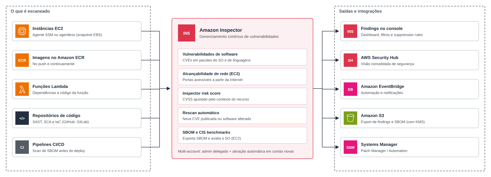

### Findings e integrações

- **Severidade:** Critical, High, Medium, Low, Informational e Untriaged.
- **Suppression rules:** ocultam findings que correspondem a critérios (ex: CVEs aceitas como risco em ambiente de dev), sem desabilitar o scan.
- **AWS Security Hub:** os findings são enviados automaticamente, junto com os de GuardDuty, Macie, Config e outros.
- **Amazon EventBridge:** cada finding novo ou atualizado gera um evento, base para **automação** e **notificações**.
- **Exportação para S3:** relatórios de findings e de **SBOM** (formatos **CycloneDX** e **SPDX**), criptografados com uma chave **KMS**.
- **Dashboard:** visão de cobertura (quais recursos estão sendo escaneados) e das vulnerabilidades mais críticas.

### Multi-account

- Integração com **AWS Organizations**: a management account define uma **conta administradora delegada** (normalmente a conta de segurança).
- O admin delegado **habilita o Inspector** nas contas membro, pode **ativar automaticamente** o serviço em **novas contas** e vê os findings de **toda a Organization**.

### Remediação automatizada

O padrão mais comum combina **EventBridge** com outros serviços:

- **EC2:** finding crítico → regra do EventBridge → **Systems Manager Patch Manager** ou **SSM Automation** aplica o patch → o Inspector reescaneia a instância e **fecha o finding automaticamente**.
- **ECR:** imagem vulnerável → regra do EventBridge → **Lambda** marca a imagem (tag), impede o deploy ou notifica o time via **SNS**.
- **Lambda e repositórios de código:** finding → abertura automática de ticket (ex: Jira) ou notificação para o time dono do código.

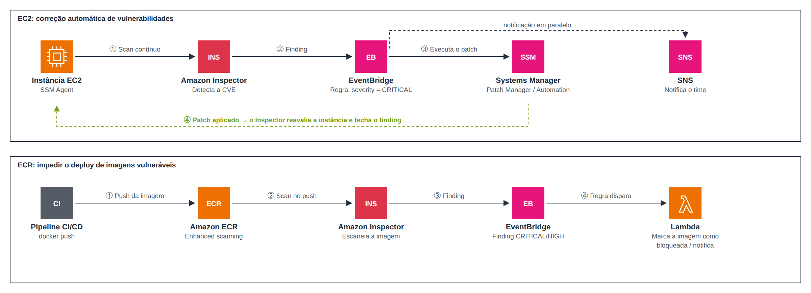

### Custo

- **EC2:** por instância escaneada por mês (o agentless tem um custo diferente, por instância escaneada).
- **ECR:** por imagem no scan inicial, mais um valor menor por **rescan**.
- **Lambda:** por função por mês (o code scanning é cobrado à parte).
- **Code Security** e **CIS benchmarks** têm cobrança própria.
- Há um **período de avaliação gratuito de 15 dias** para novas contas.

### Inspector vs. outros serviços de segurança

| Serviço | Pergunta que responde |
|---|---|
| **Amazon Inspector** | "Meu software tem **vulnerabilidades conhecidas** ou está **exposto** à rede?" |
| **Amazon GuardDuty** | "Há **atividade maliciosa** ou comportamento suspeito acontecendo agora?" |
| **Amazon Macie** | "Há **dados sensíveis** (PII) nos meus buckets S3?" |
| **AWS Config** | "Minhas **configurações** estão de acordo com as regras?" |
| **AWS Security Hub** | "Qual é a **visão consolidada** de todos os findings de segurança?" |
| **SSM Patch Manager** | "Como **aplico os patches** de SO nas instâncias?" |

### Dicas para a prova

- "Identificar **vulnerabilidades de software (CVEs)** em instâncias EC2, imagens de container ou funções Lambda" → **Amazon Inspector**.
- "Escanear **imagens de container** no ECR automaticamente no **push**" → **ECR enhanced scanning** com o **Inspector**.
- "Identificar instâncias com **portas expostas à Internet**" → **network reachability** do Inspector.
- "O Inspector não está escaneando algumas instâncias EC2" → verificar o **SSM Agent**, a **instance role** com permissões do SSM e a conectividade (**VPC endpoints** do SSM), ou usar o modo **agentless**.
- "Priorizar vulnerabilidades pelo **risco real** do ambiente" → **Inspector risk score**.
- "**Corrigir automaticamente** vulnerabilidades em EC2" → Inspector + **EventBridge** + **SSM Patch Manager/Automation**.
- "Impedir o **deploy** de imagens com vulnerabilidades críticas" → scan no **pipeline CI/CD** ou Inspector + EventBridge + Lambda.
- "Detectar **secrets hardcoded** ou falhas de segurança no **código** de funções Lambda" → **Lambda code scanning** do Inspector.
- "Gerar um **SBOM** (Software Bill of Materials) das cargas de trabalho" → **exportação de SBOM** do Inspector (CycloneDX/SPDX).
- "Habilitar o Inspector em **todas as contas** da Organization, inclusive nas novas" → **admin delegado** + ativação automática.
- "Visão **centralizada** de findings do Inspector, GuardDuty e Macie" → **Security Hub**.
- "Detectar **comportamento malicioso** (ex: instância minerando criptomoedas)" → **GuardDuty**, e não Inspector.

## AWS Config

O AWS Config é o serviço que **registra continuamente a configuração dos recursos** da conta, mantém o **histórico de mudanças** e **avalia a conformidade** dessas configurações com regras definidas pela empresa.

Ele responde a perguntas como:

- "Como estava configurado este security group **na semana passada**?"
- "**Quais buckets S3** estão com acesso público?"
- "Quais volumes EBS **não estão criptografados**?"
- "**Quem** alterou esta configuração, e quando?" (em conjunto com o CloudTrail)

**Características:**

- É um serviço **regional**: precisa ser habilitado em **cada região** (e em cada conta) que se quer monitorar. Para recursos globais (ex: IAM), a gravação deve ser habilitada em **uma única região**, para evitar duplicidade.
- É um **controle detectivo**: **identifica** configurações fora do padrão, mas **não impede** que elas sejam feitas. Para prevenir, use **SCPs**, **IAM** ou as **regras proativas** do Config.

### Componentes

- **Configuration recorder:** registra as configurações dos recursos. Pode gravar **todos os tipos de recurso** ou apenas os escolhidos, de forma **contínua** (a cada mudança) ou **diária** (mais barato, com menos detalhe).
- **Configuration item (CI):** o "retrato" da configuração de um recurso em um momento: atributos, tags, **relacionamentos** com outros recursos (ex: a instância EC2 está na subnet X e usa o security group Y) e eventos do CloudTrail relacionados.
- **Configuration history** e **snapshots:** o histórico de CIs de cada recurso e uma "foto" de todos os recursos em um momento.
- **Delivery channel:** envia o histórico e os snapshots para um **bucket S3** e, opcionalmente, notificações de mudanças para um **tópico SNS**.
- **Resource timeline:** linha do tempo de cada recurso, mostrando **o que mudou** (Config) e **quem mudou** (CloudTrail).

### Config Rules

Regras que avaliam se os recursos estão **em conformidade** (`COMPLIANT` ou `NON_COMPLIANT`).

- **AWS managed rules:** centenas de regras prontas. Exemplos:
  - `s3-bucket-public-read-prohibited` / `s3-bucket-public-write-prohibited`;
  - `restricted-ssh` (security groups com SSH aberto para `0.0.0.0/0`);
  - `encrypted-volumes` e `rds-storage-encrypted`;
  - `required-tags`;
  - `cloudtrail-enabled` e `root-account-mfa-enabled`;
  - `approved-amis-by-id`.
- **Custom rules:**
  - **Lambda:** uma função Lambda avalia o recurso com qualquer lógica.
  - **Custom policy (Guard):** regras escritas em **CloudFormation Guard**, sem precisar de Lambda.
- **Gatilhos (triggers):**
  - **Mudança de configuração:** a regra é avaliada quando um recurso no escopo é alterado.
  - **Periódico:** a regra é avaliada a cada 1, 3, 6, 12 ou 24 horas.
- **Modo de avaliação:**
  - **Detectivo:** avalia os recursos que já existem.
  - **Proativo:** avalia a configuração **antes** de o recurso ser criado (ex: via **CloudFormation Hooks**), permitindo bloquear o deploy.

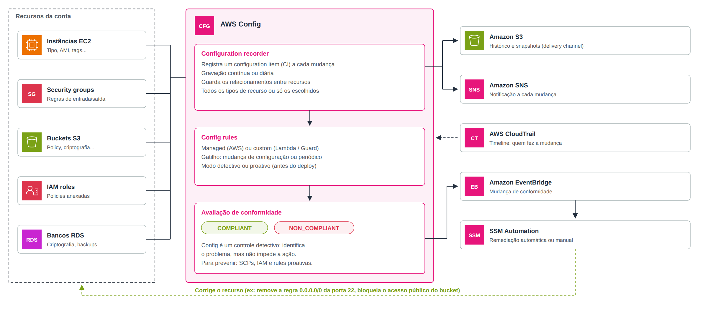

### Remediação

- Recursos não conformes podem ser corrigidos com **SSM Automation documents** (runbooks), prontos da AWS ou próprios. Exemplos: `AWS-DisableS3BucketPublicReadWrite`, `AWS-DisableIncomingSSHOnPort22`.
- A remediação pode ser **manual** (alguém dispara pelo console) ou **automática**, com número de **tentativas** configurável.
- A remediação usa uma **IAM role** com permissão para alterar o recurso.
- Para fluxos mais complexos, use o **EventBridge**: cada mudança de conformidade gera um evento que pode acionar **Lambda**, **SNS**, Step Functions etc.

### Conformance Packs

Um **conformance pack** é um **conjunto de regras do Config e ações de remediação** empacotado em um template **YAML**, implantado como uma unidade.

- A AWS fornece **templates de exemplo** para frameworks de compliance: **CIS Benchmarks**, **PCI DSS**, **HIPAA**, **NIST**, Operational Best Practices para serviços específicos etc.
- Podem ser implantados em uma conta ou em **toda a Organization** (organization conformance packs).
- Têm um **score de conformidade** próprio, facilitando o acompanhamento por framework.

### Multi-account e multi-region

- **Aggregator:** consolida os dados de configuração e conformidade de **várias contas e regiões** em uma única conta. É **somente leitura**: **não aplica regras** nas contas (detalhes em [Config Aggregator](#config-aggregator)).
- **Organization rules** e **organization conformance packs:** a management account ou uma **conta administradora delegada** implanta regras e conformance packs em **todas as contas** da Organization, inclusive nas novas.
- **Delivery channel centralizado:** as contas podem enviar o histórico para um **bucket S3 central** na conta de log/segurança.
- **Advanced queries:** consultas em **SQL** sobre o estado atual de configuração dos recursos, em uma conta ou **em todo o aggregator** (ex: "liste todas as instâncias EC2 do tipo t2.micro em todas as contas"). Também é possível gerar a consulta a partir de linguagem natural.

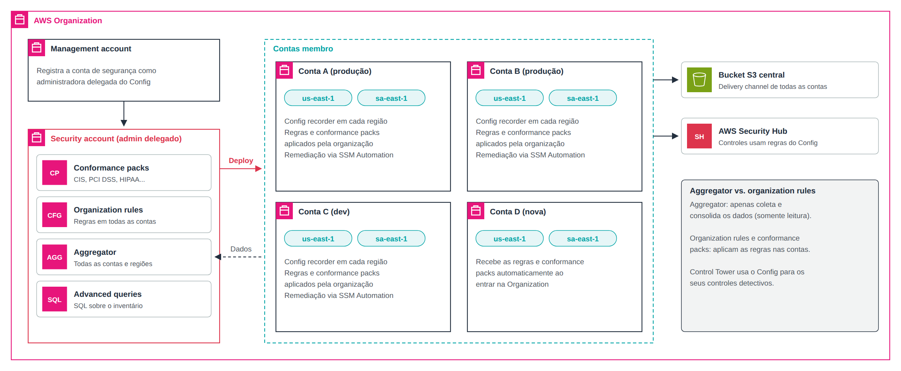

> **Obs:** O **AWS Security Hub** usa regras do Config para executar seus **controles de segurança**, e o **AWS Control Tower** usa o Config para os seus **controles detectivos**. Por isso o Config precisa estar habilitado nas contas para que esses serviços funcionem. O **Firewall Manager** também exige o Config.

### Config Aggregator

O **aggregator** é um recurso do Config que **coleta e consolida** os dados de configuração e de conformidade de **várias contas e regiões** em uma **única conta** (a *aggregator account*, normalmente a conta de segurança). Com ele, o time de segurança tem uma visão central do inventário e da conformidade de todo o ambiente, sem precisar acessar cada conta e região.

**O que o aggregator consolida:**

- **Configuração dos recursos:** inventário de todos os recursos gravados nas contas e regiões de origem.
- **Conformidade:** status das **Config rules** e dos **conformance packs** de cada conta.
- **Advanced queries** podem ser executadas **sobre o aggregator**, consultando com SQL o inventário de todas as contas e regiões de uma vez.

#### Tipos de origem

| | **AWS Organization** | **Contas individuais** |
|---|---|---|
| Onde é criado | **Management account** ou **conta administradora delegada** do Config | Qualquer conta |
| Autorização | **Não precisa** de autorização conta a conta: usa uma **IAM role** com a policy `AWSConfigRoleForOrganizations` | **Cada conta de origem** precisa criar uma **authorization** para a conta e a região do aggregator |
| Contas novas | Incluídas **automaticamente** | Precisam ser **adicionadas e autorizar** manualmente |
| Uso típico | Todas as contas da empresa | Contas **fora da Organization** (parceiros, empresas adquiridas, outra Organization) |

Nos dois tipos, é possível escolher **todas as regiões** (incluindo regiões habilitadas no futuro) ou só **regiões específicas**.

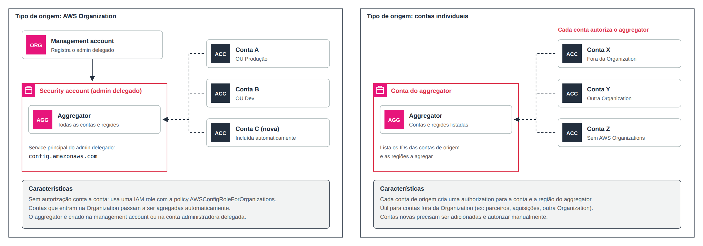

> **Obs:** Para usar uma **conta administradora delegada** no Config, a management account registra a conta para o service principal correto. São dois: `config.amazonaws.com` para **aggregators** e `config-multiaccountsetup.amazonaws.com` para **organization rules e conformance packs**. Para fazer as duas coisas a partir da conta de segurança, é preciso registrar os dois.

#### Limitações e cuidados

- O aggregator **não habilita o Config** nas contas de origem: o **configuration recorder** precisa estar ativo em cada conta e região, senão não há dados para agregar. Use **organization conformance packs**, **CloudFormation StackSets** ou o **Control Tower** para garantir isso.
- É **somente leitura**: não cria regras, não executa **remediação** e não altera recursos nas contas de origem. Para aplicar regras use **organization rules / conformance packs**; para remediar, configure a remediação nas próprias regras (em cada conta).
- **Não copia os dados** para um bucket S3: a visão consolidada fica disponível no **console** e nas **APIs** do Config da conta do aggregator. Para centralizar o **histórico** em arquivos, configure o **delivery channel** das contas para um **bucket S3 central**.
- Os dados aparecem no aggregator com um pequeno **atraso** em relação à conta de origem.
- O aggregator em si **não tem custo adicional**: o custo continua sendo o da gravação e das avaliações de regras em cada conta.

#### Aggregator vs. outras visões centralizadas

| Necessidade | Serviço |
|---|---|
| Inventário e **conformidade de configuração** de todas as contas e regiões | **Config aggregator** |
| **Aplicar** as mesmas regras em todas as contas | **Organization rules / conformance packs** |
| Visão consolidada de **findings de segurança** (GuardDuty, Inspector, Macie, controles do Config) | **AWS Security Hub** (com agregação entre regiões e admin delegado) |
| Visão consolidada de **dados operacionais** (OpsItems, patches, inventário de instâncias) | **Systems Manager Explorer** |

#### Dicas para a prova (aggregator)

- "Visão **centralizada** da conformidade de **todas as contas e regiões**" → **Config aggregator** na conta de segurança.
- "Incluir **automaticamente** as contas novas na visão consolidada" → aggregator com origem **AWS Organization**.
- "Agregar dados de contas que **não fazem parte da Organization**" → aggregator com **contas individuais** + **authorization** em cada conta de origem.
- "Consultar com **SQL** o inventário de recursos de **várias contas**" → **advanced queries** no aggregator.
- "O aggregator não mostra dados de uma conta/região" → verificar se o **configuration recorder** está habilitado nela e, no tipo contas individuais, se a **authorization** foi criada.
- "Usar a conta de segurança, e não a management account, para gerenciar o aggregator" → registrar a conta como **administradora delegada** (`config.amazonaws.com`).
- "Corrigir automaticamente recursos não conformes vistos no aggregator" → o aggregator **não remedia**: configurar **remediação nas regras** das contas (ex: via conformance pack com remediação).

### Custo

- Por **configuration item** gravado (a gravação **diária** tem preço diferente da contínua).
- Por **avaliação de regra**.
- Por **avaliação de conformance pack**.
- Custos adicionais de S3, SNS, Lambda (custom rules) e SSM Automation.

> **Obs:** Gravar **todos os tipos de recurso** de forma **contínua**, em ambientes com muitas mudanças (ex: Auto Scaling frequente), pode gerar um custo alto. Para reduzir, grave apenas os tipos de recurso relevantes ou use a gravação **diária** para os menos críticos.

### Config vs. CloudTrail vs. CloudWatch

| | AWS Config | AWS CloudTrail | Amazon CloudWatch |
|---|---|---|---|
| Pergunta | **Como** o recurso está (e estava) configurado? Está **em conformidade**? | **Quem** fez **qual chamada de API**, e quando? | Como está a **performance** e a **saúde**? |
| Dado | Configuração e relacionamentos dos recursos | Eventos de API | Métricas, logs e alarmes |
| Uso típico | Compliance, auditoria de configuração, histórico de mudanças | Auditoria de ações, investigação de incidentes | Monitoramento operacional |

### Dicas para a prova

- "Auditar e avaliar **continuamente a conformidade** da configuração dos recursos" → **AWS Config rules**.
- "Ver o **histórico de configuração** de um recurso" ou "como estava configurado em uma **data passada**" → **AWS Config**.
- "Saber **quem** alterou a configuração" → **CloudTrail** (o Config mostra os eventos do CloudTrail na timeline do recurso).
- "**Corrigir automaticamente** recursos não conformes" (ex: bucket público, SSH aberto) → Config rule + **remediação automática com SSM Automation**.
- "Ser **notificado** quando um recurso ficar não conforme" → Config + **EventBridge** → SNS.
- "Aplicar um conjunto de regras de um **framework de compliance** (PCI DSS, HIPAA, CIS)" → **conformance packs**.
- "Implantar regras do Config em **todas as contas** da Organization" → **organization rules / organization conformance packs** com **admin delegado**.
- "Visão **consolidada** de conformidade de **várias contas e regiões**" → **Config aggregator**.
- "Consultar o **inventário** de recursos de todas as contas com SQL" → **advanced queries** sobre o aggregator.
- "Regra de conformidade **específica da empresa** que não existe como managed rule" → **custom rule** (Lambda ou Guard).
- "**Impedir** a criação de recursos não conformes" → o Config é detectivo: usar **SCPs**, IAM ou **regras proativas** do Config com **CloudFormation Hooks**.
- "Garantir que todos os recursos tenham **tags obrigatórias**" → managed rule **`required-tags`** (para impedir a criação sem tags: **tag policies** + SCP).
- "**Reduzir o custo** do AWS Config" → gravar apenas os **tipos de recurso necessários** ou usar a gravação **diária**.


## Amazon GuardDuty

O Amazon GuardDuty é o serviço de **detecção inteligente de ameaças** da AWS. Ele analisa continuamente eventos e logs da conta usando **machine learning**, **detecção de anomalias** e **threat intelligence** para identificar **atividades maliciosas ou suspeitas**, como instâncias comprometidas, credenciais vazadas, mineração de criptomoedas e reconhecimento de rede.

- É um serviço **regional**, habilitado com **um clique**, sem agentes (exceto no Runtime Monitoring) e sem impacto na performance dos recursos.
- **Período de avaliação gratuito de 30 dias**.
- É um controle **detectivo**: gera **findings**, mas **não bloqueia** nada. A resposta é implementada com **EventBridge** e automação.
- Usa **threat intelligence** da AWS e de parceiros (listas de IPs e domínios maliciosos) e aprende o **comportamento normal** da conta para detectar desvios.

### Fontes de dados

#### Fontes fundamentais

Analisadas automaticamente assim que o GuardDuty é habilitado:

- **CloudTrail management events:** chamadas de API na conta (ex: alguém desabilitando o CloudTrail, chamadas de API vindas de um IP malicioso).
- **VPC Flow Logs:** tráfego de rede de instâncias e ENIs (ex: comunicação com servidores de C&C, port scanning).
- **Route 53 Resolver DNS query logs:** consultas DNS das VPCs (ex: consultas a domínios de mineração de criptomoedas ou usados para exfiltração).

> **Obs:** **Não é preciso habilitar** o CloudTrail, os VPC Flow Logs ou os DNS logs para o GuardDuty funcionar: ele consome **fluxos de dados independentes e duplicados** diretamente da AWS. Esses dados também não aparecem nos seus buckets nem geram custo de armazenamento para você.

> **Obs:** O GuardDuty só enxerga as consultas DNS que passam pelo **Route 53 Resolver** (o DNS padrão da VPC, `AmazonProvidedDNS`). Se as instâncias usam um **servidor DNS próprio** ou externo, essas consultas **não são analisadas**.

#### Protection plans (opcionais)

| Protection plan | O que analisa | Detecta |
|---|---|---|
| **S3 Protection** | **CloudTrail data events** do S3 | Acesso suspeito a dados (ex: leitura em massa a partir de IP malicioso, desabilitação do Block Public Access) |
| **EKS Protection** | **Audit logs** do EKS | Atividade suspeita no plano de controle do Kubernetes (ex: pod privilegiado, acesso anônimo) |
| **Runtime Monitoring** | **Agente** (security agent) em **EC2**, **ECS** (inclusive Fargate) e **EKS** | Ameaças no **sistema operacional**: processos, arquivos, conexões (ex: execução de malware, escalação de privilégio) |
| **Malware Protection for EC2** | **Snapshots EBS** (agentless) | **Malware** nos volumes, escaneados quando um finding indica possível comprometimento (ou sob demanda) |
| **Malware Protection for S3** | **Novos objetos** enviados a buckets selecionados | **Malware** em arquivos enviados (pode ser usado mesmo sem habilitar o GuardDuty inteiro) |
| **RDS Protection** | **Atividade de login** no Aurora/RDS | Tentativas de login anômalas ou de força bruta |
| **Lambda Protection** | **Atividade de rede** das funções Lambda | Funções comunicando com destinos maliciosos (ex: mineração) |

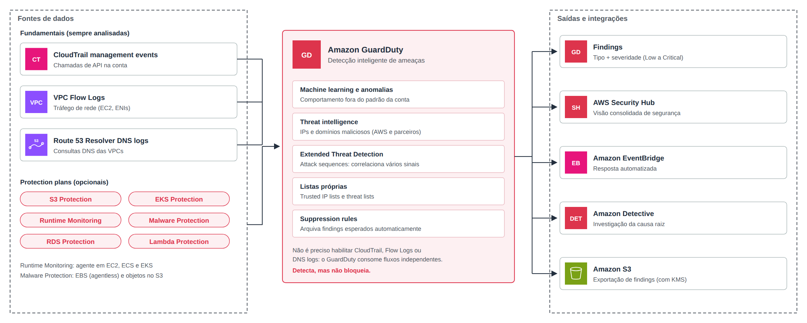

### Findings

Cada finding tem um **tipo**, uma **severidade**, o recurso afetado e os detalhes da atividade.

**Formato do tipo:** `ThreatPurpose:ResourceTypeAffected/ThreatFamilyName.DetectionMechanism!Artifact`

| Exemplo | Significado |
|---|---|
| `CryptoCurrency:EC2/BitcoinTool.B!DNS` | Instância consultando domínios de **mineração de criptomoedas** |
| `Backdoor:EC2/C&CActivity.B!DNS` | Instância se comunicando com um servidor de **command & control** |
| `UnauthorizedAccess:IAMUser/InstanceCredentialExfiltration.OutsideAWS` | Credenciais de uma **instance role** sendo usadas **fora da AWS** (credenciais vazadas) |
| `Recon:EC2/PortProbeUnprotectedPort` | Porta exposta sendo **sondada** por um IP malicioso |
| `Trojan:EC2/DNSDataExfiltration` | **Exfiltração de dados** via consultas DNS |
| `Policy:IAMUser/RootCredentialUsage` | Uso das credenciais do **root user** |
| `Stealth:IAMUser/CloudTrailLoggingDisabled` | Alguém **desabilitou o CloudTrail** |
| `Policy:S3/BucketBlockPublicAccessDisabled` | Block Public Access de um bucket **desabilitado** |

**Severidade:** **Low**, **Medium**, **High** e **Critical** (esta última usada para attack sequences).

#### Extended Threat Detection

O GuardDuty **correlaciona vários sinais** ao longo do tempo (eventos de API, findings, comportamento em runtime) e de diferentes recursos para identificar **sequências de ataque** (*attack sequences*) com várias etapas, como reconhecimento → escalação de privilégio → exfiltração de dados. Essas sequências geram um único finding de severidade **Critical**, com a linha do tempo do ataque e o mapeamento para táticas do **MITRE ATT&CK**.

### Personalização

- **Trusted IP lists:** IPs confiáveis (ex: da própria empresa) que **não geram findings**.
- **Threat lists:** listas próprias de **IPs maliciosos** conhecidos, que **geram findings** quando aparecem.
- **Suppression rules:** **arquivam automaticamente** findings que correspondem a critérios (ex: um scanner de vulnerabilidades interno que gera findings de port scan), reduzindo o ruído sem desabilitar a detecção.

### Integrações e resposta automatizada

- **Amazon EventBridge:** cada finding novo gera um evento. Atualizações de findings existentes são enviadas com frequência configurável (**15 minutos, 1 hora ou 6 horas**, padrão de 6 horas).
- **AWS Security Hub:** os findings são enviados automaticamente para a visão consolidada.
- **Amazon Detective:** a partir de um finding, permite **investigar a causa raiz** com visualizações do comportamento dos recursos ao longo do tempo.
- **Exportação para S3:** os findings podem ser exportados para um **bucket S3**, criptografados com uma chave **KMS** (útil para retenção longa, já que o GuardDuty guarda os findings por **90 dias**).

**Resposta automatizada:** finding → **EventBridge** → **Lambda**, **Step Functions** ou **SSM Automation** executando ações de contenção:

- **Isolar a instância:** trocar o security group por um SG de **quarentena** (sem regras de entrada/saída).
- **Preservar evidências:** criar **snapshots** dos volumes EBS para análise forense.
- **Bloquear o IP ou domínio malicioso:** em **NACLs**, **WAF**, **AWS Network Firewall** ou **Route 53 Resolver DNS Firewall**.
- **Revogar credenciais:** invalidar as sessões da **IAM role** comprometida ou desativar **access keys**.
- **Notificar** o time via **SNS**, chat ou ferramenta de incidentes.

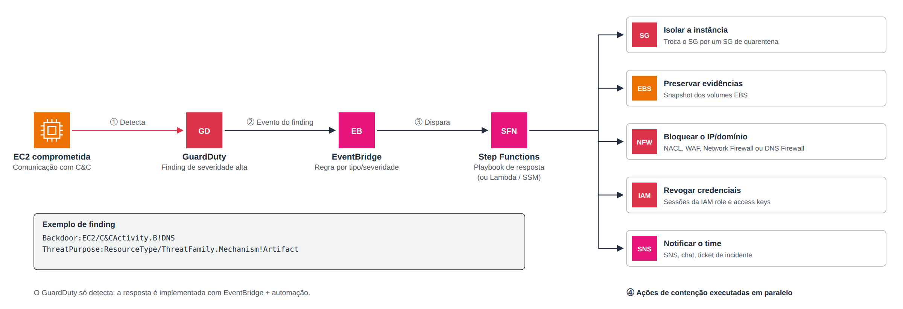

### Multi-account e multi-region

- Integração com **AWS Organizations**: a management account define uma **conta administradora delegada** (normalmente a de segurança). Como o GuardDuty é **regional**, o admin delegado precisa ser configurado **em cada região**.
- O admin delegado **habilita o GuardDuty** e os protection plans nas contas membro, pode **ativar automaticamente** (*auto-enable*) o serviço em **contas novas** e vê os findings de **toda a Organization** naquela região.
- As contas membro **não conseguem desabilitar** o GuardDuty nem alterar as configurações definidas pelo admin.
- Também existe o modelo por **convite** (para contas fora da Organization), hoje menos usado.

**Centralizando findings de várias regiões:** os findings do GuardDuty ficam na região onde foram gerados. Para ter uma visão única:

- **AWS Security Hub** com **agregação entre regiões** (*cross-region aggregation*): os findings de todas as regiões chegam a uma **home region**.
- **EventBridge:** encaminhar os eventos de findings de cada região para um **event bus central** (cross-region e cross-account), onde fica a automação de resposta.
- **Exportação para S3:** cada região exporta para um **bucket central** (com KMS), para retenção e análise com Athena.

> **Obs:** A boa prática é habilitar o GuardDuty em **todas as regiões**, inclusive nas que a empresa **não usa**. Um atacante com credenciais vazadas costuma criar recursos (ex: instâncias para minerar criptomoedas) justamente em regiões sem monitoramento. Para impedir o uso dessas regiões, combine com uma **SCP** que nega ações fora das regiões aprovadas.

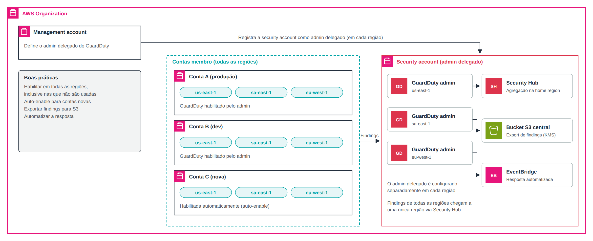

### Malware Protection for S3 em detalhe

Escaneia **novos objetos** enviados a buckets selecionados (ex: bucket de upload de arquivos de usuários), sem agentes e sem infraestrutura própria.

- Pode ser habilitado **por bucket** e **mesmo sem habilitar o GuardDuty** na conta.
- Depois do scan, o GuardDuty pode adicionar ao objeto a tag **`GuardDutyMalwareScanStatus`** com o resultado: `NO_THREATS_FOUND`, `THREATS_FOUND`, `UNSUPPORTED`, `ACCESS_DENIED` ou `FAILED`.
- Com uma **bucket policy** baseada nessa tag (`s3:ExistingObjectTag/GuardDutyMalwareScanStatus`), é possível **bloquear a leitura** de objetos que ainda não foram escaneados ou que estão infectados.
- O resultado também gera um **evento no EventBridge**, que pode acionar uma Lambda para **mover o objeto para um bucket de quarentena** ou notificar o time.
- Exige uma **IAM role** que permita ao GuardDuty ler os objetos (e usar a chave KMS, se o bucket for criptografado com SSE-KMS) e adicionar as tags.

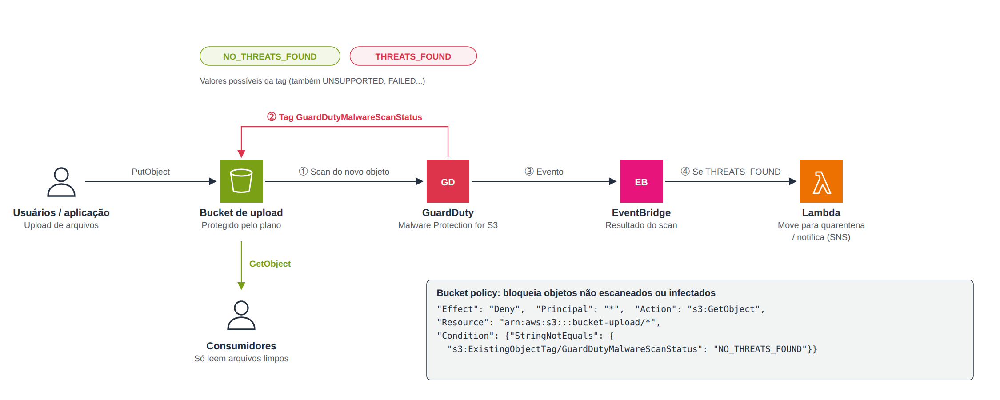

### Runtime Monitoring em detalhe

- Usa um **security agent** do GuardDuty que coleta eventos do sistema operacional (processos, acesso a arquivos, conexões de rede).
- O agente pode ser **gerenciado automaticamente** pelo GuardDuty:
  - **EKS:** instalado como **EKS add-on**;
  - **ECS no Fargate:** injetado como **sidecar** nas novas tasks;
  - **EC2:** instalado via **Systems Manager** (a instância precisa ser uma managed instance do SSM).
- O agente envia os dados por um **VPC endpoint** do GuardDuty. Com o gerenciamento automático, o GuardDuty **cria o VPC endpoint** nas VPCs. Se uma **SCP** ou policy impedir a criação do endpoint, o agente não consegue enviar os dados.
- Também é possível gerenciar o agente **manualmente** (ex: quando a empresa controla todos os componentes instalados nos clusters).

### Testando a automação: sample findings

O GuardDuty pode gerar **findings de exemplo** (*sample findings*) pelo console ou pela API `CreateSampleFindings`. Eles têm o prefixo **`[SAMPLE]`** e servem para **testar as regras do EventBridge** e os playbooks de resposta sem precisar simular um ataque real.

### Exemplo de regra do EventBridge

Regra que dispara a automação para findings de severidade **alta ou crítica** (7 ou mais):

```json
{
  "source": ["aws.guardduty"],
  "detail-type": ["GuardDuty Finding"],
  "detail": {
    "severity": [{ "numeric": [">=", 7] }]
  }
}
```

Também é possível filtrar pelo **tipo** do finding, por exemplo `"type": [{ "prefix": "CryptoCurrency:EC2/" }]`.

### Custo

- Baseado no **volume de dados analisados**: quantidade de **eventos do CloudTrail** e **GB** de VPC Flow Logs e DNS logs.
- Cada **protection plan** tem cobrança própria (eventos de S3/EKS, vCPUs monitoradas no Runtime Monitoring, GB escaneados no Malware Protection etc.).
- O console mostra uma **estimativa de custo** por conta e por fonte de dados.

### GuardDuty vs. outros serviços de segurança

| Serviço | Pergunta que responde |
|---|---|
| **Amazon GuardDuty** | "Há **atividade maliciosa** ou suspeita acontecendo na conta?" |
| **Amazon Inspector** | "Meu software tem **vulnerabilidades conhecidas**?" |
| **Amazon Macie** | "Há **dados sensíveis** expostos no S3?" |
| **Amazon Detective** | "**Qual a causa raiz** e o alcance deste incidente?" |
| **AWS Security Hub** | "Qual é a **visão consolidada** dos findings e da postura de segurança?" |
| **AWS Config** | "As **configurações** estão em conformidade?" |

### Dicas para a prova

- "Detectar **atividade maliciosa**, **instâncias comprometidas** ou **comportamento anômalo** na conta" → **GuardDuty**.
- "Detectar **mineração de criptomoedas** em instâncias EC2" → **GuardDuty** (findings `CryptoCurrency`).
- "Detectar o uso de **credenciais de instance role fora da AWS**" → **GuardDuty** (`InstanceCredentialExfiltration`).
- "Solução de detecção de ameaças com **menor esforço operacional**, sem agentes e sem habilitar logs" → **GuardDuty**.
- "**Responder automaticamente** a um finding" (isolar instância, bloquear IP) → **EventBridge** + **Lambda / Step Functions / SSM Automation**.
- "Detectar **malware** em instâncias EC2 **sem instalar agentes**" → **Malware Protection for EC2**.
- "Escanear **arquivos enviados** a um bucket S3 em busca de malware" → **Malware Protection for S3**.
- "Detectar ameaças **dentro do sistema operacional** de containers e instâncias" → **Runtime Monitoring**.
- "Detectar acessos **suspeitos aos dados do S3**" → **S3 Protection**.
- "Detectar **logins anômalos** no Aurora/RDS" → **RDS Protection**.
- "Reduzir **falsos positivos** de um scanner interno" → **trusted IP list** ou **suppression rule**.
- "O GuardDuty não detecta consultas DNS das instâncias" → elas não usam o **Route 53 Resolver** (DNS próprio).
- "Habilitar o GuardDuty em **todas as contas e regiões**, inclusive nas novas" → **admin delegado** + **auto-enable** (em cada região).
- "**Reter findings** por mais de 90 dias" → **exportação para S3**.
- "**Investigar a causa raiz** de um finding" → **Amazon Detective**.
- "**Bloquear** o tráfego malicioso" → o GuardDuty **não bloqueia**: usar NACL, WAF, Network Firewall ou DNS Firewall (via automação).
- "Visão **única** dos findings de **todas as regiões**" → **Security Hub** com **agregação entre regiões** (ou EventBridge encaminhando para um event bus central).
- "Detectar atividade em **regiões que a empresa não usa**" → habilitar o GuardDuty em **todas as regiões** (e restringir regiões com SCP).
- "Impedir que aplicações leiam **arquivos com malware** enviados ao S3" → **Malware Protection for S3** + bucket policy baseada na tag **`GuardDutyMalwareScanStatus`**.
- "**Testar** as regras de resposta automatizada sem um ataque real" → **sample findings** (`CreateSampleFindings`).
- "Runtime Monitoring não recebe dados das instâncias/containers" → verificar o **VPC endpoint** do GuardDuty (e se uma SCP bloqueou a criação) e o **SSM Agent** nas instâncias EC2.

## AWS Security Hub

O AWS Security Hub é o serviço de **gerenciamento da postura de segurança** (*CSPM — Cloud Security Posture Management*) e de **centralização de findings** da AWS. Ele faz duas coisas:

1. **Avalia continuamente** os recursos contra **padrões de segurança** (best practices da AWS, CIS, PCI DSS, NIST) e gera um **security score**.
2. **Agrega, normaliza e prioriza** os findings de outros serviços de segurança da AWS (GuardDuty, Inspector, Macie etc.) e de **parceiros**, em um único painel.

- É um serviço **regional**, com suporte a **agregação entre regiões** e **multi-account** via AWS Organizations.
- **Período de avaliação gratuito de 30 dias**.
- É um controle **detectivo**: consolida e prioriza, mas **não bloqueia** nada. A resposta é implementada com **EventBridge** e automação.
- **Pré-requisito:** os controles dos padrões de segurança usam **regras do AWS Config** (*service-linked rules*), então o **AWS Config precisa estar habilitado** e gravando os recursos em todas as contas e regiões monitoradas.

> **Obs:** No fim de 2025 a AWS lançou uma **nova versão do Security Hub**, que unifica GuardDuty, Inspector, Macie e o CSPM e adiciona **exposure findings** (correlação de vulnerabilidades, configurações incorretas e exposição à Internet de um mesmo recurso) e visualização de **caminhos de ataque**, com findings no formato **OCSF**. A funcionalidade "clássica" de padrões e controles passou a se chamar **AWS Security Hub CSPM**. As questões da prova ainda são baseadas principalmente nos conceitos abaixo (padrões, controles, ASFF, insights, automação, agregação), que continuam válidos.

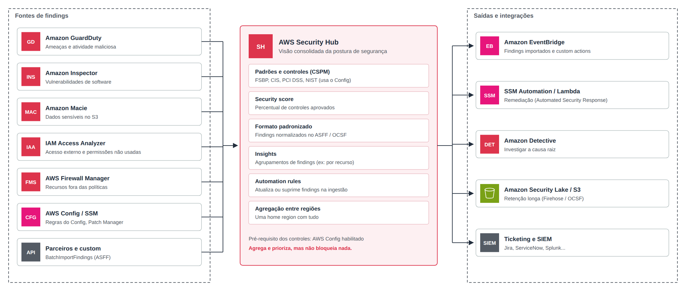

### Padrões de segurança e controles

Um **padrão** (*security standard*) é um conjunto de **controles**. Cada controle verifica uma configuração específica (ex: `S3.8 — S3 buckets should block public access`, `IAM.6 — Hardware MFA should be enabled for the root user`).

| Padrão | Uso |
|---|---|
| **AWS Foundational Security Best Practices (FSBP)** | Boas práticas da própria AWS. Padrão **recomendado** e mais abrangente |
| **CIS AWS Foundations Benchmark** | Benchmark do Center for Internet Security (várias versões) |
| **PCI DSS** | Ambientes que processam **dados de cartão de pagamento** |
| **NIST SP 800-53** | Requisitos do governo dos EUA / frameworks regulatórios |
| **AWS Resource Tagging Standard** | Verifica se os recursos têm as **tags obrigatórias** |
| **Service-Managed Standard: AWS Control Tower** | Controles detectivos gerenciados pelo **Control Tower** |

- Cada controle tem uma **severidade** e um resultado: **PASSED**, **FAILED**, **WARNING** ou **NOT_AVAILABLE**.
- É possível **desabilitar controles** que não se aplicam (ex: controles de recursos globais do IAM em regiões que não são a principal) e, em alguns controles, **customizar parâmetros** (ex: idade máxima de uma access key).
- **Consolidated control findings:** quando ativado, um controle que aparece em vários padrões gera **um único finding**, em vez de um por padrão (reduz ruído).
- **Security score:** percentual de controles **aprovados**, por padrão e geral. Útil para acompanhar a evolução da postura de segurança.

### Findings e o ASFF

Todos os findings são normalizados no **AWS Security Finding Format (ASFF)**, um formato JSON padronizado. Isso permite tratar findings de origens diferentes da mesma forma (filtros, automação, integrações).

**Origens dos findings:**

- **Serviços da AWS:** GuardDuty, Inspector, Macie, IAM Access Analyzer, Firewall Manager, Config (regras próprias), Systems Manager Patch Manager, Health, Detective.
- **Parceiros:** CrowdStrike, Palo Alto, Trend Micro, Prisma Cloud e outros (integração habilitada no console).
- **Findings customizados:** qualquer ferramenta própria pode enviar findings no formato ASFF pela API **`BatchImportFindings`**.

**Campos importantes de um finding:**

| Campo | Valores | Significado |
|---|---|---|
| **Severity.Label** | `INFORMATIONAL`, `LOW`, `MEDIUM`, `HIGH`, `CRITICAL` | Criticidade normalizada |
| **Workflow.Status** | `NEW`, `NOTIFIED`, `RESOLVED`, `SUPPRESSED` | Andamento da investigação (controlado pelo time) |
| **RecordState** | `ACTIVE`, `ARCHIVED` | Se o finding ainda é válido (controlado pela origem) |
| **Compliance.Status** | `PASSED`, `FAILED`, `WARNING`, `NOT_AVAILABLE` | Resultado do controle (findings de padrões) |

- Os findings ficam disponíveis por **90 dias** após a última atualização. Para retenção longa, exportar via **EventBridge → Kinesis Data Firehose → S3** ou usar o **Amazon Security Lake**.

### Insights

**Insights** são **agrupamentos** de findings relacionados, definidos por um filtro e um atributo de agrupamento (ex: "recursos EC2 com mais findings", "contas com mais findings críticos", "buckets S3 com permissões públicas").

- **Managed insights:** prontos, fornecidos pela AWS.
- **Custom insights:** criados pelo time com filtros próprios.

### Automação e resposta

**Automation rules:** regras avaliadas **no momento em que o finding é criado ou atualizado**, que **alteram campos** automaticamente, sem código:

- ajustar a **severidade** (ex: elevar para `CRITICAL` findings de contas de produção);
- adicionar uma **nota** ou **campos de usuário** (ex: time responsável);
- mudar o **workflow status** para `SUPPRESSED` (ex: findings esperados em contas de sandbox).

**Integração com o EventBridge:**

- **`Security Hub Findings - Imported`:** todo finding novo ou atualizado gera um evento automaticamente. Usado para **remediação automática**.
- **`Security Hub Findings - Custom Action`:** o analista seleciona findings no console e escolhe uma **custom action** (ex: "Enviar para o Jira", "Isolar instância"). Usado para **resposta sob demanda**, com um humano decidindo.
- **`Security Hub Insight Results`:** resultados de um insight enviados por custom action.

O alvo da regra do EventBridge é uma **Lambda**, **Step Functions**, **SSM Automation**, **SNS** ou ferramenta de ticketing.

**Automated Security Response on AWS (ASR):** solução da AWS (antiga *Security Hub Automated Response and Remediation*, SHARR) com **playbooks prontos** em SSM Automation para corrigir controles comuns dos padrões FSBP, CIS e PCI DSS (ex: bloquear o acesso público de um bucket, habilitar o CloudTrail).

Também há integrações bidirecionais com **Jira** e **ServiceNow** para abrir e sincronizar tickets a partir dos findings.

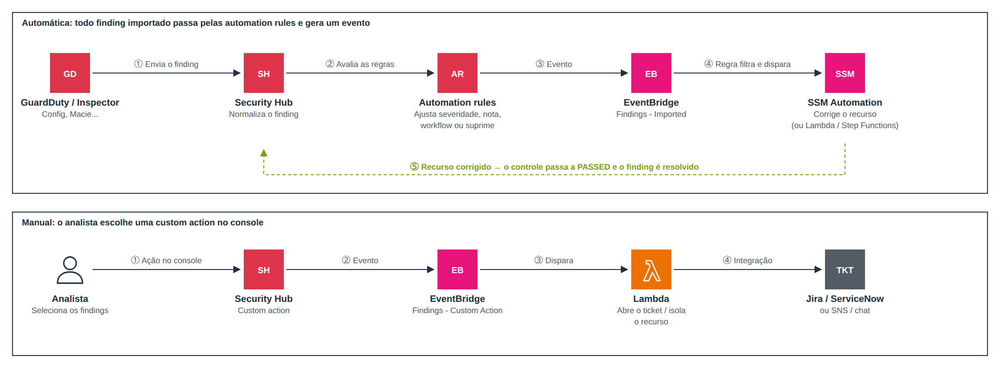

#### Exemplo de regra do EventBridge

Remediação automática de findings de controles com falha e severidade alta ou crítica:

```json
{
  "source": ["aws.securityhub"],
  "detail-type": ["Security Hub Findings - Imported"],
  "detail": {
    "findings": {
      "Compliance": { "Status": ["FAILED"] },
      "Severity": { "Label": ["HIGH", "CRITICAL"] },
      "Workflow": { "Status": ["NEW"] },
      "RecordState": ["ACTIVE"]
    }
  }
}
```

### Multi-account e multi-region

- Integração com **AWS Organizations**: a management account define uma **conta administradora delegada** (normalmente a de segurança). Diferente do GuardDuty, o admin delegado definido na região principal vale para as **demais regiões**.
- O admin delegado vê e gerencia os findings de **todas as contas membro**, e pode **ativar automaticamente** o Security Hub em **contas novas**.
- **Central configuration:** o admin delegado cria **configuration policies** na **home region** e as associa a **OUs** ou contas. A policy define se o Security Hub fica habilitado, quais **padrões** e **controles** ficam ativos e os parâmetros dos controles, e vale para **todas as regiões vinculadas**. Contas novas **herdam** a policy da OU.
- **Cross-region aggregation:** os findings, insights e security scores das **linked regions** são replicados para uma **home region** (aggregation region). Atualizações feitas na home region (ex: mudar o workflow status) são **replicadas de volta** para a região de origem.
- Com a agregação, a **automação central** pode ficar só na home region: um único EventBridge recebe os findings de todas as contas e regiões.

> **Obs:** Como os controles dependem do **AWS Config**, ele precisa estar habilitado em **todas as contas e regiões** (normalmente via Control Tower, StackSets ou Quick Setup). Para recursos globais (ex: IAM), a boa prática é gravá-los no Config **apenas em uma região** e **desabilitar os controles de recursos globais** nas demais, evitando findings duplicados.

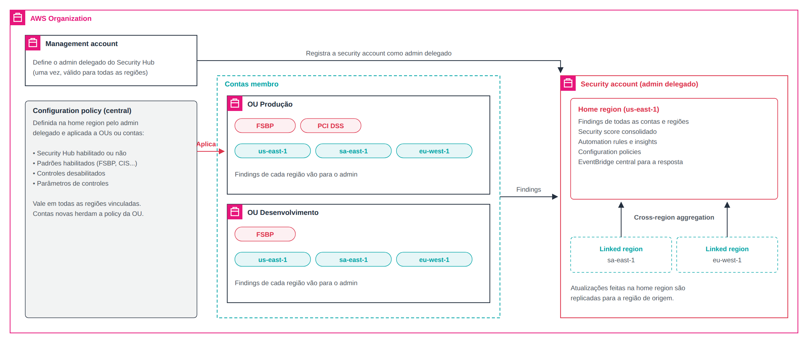

### Custo

- **Security checks:** cobrança por **verificação de controle** realizada (por conta, por região, por mês).
- **Finding ingestion events:** cobrança por **finding ingerido** de outros serviços e parceiros, com uma faixa **gratuita** mensal (os findings dos próprios controles do Security Hub não são cobrados como ingestão).
- **Automation rules:** cobrança por avaliação de regra.
- O custo do **AWS Config** (itens de configuração e avaliações de regras) é **separado** e pode ser relevante em ambientes grandes.

### Security Hub vs. outros serviços

| Serviço | Papel |
|---|---|
| **AWS Security Hub** | **Painel central**: postura de segurança (padrões e controles) + agregação e priorização dos findings |
| **Amazon GuardDuty** | **Detecta ameaças** (atividade maliciosa). Envia findings ao Security Hub |
| **Amazon Inspector** | **Detecta vulnerabilidades** de software. Envia findings ao Security Hub |
| **Amazon Macie** | Descobre **dados sensíveis** no S3. Envia findings ao Security Hub |
| **AWS Config** | Registra configurações e avalia **regras**. É o **motor** dos controles do Security Hub |
| **Amazon Detective** | **Investiga a causa raiz** de um finding |
| **Amazon Security Lake** | **Data lake** de logs e eventos de segurança no S3, no formato **OCSF**, para retenção longa e análise (Athena, SIEM) |
| **AWS Audit Manager** | Coleta **evidências** para **auditorias** e relatórios de compliance |

### Dicas para a prova

- "**Visão única** dos findings de GuardDuty, Inspector, Macie e ferramentas de parceiros" → **Security Hub**.
- "Avaliar continuamente as contas contra o **CIS Benchmark**, **PCI DSS** ou as **best practices da AWS**" → **Security Hub** (padrões de segurança).
- "Security Hub não mostra resultados dos controles" → o **AWS Config** não está habilitado/gravando os recursos.
- "Habilitar o Security Hub e os mesmos padrões em **todas as contas e regiões**, inclusive nas novas" → **admin delegado** + **central configuration** (configuration policies por OU).
- "Visão **única** dos findings de **todas as regiões**" → **cross-region aggregation** (home region).
- "**Remediar automaticamente** controles com falha" → **EventBridge** (`Findings - Imported`) + **SSM Automation / Lambda**, ou a solução **Automated Security Response on AWS**.
- "Permitir que o **analista decida** quando executar uma ação sobre um finding" → **custom action** + EventBridge.
- "**Elevar a severidade** ou **suprimir** findings automaticamente, **sem código**" → **automation rules**.
- "Enviar findings de uma **ferramenta própria** ao Security Hub" → **`BatchImportFindings`** no formato **ASFF**.
- "**Reter findings** por mais de 90 dias" → EventBridge + **Firehose → S3**, ou **Security Lake**.
- "Abrir **tickets** automaticamente a partir de findings" → integração com **Jira/ServiceNow** ou EventBridge + Lambda.
- "Findings **duplicados** de recursos globais (IAM) em várias regiões" → desabilitar os controles de recursos globais fora da região principal (e **consolidated control findings** para duplicidade entre padrões).
- "**Investigar** a causa raiz de um finding visto no Security Hub" → **Amazon Detective**.
- "Centralizar **logs** de segurança em formato aberto para análise e retenção" → **Security Lake** (o Security Hub centraliza **findings**, não logs).
