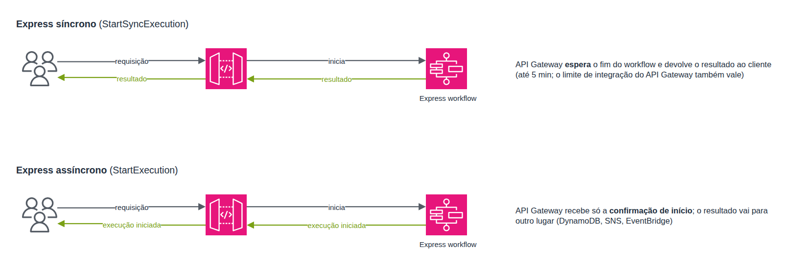
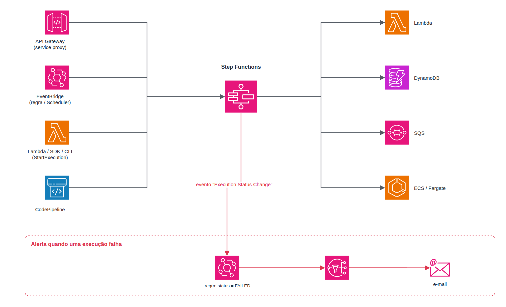
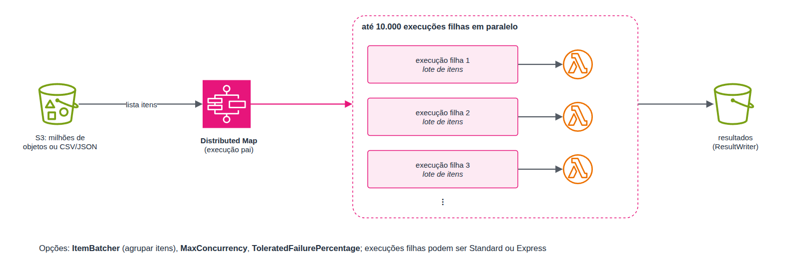

# Service Communication

> **Escopo:** _(em uma frase, o que este arquivo cobre)_
>
> **Por que cai na prova:** _(o ângulo que a SAP-C02 costuma explorar)_

## Índice

- **Orquestração:** [AWS Step Functions](#aws-step-functions)
- **Revisão:** [Qual serviço usar](#revisão-qual-serviço-usar)

## AWS Step Functions

### Contexto: workflows, máquinas de estados e orquestração

Quase todo processo de negócio é uma **sequência de passos**: validar um pedido, cobrar o cartão, reservar o estoque, emitir a nota, avisar o cliente. Em um monolito, esses passos são chamadas de função dentro de um mesmo processo. Em uma arquitetura de **microsserviços** ou **serverless**, cada passo vive em um serviço diferente (uma Lambda, um container, uma fila, um banco), e surge um problema: **quem coordena o fluxo?** Quem sabe qual é o próximo passo, o que fazer quando um deles falha e em que ponto o processo parou?

Alguns conceitos de computação e engenharia de software ajudam a entender a resposta:

- **Workflow:** a descrição de um processo como um conjunto de passos, com a ordem entre eles, as decisões (*se X, faça Y*), os passos em paralelo e as esperas.
- **Máquina de estados finita:** um modelo da teoria da computação em que um sistema está sempre em **um estado** de um conjunto finito, e **transições** levam de um estado para outro conforme a entrada. Um semáforo é o exemplo clássico: verde → amarelo → vermelho → verde. Um workflow pode ser descrito como uma máquina de estados: cada passo é um estado, e o resultado do passo define a transição.
- **Orquestração vs. coreografia:** as duas formas de coordenar serviços.
  - Na **orquestração**, um **coordenador central** conhece o fluxo inteiro e manda cada serviço executar sua parte, como um maestro. O fluxo fica explícito e fácil de acompanhar.
  - Na **coreografia**, não há coordenador: cada serviço **reage a eventos** dos outros (via SNS, SQS ou EventBridge), como dançarinos que conhecem a música. O acoplamento é menor, mas o fluxo fica espalhado e é difícil saber "onde está o pedido 123".
- **Workflow durável:** o estado da execução (em que passo está e com quais dados) é **persistido** fora do código. Se um servidor cair, o processo continua do ponto em que parou, mesmo que dure dias.
- **Retry com backoff exponencial e jitter:** falhas transitórias (timeout, *throttling*) costumam se resolver sozinhas. A estratégia padrão é tentar de novo com **intervalos crescentes** (1 s, 2 s, 4 s...) e um **componente aleatório** (*jitter*), para que milhares de clientes não tentem todos no mesmo instante.
- **Idempotência:** uma operação é idempotente quando executá-la **duas vezes** tem o mesmo efeito que executá-la **uma vez** (ex: "definir o saldo como 100" é idempotente; "somar 100 ao saldo" não é). Com retries, o mesmo passo pode rodar mais de uma vez, então os passos precisam ser idempotentes.
- **Transações distribuídas e o padrão Saga:** um banco de dados garante que várias escritas aconteçam **todas ou nenhuma** (transação ACID). Quando o processo atravessa vários serviços, cada um com seu banco, não existe essa garantia. O **padrão Saga** resolve isso com uma sequência de transações locais, em que cada passo tem uma **ação de compensação** que desfaz seu efeito (ex: "cobrar" ↔ "estornar"). Se um passo falha, o orquestrador executa as compensações dos passos já concluídos.

O **AWS Step Functions** é o serviço **serverless de orquestração** da AWS: você descreve o workflow como uma **máquina de estados** em JSON, e o serviço executa cada passo, guarda o estado, faz retries, trata erros e mostra visualmente onde cada execução está. Na prova, ele aparece em cenários de **orquestrar Lambdas e microsserviços**, **processos longos** (dias ou meses), **aprovação humana**, **tratamento de erros sem código** e **processamento em lote em larga escala**.

[↑ Índice](#índice)

### O que é o Step Functions

- **Máquina de estados (*state machine*):** a definição do workflow, escrita em **Amazon States Language (ASL)**, um JSON que lista os estados e as transições. O **Workflow Studio** do console permite desenhá-la arrastando blocos.
- **Execução:** cada vez que a máquina de estados é iniciada, com uma **entrada em JSON**. A saída de um estado vira a entrada do próximo. Os dados podem ser filtrados e transformados com **JSONPath** ou **JSONata**, e guardados em **variáveis** para uso em estados posteriores.
- **Duração:** uma execução **Standard** pode durar até **1 ano**, sem nenhum servidor esperando: o estado fica persistido no serviço.
- **Visualização:** o console mostra o grafo de cada execução, com o estado atual, a entrada e a saída de cada passo e onde ocorreu a falha. Isso facilita muito a depuração em relação a logs espalhados.
- **Serverless:** sem infraestrutura, com escala automática e pagamento por uso.
- **Latência:** cada transição adiciona alguns milissegundos. Encadear muitas Lambdas curtas via Step Functions deixa o fluxo **mais lento** do que uma chamada direta, o que importa em APIs síncronas sensíveis à latência.

Exemplo de ASL com um estado `Task` que chama uma Lambda com retry e desvia para um estado de compensação em caso de erro:

```json
{
  "StartAt": "CobrarPagamento",
  "States": {
    "CobrarPagamento": {
      "Type": "Task",
      "Resource": "arn:aws:states:::lambda:invoke",
      "Arguments": { "FunctionName": "cobrar-pagamento", "Payload": "" },
      "Retry": [{ "ErrorEquals": ["States.TaskFailed"], "IntervalSeconds": 2, "BackoffRate": 2, "MaxAttempts": 3 }],
      "Catch": [{ "ErrorEquals": ["States.ALL"], "Next": "Estornar" }],
      "Next": "Sucesso"
    },
    "Estornar": { "Type": "Task", "Resource": "arn:aws:states:::lambda:invoke", "Arguments": { "FunctionName": "estornar" }, "Next": "Falhou" },
    "Sucesso": { "Type": "Succeed" },
    "Falhou": { "Type": "Fail", "Error": "PagamentoRecusado" }
  },
  "QueryLanguage": "JSONata"
}
```

[↑ Índice](#índice)

### Tipos de estado

| Estado | O que faz | Exemplo |
|---|---|---|
| **Task** | Executa um trabalho: chama um serviço AWS, uma API HTTP ou espera um worker | Invocar uma Lambda, gravar no DynamoDB |
| **Choice** | Desvia o fluxo conforme uma condição sobre os dados | "valor > 10 mil" → aprovação manual |
| **Parallel** | Executa **ramos diferentes** ao mesmo tempo e espera todos terminarem | Cobrar e reservar estoque em paralelo |
| **Map** | Executa **os mesmos passos para cada item** de uma lista | Processar cada item do pedido. No modo **Distributed**, milhões de objetos do S3 |
| **Wait** | Pausa por um tempo ou até uma data/hora | Esperar 24 h antes de enviar um lembrete |
| **Pass** | Repassa ou transforma dados, sem chamar nada | Montar a entrada do próximo passo |
| **Succeed** / **Fail** | Encerra a execução com sucesso ou com erro | Fim do fluxo |


> **Obs:** o estado **Task** pode chamar quatro tipos de trabalho: uma **Lambda**, um **serviço AWS** (integrações), uma **API HTTPS** externa (HTTP Task) ou uma **Activity** (worker que você hospeda). Segundo o curso, o Step Functions **não se integra nativamente com o Amazon Mechanical Turk**: tarefas humanas via Mechanical Turk apontam para o **SWF**.

[↑ Índice](#índice)

### Padrões de integração com serviços

O Step Functions chama outros serviços de três formas:

- **Integrações otimizadas:** cerca de vinte serviços com sintaxe simplificada e suporte aos padrões abaixo: **Lambda**, **Batch**, **ECS/Fargate**, **DynamoDB**, **SNS**, **SQS**, **EventBridge**, **Glue**, **EMR**, **SageMaker**, **Athena**, **CodeBuild**, **API Gateway**, **Bedrock** e o próprio **Step Functions** (workflows aninhados).
- **Integrações via AWS SDK:** acesso a **mais de 200 serviços** e milhares de ações da API, como uma chamada comum do SDK (`arn:aws:states:::aws-sdk:<serviço>:<ação>`). Elimina a "Lambda cola" que só existia para chamar uma API da AWS.
- **HTTP Task:** chama **APIs HTTPS de terceiros** (Stripe, Salesforce...), com a autenticação guardada em uma **connection do EventBridge** (API key, OAuth ou Basic).

Para cada chamada, existem três **padrões de espera**, definidos por um sufixo no ARN do recurso:

| Padrão | Sufixo | Comportamento | Uso típico |
|---|---|---|---|
| **Request Response** | (nenhum) | Chama a API e **segue** assim que ela responde, sem esperar o trabalho terminar | Enviar mensagem ao SQS, publicar no SNS |
| **Run a Job** | `.sync` | Inicia o job e **espera ele terminar** (o Step Functions acompanha o status) | Job do Batch, task do ECS, job do Glue, workflow aninhado |
| **Wait for Callback** | `.waitForTaskToken` | Envia um **task token** e **pausa** até alguém chamar `SendTaskSuccess` ou `SendTaskFailure` com esse token | **Aprovação humana**, sistema legado, processo externo |

- **Activities:** um **worker** hospedado por você (on-premises, EC2, um dispositivo móvel) faz **polling** com `GetActivityTask`, processa e devolve o resultado com `SendTaskSuccess`. O worker **puxa** o trabalho, então não precisa expor nenhum endpoint.
- **Heartbeat:** em tarefas longas (callback e activities), `HeartbeatSeconds` define em quanto tempo o worker precisa dar sinal de vida (`SendTaskHeartbeat`). Sem o sinal, o estado falha com `States.HeartbeatTimeout`, em vez de esperar até o fim do timeout.


> **Obs:** o fluxo de **aprovação humana** é o exemplo clássico do callback. O Step Functions envia o token para o SQS ou o SNS, uma Lambda manda um e-mail com links "aprovar/rejeitar" (via API Gateway), e o clique chama `SendTaskSuccess(token)`. A execução fica pausada, **sem custo de computação**, até a resposta ou o timeout.

[↑ Índice](#índice)

### Standard vs. Express

| | **Standard** | **Express** |
|---|---|---|
| Duração máxima | **1 ano** | **5 minutos** |
| Taxa de início de execuções | Mais de 2.000/s | Mais de **100.000/s** |
| Taxa de transições de estado | Mais de 4.000/s por conta | Praticamente ilimitada |
| Semântica de execução | **Exactly-once** (cada passo roda uma vez, salvo retries configurados) | **At-least-once** (assíncrono) ou **at-most-once** (síncrono) |
| Preço | Por **transição de estado** (mais caro em volume) | Por **número de execuções, duração e memória** (mais barato em volume) |
| Histórico | No console e na API por 90 dias, com depuração visual; também no CloudWatch Logs | Só no **CloudWatch Logs** (precisa ativar) |
| `.sync`, `.waitForTaskToken` e Activities | Sim | **Não** |
| Redrive após falha | Sim | Não |

- **Standard:** processos **longos**, **auditáveis**, que **não podem executar um passo duas vezes** (pagamentos, pedidos, aprovações) ou que esperam pessoas e jobs.
- **Express:** eventos de **alto volume e curta duração**: ingestão de IoT, processamento de streams, transformação de dados, backends de API e microsserviços. Os passos precisam ser **idempotentes**, por causa da semântica at-least-once.
- **Express síncrono vs. assíncrono:**
  - **síncrono** (`StartSyncExecution`): quem chamou **espera o fim** do workflow e recebe o resultado. É o padrão para um backend de API via API Gateway;
  - **assíncrono** (`StartExecution`): quem chamou recebe só a **confirmação de início**, e o resultado vai para outro destino (DynamoDB, SNS, EventBridge). Serve para workflows que não precisam de resposta imediata.



> **Obs:** é possível combinar os dois tipos. Um workflow **Standard** pode chamar um **Express** como passo (ex: uma etapa de transformação de alto volume), e o **Distributed Map** pode rodar suas execuções filhas como Express para reduzir custo.

[↑ Índice](#índice)

### Como iniciar uma execução

- **Console**, **AWS SDK** (`StartExecution`) e **CLI** (`aws stepfunctions start-execution`).
- **Lambda**, chamando `StartExecution` pelo SDK.
- **API Gateway**, como **service proxy**: a API inicia a execução diretamente, sem uma Lambda no meio.
- **EventBridge**: uma **regra** dispara o workflow a partir de um evento (ex: objeto criado no S3, mudança de estado de uma instância EC2), e o **EventBridge Scheduler** o dispara em horários (cron).
- **CodePipeline**, como uma ação do pipeline.
- **Outro Step Functions**, como workflow aninhado (`StartExecution.sync` espera a execução filha terminar). Workflows aninhados ajudam a **modularizar** e a contornar o limite de eventos por execução.



[↑ Índice](#índice)

### Tratamento de erros e o padrão Saga

O tratamento de erros fica **declarado na máquina de estados**, não no código de cada função:

- **Retry:** tenta de novo os erros listados em `ErrorEquals`, com `IntervalSeconds`, `BackoffRate` (backoff exponencial), `MaxAttempts`, `MaxDelaySeconds` e `JitterStrategy` (jitter). Serve para **falhas transitórias**.
- **Catch:** quando os retries se esgotam, desvia a execução para um **estado de fallback** (compensar, notificar, registrar o erro), em vez de falhar.
- **Erros predefinidos:** `States.ALL` (qualquer erro), `States.Timeout`, `States.TaskFailed`, `States.HeartbeatTimeout` e `States.Permissions`. As funções também podem lançar **erros próprios** (ex: `PagamentoRecusado`), tratados pelo nome.
- **Timeouts:** `TimeoutSeconds` em cada Task e na execução inteira. Sem timeout, uma Task de callback pode esperar até o limite de 1 ano.
- **Padrão Saga:** cada passo que altera dados tem um estado de **compensação** (estornar, liberar o estoque, cancelar a reserva). O `Catch` leva o fluxo para essas compensações, na ordem inversa, e o sistema volta a um estado consistente, sem uma transação distribuída.
- **Redrive:** uma execução **Standard** que falhou pode ser **retomada a partir do passo que falhou** (até 14 dias depois), sem repetir os passos que já deram certo. Útil quando a falha vinha de um bug corrigido ou de uma dependência fora do ar.
- **Alertas:** o Step Functions publica eventos de **mudança de status das execuções** no **EventBridge**. Uma regra filtrando `FAILED`, `TIMED_OUT` ou `ABORTED` pode notificar via **SNS** (e-mail) ou acionar uma automação.

[↑ Índice](#índice)

### Distributed Map: processamento em larga escala

O estado **Map** tem dois modos:

- **Inline:** itera sobre um array **dentro** da execução, com até 40 iterações em paralelo. Serve para listas pequenas (os itens de um pedido).
- **Distributed:** cria **execuções filhas** (até **10.000 em paralelo**), cada uma com um lote de itens. Ele lê os itens diretamente do **S3**, seja a lista de objetos de um prefixo, um arquivo **CSV** ou **JSON**, ou um **S3 Inventory**, e grava os resultados de volta no S3 (`ResultWriter`).
  - **Controles:** `ItemBatcher` (quantos itens por execução filha), `MaxConcurrency` e `ToleratedFailurePercentage` (quantas falhas aceitar antes de falhar o Map inteiro).
  - **Casos de uso:** processar **milhões de arquivos** (imagens, logs, documentos), reprocessar um data lake, rodar inferência de ML em lote, migrar dados.



> **Obs:** o Distributed Map é a resposta serverless para "processar milhões de objetos do S3 em paralelo com controle de falhas", sem gerenciar um cluster (EMR) ou uma fila com workers. Para transformações simples em cada objeto, o **S3 Batch Operations** também é uma opção.

[↑ Índice](#índice)

### Segurança, limites e operação

- **IAM:**
  - **execution role:** a máquina de estados assume uma role com as permissões para chamar cada serviço do workflow;
  - **cross-account:** uma Task pode assumir uma role de **outra conta** (campo `Credentials`) e chamar recursos de lá diretamente.
- **Rede:** acesso privado à API do Step Functions a partir da VPC com um **interface VPC endpoint** (PrivateLink).
- **Criptografia:** dados das execuções criptografados em repouso, com chave **gerenciada pela AWS** ou **KMS do cliente**.
- **Observabilidade:**
  - **CloudWatch Logs** (obrigatório para depurar o Express) e métricas no CloudWatch;
  - **X-Ray** para rastrear a execução entre os serviços;
  - **CloudTrail** para as chamadas de API.
- **Limites importantes:**
  - a entrada e a saída de cada estado têm no máximo **256 KB**. Para dados maiores, grave no **S3** e passe só a **referência** (bucket e chave);
  - o histórico de uma execução Standard tem no máximo **25.000 eventos**. Loops longos devem ser divididos em **workflows filhos** ou usar o Distributed Map.
- **Deploy seguro:** **versões** e **aliases** da máquina de estados permitem publicar uma nova versão e direcionar parte das execuções para ela (implantação gradual), com rollback rápido.

[↑ Índice](#índice)

### Step Functions vs. alternativas

| Necessidade | Serviço |
|---|---|
| Orquestrar passos com ordem, decisões, paralelismo, retries e visibilidade | **Step Functions** |
| Desacoplar produtor e consumidor, absorver picos, processar em background | **SQS** (coreografia, sem fluxo central) |
| Reagir a eventos e espalhar para vários consumidores | **SNS** / **EventBridge** (coreografia) |
| Pipelines de dados com **Apache Airflow** (DAGs em Python), portabilidade e operadores prontos | **Amazon MWAA** |
| Sistemas legados com workflows já em **SWF**, sinais externos ou **Mechanical Turk** | **Amazon SWF** (serviço antigo; para projetos novos, a AWS recomenda o Step Functions) |
| Uma sequência simples de 2 passos, em que a latência é crítica | Chamada direta entre serviços ou Lambda destinations |

[↑ Índice](#índice)

### Dicas para a prova

- "Orquestrar várias Lambdas com **retries, tratamento de erros e paralelismo**, sem escrever código de coordenação" → **Step Functions**.
- "Processo que precisa de **aprovação humana** antes de continuar" → Step Functions com **`.waitForTaskToken`** (callback).
- "Workflow que roda por **dias ou meses**" → Step Functions **Standard** (até 1 ano).
- "Workflow de **alto volume e curta duração** (IoT, streaming), com **menor custo**" → **Express**.
- "Backend de API que orquestra microsserviços e **devolve o resultado** na mesma requisição" → API Gateway + **Express síncrono**.
- "Cada passo deve executar **exatamente uma vez**, com histórico auditável" → **Standard** (Express é at-least-once).
- "Iniciar um job do Batch, ECS ou Glue e **esperar ele terminar**" → integração **`.sync`** (Run a Job).
- "Worker **on-premises** que processa tarefas do workflow sem expor endpoint" → **Activity** (polling).
- "**Transação distribuída** entre microsserviços, com desfazer em caso de falha" → padrão **Saga** com **Catch** e estados de compensação.
- "Ser **notificado** quando uma execução falhar" → **EventBridge** (evento de status) → **SNS**.
- "Processar **milhões de objetos do S3** em paralelo" → **Distributed Map**.
- "Chamar uma API da AWS sem uma Lambda só para isso" → **integração via AWS SDK**.
- "Payload maior que **256 KB**" → guardar no **S3** e passar a referência.
- "Retomar uma execução que falhou **sem repetir os passos concluídos**" → **Redrive**.
- "Tarefas humanas via **Mechanical Turk**" → **SWF** (o Step Functions não integra nativamente).

[↑ Índice](#índice)

## Revisão: qual serviço usar

Resumo das comparações que mais aparecem nas questões. Os detalhes estão nas seções de cada serviço.

### Orquestração (Step Functions)

| Pergunta do cenário | Solução |
|---|---|
| Coordenar vários passos com retries, erros e paralelismo | [Step Functions](#o-que-é-o-step-functions) |
| Qual estado usar (Choice, Parallel, Map, Wait...)? | [Tipos de estado](#tipos-de-estado) |
| Esperar job terminar, aprovação humana ou worker on-premises | [Padrões de integração](#padrões-de-integração-com-serviços) |
| Processo longo e auditável ou alto volume e barato? | [Standard vs. Express](#standard-vs-express) |
| API que espera o resultado do workflow | [Express síncrono](#standard-vs-express) |
| Disparar por evento, agenda ou API | [Como iniciar](#como-iniciar-uma-execução) |
| Transação entre microsserviços, desfazer em falha | [Saga](#tratamento-de-erros-e-o-padrão-saga) |
| Alertar quando uma execução falha | [EventBridge + SNS](#tratamento-de-erros-e-o-padrão-saga) |
| Milhões de objetos do S3 em paralelo | [Distributed Map](#distributed-map-processamento-em-larga-escala) |
| Payload grande, conta cruzada, acesso privado | [Segurança e limites](#segurança-limites-e-operação) |
| Step Functions, SQS, EventBridge, MWAA ou SWF? | [Alternativas](#step-functions-vs-alternativas) |

[↑ Índice](#índice)
