# Service Communication

> **Escopo:** _(em uma frase, o que este arquivo cobre)_
>
> **Por que cai na prova:** _(o ângulo que a SAP-C02 costuma explorar)_

## Índice

- **Orquestração:** [AWS Step Functions](#aws-step-functions)
- **Mensageria:** [Amazon SQS](#amazon-sqs) · [Amazon MQ](#amazon-mq) · [Amazon SNS](#amazon-sns)
- **Eventos:** [Amazon EventBridge](#amazon-eventbridge)
- **Arquitetura:** [Padrões de integração](#padrões-de-integração)
- **Revisão:** [Qual serviço usar](#revisão-qual-serviço-usar)

## AWS Step Functions

### Contexto: workflows, máquinas de estados e orquestração

Quase todo processo de negócio é uma **sequência de passos**: validar um pedido, cobrar o cartão, reservar o estoque, emitir a nota, avisar o cliente. Em um monolito, esses passos são chamadas de função dentro de um mesmo processo. Em uma arquitetura de **microsserviços** ou **serverless**, cada passo vive em um serviço diferente (uma Lambda, um container, uma fila, um banco), e surge um problema: **quem coordena o fluxo?** Quem sabe qual é o próximo passo, o que fazer quando um deles falha e em que ponto o processo parou?

Alguns conceitos de computação e engenharia de software ajudam a entender a resposta:

- **Workflow:** a descrição de um processo como um conjunto de passos, com a ordem entre eles, as decisões (*se X, faça Y*), os passos em paralelo e as esperas.
- **Máquina de estados finita:** um modelo da teoria da computação em que um sistema está sempre em **um estado** de um conjunto finito, e **transições** levam de um estado para outro conforme a entrada. Um semáforo é o exemplo clássico: verde → amarelo → vermelho → verde. Um workflow pode ser descrito como uma máquina de estados: cada passo é um estado, e o resultado do passo define a transição.
- **Orquestração vs. coreografia:** as duas formas de coordenar serviços.
  - Na **orquestração**, um **coordenador central** conhece o fluxo inteiro e manda cada serviço executar sua parte, como um maestro. O fluxo fica explícito e fácil de acompanhar.
  - Na **coreografia**, não há coordenador: cada serviço **reage a eventos** dos outros (via SNS, SQS ou EventBridge), como dançarinos que conhecem a música. O acoplamento é menor, mas o fluxo fica espalhado e é difícil saber "onde está o pedido 123".
- **Workflow durável:** o estado da execução (em que passo está e com quais dados) é **persistido** fora do código. Se um servidor cair, o processo continua do ponto em que parou, mesmo que dure dias.
- **Retry com backoff exponencial e jitter:** falhas transitórias (timeout, *throttling*) costumam se resolver sozinhas. A estratégia padrão é tentar de novo com **intervalos crescentes** (1 s, 2 s, 4 s...) e um **componente aleatório** (*jitter*), para que milhares de clientes não tentem todos no mesmo instante.
- **Idempotência:** uma operação é idempotente quando executá-la **duas vezes** tem o mesmo efeito que executá-la **uma vez** (ex: "definir o saldo como 100" é idempotente; "somar 100 ao saldo" não é). Com retries, o mesmo passo pode rodar mais de uma vez, então os passos precisam ser idempotentes.
- **Transações distribuídas e o padrão Saga:** um banco de dados garante que várias escritas aconteçam **todas ou nenhuma** (transação ACID). Quando o processo atravessa vários serviços, cada um com seu banco, não existe essa garantia. O **padrão Saga** resolve isso com uma sequência de transações locais, em que cada passo tem uma **ação de compensação** que desfaz seu efeito (ex: "cobrar" ↔ "estornar"). Se um passo falha, o orquestrador executa as compensações dos passos já concluídos.

O **AWS Step Functions** é o serviço **serverless de orquestração** da AWS: você descreve o workflow como uma **máquina de estados** em JSON, e o serviço executa cada passo, guarda o estado, faz retries, trata erros e mostra visualmente onde cada execução está. Na prova, ele aparece em cenários de **orquestrar Lambdas e microsserviços**, **processos longos** (dias ou meses), **aprovação humana**, **tratamento de erros sem código** e **processamento em lote em larga escala**.

[↑ Índice](#índice)

### O que é o Step Functions

- **Máquina de estados (*state machine*):** a definição do workflow, escrita em **Amazon States Language (ASL)**, um JSON que lista os estados e as transições. O **Workflow Studio** do console permite desenhá-la arrastando blocos.
- **Execução:** cada vez que a máquina de estados é iniciada, com uma **entrada em JSON**. A saída de um estado vira a entrada do próximo. Os dados podem ser filtrados e transformados com **JSONPath** ou **JSONata**, e guardados em **variáveis** para uso em estados posteriores.
- **Duração:** uma execução **Standard** pode durar até **1 ano**, sem nenhum servidor esperando: o estado fica persistido no serviço.
- **Visualização:** o console mostra o grafo de cada execução, com o estado atual, a entrada e a saída de cada passo e onde ocorreu a falha. Isso facilita muito a depuração em relação a logs espalhados.
- **Serverless:** sem infraestrutura, com escala automática e pagamento por uso.
- **Latência:** cada transição adiciona alguns milissegundos. Encadear muitas Lambdas curtas via Step Functions deixa o fluxo **mais lento** do que uma chamada direta, o que importa em APIs síncronas sensíveis à latência.

Exemplo de ASL com um estado `Task` que chama uma Lambda com retry e desvia para um estado de compensação em caso de erro:

```json
{
  "StartAt": "CobrarPagamento",
  "States": {
    "CobrarPagamento": {
      "Type": "Task",
      "Resource": "arn:aws:states:::lambda:invoke",
      "Arguments": { "FunctionName": "cobrar-pagamento", "Payload": "" },
      "Retry": [{ "ErrorEquals": ["States.TaskFailed"], "IntervalSeconds": 2, "BackoffRate": 2, "MaxAttempts": 3 }],
      "Catch": [{ "ErrorEquals": ["States.ALL"], "Next": "Estornar" }],
      "Next": "Sucesso"
    },
    "Estornar": { "Type": "Task", "Resource": "arn:aws:states:::lambda:invoke", "Arguments": { "FunctionName": "estornar" }, "Next": "Falhou" },
    "Sucesso": { "Type": "Succeed" },
    "Falhou": { "Type": "Fail", "Error": "PagamentoRecusado" }
  },
  "QueryLanguage": "JSONata"
}
```

[↑ Índice](#índice)

### Tipos de estado

| Estado | O que faz | Exemplo |
|---|---|---|
| **Task** | Executa um trabalho: chama um serviço AWS, uma API HTTP ou espera um worker | Invocar uma Lambda, gravar no DynamoDB |
| **Choice** | Desvia o fluxo conforme uma condição sobre os dados | "valor > 10 mil" → aprovação manual |
| **Parallel** | Executa **ramos diferentes** ao mesmo tempo e espera todos terminarem | Cobrar e reservar estoque em paralelo |
| **Map** | Executa **os mesmos passos para cada item** de uma lista | Processar cada item do pedido. No modo **Distributed**, milhões de objetos do S3 |
| **Wait** | Pausa por um tempo ou até uma data/hora | Esperar 24 h antes de enviar um lembrete |
| **Pass** | Repassa ou transforma dados, sem chamar nada | Montar a entrada do próximo passo |
| **Succeed** / **Fail** | Encerra a execução com sucesso ou com erro | Fim do fluxo |

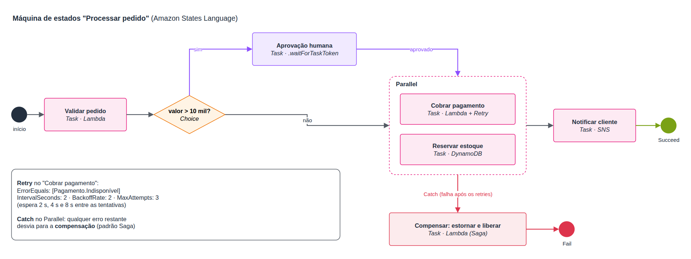

> **Obs:** o estado **Task** pode chamar quatro tipos de trabalho: uma **Lambda**, um **serviço AWS** (integrações), uma **API HTTPS** externa (HTTP Task) ou uma **Activity** (worker que você hospeda). Segundo o curso, o Step Functions **não se integra nativamente com o Amazon Mechanical Turk**: tarefas humanas via Mechanical Turk apontam para o **SWF**.

[↑ Índice](#índice)

### Padrões de integração com serviços

O Step Functions chama outros serviços de três formas:

- **Integrações otimizadas:** cerca de vinte serviços com sintaxe simplificada e suporte aos padrões abaixo: **Lambda**, **Batch**, **ECS/Fargate**, **DynamoDB**, **SNS**, **SQS**, **EventBridge**, **Glue**, **EMR**, **SageMaker**, **Athena**, **CodeBuild**, **API Gateway**, **Bedrock** e o próprio **Step Functions** (workflows aninhados).
- **Integrações via AWS SDK:** acesso a **mais de 200 serviços** e milhares de ações da API, como uma chamada comum do SDK (`arn:aws:states:::aws-sdk:<serviço>:<ação>`). Elimina a "Lambda cola" que só existia para chamar uma API da AWS.
- **HTTP Task:** chama **APIs HTTPS de terceiros** (Stripe, Salesforce...), com a autenticação guardada em uma **connection do EventBridge** (API key, OAuth ou Basic).

Para cada chamada, existem três **padrões de espera**, definidos por um sufixo no ARN do recurso:

| Padrão | Sufixo | Comportamento | Uso típico |
|---|---|---|---|
| **Request Response** | (nenhum) | Chama a API e **segue** assim que ela responde, sem esperar o trabalho terminar | Enviar mensagem ao SQS, publicar no SNS |
| **Run a Job** | `.sync` | Inicia o job e **espera ele terminar** (o Step Functions acompanha o status) | Job do Batch, task do ECS, job do Glue, workflow aninhado |
| **Wait for Callback** | `.waitForTaskToken` | Envia um **task token** e **pausa** até alguém chamar `SendTaskSuccess` ou `SendTaskFailure` com esse token | **Aprovação humana**, sistema legado, processo externo |

- **Activities:** um **worker** hospedado por você (on-premises, EC2, um dispositivo móvel) faz **polling** com `GetActivityTask`, processa e devolve o resultado com `SendTaskSuccess`. O worker **puxa** o trabalho, então não precisa expor nenhum endpoint.
- **Heartbeat:** em tarefas longas (callback e activities), `HeartbeatSeconds` define em quanto tempo o worker precisa dar sinal de vida (`SendTaskHeartbeat`). Sem o sinal, o estado falha com `States.HeartbeatTimeout`, em vez de esperar até o fim do timeout.


> **Obs:** o fluxo de **aprovação humana** é o exemplo clássico do callback. O Step Functions envia o token para o SQS ou o SNS, uma Lambda manda um e-mail com links "aprovar/rejeitar" (via API Gateway), e o clique chama `SendTaskSuccess(token)`. A execução fica pausada, **sem custo de computação**, até a resposta ou o timeout.

[↑ Índice](#índice)

### Standard vs. Express

| | **Standard** | **Express** |
|---|---|---|
| Duração máxima | **1 ano** | **5 minutos** |
| Taxa de início de execuções | Mais de 2.000/s | Mais de **100.000/s** |
| Taxa de transições de estado | Mais de 4.000/s por conta | Praticamente ilimitada |
| Semântica de execução | **Exactly-once** (cada passo roda uma vez, salvo retries configurados) | **At-least-once** (assíncrono) ou **at-most-once** (síncrono) |
| Preço | Por **transição de estado** (mais caro em volume) | Por **número de execuções, duração e memória** (mais barato em volume) |
| Histórico | No console e na API por 90 dias, com depuração visual; também no CloudWatch Logs | Só no **CloudWatch Logs** (precisa ativar) |
| `.sync`, `.waitForTaskToken` e Activities | Sim | **Não** |
| Redrive após falha | Sim | Não |

- **Standard:** processos **longos**, **auditáveis**, que **não podem executar um passo duas vezes** (pagamentos, pedidos, aprovações) ou que esperam pessoas e jobs.
- **Express:** eventos de **alto volume e curta duração**: ingestão de IoT, processamento de streams, transformação de dados, backends de API e microsserviços. Os passos precisam ser **idempotentes**, por causa da semântica at-least-once.
- **Express síncrono vs. assíncrono:**
  - **síncrono** (`StartSyncExecution`): quem chamou **espera o fim** do workflow e recebe o resultado. É o padrão para um backend de API via API Gateway;
  - **assíncrono** (`StartExecution`): quem chamou recebe só a **confirmação de início**, e o resultado vai para outro destino (DynamoDB, SNS, EventBridge). Serve para workflows que não precisam de resposta imediata.


> **Obs:** é possível combinar os dois tipos. Um workflow **Standard** pode chamar um **Express** como passo (ex: uma etapa de transformação de alto volume), e o **Distributed Map** pode rodar suas execuções filhas como Express para reduzir custo.

[↑ Índice](#índice)

### Como iniciar uma execução

- **Console**, **AWS SDK** (`StartExecution`) e **CLI** (`aws stepfunctions start-execution`).
- **Lambda**, chamando `StartExecution` pelo SDK.
- **API Gateway**, como **service proxy**: a API inicia a execução diretamente, sem uma Lambda no meio.
- **EventBridge**: uma **regra** dispara o workflow a partir de um evento (ex: objeto criado no S3, mudança de estado de uma instância EC2), e o **EventBridge Scheduler** o dispara em horários (cron).
- **CodePipeline**, como uma ação do pipeline.
- **Outro Step Functions**, como workflow aninhado (`StartExecution.sync` espera a execução filha terminar). Workflows aninhados ajudam a **modularizar** e a contornar o limite de eventos por execução.


[↑ Índice](#índice)

### Tratamento de erros e o padrão Saga

O tratamento de erros fica **declarado na máquina de estados**, não no código de cada função:

- **Retry:** tenta de novo os erros listados em `ErrorEquals`, com `IntervalSeconds`, `BackoffRate` (backoff exponencial), `MaxAttempts`, `MaxDelaySeconds` e `JitterStrategy` (jitter). Serve para **falhas transitórias**.
- **Catch:** quando os retries se esgotam, desvia a execução para um **estado de fallback** (compensar, notificar, registrar o erro), em vez de falhar.
- **Erros predefinidos:** `States.ALL` (qualquer erro), `States.Timeout`, `States.TaskFailed`, `States.HeartbeatTimeout` e `States.Permissions`. As funções também podem lançar **erros próprios** (ex: `PagamentoRecusado`), tratados pelo nome.
- **Timeouts:** `TimeoutSeconds` em cada Task e na execução inteira. Sem timeout, uma Task de callback pode esperar até o limite de 1 ano.
- **Padrão Saga:** cada passo que altera dados tem um estado de **compensação** (estornar, liberar o estoque, cancelar a reserva). O `Catch` leva o fluxo para essas compensações, na ordem inversa, e o sistema volta a um estado consistente, sem uma transação distribuída.
- **Redrive:** uma execução **Standard** que falhou pode ser **retomada a partir do passo que falhou** (até 14 dias depois), sem repetir os passos que já deram certo. Útil quando a falha vinha de um bug corrigido ou de uma dependência fora do ar.
- **Alertas:** o Step Functions publica eventos de **mudança de status das execuções** no **EventBridge**. Uma regra filtrando `FAILED`, `TIMED_OUT` ou `ABORTED` pode notificar via **SNS** (e-mail) ou acionar uma automação.

[↑ Índice](#índice)

### Distributed Map: processamento em larga escala

O estado **Map** tem dois modos:

- **Inline:** itera sobre um array **dentro** da execução, com até 40 iterações em paralelo. Serve para listas pequenas (os itens de um pedido).
- **Distributed:** cria **execuções filhas** (até **10.000 em paralelo**), cada uma com um lote de itens. Ele lê os itens diretamente do **S3**, seja a lista de objetos de um prefixo, um arquivo **CSV** ou **JSON**, ou um **S3 Inventory**, e grava os resultados de volta no S3 (`ResultWriter`).
  - **Controles:** `ItemBatcher` (quantos itens por execução filha), `MaxConcurrency` e `ToleratedFailurePercentage` (quantas falhas aceitar antes de falhar o Map inteiro).
  - **Casos de uso:** processar **milhões de arquivos** (imagens, logs, documentos), reprocessar um data lake, rodar inferência de ML em lote, migrar dados.


> **Obs:** o Distributed Map é a resposta serverless para "processar milhões de objetos do S3 em paralelo com controle de falhas", sem gerenciar um cluster (EMR) ou uma fila com workers. Para transformações simples em cada objeto, o **S3 Batch Operations** também é uma opção.

[↑ Índice](#índice)

### Segurança, limites e operação

- **IAM:**
  - **execution role:** a máquina de estados assume uma role com as permissões para chamar cada serviço do workflow;
  - **cross-account:** uma Task pode assumir uma role de **outra conta** (campo `Credentials`) e chamar recursos de lá diretamente.
- **Rede:** acesso privado à API do Step Functions a partir da VPC com um **interface VPC endpoint** (PrivateLink).
- **Criptografia:** dados das execuções criptografados em repouso, com chave **gerenciada pela AWS** ou **KMS do cliente**.
- **Observabilidade:**
  - **CloudWatch Logs** (obrigatório para depurar o Express) e métricas no CloudWatch;
  - **X-Ray** para rastrear a execução entre os serviços;
  - **CloudTrail** para as chamadas de API.
- **Limites importantes:**
  - a entrada e a saída de cada estado têm no máximo **256 KB**. Para dados maiores, grave no **S3** e passe só a **referência** (bucket e chave);
  - o histórico de uma execução Standard tem no máximo **25.000 eventos**. Loops longos devem ser divididos em **workflows filhos** ou usar o Distributed Map.
- **Deploy seguro:** **versões** e **aliases** da máquina de estados permitem publicar uma nova versão e direcionar parte das execuções para ela (implantação gradual), com rollback rápido.

[↑ Índice](#índice)

### Step Functions vs. alternativas

| Necessidade | Serviço |
|---|---|
| Orquestrar passos com ordem, decisões, paralelismo, retries e visibilidade | **Step Functions** |
| Desacoplar produtor e consumidor, absorver picos, processar em background | **SQS** (coreografia, sem fluxo central) |
| Reagir a eventos e espalhar para vários consumidores | **SNS** / **EventBridge** (coreografia) |
| Pipelines de dados com **Apache Airflow** (DAGs em Python), portabilidade e operadores prontos | **Amazon MWAA** |
| Sistemas legados com workflows já em **SWF**, sinais externos ou **Mechanical Turk** | **Amazon SWF** (serviço antigo; para projetos novos, a AWS recomenda o Step Functions) |
| Uma sequência simples de 2 passos, em que a latência é crítica | Chamada direta entre serviços ou Lambda destinations |

[↑ Índice](#índice)

### Dicas para a prova

- "Orquestrar várias Lambdas com **retries, tratamento de erros e paralelismo**, sem escrever código de coordenação" → **Step Functions**.
- "Processo que precisa de **aprovação humana** antes de continuar" → Step Functions com **`.waitForTaskToken`** (callback).
- "Workflow que roda por **dias ou meses**" → Step Functions **Standard** (até 1 ano).
- "Workflow de **alto volume e curta duração** (IoT, streaming), com **menor custo**" → **Express**.
- "Backend de API que orquestra microsserviços e **devolve o resultado** na mesma requisição" → API Gateway + **Express síncrono**.
- "Cada passo deve executar **exatamente uma vez**, com histórico auditável" → **Standard** (Express é at-least-once).
- "Iniciar um job do Batch, ECS ou Glue e **esperar ele terminar**" → integração **`.sync`** (Run a Job).
- "Worker **on-premises** que processa tarefas do workflow sem expor endpoint" → **Activity** (polling).
- "**Transação distribuída** entre microsserviços, com desfazer em caso de falha" → padrão **Saga** com **Catch** e estados de compensação.
- "Ser **notificado** quando uma execução falhar" → **EventBridge** (evento de status) → **SNS**.
- "Processar **milhões de objetos do S3** em paralelo" → **Distributed Map**.
- "Chamar uma API da AWS sem uma Lambda só para isso" → **integração via AWS SDK**.
- "Payload maior que **256 KB**" → guardar no **S3** e passar a referência.
- "Retomar uma execução que falhou **sem repetir os passos concluídos**" → **Redrive**.
- "Tarefas humanas via **Mechanical Turk**" → **SWF** (o Step Functions não integra nativamente).

[↑ Índice](#índice)

## Amazon SQS

### Contexto: comunicação assíncrona e filas de mensagens

Quando um serviço chama outro **diretamente** (uma chamada HTTP, por exemplo), a comunicação é **síncrona**: quem chama fica esperando a resposta. Isso cria um **acoplamento** forte entre os dois:

- **acoplamento temporal:** os dois precisam estar no ar **ao mesmo tempo**. Se o destino cair, a chamada falha;
- **acoplamento de capacidade:** se o chamador recebe um pico de 10x, o destino recebe o mesmo pico, quer aguente ou não;
- **falhas em cascata:** um serviço lento deixa os chamadores esperando, que deixam os seus chamadores esperando, até derrubar a cadeia inteira.

A **comunicação assíncrona** quebra esse acoplamento com um intermediário: o produtor **deixa uma mensagem** e segue a vida, e o consumidor a **processa quando puder**. Alguns conceitos por trás disso:

- **Fila de mensagens (*message queue*):** uma estrutura **FIFO** (*first in, first out*), como uma fila de banco: as mensagens entram por um lado e saem pelo outro. Uma fila de mensagens é **durável** (guarda as mensagens até alguém processá-las) e fica entre o **produtor** e o **consumidor**.
- **Ponto a ponto vs. publish/subscribe:**
  - em uma **fila** (ponto a ponto), cada mensagem é processada por **um único consumidor**, mesmo que existam vários lendo a fila;
  - em um **tópico** (pub/sub), cada mensagem é entregue a **todos os assinantes**. É o modelo do **SNS**.
- **Competing consumers:** vários consumidores leem a mesma fila e **dividem o trabalho** entre si. Para processar mais rápido, basta adicionar consumidores (escala horizontal).
- **Queue-based load leveling:** a fila funciona como um **amortecedor**. Picos de produção viram **fila acumulada** (*backlog*), e o consumidor processa em ritmo constante, sem precisar ser dimensionado para o pico.
- **Semântica de entrega:** em sistemas distribuídos, há três garantias possíveis:
  - **at-most-once:** a mensagem chega no máximo uma vez, e pode se perder;
  - **at-least-once:** a mensagem nunca se perde, mas pode chegar **duplicada**;
  - **exactly-once:** chega exatamente uma vez, o que é caro de garantir.

  Como a maioria das filas entrega **at-least-once**, o consumidor precisa ser **idempotente**: processar a mesma mensagem duas vezes não pode duplicar o efeito (ex: um *upsert* em vez de um *insert*).
- **Poison message:** uma mensagem que **sempre falha** no processamento (formato inválido, bug). Sem tratamento, ela volta para a fila infinitamente e consome recursos.

O **Amazon SQS** (*Simple Queue Service*) é o serviço de filas **serverless** da AWS, e um dos mais antigos (2004). Na prova, ele aparece sempre que o cenário pede para **desacoplar** componentes, **absorver picos**, **não perder requisições** quando o backend cai, **processar em background** ou **escalar workers** pela quantidade de trabalho pendente.

[↑ Índice](#índice)

### O que é o SQS

- **Totalmente gerenciado e serverless:** não há broker para dimensionar. Você cria uma fila e ela escala automaticamente, com **vazão praticamente ilimitada** na fila Standard.
- **Durabilidade:** as mensagens ficam armazenadas de forma redundante em **várias AZs**.
- **Retenção:** de **1 minuto a 14 dias** (padrão: **4 dias**). Depois disso, as mensagens não processadas são apagadas.
- **Tamanho da mensagem:** até **1 MiB** (1.024 KB). Para payloads maiores, use a **SQS Extended Client Library**: o corpo vai para o **S3** e a mensagem leva só a **referência**, com objetos de até 2 GB.
- **Modelo pull:** o consumidor **busca** as mensagens (polling). O SQS não "empurra" mensagens. O event source mapping da Lambda faz esse polling por você.
- **Consumidores:** EC2 (com Auto Scaling), containers no ECS/EKS, Lambda ou servidores on-premises, qualquer coisa que chame a API.
- **Delay queues:** atrasam a entrega das mensagens novas por **0 a 15 minutos** (na fila inteira ou por mensagem, com *message timers*, só na Standard).
- **Atributos:** cada mensagem pode carregar até 10 **message attributes** (metadados) além do corpo.
- **Custo:** por requisição à API (cada bloco de 64 KB conta como uma requisição). Operações em **lote** (até 10 mensagens) e **long polling** reduzem o custo.

[↑ Índice](#índice)

### Ciclo de vida de uma mensagem

1. O **produtor** envia a mensagem com `SendMessage` (ou `SendMessageBatch`, até 10 por chamada).
2. O **consumidor** chama `ReceiveMessage` e recebe **até 10 mensagens** por vez.
3. As mensagens recebidas ficam **invisíveis** para os outros consumidores durante o **visibility timeout** (padrão **30 s**, de 0 s a **12 h**). Assim, duas instâncias não processam a mesma mensagem ao mesmo tempo.
4. O consumidor processa a mensagem e a **apaga** com `DeleteMessage`. O SQS **não apaga** a mensagem sozinho ao entregá-la.
5. Se o consumidor **não apagar** a mensagem dentro do visibility timeout (porque travou, caiu ou demorou), ela **volta a ficar visível** e outro consumidor a recebe. Essa é a base da tolerância a falhas da fila.

- **Visibility timeout:** ajuste ao tempo de processamento. **Curto demais** gera processamento duplicado (a mensagem reaparece enquanto ainda está sendo tratada). **Longo demais** atrasa o reprocessamento quando o consumidor falha. Um consumidor que precisa de mais tempo pode estender o prazo com `ChangeMessageVisibility`.
- **Short polling vs. long polling:**
  - no **short polling**, `ReceiveMessage` responde na hora, mesmo **vazio**. Isso gera muitas chamadas vazias, que custam e consomem CPU;
  - no **long polling**, a chamada **espera até 20 s** por mensagens (`WaitTimeSeconds` na chamada ou `ReceiveMessageWaitTimeSeconds` na fila). Reduz chamadas vazias, **custo** e **latência**, e é a configuração recomendada.


[↑ Índice](#índice)

### Standard vs. FIFO

| | **Standard** | **FIFO** |
|---|---|---|
| Vazão | **Praticamente ilimitada** | **300 msg/s** por ação de API (**3.000** com lotes de 10). No **modo de alta vazão**, dezenas de milhares por segundo, conforme a região |
| Ordem | **Best-effort**: pode chegar fora de ordem | **Garantida** dentro de cada **message group** |
| Entrega | **At-least-once**: pode duplicar | **Exactly-once processing**: sem duplicatas na janela de **5 min** |
| Nome | Qualquer | Termina em **`.fifo`** |
| Delay por mensagem | Sim (message timers) | Não (só delay na fila inteira) |
| Uso típico | Desacoplar, buffer, processamento em background | Pedidos, transações financeiras, comandos que **não podem** trocar de ordem nem duplicar |

- **MessageGroupId (FIFO):** a ordem é garantida **por grupo**. Mensagens do mesmo grupo (ex: o mesmo cliente ou pedido) são entregues em ordem, **uma de cada vez**; grupos diferentes são processados **em paralelo** por consumidores diferentes. Mais grupos significam mais paralelismo.
- **Deduplicação (FIFO):** o SQS descarta mensagens repetidas enviadas em uma janela de **5 minutos**, identificadas por um **MessageDeduplicationId** informado pelo produtor ou por **deduplicação por conteúdo** (hash SHA-256 do corpo).
- **Fair queues (Standard):** a fila Standard também aceita **MessageGroupId**, para reduzir o efeito de um "vizinho barulhento" (um cliente que gera muitas mensagens e atrasa os outros em uma fila compartilhada).
- **Converter:** não é possível transformar uma fila Standard em FIFO. É preciso **criar uma nova fila** e migrar produtores e consumidores.


[↑ Índice](#índice)

### Dead-letter queue e redrive

- **Dead-letter queue (DLQ):** uma fila comum que recebe as mensagens que **falharam repetidamente**. Na **redrive policy** da fila de origem, o **`maxReceiveCount`** define quantas vezes uma mensagem pode ser recebida sem ser apagada. Ao passar desse limite, ela vai para a DLQ, em vez de voltar à fila para sempre. É a solução para as **poison messages**.
- **Regras:**
  - a DLQ de uma fila **FIFO** precisa ser **FIFO**, e a de uma fila **Standard** precisa ser **Standard**;
  - a DLQ fica na **mesma conta e região** da fila de origem;
  - configure uma **retenção maior** na DLQ (ex: 14 dias). Na fila Standard, a contagem da retenção usa a data **original** de envio, e a mensagem pode expirar logo depois de chegar à DLQ.
- **Monitoramento:** um **alarme no CloudWatch** com `ApproximateNumberOfMessagesVisible > 0` na DLQ avisa que há mensagens falhando.
- **Redrive to source:** depois de investigar e **corrigir o bug**, você devolve as mensagens da DLQ para a fila de origem (ou outra fila) **em lote**, pelo console ou pela API, **sem escrever código**.

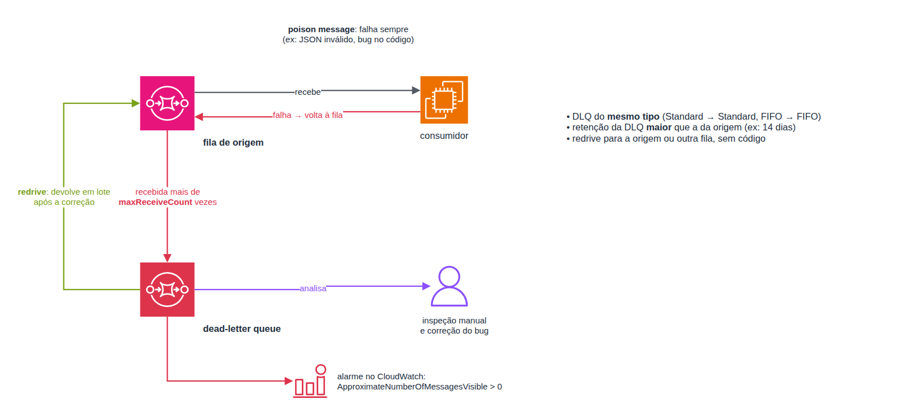

> **Obs:** um `maxReceiveCount` **baixo demais** (ex: 1) manda para a DLQ mensagens que falharam só por um problema transitório. Deixe espaço para alguns retries. Em filas FIFO, a DLQ **quebra a ordem** do grupo: as mensagens seguintes do grupo continuam sendo processadas enquanto a que falhou está na DLQ.

[↑ Índice](#índice)

### Consumidores: EC2, Auto Scaling e Lambda

**EC2 com Auto Scaling:**

- Escale os consumidores pela **quantidade de trabalho pendente**, não pela CPU.
- A métrica recomendada é o **backlog por instância**: `ApproximateNumberOfMessagesVisible` dividido pelo número de instâncias, comparado com um alvo (quantas mensagens cada instância processa no tempo aceitável), em uma política de **target tracking** com **métrica customizada**.
- Com a fila vazia, o grupo pode reduzir até o mínimo, inclusive **zero** instâncias.

**Lambda com event source mapping:**

- O **event source mapping** faz o **long polling** na fila, monta **lotes** e invoca a função.
  - O lote pode ter até **10 mensagens** em filas FIFO, ou até **10.000** em filas Standard, com uma **janela de espera** (*batching window*).
  - O event source mapping escala as invocações conforme o backlog.
- **Visibility timeout:** configure na fila um valor de pelo menos **6x o timeout da função**. Isso dá tempo para os retries e evita que a mensagem reapareça enquanto ainda está sendo processada.
- **Falhas parciais:** por padrão, se uma mensagem do lote falha, **o lote inteiro** volta para a fila. Com **`ReportBatchItemFailures`**, a função informa só as mensagens que falharam, e as demais são apagadas.
- **DLQ:** configure na **fila SQS**, não na Lambda. A DLQ da Lambda vale só para invocações **assíncronas**, e o event source mapping é uma invocação **síncrona**. Também é possível usar uma **Lambda destination** para as falhas.
- **Maximum concurrency:** limita quantas invocações simultâneas o event source mapping cria. Isso protege o destino (ex: um banco relacional com poucas conexões).
- **FIFO:** a Lambda processa cada message group **em ordem**, e grupos diferentes em paralelo.

**Idempotência no consumidor:** como a fila Standard é at-least-once, e um timeout pode fazer a mesma mensagem ser processada duas vezes, o consumidor deve ser **idempotente**. Exemplos:

- usar um **upsert** (`PutItem` com a mesma chave) em vez de um *insert* que gera duplicatas;
- registrar os IDs já processados em uma tabela com **escrita condicional**;
- usar a **FIFO** com deduplicação.


[↑ Índice](#índice)

### Padrões de arquitetura com SQS

- **Desacoplar camadas:**
  - **Cenário:** um frontend que recebe pedidos e um backend que os processa.
  - **Solução:** o frontend grava na fila e responde ao usuário na hora; o backend processa no seu ritmo. Se o backend cair, os pedidos **esperam na fila**, em vez de se perderem.
- **Buffer de escrita para o banco** (*queue-based load leveling*):
  - **Cenário:** um pico de escritas que provocaria **throttling** no DynamoDB ou esgotaria as conexões do RDS.
  - **Solução:** as escritas passam pela fila, e um consumidor com concorrência controlada grava em ritmo estável. Assim, não é preciso dimensionar o banco para o pico.
- **Request/response assíncrono:**
  - **Como funciona:** o cliente envia a requisição em uma **fila de requisições** com um **correlation ID** e um endereço de resposta; os workers processam e respondem em uma **fila de respostas**; o cliente usa o ID para casar a resposta com o pedido.
  - **Fila temporária:** a **Temporary Queue Client** cria **filas virtuais** sobre uma fila real, para não criar uma fila por cliente.
- **Fan-out com SNS + SQS:** um tópico SNS entrega a mesma mensagem a **várias filas**, uma por consumidor, cada uma processando no seu ritmo e com retries independentes. Detalhes em [Fan-out: SNS + SQS](#fan-out-sns--sqs).
- **Eventos do S3 para a fila:** o **S3 Event Notifications** grava na fila a cada objeto criado, e os workers processam os arquivos (thumbnails, ingestão).
- **Prioridade:** o SQS **não tem prioridade** entre mensagens. A solução é criar **duas filas** (alta e baixa prioridade), com os consumidores lendo primeiro a de alta.

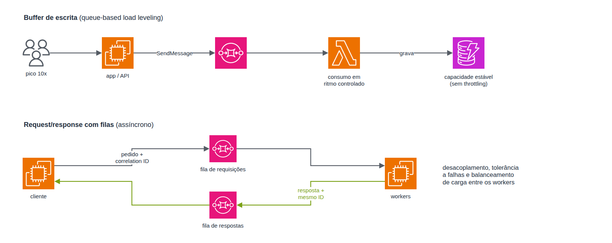

[↑ Índice](#índice)

### Segurança do SQS

- **Em trânsito:** endpoints **HTTPS** (TLS). É possível **forçar** o TLS na access policy, negando requisições com `aws:SecureTransport = false`.
- **Em repouso:**
  - **SSE-SQS** (chaves gerenciadas pelo SQS, ativado por padrão em filas novas);
  - **SSE-KMS**: com chave do KMS, para controlar a chave e auditar o uso. O produtor precisa de `kms:GenerateDataKey` e `kms:Decrypt`, e o consumidor de `kms:Decrypt`. Serviços que publicam na fila (SNS, S3, EventBridge) precisam de permissão na **key policy**, e a chave precisa ser **gerenciada pelo cliente**: a chave padrão gerenciada pela AWS (`aws/sqs`) não permite isso.
- **IAM:** políticas de identidade para controlar quem envia, recebe e apaga mensagens.
- **SQS access policy** (*resource-based*, como uma bucket policy):
  - **acesso cross-account:** permite que outra conta envie ou leia mensagens da fila;
  - **outros serviços publicarem na fila:** o **S3** (event notifications) e o **SNS** (fan-out), com a condição **`aws:SourceArn`** (ou `aws:SourceAccount`) restringindo a origem.
- **Rede:** **interface VPC endpoint** (PrivateLink) para acessar o SQS a partir de subnets privadas sem internet, com uma **endpoint policy** opcional para limitar as filas acessíveis.

[↑ Índice](#índice)

### Dicas para a prova

- "**Desacoplar** componentes e **não perder** requisições quando o backend cai" → **SQS**.
- "Picos de escrita causam **throttling** no DynamoDB" ou "esgotam as conexões do RDS" → **SQS como buffer** de escrita.
- "Mensagens precisam ser processadas **em ordem** e **sem duplicatas**" → **SQS FIFO** (com **MessageGroupId** para paralelizar).
- "Alta vazão, ordem não importa" → **SQS Standard** + consumidor **idempotente**.
- "A mesma mensagem é **processada duas vezes**" → **visibility timeout** curto demais (aumente-o ou use `ChangeMessageVisibility`) e torne o consumidor **idempotente**.
- "Muitas respostas **vazias**, custo alto de API" → **long polling** (até 20 s).
- "Mensagens que **sempre falham** travam o processamento" → **DLQ** com `maxReceiveCount`, alarme e **redrive** após a correção.
- "Escalar os workers EC2 conforme o trabalho pendente" → Auto Scaling pela métrica **backlog por instância** (`ApproximateNumberOfMessagesVisible`).
- "Lambda reprocessa o lote inteiro quando uma mensagem falha" → **`ReportBatchItemFailures`**.
- "Lambda consumindo SQS sobrecarrega o banco" → **maximum concurrency** no event source mapping.
- "Mensagens maiores que **1 MiB**" → **S3** + **SQS Extended Client Library**.
- "Atrasar o processamento das mensagens por alguns minutos" → **delay queue** (até 15 min).
- "Bucket S3 de outra conta ou tópico SNS precisa gravar na fila" → **SQS access policy** com `aws:SourceArn`.
- "Fila criptografada com KMS e o SNS ou o S3 não conseguem publicar" → **chave gerenciada pelo cliente** com permissão na **key policy** para o serviço.
- "Consumidores em subnets privadas sem NAT" → **interface VPC endpoint** do SQS.
- "Mensagens com **prioridade**" → **duas filas**.

[↑ Índice](#índice)

## Amazon MQ

### Contexto: message brokers e protocolos abertos

Muito antes da nuvem, as empresas já usavam **mensageria** para integrar sistemas: o ERP avisava o sistema de faturamento, a loja avisava o estoque, o mainframe trocava dados com aplicações Java. O componente central dessas integrações é o **message broker**, um servidor que recebe, guarda e roteia mensagens entre aplicações. Essa categoria de software é chamada de **MOM** (*Message-Oriented Middleware*), e alguns produtos dominaram esse mercado: **IBM MQ**, **TIBCO EMS**, **Apache ActiveMQ** e **RabbitMQ**.

Alguns conceitos ajudam a entender o serviço:

- **Message broker:** além de guardar mensagens em **filas** (ponto a ponto) e **tópicos** (pub/sub), ele **roteia** mensagens por regras, confirma a entrega (*acknowledgment*), faz **transações** (enviar várias mensagens de forma atômica) e mantém conexões persistentes com os clientes.
- **Protocolos abertos de mensageria:** padrões que definem como clientes e brokers conversam pela rede, independentemente do fornecedor:
  - **AMQP** (*Advanced Message Queuing Protocol*): protocolo binário e robusto, padrão em integrações corporativas. O RabbitMQ usa a versão 0-9-1; o ActiveMQ, a 1.0;
  - **MQTT:** protocolo **leve** de pub/sub, feito para **IoT** e redes instáveis;
  - **STOMP:** protocolo **textual** e simples, fácil de implementar em qualquer linguagem;
  - **OpenWire:** o protocolo nativo do ActiveMQ;
  - **WebSocket (WSS):** permite que navegadores falem com o broker.
- **JMS** (*Java Message Service*): não é um protocolo, mas uma **API padrão do Java** para mensageria. Uma aplicação escrita com JMS pode trocar de broker (de IBM MQ para ActiveMQ, por exemplo) mudando a biblioteca e a configuração, sem reescrever a lógica.
- **Roteamento no RabbitMQ:** o produtor publica em uma **exchange**, que encaminha a mensagem para as filas conforme regras (*bindings*):
  - **direct**: pela chave exata;
  - **fanout**: para todas as filas;
  - **topic**: por padrão da chave, ex: `pedidos.*.br`;
  - **headers**: pelos cabeçalhos da mensagem.
- **APIs proprietárias vs. padrões abertos:** **SQS** e **SNS** são serviços *cloud-native* com **API própria da AWS** (HTTP + SDK). Uma aplicação que fala AMQP, MQTT ou JMS **não conversa** com o SQS sem ser **reescrita**.

O **Amazon MQ** é o serviço de **message broker gerenciado** da AWS para **Apache ActiveMQ** e **RabbitMQ**. Ele existe para o cenário em que reescrever a aplicação para SQS/SNS não compensa: você **migra o broker para a AWS** (*re-platform*), e as aplicações continuam usando os **mesmos protocolos e APIs**, trocando só o endpoint. Na prova, ele aparece em **migrações** de aplicações on-premises que usam **JMS, AMQP, MQTT, STOMP ou OpenWire**, ou que dependem de IBM MQ, TIBCO EMS, ActiveMQ ou RabbitMQ.


[↑ Índice](#índice)

### O que é o Amazon MQ

- **Broker gerenciado:** a AWS provisiona as instâncias, aplica **patches** e upgrades de versão em uma **janela de manutenção**, detecta falhas e faz o failover. Você continua escolhendo o **tipo de instância** e o **modo de implantação**.
- **Engines:** **Apache ActiveMQ** (Classic) e **RabbitMQ**.
- **Filas e tópicos:** oferece tanto o modelo de **fila** (como o SQS) quanto o de **tópico** (como o SNS), no mesmo broker.
- **Não é serverless:** roda em **instâncias** (de `mq.t3.micro`, para testes, a famílias `mq.m5` e `mq.m7g`). Por isso:
  - **não escala** como o SQS e o SNS: a capacidade é limitada pela instância;
  - escalar significa trocar o **tipo de instância** (escala vertical), o que exige reinicialização. No ActiveMQ, uma **network of brokers** distribui a carga entre vários brokers;
  - o **custo** é por **hora de instância** + armazenamento, mesmo sem tráfego.
- **Na VPC:** o broker fica em subnets da sua VPC, com acesso **privado** ou **público**.
- **Monitoramento:** métricas no **CloudWatch** (ex: tamanho das filas, conexões, uso de memória), logs no **CloudWatch Logs** e chamadas de API no **CloudTrail**.

[↑ Índice](#índice)

### ActiveMQ vs. RabbitMQ

| | **ActiveMQ** | **RabbitMQ** |
|---|---|---|
| Protocolos | **OpenWire**, **AMQP 1.0**, **STOMP**, **MQTT**, **WSS**, e a API **JMS** | **AMQP 0-9-1** |
| Modos de implantação | Single-instance, **active/standby** (2 AZs) e **network of brokers** | Single-instance e **cluster** de 3 nós (3 AZs) |
| Armazenamento | **EFS** (durável, Multi-AZ, necessário para active/standby) ou **EBS** (maior vazão, só single-instance) | **EBS** em cada nó |
| Autenticação | Usuários do broker ou **LDAP** (ex: Active Directory) | Usuários internos e outros mecanismos de identidade |
| Perfil típico | Aplicações **Java/JMS** e integrações corporativas; migração de **IBM MQ** e **TIBCO EMS** | Aplicações que já usam **RabbitMQ**, roteamento flexível com exchanges |

> **Obs:** o Amazon MQ **não roda IBM MQ nem TIBCO EMS**. A migração desses brokers é feita para o **ActiveMQ**, que implementa **JMS**: as aplicações JMS trocam o provedor e a configuração de conexão.

[↑ Índice](#índice)

### Alta disponibilidade do Amazon MQ

- **ActiveMQ active/standby:**
  - **Como funciona:** dois brokers em **AZs diferentes**, compartilhando o armazenamento no **EFS**. Só o **ativo** atende os clientes; se ele falhar (ou durante a manutenção), o **standby** assume com os mesmos dados.
  - **Clientes:** usam a **failover URL** com os dois endpoints (`failover:(ssl://b-1...:61617,ssl://b-2...:61617)`), e a biblioteca reconecta sozinha ao broker que estiver ativo.
- **RabbitMQ cluster:**
  - **Como funciona:** **três nós** em **três AZs**, atrás de um **Network Load Balancer** que expõe um endpoint único. As filas são **replicadas** entre os nós (**quorum queues**, baseadas no algoritmo de consenso Raft).
  - **Resiliência:** a perda de um nó ou de uma AZ não interrompe o broker.
- **Single-instance:** um broker em **uma AZ**. Serve para desenvolvimento e testes: uma falha ou uma janela de manutenção causa **indisponibilidade**.
- **DR entre regiões:** o ActiveMQ oferece **replicação de dados entre regiões** (*cross-Region data replication*), com um broker primário e uma réplica em outra região, promovida em caso de desastre.


[↑ Índice](#índice)

### Migração para o Amazon MQ

- **Re-platform:** a estratégia típica é levar o broker para o Amazon MQ **sem mudar o código** das aplicações. Elas passam a apontar para o novo endpoint (via **Direct Connect** ou **VPN**, se continuarem on-premises).
- **Origens possíveis:** **IBM MQ**, **TIBCO EMS**, **ActiveMQ** e **RabbitMQ** on-premises ou em EC2.
- **Migração em fases:** em ambientes grandes, não dá para migrar todas as aplicações de uma vez. Uma **ponte** (ex: **Apache Camel** ou uma ponte JMS) copia as mensagens entre o broker legado e o Amazon MQ. As aplicações migram **uma a uma**, e o broker legado é desligado quando não houver mais clientes.
- **Consumidores na AWS:** depois da migração, as mensagens podem ser consumidas por EC2, containers ou **Lambda**. O Amazon MQ (ActiveMQ e RabbitMQ) pode ser **event source da Lambda**, com as credenciais do broker no **Secrets Manager**.
- **Quando refatorar em vez de migrar:** para aplicações **novas** ou em reescrita, prefira **SQS/SNS/EventBridge**: são serverless, escalam sem limite prático e não exigem gerenciar instâncias.

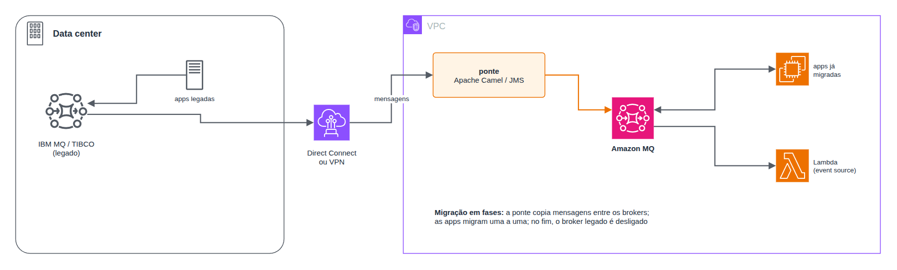

[↑ Índice](#índice)

### Segurança do Amazon MQ

- **Rede:**
  - **broker privado:** acessível só de dentro da VPC (ou de redes conectadas por Direct Connect, VPN ou peering), com **security groups**;
  - **broker público:** acessível pela internet, com autenticação. Evite em produção.
- **Em trânsito:** conexões com **TLS**.
- **Em repouso:** dados criptografados com o **KMS** (chave da AWS ou, no ActiveMQ, chave gerenciada pelo cliente).
- **Autenticação dos clientes:**
  - **usuários do broker**, criados no Amazon MQ;
  - no ActiveMQ, integração com **LDAP**.
- **Autorização:** permissões por fila e tópico (ActiveMQ) ou por *virtual host* (RabbitMQ).
- **IAM:** controla quem pode **gerenciar** o broker (criar, reiniciar, alterar a configuração), mas **não** autentica as conexões de mensageria, que usam os protocolos padrão.

[↑ Índice](#índice)

### Amazon MQ vs. SQS e SNS

| | **Amazon MQ** | **SQS / SNS** |
|---|---|---|
| Protocolos | **Abertos**: AMQP, MQTT, STOMP, OpenWire, WSS, JMS | **API proprietária** da AWS (HTTP + SDK) |
| Infraestrutura | **Instâncias** (escolher tipo e modo) | **Serverless** |
| Escala | Limitada à instância (vertical) ou à network of brokers | **Praticamente ilimitada**, automática |
| Alta disponibilidade | Configurar **active/standby** ou **cluster** | Nativa, Multi-AZ |
| Recursos de broker | Roteamento avançado, transações, seletores de mensagem, filas e tópicos juntos | Filas (SQS) e tópicos (SNS) separados, com filtros |
| Custo | Por hora de instância, mesmo ocioso | Por uso (requisições) |
| Melhor uso | **Migrar** aplicações que já usam um broker | Aplicações **novas** ou **reescritas** para a nuvem |

[↑ Índice](#índice)

### Dicas para a prova

- "Migrar para a AWS uma aplicação que usa **JMS, AMQP, MQTT, STOMP ou OpenWire**, **sem reescrever o código**" → **Amazon MQ**.
- "Aplicação on-premises usa **IBM MQ** ou **TIBCO EMS**" → **Amazon MQ (ActiveMQ)**, com migração em fases se necessário.
- "Aplicação usa **RabbitMQ** e precisa de alta disponibilidade gerenciada" → **Amazon MQ for RabbitMQ** em **cluster** (3 AZs).
- "Broker ActiveMQ **altamente disponível**" → **active/standby** em 2 AZs com armazenamento no **EFS** e **failover URL** nos clientes.
- "Aplicação **nova**, escala ilimitada, sem gerenciar servidores" → **SQS/SNS**, não Amazon MQ.
- "Mensageria para **IoT com MQTT**" → avalie o **IoT Core** (serverless, milhões de dispositivos); o Amazon MQ serve quando a aplicação já depende de um broker MQTT.
- "Consumir mensagens do Amazon MQ com **Lambda**" → **event source mapping**, com as credenciais no **Secrets Manager**.
- "Broker com **maior vazão** e sem necessidade de Multi-AZ" → ActiveMQ **single-instance** com **EBS**.
- "Broker sem indisponibilidade durante a **janela de manutenção**" → **active/standby** ou **cluster**, nunca single-instance.

[↑ Índice](#índice)

## Amazon SNS

### Contexto: publish/subscribe e arquitetura orientada a eventos

Uma fila resolve a comunicação entre **um produtor e um consumidor**: cada mensagem é processada por **um** consumidor. Muitas vezes, porém, um mesmo acontecimento interessa a **vários** sistemas. Quando um pedido é criado, o antifraude precisa analisá-lo, o estoque precisa reservá-lo, o envio precisa prepará-lo e o cliente precisa receber um e-mail. Se o serviço de pedidos chamar cada um diretamente, ele passa a **conhecer todos os interessados**. Cada novo sistema exige uma mudança no código do produtor, e a falha de um destino afeta os demais.

Alguns conceitos de engenharia de software estão por trás da solução:

- **Publish/subscribe (pub/sub):** o produtor (**publisher**) publica a mensagem em um **tópico**, sem saber quem vai recebê-la. Os interessados (**subscribers**) **assinam** o tópico, e cada um recebe **uma cópia** de cada mensagem. Produtor e consumidores ficam **desacoplados**: novos consumidores entram sem mudar o produtor.
- **Padrão Observer:** a mesma ideia em escala de objetos, em que um "sujeito" notifica todos os "observadores" registrados quando seu estado muda. O pub/sub é o Observer **distribuído** e mediado por um intermediário.
- **Fan-out:** espalhar **uma** mensagem para **muitos** destinos em paralelo. É o contrário do *fan-in*, que junta várias fontes em um destino.
- **Push vs. pull:**
  - no **pull**, o consumidor busca as mensagens. É o caso do SQS;
  - no **push**, o intermediário **entrega** a mensagem ativamente ao consumidor (chama a Lambda, faz um POST HTTP, envia o e-mail). É o caso do SNS.
- **Arquitetura orientada a eventos (*event-driven*):** os sistemas reagem a **eventos** ("pedido criado", "arquivo enviado", "alarme disparado") em vez de serem chamados diretamente. Isso favorece a **coreografia** entre serviços (ver [Step Functions](#contexto-workflows-máquinas-de-estados-e-orquestração)).
- **A2A vs. A2P:**
  - **application-to-application (A2A):** mensagens entre sistemas (filas, funções, webhooks);
  - **application-to-person (A2P):** notificações para **pessoas** (SMS, e-mail, push no celular).

O **Amazon SNS** (*Simple Notification Service*) é o serviço **serverless** de **pub/sub** da AWS. Ele atende os dois mundos: integra sistemas (A2A) e envia notificações a pessoas (A2P). Na prova, ele aparece em cenários de **fan-out** (uma mensagem para vários consumidores), **notificações de alarmes e eventos** da AWS, **SNS + SQS** para desacoplar com durabilidade e **filtragem** de mensagens por assinante.

[↑ Índice](#índice)

### O que é o SNS

- **Tópico:** o ponto onde os publicadores enviam as mensagens. Um tópico **Standard** aceita até **12,5 milhões de assinaturas**, e uma conta pode ter até **100.000 tópicos** (limite ajustável).
- **Assinaturas (*subscriptions*):** cada assinatura liga o tópico a um destino:
  - **A2A:** **SQS**, **Lambda**, **Data Firehose** e **HTTP/HTTPS** (webhooks);
  - **A2P:** **e-mail** (ou e-mail-JSON), **SMS** e **mobile push** (Apple APNs, Google FCM, Amazon ADM, Baidu).
- **Confirmação:** assinaturas de e-mail e HTTP/S precisam ser **confirmadas** pelo destino (link no e-mail, ou chamada à `SubscribeURL`). Isso evita que alguém inscreva endereços de terceiros.
- **Sem persistência:** o SNS **não guarda** as mensagens para leitura posterior. Ele as entrega imediatamente; se a entrega falhar depois de todos os retries, a mensagem é **descartada**, salvo se houver uma **DLQ**. Para durabilidade, combine com o **SQS** (fan-out).
- **Tamanho da mensagem:** até **256 KB**. Para payloads maiores, a **Extended Client Library** guarda o corpo no **S3** e publica só a referência.
- **Como publicar:**
  - **Topic publish:** crie o tópico e as assinaturas e publique com `Publish` (SDK).
  - **Direct publish (mobile):** crie uma **platform application** e um **platform endpoint** por dispositivo, e publique direto no endpoint (uma notificação para um celular específico).
- **Serviços que publicam no SNS:** muitos serviços da AWS enviam notificações direto para um tópico:
  - **CloudWatch Alarms**, **AWS Budgets** e **Auto Scaling** (eventos de scale in/out);
  - **S3 Event Notifications**, **eventos do RDS**, **CloudFormation** (mudanças de estado da stack) e **DMS**;
  - **Health**, **Config**, **CodePipeline**, entre outros.
- **Raw message delivery:** para SQS, HTTP/S e Firehose, entrega o **corpo original** da mensagem, sem o envelope JSON do SNS.
- **Message attributes:** metadados enviados junto com a mensagem, usados principalmente na **filtragem**.

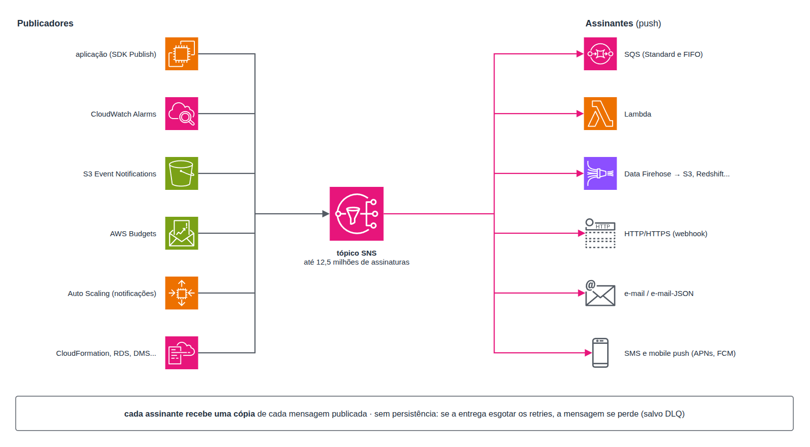

> **Obs:** para **SMS** e e-mails em massa de marketing, a AWS oferece serviços dedicados: o **AWS End User Messaging** (SMS, voz e push, com números de origem e controle de entrega) e o **Amazon SES** (e-mail transacional e de marketing). O SNS serve bem para notificações operacionais e alertas.

[↑ Índice](#índice)

### Fan-out: SNS + SQS

O padrão mais cobrado do SNS é combiná-lo com o SQS: o produtor publica **uma vez** no tópico, e **várias filas** assinadas recebem cada uma a sua cópia.

- **Por que não publicar direto em várias filas:** o produtor teria que conhecer todas as filas, e uma falha no meio do envio deixaria algumas filas com a mensagem e outras sem.
- **Por que não só SNS:** o SNS faz push e não guarda mensagens. Com uma fila por consumidor, cada um ganha **persistência**, **processamento no próprio ritmo**, **retries** e **DLQ** independentes. Um consumidor lento ou fora do ar não afeta os outros.
- **Evolução:** para adicionar um consumidor, basta **assinar** uma nova fila no tópico, sem mexer no produtor.
- **Requisitos:**
  - a **access policy da fila** precisa permitir `sqs:SendMessage` para o SNS, com a condição `aws:SourceArn` igual ao ARN do tópico;
  - se a fila usa **SSE-KMS**, a chave precisa ser **gerenciada pelo cliente**, com permissão para o SNS na key policy.
- **Cross-Region e cross-account:** um tópico pode entregar para filas SQS e funções Lambda em **outras regiões** e em **outras contas**, desde que as policies permitam.
- **Ordem e sem duplicatas:** **SNS FIFO + SQS FIFO**.

**Aplicação: o mesmo evento do S3 para vários consumidores.**

- O S3 não permite duas regras de notificação com **o mesmo tipo de evento** e **prefixos que se sobrepõem** (ex: duas regras para `ObjectCreated` em `images/`).
- Para enviar o mesmo evento a vários destinos, a regra aponta para um **tópico SNS**, que faz o fan-out para as filas e funções. Outra opção é enviar os eventos do S3 para o **EventBridge**, que aceita várias regras sobre o mesmo evento.

**Aplicação: SNS para o S3 via Data Firehose.**

- O **Data Firehose** pode assinar o tópico e entregar as mensagens no **S3**, no **Redshift**, no **OpenSearch** ou em outros destinos suportados.
- Serve para **arquivar** todas as notificações ou analisá-las depois.

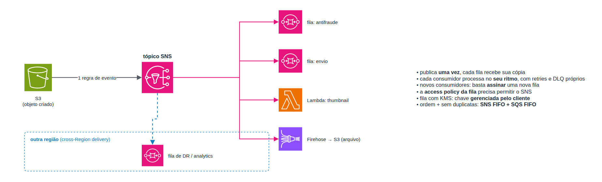

[↑ Índice](#índice)

### Filtragem de mensagens

- **Filter policy:** uma política em JSON, definida **em cada assinatura**, que diz quais mensagens ela quer receber. Sem filter policy, a assinatura recebe **todas** as mensagens do tópico.
- **Escopo:** a filtragem pode olhar os **message attributes** (padrão) ou o **corpo** da mensagem em JSON (`FilterPolicyScope = MessageBody`).
- **Operadores:** valor exato, **prefixo**, **sufixo**, **anything-but** (qualquer valor exceto), **numérico** (`>`, `<=`, intervalos), **exists**, igualdade sem diferenciar maiúsculas e endereço IP. Condições em **chaves diferentes** se combinam com **E**; valores na **mesma lista**, com **OU**.
- **Por que usar:**
  - em vez de cada consumidor receber tudo e descartar o que não interessa, o SNS só entrega o que **casa com o filtro**. Isso reduz **custo** e **código** nos consumidores;
  - permite usar **um tópico** para vários tipos de evento (ex: pedidos criados, cancelados e recusados), em vez de um tópico por tipo.

Exemplo de filter policy que recebe só pedidos **criados** acima de **1.000**:

```json
{
  "status": ["criado"],
  "valor": [{ "numeric": [">", 1000] }]
}
```

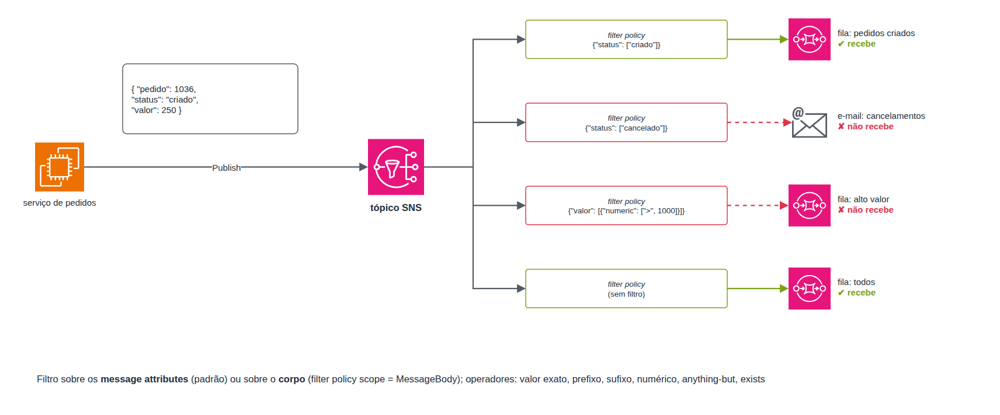

[↑ Índice](#índice)

### SNS FIFO

- **Tópico FIFO:** garante a **ordem** das mensagens e elimina **duplicatas**, com os mesmos mecanismos do SQS FIFO:
  - **ordem por MessageGroupId:** mensagens do mesmo grupo chegam na ordem em que foram publicadas;
  - **deduplicação** por **MessageDeduplicationId** ou por **conteúdo**, em uma janela de 5 minutos.
- **Assinantes:** filas **SQS FIFO** e também filas **SQS Standard** (que recebem as mensagens, mas sem garantia de ordem).
- **Nome:** termina em **`.fifo`**.
- **Vazão limitada**, na mesma ordem de grandeza do SQS FIFO, e **menos assinaturas** por tópico que um tópico Standard.
- **Arquivamento e replay:** um tópico FIFO pode **arquivar** as mensagens por até **365 dias** e **reenviá-las** (*replay*) a uma assinatura. Serve para recuperar um consumidor que perdeu dados ou para alimentar um consumidor novo com o histórico.
- **Uso típico:** **fan-out com ordem e sem duplicatas**, como atualizações de preço, mudanças de saldo ou eventos de um pedido que precisam chegar em ordem a vários sistemas. O padrão é **SNS FIFO + SQS FIFO**.

[↑ Índice](#índice)

### Entrega, retries e DLQ do SNS

- **Delivery policy:** quando uma entrega falha por erro do lado do destino (ex: HTTP 5xx, serviço indisponível), o SNS tenta de novo em **quatro fases**: tentativas imediatas, pré-backoff, **backoff exponencial** e pós-backoff.

| Tipo de destino | Exemplos | Total de tentativas |
|---|---|---|
| **Gerenciados pela AWS** | SQS, Lambda, Data Firehose | **100.015** tentativas, ao longo de **~23 dias** |
| **Gerenciados pelo cliente** | HTTP/S, e-mail, SMS, mobile push | **50** tentativas, ao longo de **~6 horas** |

- **Política customizada:** só **HTTP/S** aceita uma delivery policy **customizada** (número de tentativas, intervalos e limite de vazão de entrega, para não sobrecarregar o endpoint).
- **Erros do cliente** (ex: a fila foi apagada, ou o SNS não tem permissão) **não** passam pelos retries: a mensagem vai direto para a DLQ, se houver.
- **DLQ do SNS:**
  - é uma **fila SQS** (ou SQS FIFO, para tópicos FIFO) ligada **à assinatura**, não ao tópico. Cada assinatura pode ter sua própria DLQ;
  - recebe as mensagens que **não foram entregues** depois de esgotar a delivery policy. **Sem DLQ, a mensagem é descartada.**
- **Delivery status logging:** registra no **CloudWatch Logs** o sucesso ou a falha de cada entrega para SQS, Lambda, HTTP/S, Firehose, mobile push e SMS. Ajuda a depurar assinaturas com problema.

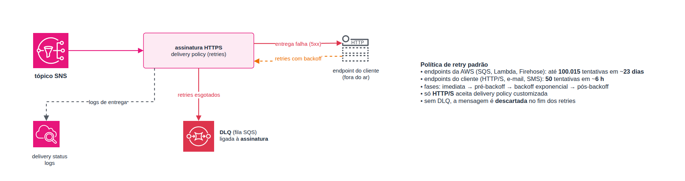

[↑ Índice](#índice)

### Segurança do SNS

- **Em trânsito:** API com **HTTPS**. É possível exigir TLS na access policy com `aws:SecureTransport`.
- **Em repouso:** **SSE com KMS**.
  - Os publicadores precisam de `kms:GenerateDataKey` e `kms:Decrypt` na chave.
  - Para que **serviços da AWS** publiquem em um tópico criptografado (CloudWatch Alarms, S3, EventBridge), use uma **chave gerenciada pelo cliente**, com permissão para o serviço na key policy. A chave padrão gerenciada pela AWS (`aws/sns`) não permite isso.
- **Criptografia no cliente:** se o cliente quiser criptografar e descriptografar por conta própria antes de publicar.
- **IAM:** políticas de identidade controlam quem pode criar tópicos, publicar e assinar.
- **SNS access policy** (*resource-based*, como uma bucket policy):
  - **acesso cross-account:** permite que outra conta **publique** no tópico ou **assine** filas e funções dela;
  - **serviços publicando no tópico:** permite que o **S3**, o **CloudWatch** e outros serviços publiquem, com as condições `aws:SourceArn` e `aws:SourceAccount`.
- **Rede:** **interface VPC endpoint** (PrivateLink) para **publicar** a partir de subnets privadas, sem internet. As assinaturas **HTTP/S** precisam de um endpoint **acessível publicamente**: o SNS não entrega em IPs privados da VPC.
- **Message data protection:** políticas que **detectam dados sensíveis** (PII, como CPF, cartão de crédito e e-mail) nas mensagens, para **auditar**, **mascarar** ou **bloquear** a publicação e a entrega.

[↑ Índice](#índice)

### SNS vs. SQS vs. EventBridge

| | **SNS** | **SQS** | **EventBridge** |
|---|---|---|---|
| Modelo | **Pub/sub** (push) | **Fila** (pull) | **Barramento de eventos** (push com regras) |
| Destinatários por mensagem | **Todos** os assinantes | **Um** consumidor | Todos os **alvos** das regras que casam |
| Persistência | Não (salvo DLQ e arquivo do FIFO) | **Sim**, até 14 dias | Não (salvo **archive** e replay) |
| Filtragem | Filter policy por assinatura | Não (o consumidor lê tudo) | **Regras** com padrões ricos sobre o evento |
| Destinos | SQS, Lambda, Firehose, HTTP/S, e-mail, SMS, push | Quem fizer polling | **Mais de 20 serviços** da AWS, APIs externas, outras contas e regiões |
| Escala | Milhões de assinaturas, alta vazão | Praticamente ilimitada | Alta, com cotas por região |
| Uso típico | **Fan-out**, alertas, notificações a pessoas | **Desacoplar**, buffer, trabalho em background | **Integração orientada a eventos**, eventos de SaaS e da AWS, roteamento por conteúdo |

[↑ Índice](#índice)

### Dicas para a prova

- "Enviar **a mesma mensagem** para vários sistemas, cada um processando de forma independente" → **SNS + SQS (fan-out)**.
- "Fan-out com **ordem** e **sem duplicatas**" → **SNS FIFO + SQS FIFO**.
- "O mesmo **evento do S3** precisa chegar a várias filas ou funções" → evento do S3 → **SNS** → várias assinaturas (ou **EventBridge**).
- "Cada consumidor quer só **parte** das mensagens do tópico" → **filter policy** na assinatura.
- "Notificar a equipe por **e-mail ou SMS** quando um alarme dispara" → **CloudWatch Alarm** → **SNS**.
- "**Arquivar** todas as notificações no S3" → assinatura do **Data Firehose** → S3.
- "Mensagens do SNS **se perdem** quando o endpoint fica fora do ar por muito tempo" → **DLQ** na **assinatura** (+ delivery status logging).
- "Endpoint HTTP do cliente sobrecarregado pelas entregas" → **delivery policy customizada** (só HTTP/S).
- "Fila SQS de outra conta ou região precisa receber as mensagens do tópico" → **assinatura cross-account/cross-Region** + **access policy da fila** permitindo o tópico.
- "Tópico criptografado com KMS e o **CloudWatch** não consegue publicar" → **chave gerenciada pelo cliente** com permissão na key policy.
- "Publicar no SNS a partir de **subnet privada sem NAT**" → **interface VPC endpoint**.
- "Notificação push para **um dispositivo móvel** específico" → **direct publish** em um **platform endpoint**.
- "Detectar ou mascarar **PII** nas mensagens" → **message data protection**.
- "Recuperar mensagens já entregues para um consumidor novo" → **arquivamento e replay** do **SNS FIFO** (ou archive do EventBridge).

[↑ Índice](#índice)

## Amazon EventBridge

### Contexto: eventos e barramentos de eventos

As seções anteriores usaram **mensagens** (SQS) e **notificações** (SNS). Um **evento** é um tipo específico de mensagem, e vale distinguir os três conceitos:

- **Comando:** um pedido para **fazer algo**, dirigido a um destinatário conhecido ("processe este pagamento"). Quem envia espera que **alguém** execute.
- **Evento:** o registro de que **algo aconteceu**, no passado ("pagamento aprovado", "instância parada", "arquivo enviado"). Quem publica **não sabe nem se importa** com quem vai reagir. Zero, um ou dez sistemas podem se interessar.
- **Mensagem:** o envelope que transporta comandos ou eventos.

Outros conceitos por trás do serviço:

- **Barramento de eventos (*event bus*):** um canal central onde produtores publicam eventos e de onde os consumidores recebem os que interessam. Ele funciona como um **roteador**: o produtor publica no barramento, e **regras** decidem para onde cada evento vai.
- **Roteamento por conteúdo (*content-based routing*):** o destino de um evento é decidido pelo **conteúdo** dele (ex: "eventos de pedidos com valor acima de 1.000 vindos do Brasil"), e não por um nome de fila ou tópico escolhido pelo produtor.
- **Contrato de eventos (*schema*):** como produtores e consumidores não se conhecem, o **formato** do evento é o único acordo entre eles. Mudar um campo pode quebrar consumidores que o produtor nem conhece. Por isso, *schemas* versionados e documentados são importantes.
- **Integração de SaaS:** sistemas externos (Salesforce, Zendesk, Datadog, Shopify) também geram eventos de negócio ("ticket criado", "pagamento recebido") que a sua aplicação quer consumir sem precisar fazer polling nas APIs deles.

O **Amazon EventBridge** (antes chamado **CloudWatch Events**) é o **barramento de eventos serverless** da AWS. Ele recebe eventos de **mais de 200 serviços da AWS**, de **parceiros SaaS** e das **suas aplicações**, e os roteia por **regras** para dezenas de tipos de alvo. Na prova, ele aparece em cenários de **reagir a mudanças na conta** (uma instância parou, uma chamada de API sensível aconteceu), **automação e remediação**, **agendamento** (cron), **centralizar eventos de várias contas**, **integração com SaaS** e **arquiteturas orientadas a eventos** entre microsserviços.

[↑ Índice](#índice)

### O que é o EventBridge

- **Event bus:** o barramento que recebe os eventos. Há três tipos:
  - **default:** já existe em cada conta e região e recebe os eventos dos **serviços da AWS**;
  - **partner:** recebe eventos de **parceiros SaaS** integrados (Zendesk, Datadog, PagerDuty, Auth0, Shopify...);
  - **custom:** criado por você para os eventos das **suas aplicações**, publicados com `PutEvents`.
- **Evento:** um JSON com um envelope padrão. Os campos `source` e `detail-type` identificam o tipo do evento, e `detail` traz os dados específicos.

```json
{
  "version": "0",
  "id": "6a7e8feb-b491-4cf7-a9f1-bf3703467718",
  "detail-type": "EC2 Instance State-change Notification",
  "source": "aws.ec2",
  "account": "111122223333",
  "time": "2026-11-21T12:00:00Z",
  "region": "us-east-1",
  "resources": ["arn:aws:ec2:us-east-1:111122223333:instance/i-0abc123"],
  "detail": { "instance-id": "i-0abc123", "state": "stopped" }
}
```

- **Regras:** cada regra tem um **event pattern** (quais eventos casam) ou uma **agenda** (cron/rate) e até **5 alvos**. Um mesmo evento pode casar com **várias regras**, e cada uma entrega aos seus alvos.
- **Alvos:**
  - **computação:** Lambda, Step Functions, tasks do ECS, jobs do Batch;
  - **integração:** SQS, SNS, Kinesis Data Streams, Data Firehose;
  - **operação:** SSM Automation e Run Command, ações do EC2 (parar, reiniciar, snapshot), CodePipeline, CodeBuild;
  - **externos:** **API destinations** (qualquer API HTTP) e event buses em **outras contas ou regiões**.
- **Input transformer:** ajusta o JSON entregue ao alvo, extraindo campos do evento e montando o payload que o alvo espera, sem uma Lambda intermediária.
- **Entrega:** **at-least-once**, com **retries** por até **24 horas** (até 185 tentativas, configurável) e **DLQ** (fila SQS) **por alvo** para os eventos que não puderam ser entregues.
- **Limites:** eventos de até **256 KB**. A vazão de `PutEvents` é de milhares de eventos por segundo por região (cota ajustável).

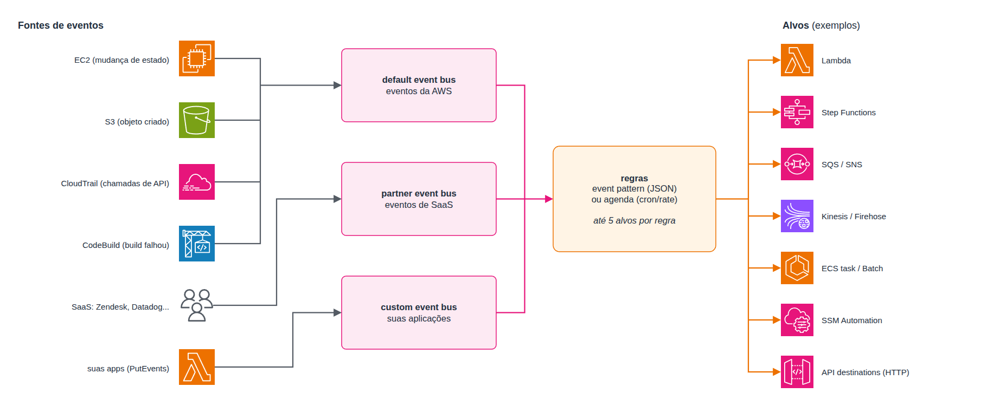

[↑ Índice](#índice)

### Regras e event patterns

Um **event pattern** é um JSON com a **mesma estrutura** do evento. Ele lista só os campos que importam e os valores aceitos. Exemplo de regra que casa quando uma instância EC2 é **parada ou encerrada** em produção:

```json
{
  "source": ["aws.ec2"],
  "detail-type": ["EC2 Instance State-change Notification"],
  "detail": {
    "state": ["stopped", "terminated"],
    "instance-id": [{ "prefix": "i-" }]
  }
}
```

- **Operadores:**
  - **valor exato** e listas (OU entre os valores);
  - **prefixo** e **sufixo**;
  - **anything-but** (qualquer valor exceto);
  - **numérico** (`>`, `<=`, intervalos);
  - **exists**, **endereço IP** (CIDR), **igualdade sem diferenciar maiúsculas** e **wildcard**;
  - **`$or`** para combinar condições alternativas.
- **Combinação:** campos diferentes se combinam com **E**.
- **Sandbox:** o console permite testar um pattern contra um evento de exemplo antes de criar a regra.

[↑ Índice](#índice)

### Interceptando chamadas de API com o CloudTrail

- O **CloudTrail** registra as chamadas de API da conta, e o EventBridge recebe essas chamadas como eventos do tipo **"AWS API Call via CloudTrail"**. Assim, uma regra pode reagir a **qualquer ação** feita na conta, mesmo em serviços que não emitem eventos próprios para aquela operação.
- **Exemplos clássicos:**
  - alertar quando alguém **apaga uma tabela** do DynamoDB (`DeleteTable`);
  - detectar `AssumeRole` em uma **role sensível**;
  - reagir a `AuthorizeSecurityGroupIngress` que **abre a porta 22** para `0.0.0.0/0` e **remover a regra** automaticamente com uma Lambda;
  - avisar sobre o **login do usuário root** (evento "AWS Console Sign In via CloudTrail").
- **Detalhes que caem:**
  - eventos de **serviços globais** (IAM, STS, login no console) chegam ao EventBridge na região **us-east-1**. A regra precisa estar **lá**;
  - chamadas **somente leitura** (`Get*`, `List*`, `Describe*`) **não** geram esses eventos;
  - **data events** (ex: `GetObject` no S3, `Invoke` na Lambda) só chegam se uma **trail** tiver esses eventos habilitados.

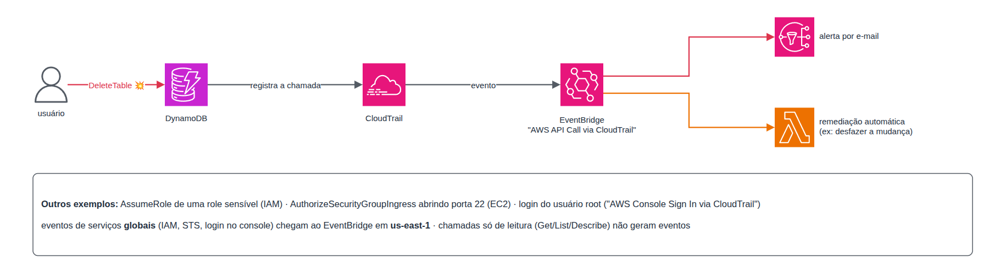

[↑ Índice](#índice)

### Agendamento: regras agendadas e EventBridge Scheduler

- **Regras agendadas:** uma regra com expressão **cron** ou **rate** (ex: `rate(1 hour)`, `cron(0 3 * * ? *)`) dispara os alvos periodicamente. É o "cron" serverless da AWS: substitui uma instância EC2 só para rodar scripts agendados.
- **EventBridge Scheduler:** um serviço de agendamento mais completo, recomendado para casos novos:
  - agendas **únicas** (*one-time*, "às 15h de amanhã") e recorrentes;
  - **fuso horário** e horário de verão;
  - **milhões de agendas** por conta;
  - **janela flexível** (*flexible time window*), para espalhar as execuções e não sobrecarregar o destino;
  - **retries** e **DLQ**;
  - chama milhares de ações de API de **centenas de serviços** diretamente (*universal targets*), sem passar por um event bus.
- **Uso típico do Scheduler:** um lembrete por cliente, expirar um recurso 30 dias depois de criado, desligar ambientes de desenvolvimento à noite.

[↑ Índice](#índice)

### Multi-conta e multi-região

- **Resource-based policy do event bus:** controla **quem pode publicar** no barramento. Permite receber eventos de **outras contas** ou de **toda a organização**, com a condição `aws:PrincipalOrgID`.
- **Barramento central:**
  - **Como funciona:** cada conta da organização tem uma regra que envia os eventos relevantes (achados do GuardDuty e do Security Hub, chamadas de API sensíveis, mudanças do Config) para um **event bus central** em uma conta de **segurança ou auditoria**. Lá, as regras disparam alertas, remediação ou o envio a um SIEM.
  - **Na prova:** é o padrão para "**agregar os eventos de todas as contas** da organização em uma conta e região".
- **Cross-Region:** uma regra pode ter como alvo um event bus em **outra região**, para centralizar ou replicar eventos.
- **Global endpoints:**
  - **Como funcionam:** um endpoint que publica em um event bus **primário** e faz **failover automático** para uma **região secundária**, guiado por um health check do Route 53. A **replicação** de eventos entre as duas regiões pode ser ativada.
  - **Na prova:** é a resposta para "event bus **resiliente a falha regional**".

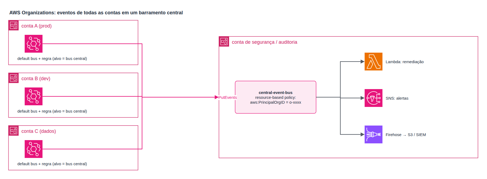

[↑ Índice](#índice)

### Archive, replay e schema registry

- **Archive:** guarda os eventos publicados em um barramento, **todos** ou só os que casam com um **pattern**, por um período definido ou **indefinidamente**.
- **Replay:** reenvia eventos arquivados de um intervalo de tempo para o barramento de origem, onde as regras os processam de novo. Usos típicos:
  - **reprocessar** depois de corrigir um bug em um consumidor;
  - **alimentar** um consumidor novo com o histórico;
  - **testar** uma nova regra com eventos reais.
- **Schema registry:**
  - **schema discovery:** o EventBridge analisa os eventos de um barramento e **infere o schema** de cada tipo de evento;
  - **registro:** os schemas ficam **versionados** e pesquisáveis, junto com os schemas de todos os eventos da AWS;
  - **code bindings:** o registro gera classes em **Java, Python, TypeScript e Go**, para que o código saiba de antemão a estrutura dos eventos.

[↑ Índice](#índice)

### Pipes e API destinations

- **EventBridge Pipes:** conecta **uma origem** a **um alvo**, ponto a ponto, sem código de cola (a "Lambda que só lê de uma fila e chama outro serviço").
  - **Origens:** SQS, Kinesis Data Streams, DynamoDB Streams, Amazon MQ, MSK e Kafka autogerenciado.
  - **Filtro:** um event pattern descarta os eventos que não interessam. Você **não paga** pelos descartados.
  - **Enriquecimento** (opcional): busca dados extras antes de entregar, via Lambda, Step Functions Express, API Gateway ou API destination.
  - **Alvos:** os mesmos tipos das regras (Step Functions, event bus, SQS, SNS, ECS, Batch, Firehose...).
  - **Diferença para as regras:** uma regra processa eventos **publicados no barramento** (muitos para muitos). Um pipe **lê de uma origem que faz polling** (fila ou stream) e entrega a **um** alvo, preservando a **ordem** quando a origem é ordenada.
- **API destinations:** permitem que uma regra ou um pipe chame **qualquer API HTTP** (SaaS ou sistema próprio) como alvo.
  - A **connection** guarda a autenticação (API key, OAuth ou Basic) no **Secrets Manager**.
  - Um **limite de invocações por segundo** protege a API de destino.
- **Partner event sources:** integrações prontas em que o **SaaS publica eventos** no seu partner event bus, sem você precisar fazer polling ou expor webhooks.

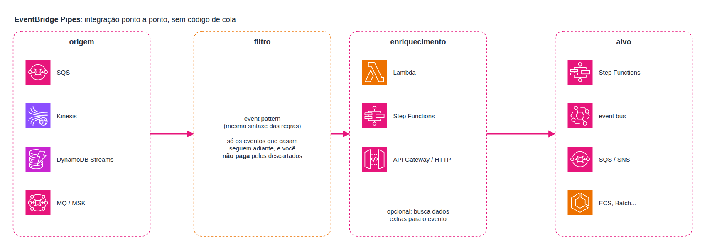

[↑ Índice](#índice)

### Segurança do EventBridge

- **Permissões para os alvos:** a regra usa uma **IAM role** para invocar alvos como Step Functions, Kinesis e ECS. Para Lambda, SNS e SQS, a permissão costuma ficar na **resource-based policy** do alvo, que deve permitir `events.amazonaws.com`, com a condição `aws:SourceArn` igual ao ARN da regra.
- **Quem publica:** a **resource-based policy do event bus** controla quais contas e organizações podem publicar. Políticas IAM controlam `events:PutEvents` nas identidades.
- **Criptografia:** eventos criptografados em repouso, com opção de **chave KMS gerenciada pelo cliente** em custom buses e archives.
- **Rede:** **interface VPC endpoint** para publicar eventos a partir de subnets privadas.
- **Auditoria:** as chamadas à API do EventBridge ficam no **CloudTrail**.

[↑ Índice](#índice)

### EventBridge vs. SNS

| | **EventBridge** | **SNS** |
|---|---|---|
| Modelo | Barramento com **regras** (roteamento por conteúdo) | Tópico com **assinaturas** (fan-out) |
| Filtragem | **Rica**, sobre qualquer campo do evento | Filter policy por assinatura |
| Fontes | **Serviços da AWS** (nativamente), **SaaS** e apps | Apps e serviços que publicam no tópico |
| Destinos | **Dezenas** de serviços, APIs HTTP, outras contas e regiões | SQS, Lambda, Firehose, HTTP/S, **e-mail, SMS, push** |
| Escala de destinatários | Até 5 alvos por regra, centenas de regras por barramento | **Milhões** de assinaturas por tópico |
| Extras | **Archive/replay**, **schema registry**, Pipes, Scheduler | Notificações a pessoas (A2P), FIFO |
| Quando escolher | Reagir a **eventos da AWS** e de **SaaS**, roteamento complexo, integração entre microsserviços | **Fan-out** de alto volume, **notificações a pessoas** |

[↑ Índice](#índice)

### Dicas para a prova

- "Reagir a uma mudança em um recurso da AWS" (instância parou, build falhou, objeto criado) → **regra do EventBridge** no **default bus**.
- "Ser alertado ou remediar quando alguém faz uma **chamada de API** específica" → **CloudTrail** + regra do EventBridge (**"AWS API Call via CloudTrail"**) → SNS ou Lambda.
- "Alerta de **login do root**" ou "ação no **IAM**" → regra em **us-east-1**.
- "Rodar uma tarefa **a cada hora** sem servidor" → **regra agendada** ou **EventBridge Scheduler**.
- "Milhões de agendas **únicas**, com fuso horário" → **EventBridge Scheduler**.
- "Agregar eventos de **todas as contas** da organização em uma conta central" → **event bus central** com **resource-based policy** (`aws:PrincipalOrgID`).
- "Receber eventos de um **SaaS** (Zendesk, Datadog, Shopify) sem polling" → **partner event bus**.
- "**Reprocessar** eventos depois de corrigir um bug" → **archive + replay**.
- "Gerar código a partir do formato dos eventos" ou "descobrir a estrutura dos eventos" → **schema registry** (com schema discovery).
- "Ligar uma fila SQS ou um stream a um alvo, com **filtro** e **enriquecimento**, **sem Lambda de cola**" → **EventBridge Pipes**.
- "Enviar eventos para uma **API HTTP externa** com autenticação e limite de taxa" → **API destinations**.
- "Event bus **resiliente a falha regional**" → **global endpoints**.
- "Roteamento por **conteúdo** do evento entre microsserviços" → **EventBridge**; "fan-out para **milhões** de assinantes ou **SMS/e-mail**" → **SNS**.

[↑ Índice](#índice)

## Padrões de integração

### Contexto: estilos de integração e acoplamento

As seções anteriores descreveram **serviços**. Esta seção olha para o problema de **arquitetura** que esses serviços resolvem: como fazer sistemas independentes trabalharem juntos sem que um dependa demais do outro. Esse problema é antigo e tem vocabulário próprio. O livro ***Enterprise Integration Patterns*** (Hohpe e Woolf, 2003) catalogou 65 padrões de mensageria que continuam sendo a linguagem comum da área. Os guias da AWS (*Prescriptive Guidance*, *Well-Architected*) descrevem como implementar esses padrões com os serviços gerenciados.

O livro identifica **quatro estilos de integração**:

| Estilo | Como funciona | Exemplo na AWS | Problema principal |
|---|---|---|---|
| **Transferência de arquivos** | Um sistema exporta um arquivo, o outro importa | S3, [Transfer Family](storage.md#aws-transfer-family), [DataSync](storage.md#aws-datasync) | Dados **atrasados** (lotes), formatos frágeis |
| **Banco de dados compartilhado** | Vários sistemas leem e escrevem nas mesmas tabelas | Um RDS acessado por vários serviços | **Acoplamento** total ao schema: ninguém muda nada sem quebrar alguém |
| **Chamada remota (RPC)** | Um sistema chama a API do outro e espera a resposta | API Gateway, ALB, AppSync, invocação síncrona da Lambda | **Acoplamento temporal**: os dois precisam estar no ar ao mesmo tempo |
| **Mensageria** | Os sistemas trocam mensagens por um canal intermediário | SQS, SNS, EventBridge, Kinesis, Amazon MQ | Complexidade: consistência eventual, duplicatas, ordem |

O critério para escolher entre eles é o **acoplamento**, que tem várias dimensões:

- **Temporal:** os dois lados precisam estar disponíveis **ao mesmo tempo**?
- **De localização:** o produtor precisa saber **quem** e **onde** está o consumidor?
- **De formato:** uma mudança no formato dos dados **quebra** o outro lado?
- **De tecnologia:** os dois lados precisam usar a mesma **plataforma ou protocolo**?

Arquiteturas modernas combinam os estilos: **chamadas síncronas** onde o usuário espera uma resposta imediata, e **mensageria** para todo o resto. Na SAP-C02, quase toda questão de "**desacoplar**", "**aumentar a resiliência**" ou "**absorver picos**" é, no fundo, uma questão de trocar acoplamento síncrono por assíncrono com o padrão certo.

[↑ Índice](#índice)

### Síncrono vs. assíncrono

| | **Síncrono** (request/response) | **Assíncrono** (mensagens e eventos) |
|---|---|---|
| Quem chama | **Espera** a resposta | Envia e **segue** |
| Disponibilidade | O destino precisa estar **no ar** | O canal **guarda** a mensagem até o destino voltar |
| Picos | Repassados ao destino | **Absorvidos** pelo canal |
| Latência percebida | A soma de todas as chamadas da cadeia | Só a do envio ao canal |
| Consistência | Imediata | **Eventual** |
| Depuração | Simples (uma pilha de chamadas) | Mais difícil (rastreamento distribuído, como o **X-Ray**) |
| Na AWS | API Gateway, ALB, AppSync, Lambda `RequestResponse` | SQS, SNS, EventBridge, Kinesis, Lambda `Event` (assíncrona) com **destinations** |

- **A conta da disponibilidade:** em uma cadeia **síncrona**, as disponibilidades se **multiplicam**. Três serviços com 99,9% cada, chamados em sequência, entregam 99,9% × 99,9% × 99,9% ≈ **99,7%**. Com mensageria entre eles, a falha de um serviço **atrasa** o processamento, mas não derruba a requisição.
- **Falhas em cascata:** um serviço lento segura as conexões dos chamadores, que esgotam seus recursos e ficam lentos também. **Timeouts** curtos, **retries com backoff** e **circuit breakers** limitam o estrago.
- **Regra prática:** use chamada síncrona quando o usuário **precisa da resposta para continuar** (consultar saldo, validar login). Use assíncrona quando a resposta pode vir **depois** (processar um pedido, gerar um relatório, notificar outros sistemas).

[↑ Índice](#índice)

### Canais de mensagens: fila, tópico, barramento e stream

O **canal** é o intermediário por onde as mensagens passam. Os quatro tipos de canal se comportam de formas diferentes, e a escolha define o que o sistema consegue fazer:

| | **Fila** | **Tópico** | **Barramento** | **Stream** |
|---|---|---|---|---|
| Padrão (EIP) | *Point-to-Point Channel* | *Publish-Subscribe Channel* | *Message Bus* + *Content-Based Router* | Log de eventos particionado |
| Quem recebe cada mensagem | **Um** consumidor | **Todos** os assinantes | Os alvos das **regras que casam** | **Todos** os consumidores, cada um com sua posição |
| Retenção | Até ser processada (máx. 14 dias) | Nenhuma | Nenhuma (salvo archive) | **Horas a dias** (ou mais), mesmo depois de lida |
| Reler o passado | Não | Não | Com **replay** do archive | **Sim**: o consumidor volta a posição |
| Ordem | FIFO por grupo | FIFO por grupo | Não garantida | **Por partição (shard)** |
| Modelo | Pull | Push | Push | Pull |
| Na AWS | **SQS**, Amazon MQ (queue) | **SNS**, Amazon MQ (topic) | **EventBridge** | **Kinesis Data Streams**, **MSK**, **DynamoDB Streams** |

- **Fila:** para **distribuir trabalho** entre workers (*competing consumers*) e absorver picos.
- **Tópico:** para **avisar** vários sistemas do mesmo fato (fan-out).
- **Barramento:** para **rotear** eventos de muitas origens para muitos destinos, pelo conteúdo.
- **Stream:** para **alto volume** com **ordem**, **vários consumidores independentes** e **reprocessamento** (analytics em tempo real, *event sourcing*, CDC).

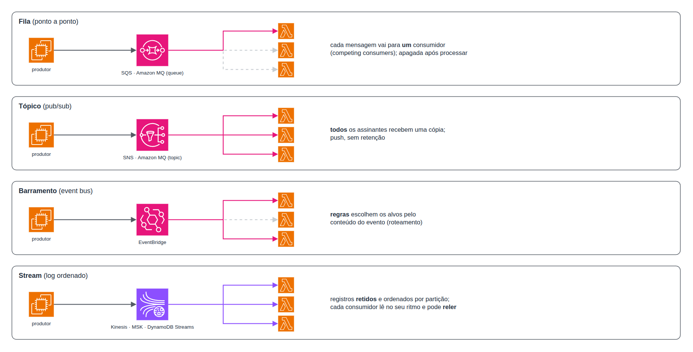

> **Obs:** os canais se **combinam**. O fan-out **SNS + SQS** é um tópico seguido de filas: cada consumidor ganha durabilidade e ritmo próprio. Já **EventBridge → SQS** é um barramento seguido de uma fila, para que o alvo processe em lote e com retries.

[↑ Índice](#índice)

### Orquestração vs. coreografia

Quando um processo de negócio atravessa vários serviços, alguém precisa coordenar a sequência. Há duas formas:

| | **Orquestração** | **Coreografia** |
|---|---|---|
| Quem coordena | Um **orquestrador central** que conhece o fluxo inteiro | **Ninguém**: cada serviço reage a eventos e publica os seus |
| Acoplamento | O orquestrador conhece todos os participantes | Os serviços só conhecem os **eventos** |
| Visibilidade | O estado de cada execução está em um lugar | Espalhada: é preciso **rastreamento distribuído** para reconstruir o fluxo |
| Erros e compensação | Centralizados (Retry, Catch, Saga orquestrada) | Cada serviço publica eventos de falha e compensação (Saga coreografada) |
| Mudanças no fluxo | Altera a definição do orquestrador | Novos serviços **assinam** eventos sem mexer nos outros |
| Na AWS | **Step Functions** | **EventBridge**, **SNS**, **SQS** |

- **Quando orquestrar:** fluxos com **ordem rígida**, **decisões**, **prazos**, **aprovações** e **compensações**, em que o negócio precisa saber "**em que passo está o pedido 123**". Normalmente **dentro** de um domínio, como o processamento de um pedido.
- **Quando coreografar:** quando vários domínios independentes reagem ao **mesmo fato** e evoluem em ritmos diferentes. Normalmente **entre** domínios: o domínio de pedidos publica "PedidoCriado", e o faturamento, a logística e o marketing reagem.
- **Na prática, os dois juntos:** cada domínio **orquestra** seu fluxo interno com Step Functions e **publica eventos** no EventBridge para os outros domínios, que **coreografam** a partir deles.

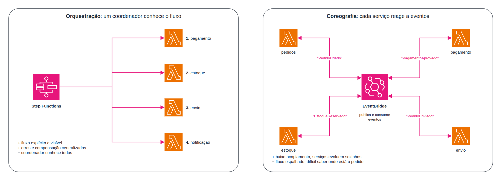

[↑ Índice](#índice)

### Padrões de roteamento e transformação

Padrões clássicos do *Enterprise Integration Patterns* e como implementá-los na AWS **sem código** ou com pouco código:

| Padrão | O que faz | Implementação na AWS |
|---|---|---|
| **Content-Based Router** | Escolhe o destino pelo conteúdo da mensagem | Regras do **EventBridge**; estado **Choice** do Step Functions |
| **Message Filter** | Descarta as mensagens que não interessam ao consumidor | **Filter policy** do SNS; filtro do **EventBridge Pipes**; **filtro de eventos** no event source mapping da Lambda |
| **Recipient List / Fan-out** | Entrega a mesma mensagem a vários destinos | **SNS** (fan-out); regra do EventBridge com vários alvos |
| **Splitter** | Divide uma mensagem grande em várias menores | **Map** / **Distributed Map** do Step Functions |
| **Aggregator** | Junta várias mensagens relacionadas em uma | Saída do **Map** ou **Parallel** no Step Functions; janelas da Lambda sobre Kinesis |
| **Content Enricher** | Acrescenta dados que faltam na mensagem | **Enriquecimento** do EventBridge Pipes; uma Task do Step Functions |
| **Message Translator** | Converte o formato da mensagem para o que o destino espera | **Input transformer** do EventBridge; **JSONata** no Step Functions; **mapping templates** do API Gateway |
| **Normalizer** / **Canonical Data Model** | Converte vários formatos para um modelo comum | Lambda ou Pipes de tradução + **schema registry** do EventBridge |
| **Claim Check** | Guarda o payload grande à parte e envia só a referência | Corpo no **S3** + referência no SQS/SNS (**Extended Client Library**); o mesmo para o limite de 256 KB do Step Functions |
| **Wire Tap** | Copia as mensagens para auditoria sem afetar o fluxo | Assinatura extra de **Firehose → S3** no SNS; **archive** do EventBridge |
| **Process Manager** | Coordena um processo de vários passos com estado | **Step Functions** |
| **Messaging Gateway / Bridge** | Liga sistemas que usam protocolos diferentes | **Amazon MQ** + ponte (Camel/JMS); **API destinations** do EventBridge |

[↑ Índice](#índice)

### Padrões de confiabilidade

Mensageria troca falhas visíveis (erro na hora) por falhas **silenciosas** (mensagem perdida, duplicada ou presa). Estes padrões tratam disso:

| Padrão | Problema que resolve | Implementação na AWS |
|---|---|---|
| **Retry com backoff exponencial e jitter** | Falhas **transitórias** (timeout, throttling) | Padrão nos **SDKs da AWS**; **Retry** do Step Functions; delivery policy do SNS; retry policy do EventBridge |
| **Dead Letter Channel** | Mensagens que **nunca** são processadas (*poison messages*) | **DLQ** do SQS (`maxReceiveCount`); DLQ por **assinatura** no SNS; DLQ por **alvo** no EventBridge; **on-failure destination** da Lambda assíncrona |
| **Idempotent Receiver** | Entregas **at-least-once** geram duplicatas | Chave de idempotência gravada no **DynamoDB** com escrita condicional; utilitário de idempotência do **Powertools for AWS Lambda**; deduplicação do **SQS/SNS FIFO** |
| **Competing Consumers** | Um único consumidor não dá conta | **SQS** + Auto Scaling pelo backlog ou Lambda |
| **Queue-Based Load Leveling** | Picos sobrecarregam o destino | **SQS** como buffer + consumo com concorrência controlada |
| **Throttling / backpressure** | Um produtor rápido derruba um consumidor lento | Throttling do **API Gateway**; **reserved concurrency** da Lambda; **maximum concurrency** no event source mapping |
| **Circuit Breaker** | Continuar chamando uma dependência que está falhando piora tudo | Estado do circuito no **DynamoDB**, consultado por Step Functions ou Lambda; bibliotecas no código |
| **Bulkhead** | A falha de uma parte consome os recursos de todas | **Filas** e **reserved concurrency** separadas por cliente ou prioridade; contas separadas |
| **Guaranteed Delivery** | A mensagem não pode se perder se o destino estiver fora | Canal **durável** (SQS, Kinesis); SNS e EventBridge **sempre com DLQ** |

> **Obs:** **idempotência** é o padrão mais importante da lista. Como SQS Standard, SNS, EventBridge e Kinesis entregam **at-least-once**, e os retries repetem operações, todo consumidor deve suportar receber a mesma mensagem duas vezes.

[↑ Índice](#índice)

### Resposta assíncrona (async request-reply)

Quando o processamento demora mais do que o cliente pode esperar (o **timeout de 29 s** do API Gateway, por exemplo), a requisição vira assíncrona, mas o cliente ainda precisa do resultado:

1. O cliente envia a requisição e recebe na hora **202 Accepted** com um **ID** (e, opcionalmente, a URL de status).
2. O trabalho roda em background (**Step Functions**, ou **SQS** + workers) e grava o status e o resultado, por exemplo no **DynamoDB**.
3. O cliente obtém o resultado de uma destas formas:
   - **polling** em `GET /status/{id}`;
   - **push** via **WebSocket** (API Gateway WebSocket API ou AppSync subscriptions);
   - **webhook/callback** para uma URL do cliente;
   - **notificação** (SNS, e-mail).

- **Variações:**
  - **filas de requisição e resposta** com *correlation ID* (ver [padrões com SQS](#padrões-de-arquitetura-com-sqs));
  - **task token** do Step Functions, quando o sistema que responde é externo ou humano.
- Mais detalhes sobre os limites e padrões do API Gateway em [API Gateway: padrões arquiteturais](compute-and-load-balancing.md#padrões-arquiteturais).

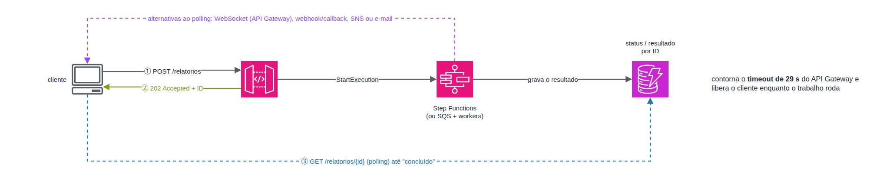

[↑ Índice](#índice)

### Consistência entre serviços: outbox, CDC, CQRS e event sourcing

Em microsserviços, cada serviço tem **o seu banco** (*database per service*), e os outros só acessam os dados pela API ou por eventos. Isso cria um problema clássico:

- **Dual write:** o serviço precisa **gravar no banco** e **publicar um evento**. São duas operações em sistemas diferentes, sem transação entre elas:
  - se a gravação dá certo e a publicação falha, os outros serviços **nunca ficam sabendo**;
  - se a publicação acontece e a gravação falha, eles reagem a algo que **não aconteceu**.

Os padrões abaixo resolvem esse problema e seus derivados:

- **Transactional outbox:** o serviço grava o estado **e** o evento no **mesmo banco**, na **mesma transação**: o evento vai para uma tabela `outbox`. Um processo separado lê a outbox e publica os eventos. Ou as duas coisas acontecem, ou nenhuma.
  - **No RDS/Aurora:** tabela outbox + **CDC** com o **DMS** (ou Debezium no MSK Connect) publicando em Kinesis ou MSK, ou uma Lambda fazendo polling da tabela.
  - **No DynamoDB:** o próprio **DynamoDB Streams** faz o papel da outbox. Cada escrita confirmada gera um registro no stream, que o **EventBridge Pipes** (ou uma Lambda) transforma em evento de negócio. Ver [DynamoDB Streams](databases.md#dynamodb-streams-e-integrações).
- **Change Data Capture (CDC):** capturar as mudanças do banco a partir do **log de transações**, sem alterar a aplicação. Na AWS: **DynamoDB Streams**, **DMS** com CDC, **change streams** do DocumentDB e as integrações **zero-ETL** do Aurora e do DynamoDB com o Redshift.
- **Evento de notificação vs. evento com estado:**
  - um **evento de notificação** (*thin*) diz só o que aconteceu e o ID ("PedidoCriado: 123"). O consumidor busca os detalhes na API do produtor, o que gera **acoplamento** e carga nessa API;
  - um **evento com estado** (*event-carried state transfer*, *fat*) leva os dados necessários. O consumidor não precisa chamar o produtor, ao custo de eventos maiores (para payloads grandes, use o **Claim Check**).
- **CQRS** (*Command Query Responsibility Segregation*): separar o modelo de **escrita** (comandos) do modelo de **leitura** (consultas). A escrita vai para o banco transacional, e eventos ou CDC alimentam **modelos de leitura** otimizados para cada consulta. Exemplos: **DynamoDB → Streams → OpenSearch** para busca textual; **ElastiCache** para leituras quentes; **Redshift** para analytics. O preço é a **consistência eventual** entre os modelos.
- **Event sourcing:** em vez de guardar só o **estado atual**, guardar a **sequência de eventos** que levou a ele ("conta aberta", "depósito de 100", "saque de 30"). O estado é reconstruído reprocessando os eventos.
  - **Ganhos:** auditoria completa e a possibilidade de recalcular modelos de leitura.
  - **Na AWS:** o log pode ficar no **DynamoDB** (append-only), no **Kinesis/MSK** (com retenção longa) ou em arquivos no **S3**.

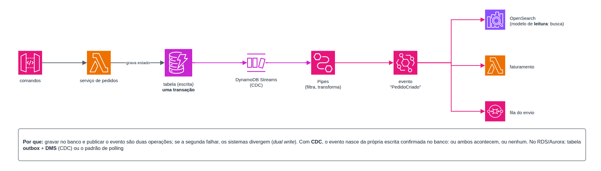

[↑ Índice](#índice)

### Integração com legado e migração

- **Strangler fig:** migrar um monolito **aos poucos**, sem um "big bang". Uma **fachada** (API Gateway, ALB ou CloudFront) recebe todas as requisições e roteia cada rota para o monolito ou para o serviço novo que a substituiu. A cada etapa, uma rota migra; quando nenhuma rota aponta mais para o monolito, ele é desligado. O **AWS Migration Hub Refactor Spaces** monta essa fachada e o roteamento entre contas.
- **Anti-corruption layer (ACL):** uma camada de **tradução** entre o modelo do sistema legado e o modelo dos serviços novos, para que os conceitos e formatos antigos não "contaminem" o novo design. Na AWS: Lambda, EventBridge Pipes ou o input transformer convertendo eventos e chamadas.
- **Messaging bridge:** quando o legado usa um broker com protocolo aberto (JMS, AMQP, MQTT), o **Amazon MQ** recebe esse tráfego sem reescrever a aplicação, e uma ponte liga o broker aos serviços nativos (SQS, Lambda). Ver [migração para o Amazon MQ](#migração-para-o-amazon-mq).
- **Transferência de arquivos:** parceiros e sistemas legados que só trocam arquivos (SFTP, FTPS, AS2) continuam assim com o **Transfer Family**, e a chegada de cada arquivo no S3 dispara o processamento orientado a eventos (S3 → EventBridge → Step Functions).
- **Banco compartilhado (anti-padrão):** dois serviços que escrevem nas **mesmas tabelas** ficam acoplados ao schema. Na migração para microsserviços, o caminho é dar a cada serviço **o seu banco** e sincronizar os dados por **eventos** ou **CDC**.
- **SaaS:** para integrar dados de SaaS em lote (Salesforce, SAP, ServiceNow → S3/Redshift), existe o **Amazon AppFlow**. Para eventos em tempo real de SaaS, os **partner event buses** do EventBridge.

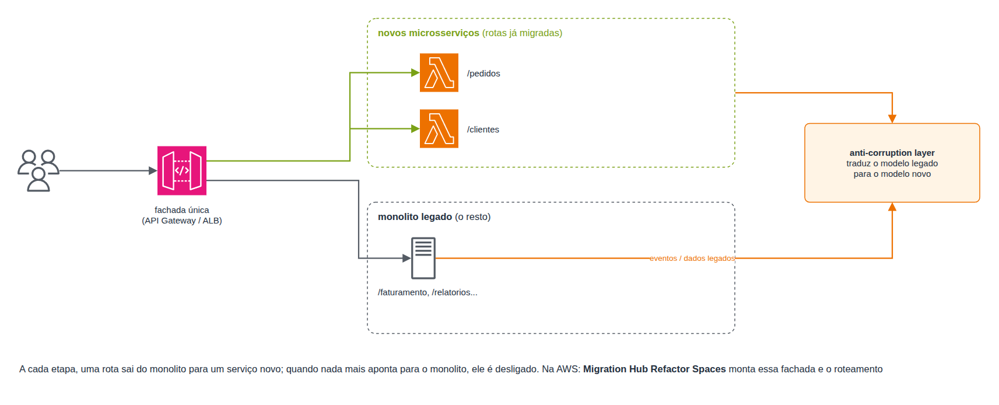

[↑ Índice](#índice)

### Escolhendo o serviço de integração

| Requisito do cenário | Serviço / padrão |
|---|---|
| Cliente precisa da resposta **na hora** | Chamada **síncrona**: API Gateway, ALB, AppSync |
| Trabalho em background, absorver picos, workers escaláveis | **SQS** (fila) |
| A mesma mensagem para **vários** consumidores independentes | **SNS + SQS** (fan-out) |
| Ordem estrita e sem duplicatas | **SQS FIFO** / **SNS FIFO** |
| Rotear eventos por **conteúdo**, eventos da AWS ou de SaaS | **EventBridge** |
| Alto volume, ordem por chave, **vários consumidores** e **reprocessamento** | **Kinesis Data Streams** / **MSK** |
| Fluxo de vários passos com decisões, espera, erros e compensação | **Step Functions** |
| Aplicação existente com **JMS, AMQP, MQTT** | **Amazon MQ** |
| Ligar uma fila ou stream a um alvo, com filtro e enriquecimento | **EventBridge Pipes** |
| Gravar no banco e publicar evento **sem dual write** | **Outbox** / **CDC** (DynamoDB Streams, DMS) |
| Processamento maior que o timeout da API | **Async request-reply** (202 + polling ou WebSocket) |
| Migrar um monolito aos poucos | **Strangler fig** (fachada no API Gateway/ALB, Refactor Spaces) |
| Payload maior que o limite do canal | **Claim check** (S3 + referência) |

[↑ Índice](#índice)

### Dicas para a prova

- "**Desacoplar** componentes para que a falha de um não afete o outro" → trocar a chamada síncrona por **mensageria** (SQS, SNS, EventBridge).
- "Cadeia de chamadas síncronas com **timeouts** e falhas em cascata" → **assíncrono** com filas, ou circuit breaker e timeouts.
- "Vários sistemas reagem ao **mesmo evento** e novos sistemas vão surgir" → **pub/sub** (SNS fan-out ou EventBridge) e **coreografia**.
- "Processo com ordem, decisões, aprovação e **compensação**, com visibilidade de cada execução" → **orquestração** com **Step Functions** (Saga).
- "Consumidores precisam **reler** eventos passados ou processar em **ordem por chave**" → **stream** (Kinesis/MSK), não fila nem tópico.
- "Mensagens **duplicadas** causam cobranças em dobro" → consumidor **idempotente** (chave de idempotência no DynamoDB) ou **FIFO**.
- "Mensagens que falham sempre travam a fila" → **dead letter channel** (DLQ) + alarme + redrive.
- "Gravar no banco e **publicar o evento** de forma confiável" → **transactional outbox** / **CDC** (DynamoDB Streams + Pipes/EventBridge; DMS no RDS).
- "Consultas de **busca** sobre dados do DynamoDB sem afetar a escrita" → **CQRS**: Streams → **OpenSearch**.
- "Payload grande demais para SQS, SNS, EventBridge ou Step Functions" → **claim check** no **S3**.
- "Requisição leva **minutos** e o API Gateway corta em 29 s" → **async request-reply** (202 + polling, WebSocket ou callback).
- "Migrar um monolito para microsserviços **gradualmente**, sem downtime" → **strangler fig** (Refactor Spaces, API Gateway/ALB roteando por caminho).
- "Serviços novos não podem herdar o modelo de dados confuso do legado" → **anti-corruption layer**.
- "Vários microsserviços leem e escrevem no **mesmo banco**" → anti-padrão: **um banco por serviço** + eventos.

[↑ Índice](#índice)

## Revisão: qual serviço usar

Resumo das comparações que mais aparecem nas questões. Os detalhes estão nas seções de cada serviço.

### Orquestração (Step Functions)

| Pergunta do cenário | Solução |
|---|---|
| Coordenar vários passos com retries, erros e paralelismo | [Step Functions](#o-que-é-o-step-functions) |
| Qual estado usar (Choice, Parallel, Map, Wait...)? | [Tipos de estado](#tipos-de-estado) |
| Esperar job terminar, aprovação humana ou worker on-premises | [Padrões de integração](#padrões-de-integração-com-serviços) |
| Processo longo e auditável ou alto volume e barato? | [Standard vs. Express](#standard-vs-express) |
| API que espera o resultado do workflow | [Express síncrono](#standard-vs-express) |
| Disparar por evento, agenda ou API | [Como iniciar](#como-iniciar-uma-execução) |
| Transação entre microsserviços, desfazer em falha | [Saga](#tratamento-de-erros-e-o-padrão-saga) |
| Alertar quando uma execução falha | [EventBridge + SNS](#tratamento-de-erros-e-o-padrão-saga) |
| Milhões de objetos do S3 em paralelo | [Distributed Map](#distributed-map-processamento-em-larga-escala) |
| Payload grande, conta cruzada, acesso privado | [Segurança e limites](#segurança-limites-e-operação) |
| Step Functions, SQS, EventBridge, MWAA ou SWF? | [Alternativas](#step-functions-vs-alternativas) |

[↑ Índice](#índice)

### Filas (SQS)

| Pergunta do cenário | Solução |
|---|---|
| Desacoplar, absorver picos, não perder requisições | [SQS](#o-que-é-o-sqs) |
| Mensagem processada duas vezes, chamadas vazias | [Visibility timeout e long polling](#ciclo-de-vida-de-uma-mensagem) |
| Ordem e sem duplicatas, ou vazão máxima? | [Standard vs. FIFO](#standard-vs-fifo) |
| Mensagens que sempre falham | [DLQ e redrive](#dead-letter-queue-e-redrive) |
| Escalar workers EC2 ou Lambda pela fila | [Consumidores](#consumidores-ec2-auto-scaling-e-lambda) |
| Buffer de escrita, request/response, prioridade | [Padrões](#padrões-de-arquitetura-com-sqs) |
| Cross-account, S3/SNS publicando, KMS, VPC endpoint | [Segurança](#segurança-do-sqs) |

[↑ Índice](#índice)

### Message broker (Amazon MQ)

| Pergunta do cenário | Solução |
|---|---|
| Migrar app com JMS/AMQP/MQTT/STOMP sem reescrever | [Amazon MQ](#contexto-message-brokers-e-protocolos-abertos) |
| ActiveMQ ou RabbitMQ? IBM MQ e TIBCO? | [ActiveMQ vs. RabbitMQ](#activemq-vs-rabbitmq) |
| Broker Multi-AZ, failover, DR entre regiões | [Alta disponibilidade](#alta-disponibilidade-do-amazon-mq) |
| Migrar aos poucos de um broker legado | [Migração](#migração-para-o-amazon-mq) |
| Broker privado, TLS, KMS, LDAP | [Segurança](#segurança-do-amazon-mq) |
| Amazon MQ ou SQS/SNS? | [Comparação](#amazon-mq-vs-sqs-e-sns) |

[↑ Índice](#índice)

### Pub/sub e notificações (SNS)

| Pergunta do cenário | Solução |
|---|---|
| Uma mensagem para vários consumidores, alertas, notificações a pessoas | [SNS](#o-que-é-o-sns) |
| Fan-out durável, mesmo evento do S3 para várias filas | [SNS + SQS](#fan-out-sns--sqs) |
| Cada assinante quer só parte das mensagens | [Filter policy](#filtragem-de-mensagens) |
| Fan-out com ordem e sem duplicatas, replay | [SNS FIFO](#sns-fifo) |
| Entregas falhando, endpoint fora do ar | [Retries e DLQ](#entrega-retries-e-dlq-do-sns) |
| Cross-account, KMS, VPC endpoint, PII | [Segurança](#segurança-do-sns) |
| SNS, SQS ou EventBridge? | [Comparação](#sns-vs-sqs-vs-eventbridge) |

[↑ Índice](#índice)

### Eventos (EventBridge)

| Pergunta do cenário | Solução |
|---|---|
| Reagir a mudanças em recursos da AWS, eventos de SaaS ou das apps | [EventBridge](#o-que-é-o-eventbridge) |
| Filtrar eventos por conteúdo | [Event patterns](#regras-e-event-patterns) |
| Alertar ou remediar uma chamada de API (DeleteTable, root login) | [CloudTrail + EventBridge](#interceptando-chamadas-de-api-com-o-cloudtrail) |
| Cron serverless, agendas únicas com fuso horário | [Scheduler](#agendamento-regras-agendadas-e-eventbridge-scheduler) |
| Eventos de todas as contas em uma conta central, falha regional | [Multi-conta e multi-região](#multi-conta-e-multi-região) |
| Reprocessar eventos, descobrir o formato dos eventos | [Archive, replay e schemas](#archive-replay-e-schema-registry) |
| Fila/stream → alvo sem Lambda de cola, chamar API HTTP externa | [Pipes e API destinations](#pipes-e-api-destinations) |
| Permissões dos alvos, KMS, VPC endpoint | [Segurança](#segurança-do-eventbridge) |
| EventBridge ou SNS? | [Comparação](#eventbridge-vs-sns) |

[↑ Índice](#índice)

### Arquitetura (padrões de integração)

| Pergunta do cenário | Solução |
|---|---|
| Arquivo, banco compartilhado, RPC ou mensageria? | [Estilos de integração](#contexto-estilos-de-integração-e-acoplamento) |
| Chamada síncrona ou assíncrona? | [Síncrono vs. assíncrono](#síncrono-vs-assíncrono) |
| Fila, tópico, barramento ou stream? | [Canais](#canais-de-mensagens-fila-tópico-barramento-e-stream) |
| Coordenador central ou serviços reagindo a eventos? | [Orquestração vs. coreografia](#orquestração-vs-coreografia) |
| Rotear, filtrar, dividir, enriquecer, traduzir mensagens | [Roteamento e transformação](#padrões-de-roteamento-e-transformação) |
| Duplicatas, poison messages, picos, dependência falhando | [Confiabilidade](#padrões-de-confiabilidade) |
| Processamento mais longo que o timeout da API | [Async request-reply](#resposta-assíncrona-async-request-reply) |
| Dual write, CDC, modelos de leitura, histórico de eventos | [Outbox, CDC, CQRS](#consistência-entre-serviços-outbox-cdc-cqrs-e-event-sourcing) |
| Monolito, broker legado, parceiros com arquivos | [Legado e migração](#integração-com-legado-e-migração) |
| Qual serviço para cada requisito? | [Escolhendo o serviço](#escolhendo-o-serviço-de-integração) |

[↑ Índice](#índice)
