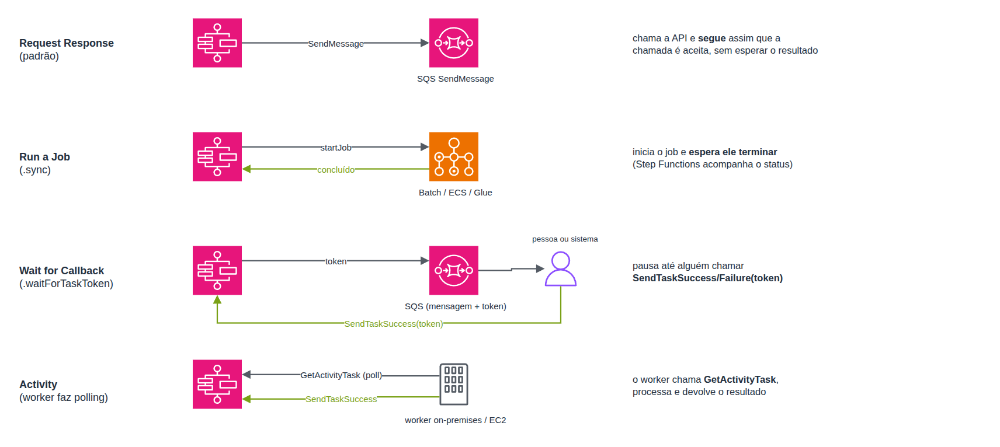
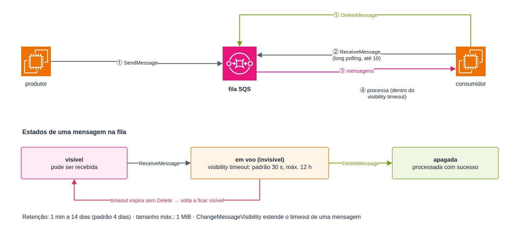
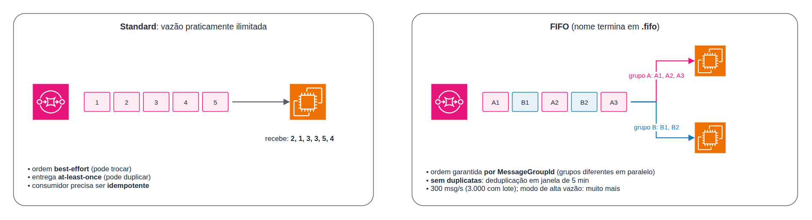
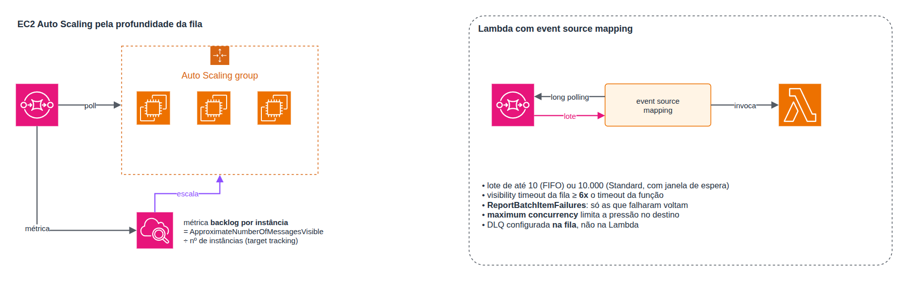
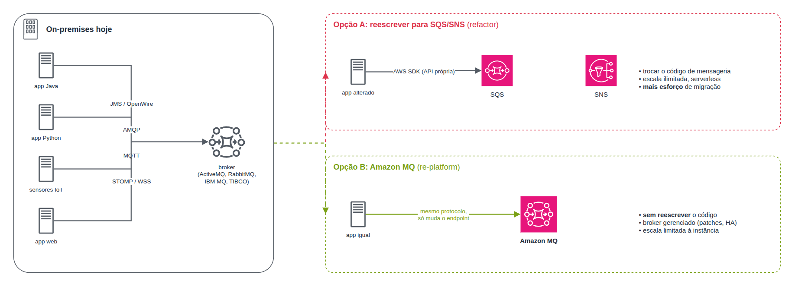
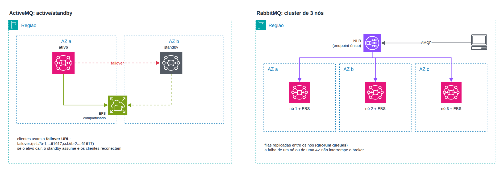

# Service Communication

> **Escopo:** _(em uma frase, o que este arquivo cobre)_
>
> **Por que cai na prova:** _(o ângulo que a SAP-C02 costuma explorar)_

## Índice

- **Orquestração:** [AWS Step Functions](#aws-step-functions)
- **Mensageria:** [Amazon SQS](#amazon-sqs) · [Amazon MQ](#amazon-mq)
- **Revisão:** [Qual serviço usar](#revisão-qual-serviço-usar)

## AWS Step Functions

### Contexto: workflows, máquinas de estados e orquestração

Quase todo processo de negócio é uma **sequência de passos**: validar um pedido, cobrar o cartão, reservar o estoque, emitir a nota, avisar o cliente. Em um monolito, esses passos são chamadas de função dentro de um mesmo processo. Em uma arquitetura de **microsserviços** ou **serverless**, cada passo vive em um serviço diferente (uma Lambda, um container, uma fila, um banco), e surge um problema: **quem coordena o fluxo?** Quem sabe qual é o próximo passo, o que fazer quando um deles falha e em que ponto o processo parou?

Alguns conceitos de computação e engenharia de software ajudam a entender a resposta:

- **Workflow:** a descrição de um processo como um conjunto de passos, com a ordem entre eles, as decisões (*se X, faça Y*), os passos em paralelo e as esperas.
- **Máquina de estados finita:** um modelo da teoria da computação em que um sistema está sempre em **um estado** de um conjunto finito, e **transições** levam de um estado para outro conforme a entrada. Um semáforo é o exemplo clássico: verde → amarelo → vermelho → verde. Um workflow pode ser descrito como uma máquina de estados: cada passo é um estado, e o resultado do passo define a transição.
- **Orquestração vs. coreografia:** as duas formas de coordenar serviços.
  - Na **orquestração**, um **coordenador central** conhece o fluxo inteiro e manda cada serviço executar sua parte, como um maestro. O fluxo fica explícito e fácil de acompanhar.
  - Na **coreografia**, não há coordenador: cada serviço **reage a eventos** dos outros (via SNS, SQS ou EventBridge), como dançarinos que conhecem a música. O acoplamento é menor, mas o fluxo fica espalhado e é difícil saber "onde está o pedido 123".
- **Workflow durável:** o estado da execução (em que passo está e com quais dados) é **persistido** fora do código. Se um servidor cair, o processo continua do ponto em que parou, mesmo que dure dias.
- **Retry com backoff exponencial e jitter:** falhas transitórias (timeout, *throttling*) costumam se resolver sozinhas. A estratégia padrão é tentar de novo com **intervalos crescentes** (1 s, 2 s, 4 s...) e um **componente aleatório** (*jitter*), para que milhares de clientes não tentem todos no mesmo instante.
- **Idempotência:** uma operação é idempotente quando executá-la **duas vezes** tem o mesmo efeito que executá-la **uma vez** (ex: "definir o saldo como 100" é idempotente; "somar 100 ao saldo" não é). Com retries, o mesmo passo pode rodar mais de uma vez, então os passos precisam ser idempotentes.
- **Transações distribuídas e o padrão Saga:** um banco de dados garante que várias escritas aconteçam **todas ou nenhuma** (transação ACID). Quando o processo atravessa vários serviços, cada um com seu banco, não existe essa garantia. O **padrão Saga** resolve isso com uma sequência de transações locais, em que cada passo tem uma **ação de compensação** que desfaz seu efeito (ex: "cobrar" ↔ "estornar"). Se um passo falha, o orquestrador executa as compensações dos passos já concluídos.

O **AWS Step Functions** é o serviço **serverless de orquestração** da AWS: você descreve o workflow como uma **máquina de estados** em JSON, e o serviço executa cada passo, guarda o estado, faz retries, trata erros e mostra visualmente onde cada execução está. Na prova, ele aparece em cenários de **orquestrar Lambdas e microsserviços**, **processos longos** (dias ou meses), **aprovação humana**, **tratamento de erros sem código** e **processamento em lote em larga escala**.

[↑ Índice](#índice)

### O que é o Step Functions

- **Máquina de estados (*state machine*):** a definição do workflow, escrita em **Amazon States Language (ASL)**, um JSON que lista os estados e as transições. O **Workflow Studio** do console permite desenhá-la arrastando blocos.
- **Execução:** cada vez que a máquina de estados é iniciada, com uma **entrada em JSON**. A saída de um estado vira a entrada do próximo. Os dados podem ser filtrados e transformados com **JSONPath** ou **JSONata**, e guardados em **variáveis** para uso em estados posteriores.
- **Duração:** uma execução **Standard** pode durar até **1 ano**, sem nenhum servidor esperando: o estado fica persistido no serviço.
- **Visualização:** o console mostra o grafo de cada execução, com o estado atual, a entrada e a saída de cada passo e onde ocorreu a falha. Isso facilita muito a depuração em relação a logs espalhados.
- **Serverless:** sem infraestrutura, com escala automática e pagamento por uso.
- **Latência:** cada transição adiciona alguns milissegundos. Encadear muitas Lambdas curtas via Step Functions deixa o fluxo **mais lento** do que uma chamada direta, o que importa em APIs síncronas sensíveis à latência.

Exemplo de ASL com um estado `Task` que chama uma Lambda com retry e desvia para um estado de compensação em caso de erro:

```json
{
  "StartAt": "CobrarPagamento",
  "States": {
    "CobrarPagamento": {
      "Type": "Task",
      "Resource": "arn:aws:states:::lambda:invoke",
      "Arguments": { "FunctionName": "cobrar-pagamento", "Payload": "" },
      "Retry": [{ "ErrorEquals": ["States.TaskFailed"], "IntervalSeconds": 2, "BackoffRate": 2, "MaxAttempts": 3 }],
      "Catch": [{ "ErrorEquals": ["States.ALL"], "Next": "Estornar" }],
      "Next": "Sucesso"
    },
    "Estornar": { "Type": "Task", "Resource": "arn:aws:states:::lambda:invoke", "Arguments": { "FunctionName": "estornar" }, "Next": "Falhou" },
    "Sucesso": { "Type": "Succeed" },
    "Falhou": { "Type": "Fail", "Error": "PagamentoRecusado" }
  },
  "QueryLanguage": "JSONata"
}
```

[↑ Índice](#índice)

### Tipos de estado

| Estado | O que faz | Exemplo |
|---|---|---|
| **Task** | Executa um trabalho: chama um serviço AWS, uma API HTTP ou espera um worker | Invocar uma Lambda, gravar no DynamoDB |
| **Choice** | Desvia o fluxo conforme uma condição sobre os dados | "valor > 10 mil" → aprovação manual |
| **Parallel** | Executa **ramos diferentes** ao mesmo tempo e espera todos terminarem | Cobrar e reservar estoque em paralelo |
| **Map** | Executa **os mesmos passos para cada item** de uma lista | Processar cada item do pedido. No modo **Distributed**, milhões de objetos do S3 |
| **Wait** | Pausa por um tempo ou até uma data/hora | Esperar 24 h antes de enviar um lembrete |
| **Pass** | Repassa ou transforma dados, sem chamar nada | Montar a entrada do próximo passo |
| **Succeed** / **Fail** | Encerra a execução com sucesso ou com erro | Fim do fluxo |


> **Obs:** o estado **Task** pode chamar quatro tipos de trabalho: uma **Lambda**, um **serviço AWS** (integrações), uma **API HTTPS** externa (HTTP Task) ou uma **Activity** (worker que você hospeda). Segundo o curso, o Step Functions **não se integra nativamente com o Amazon Mechanical Turk**: tarefas humanas via Mechanical Turk apontam para o **SWF**.

[↑ Índice](#índice)

### Padrões de integração com serviços

O Step Functions chama outros serviços de três formas:

- **Integrações otimizadas:** cerca de vinte serviços com sintaxe simplificada e suporte aos padrões abaixo: **Lambda**, **Batch**, **ECS/Fargate**, **DynamoDB**, **SNS**, **SQS**, **EventBridge**, **Glue**, **EMR**, **SageMaker**, **Athena**, **CodeBuild**, **API Gateway**, **Bedrock** e o próprio **Step Functions** (workflows aninhados).
- **Integrações via AWS SDK:** acesso a **mais de 200 serviços** e milhares de ações da API, como uma chamada comum do SDK (`arn:aws:states:::aws-sdk:<serviço>:<ação>`). Elimina a "Lambda cola" que só existia para chamar uma API da AWS.
- **HTTP Task:** chama **APIs HTTPS de terceiros** (Stripe, Salesforce...), com a autenticação guardada em uma **connection do EventBridge** (API key, OAuth ou Basic).

Para cada chamada, existem três **padrões de espera**, definidos por um sufixo no ARN do recurso:

| Padrão | Sufixo | Comportamento | Uso típico |
|---|---|---|---|
| **Request Response** | (nenhum) | Chama a API e **segue** assim que ela responde, sem esperar o trabalho terminar | Enviar mensagem ao SQS, publicar no SNS |
| **Run a Job** | `.sync` | Inicia o job e **espera ele terminar** (o Step Functions acompanha o status) | Job do Batch, task do ECS, job do Glue, workflow aninhado |
| **Wait for Callback** | `.waitForTaskToken` | Envia um **task token** e **pausa** até alguém chamar `SendTaskSuccess` ou `SendTaskFailure` com esse token | **Aprovação humana**, sistema legado, processo externo |

- **Activities:** um **worker** hospedado por você (on-premises, EC2, um dispositivo móvel) faz **polling** com `GetActivityTask`, processa e devolve o resultado com `SendTaskSuccess`. O worker **puxa** o trabalho, então não precisa expor nenhum endpoint.
- **Heartbeat:** em tarefas longas (callback e activities), `HeartbeatSeconds` define em quanto tempo o worker precisa dar sinal de vida (`SendTaskHeartbeat`). Sem o sinal, o estado falha com `States.HeartbeatTimeout`, em vez de esperar até o fim do timeout.



> **Obs:** o fluxo de **aprovação humana** é o exemplo clássico do callback. O Step Functions envia o token para o SQS ou o SNS, uma Lambda manda um e-mail com links "aprovar/rejeitar" (via API Gateway), e o clique chama `SendTaskSuccess(token)`. A execução fica pausada, **sem custo de computação**, até a resposta ou o timeout.

[↑ Índice](#índice)

### Standard vs. Express

| | **Standard** | **Express** |
|---|---|---|
| Duração máxima | **1 ano** | **5 minutos** |
| Taxa de início de execuções | Mais de 2.000/s | Mais de **100.000/s** |
| Taxa de transições de estado | Mais de 4.000/s por conta | Praticamente ilimitada |
| Semântica de execução | **Exactly-once** (cada passo roda uma vez, salvo retries configurados) | **At-least-once** (assíncrono) ou **at-most-once** (síncrono) |
| Preço | Por **transição de estado** (mais caro em volume) | Por **número de execuções, duração e memória** (mais barato em volume) |
| Histórico | No console e na API por 90 dias, com depuração visual; também no CloudWatch Logs | Só no **CloudWatch Logs** (precisa ativar) |
| `.sync`, `.waitForTaskToken` e Activities | Sim | **Não** |
| Redrive após falha | Sim | Não |

- **Standard:** processos **longos**, **auditáveis**, que **não podem executar um passo duas vezes** (pagamentos, pedidos, aprovações) ou que esperam pessoas e jobs.
- **Express:** eventos de **alto volume e curta duração**: ingestão de IoT, processamento de streams, transformação de dados, backends de API e microsserviços. Os passos precisam ser **idempotentes**, por causa da semântica at-least-once.
- **Express síncrono vs. assíncrono:**
  - **síncrono** (`StartSyncExecution`): quem chamou **espera o fim** do workflow e recebe o resultado. É o padrão para um backend de API via API Gateway;
  - **assíncrono** (`StartExecution`): quem chamou recebe só a **confirmação de início**, e o resultado vai para outro destino (DynamoDB, SNS, EventBridge). Serve para workflows que não precisam de resposta imediata.


> **Obs:** é possível combinar os dois tipos. Um workflow **Standard** pode chamar um **Express** como passo (ex: uma etapa de transformação de alto volume), e o **Distributed Map** pode rodar suas execuções filhas como Express para reduzir custo.

[↑ Índice](#índice)

### Como iniciar uma execução

- **Console**, **AWS SDK** (`StartExecution`) e **CLI** (`aws stepfunctions start-execution`).
- **Lambda**, chamando `StartExecution` pelo SDK.
- **API Gateway**, como **service proxy**: a API inicia a execução diretamente, sem uma Lambda no meio.
- **EventBridge**: uma **regra** dispara o workflow a partir de um evento (ex: objeto criado no S3, mudança de estado de uma instância EC2), e o **EventBridge Scheduler** o dispara em horários (cron).
- **CodePipeline**, como uma ação do pipeline.
- **Outro Step Functions**, como workflow aninhado (`StartExecution.sync` espera a execução filha terminar). Workflows aninhados ajudam a **modularizar** e a contornar o limite de eventos por execução.


[↑ Índice](#índice)

### Tratamento de erros e o padrão Saga

O tratamento de erros fica **declarado na máquina de estados**, não no código de cada função:

- **Retry:** tenta de novo os erros listados em `ErrorEquals`, com `IntervalSeconds`, `BackoffRate` (backoff exponencial), `MaxAttempts`, `MaxDelaySeconds` e `JitterStrategy` (jitter). Serve para **falhas transitórias**.
- **Catch:** quando os retries se esgotam, desvia a execução para um **estado de fallback** (compensar, notificar, registrar o erro), em vez de falhar.
- **Erros predefinidos:** `States.ALL` (qualquer erro), `States.Timeout`, `States.TaskFailed`, `States.HeartbeatTimeout` e `States.Permissions`. As funções também podem lançar **erros próprios** (ex: `PagamentoRecusado`), tratados pelo nome.
- **Timeouts:** `TimeoutSeconds` em cada Task e na execução inteira. Sem timeout, uma Task de callback pode esperar até o limite de 1 ano.
- **Padrão Saga:** cada passo que altera dados tem um estado de **compensação** (estornar, liberar o estoque, cancelar a reserva). O `Catch` leva o fluxo para essas compensações, na ordem inversa, e o sistema volta a um estado consistente, sem uma transação distribuída.
- **Redrive:** uma execução **Standard** que falhou pode ser **retomada a partir do passo que falhou** (até 14 dias depois), sem repetir os passos que já deram certo. Útil quando a falha vinha de um bug corrigido ou de uma dependência fora do ar.
- **Alertas:** o Step Functions publica eventos de **mudança de status das execuções** no **EventBridge**. Uma regra filtrando `FAILED`, `TIMED_OUT` ou `ABORTED` pode notificar via **SNS** (e-mail) ou acionar uma automação.

[↑ Índice](#índice)

### Distributed Map: processamento em larga escala

O estado **Map** tem dois modos:

- **Inline:** itera sobre um array **dentro** da execução, com até 40 iterações em paralelo. Serve para listas pequenas (os itens de um pedido).
- **Distributed:** cria **execuções filhas** (até **10.000 em paralelo**), cada uma com um lote de itens. Ele lê os itens diretamente do **S3**, seja a lista de objetos de um prefixo, um arquivo **CSV** ou **JSON**, ou um **S3 Inventory**, e grava os resultados de volta no S3 (`ResultWriter`).
  - **Controles:** `ItemBatcher` (quantos itens por execução filha), `MaxConcurrency` e `ToleratedFailurePercentage` (quantas falhas aceitar antes de falhar o Map inteiro).
  - **Casos de uso:** processar **milhões de arquivos** (imagens, logs, documentos), reprocessar um data lake, rodar inferência de ML em lote, migrar dados.


> **Obs:** o Distributed Map é a resposta serverless para "processar milhões de objetos do S3 em paralelo com controle de falhas", sem gerenciar um cluster (EMR) ou uma fila com workers. Para transformações simples em cada objeto, o **S3 Batch Operations** também é uma opção.

[↑ Índice](#índice)

### Segurança, limites e operação

- **IAM:**
  - **execution role:** a máquina de estados assume uma role com as permissões para chamar cada serviço do workflow;
  - **cross-account:** uma Task pode assumir uma role de **outra conta** (campo `Credentials`) e chamar recursos de lá diretamente.
- **Rede:** acesso privado à API do Step Functions a partir da VPC com um **interface VPC endpoint** (PrivateLink).
- **Criptografia:** dados das execuções criptografados em repouso, com chave **gerenciada pela AWS** ou **KMS do cliente**.
- **Observabilidade:**
  - **CloudWatch Logs** (obrigatório para depurar o Express) e métricas no CloudWatch;
  - **X-Ray** para rastrear a execução entre os serviços;
  - **CloudTrail** para as chamadas de API.
- **Limites importantes:**
  - a entrada e a saída de cada estado têm no máximo **256 KB**. Para dados maiores, grave no **S3** e passe só a **referência** (bucket e chave);
  - o histórico de uma execução Standard tem no máximo **25.000 eventos**. Loops longos devem ser divididos em **workflows filhos** ou usar o Distributed Map.
- **Deploy seguro:** **versões** e **aliases** da máquina de estados permitem publicar uma nova versão e direcionar parte das execuções para ela (implantação gradual), com rollback rápido.

[↑ Índice](#índice)

### Step Functions vs. alternativas

| Necessidade | Serviço |
|---|---|
| Orquestrar passos com ordem, decisões, paralelismo, retries e visibilidade | **Step Functions** |
| Desacoplar produtor e consumidor, absorver picos, processar em background | **SQS** (coreografia, sem fluxo central) |
| Reagir a eventos e espalhar para vários consumidores | **SNS** / **EventBridge** (coreografia) |
| Pipelines de dados com **Apache Airflow** (DAGs em Python), portabilidade e operadores prontos | **Amazon MWAA** |
| Sistemas legados com workflows já em **SWF**, sinais externos ou **Mechanical Turk** | **Amazon SWF** (serviço antigo; para projetos novos, a AWS recomenda o Step Functions) |
| Uma sequência simples de 2 passos, em que a latência é crítica | Chamada direta entre serviços ou Lambda destinations |

[↑ Índice](#índice)

### Dicas para a prova

- "Orquestrar várias Lambdas com **retries, tratamento de erros e paralelismo**, sem escrever código de coordenação" → **Step Functions**.
- "Processo que precisa de **aprovação humana** antes de continuar" → Step Functions com **`.waitForTaskToken`** (callback).
- "Workflow que roda por **dias ou meses**" → Step Functions **Standard** (até 1 ano).
- "Workflow de **alto volume e curta duração** (IoT, streaming), com **menor custo**" → **Express**.
- "Backend de API que orquestra microsserviços e **devolve o resultado** na mesma requisição" → API Gateway + **Express síncrono**.
- "Cada passo deve executar **exatamente uma vez**, com histórico auditável" → **Standard** (Express é at-least-once).
- "Iniciar um job do Batch, ECS ou Glue e **esperar ele terminar**" → integração **`.sync`** (Run a Job).
- "Worker **on-premises** que processa tarefas do workflow sem expor endpoint" → **Activity** (polling).
- "**Transação distribuída** entre microsserviços, com desfazer em caso de falha" → padrão **Saga** com **Catch** e estados de compensação.
- "Ser **notificado** quando uma execução falhar" → **EventBridge** (evento de status) → **SNS**.
- "Processar **milhões de objetos do S3** em paralelo" → **Distributed Map**.
- "Chamar uma API da AWS sem uma Lambda só para isso" → **integração via AWS SDK**.
- "Payload maior que **256 KB**" → guardar no **S3** e passar a referência.
- "Retomar uma execução que falhou **sem repetir os passos concluídos**" → **Redrive**.
- "Tarefas humanas via **Mechanical Turk**" → **SWF** (o Step Functions não integra nativamente).

[↑ Índice](#índice)

## Amazon SQS

### Contexto: comunicação assíncrona e filas de mensagens

Quando um serviço chama outro **diretamente** (uma chamada HTTP, por exemplo), a comunicação é **síncrona**: quem chama fica esperando a resposta. Isso cria um **acoplamento** forte entre os dois:

- **acoplamento temporal:** os dois precisam estar no ar **ao mesmo tempo**. Se o destino cair, a chamada falha;
- **acoplamento de capacidade:** se o chamador recebe um pico de 10x, o destino recebe o mesmo pico, quer aguente ou não;
- **falhas em cascata:** um serviço lento deixa os chamadores esperando, que deixam os seus chamadores esperando, até derrubar a cadeia inteira.

A **comunicação assíncrona** quebra esse acoplamento com um intermediário: o produtor **deixa uma mensagem** e segue a vida, e o consumidor a **processa quando puder**. Alguns conceitos por trás disso:

- **Fila de mensagens (*message queue*):** uma estrutura **FIFO** (*first in, first out*), como uma fila de banco: as mensagens entram por um lado e saem pelo outro. Uma fila de mensagens é **durável** (guarda as mensagens até alguém processá-las) e fica entre o **produtor** e o **consumidor**.
- **Ponto a ponto vs. publish/subscribe:**
  - em uma **fila** (ponto a ponto), cada mensagem é processada por **um único consumidor**, mesmo que existam vários lendo a fila;
  - em um **tópico** (pub/sub), cada mensagem é entregue a **todos os assinantes**. É o modelo do **SNS**.
- **Competing consumers:** vários consumidores leem a mesma fila e **dividem o trabalho** entre si. Para processar mais rápido, basta adicionar consumidores (escala horizontal).
- **Queue-based load leveling:** a fila funciona como um **amortecedor**. Picos de produção viram **fila acumulada** (*backlog*), e o consumidor processa em ritmo constante, sem precisar ser dimensionado para o pico.
- **Semântica de entrega:** em sistemas distribuídos, há três garantias possíveis:
  - **at-most-once:** a mensagem chega no máximo uma vez, e pode se perder;
  - **at-least-once:** a mensagem nunca se perde, mas pode chegar **duplicada**;
  - **exactly-once:** chega exatamente uma vez, o que é caro de garantir.

  Como a maioria das filas entrega **at-least-once**, o consumidor precisa ser **idempotente**: processar a mesma mensagem duas vezes não pode duplicar o efeito (ex: um *upsert* em vez de um *insert*).
- **Poison message:** uma mensagem que **sempre falha** no processamento (formato inválido, bug). Sem tratamento, ela volta para a fila infinitamente e consome recursos.

O **Amazon SQS** (*Simple Queue Service*) é o serviço de filas **serverless** da AWS, e um dos mais antigos (2004). Na prova, ele aparece sempre que o cenário pede para **desacoplar** componentes, **absorver picos**, **não perder requisições** quando o backend cai, **processar em background** ou **escalar workers** pela quantidade de trabalho pendente.

[↑ Índice](#índice)

### O que é o SQS

- **Totalmente gerenciado e serverless:** não há broker para dimensionar. Você cria uma fila e ela escala automaticamente, com **vazão praticamente ilimitada** na fila Standard.
- **Durabilidade:** as mensagens ficam armazenadas de forma redundante em **várias AZs**.
- **Retenção:** de **1 minuto a 14 dias** (padrão: **4 dias**). Depois disso, as mensagens não processadas são apagadas.
- **Tamanho da mensagem:** até **1 MiB** (1.024 KB). Para payloads maiores, use a **SQS Extended Client Library**: o corpo vai para o **S3** e a mensagem leva só a **referência**, com objetos de até 2 GB.
- **Modelo pull:** o consumidor **busca** as mensagens (polling). O SQS não "empurra" mensagens. O event source mapping da Lambda faz esse polling por você.
- **Consumidores:** EC2 (com Auto Scaling), containers no ECS/EKS, Lambda ou servidores on-premises, qualquer coisa que chame a API.
- **Delay queues:** atrasam a entrega das mensagens novas por **0 a 15 minutos** (na fila inteira ou por mensagem, com *message timers*, só na Standard).
- **Atributos:** cada mensagem pode carregar até 10 **message attributes** (metadados) além do corpo.
- **Custo:** por requisição à API (cada bloco de 64 KB conta como uma requisição). Operações em **lote** (até 10 mensagens) e **long polling** reduzem o custo.

[↑ Índice](#índice)

### Ciclo de vida de uma mensagem

1. O **produtor** envia a mensagem com `SendMessage` (ou `SendMessageBatch`, até 10 por chamada).
2. O **consumidor** chama `ReceiveMessage` e recebe **até 10 mensagens** por vez.
3. As mensagens recebidas ficam **invisíveis** para os outros consumidores durante o **visibility timeout** (padrão **30 s**, de 0 s a **12 h**). Assim, duas instâncias não processam a mesma mensagem ao mesmo tempo.
4. O consumidor processa a mensagem e a **apaga** com `DeleteMessage`. O SQS **não apaga** a mensagem sozinho ao entregá-la.
5. Se o consumidor **não apagar** a mensagem dentro do visibility timeout (porque travou, caiu ou demorou), ela **volta a ficar visível** e outro consumidor a recebe. Essa é a base da tolerância a falhas da fila.

- **Visibility timeout:** ajuste ao tempo de processamento. **Curto demais** gera processamento duplicado (a mensagem reaparece enquanto ainda está sendo tratada). **Longo demais** atrasa o reprocessamento quando o consumidor falha. Um consumidor que precisa de mais tempo pode estender o prazo com `ChangeMessageVisibility`.
- **Short polling vs. long polling:**
  - no **short polling**, `ReceiveMessage` responde na hora, mesmo **vazio**. Isso gera muitas chamadas vazias, que custam e consomem CPU;
  - no **long polling**, a chamada **espera até 20 s** por mensagens (`WaitTimeSeconds` na chamada ou `ReceiveMessageWaitTimeSeconds` na fila). Reduz chamadas vazias, **custo** e **latência**, e é a configuração recomendada.



[↑ Índice](#índice)

### Standard vs. FIFO

| | **Standard** | **FIFO** |
|---|---|---|
| Vazão | **Praticamente ilimitada** | **300 msg/s** por ação de API (**3.000** com lotes de 10). No **modo de alta vazão**, dezenas de milhares por segundo, conforme a região |
| Ordem | **Best-effort**: pode chegar fora de ordem | **Garantida** dentro de cada **message group** |
| Entrega | **At-least-once**: pode duplicar | **Exactly-once processing**: sem duplicatas na janela de **5 min** |
| Nome | Qualquer | Termina em **`.fifo`** |
| Delay por mensagem | Sim (message timers) | Não (só delay na fila inteira) |
| Uso típico | Desacoplar, buffer, processamento em background | Pedidos, transações financeiras, comandos que **não podem** trocar de ordem nem duplicar |

- **MessageGroupId (FIFO):** a ordem é garantida **por grupo**. Mensagens do mesmo grupo (ex: o mesmo cliente ou pedido) são entregues em ordem, **uma de cada vez**; grupos diferentes são processados **em paralelo** por consumidores diferentes. Mais grupos significam mais paralelismo.
- **Deduplicação (FIFO):** o SQS descarta mensagens repetidas enviadas em uma janela de **5 minutos**, identificadas por um **MessageDeduplicationId** informado pelo produtor ou por **deduplicação por conteúdo** (hash SHA-256 do corpo).
- **Fair queues (Standard):** a fila Standard também aceita **MessageGroupId**, para reduzir o efeito de um "vizinho barulhento" (um cliente que gera muitas mensagens e atrasa os outros em uma fila compartilhada).
- **Converter:** não é possível transformar uma fila Standard em FIFO. É preciso **criar uma nova fila** e migrar produtores e consumidores.



[↑ Índice](#índice)

### Dead-letter queue e redrive

- **Dead-letter queue (DLQ):** uma fila comum que recebe as mensagens que **falharam repetidamente**. Na **redrive policy** da fila de origem, o **`maxReceiveCount`** define quantas vezes uma mensagem pode ser recebida sem ser apagada. Ao passar desse limite, ela vai para a DLQ, em vez de voltar à fila para sempre. É a solução para as **poison messages**.
- **Regras:**
  - a DLQ de uma fila **FIFO** precisa ser **FIFO**, e a de uma fila **Standard** precisa ser **Standard**;
  - a DLQ fica na **mesma conta e região** da fila de origem;
  - configure uma **retenção maior** na DLQ (ex: 14 dias). Na fila Standard, a contagem da retenção usa a data **original** de envio, e a mensagem pode expirar logo depois de chegar à DLQ.
- **Monitoramento:** um **alarme no CloudWatch** com `ApproximateNumberOfMessagesVisible > 0` na DLQ avisa que há mensagens falhando.
- **Redrive to source:** depois de investigar e **corrigir o bug**, você devolve as mensagens da DLQ para a fila de origem (ou outra fila) **em lote**, pelo console ou pela API, **sem escrever código**.


> **Obs:** um `maxReceiveCount` **baixo demais** (ex: 1) manda para a DLQ mensagens que falharam só por um problema transitório. Deixe espaço para alguns retries. Em filas FIFO, a DLQ **quebra a ordem** do grupo: as mensagens seguintes do grupo continuam sendo processadas enquanto a que falhou está na DLQ.

[↑ Índice](#índice)

### Consumidores: EC2, Auto Scaling e Lambda

**EC2 com Auto Scaling:**

- Escale os consumidores pela **quantidade de trabalho pendente**, não pela CPU.
- A métrica recomendada é o **backlog por instância**: `ApproximateNumberOfMessagesVisible` dividido pelo número de instâncias, comparado com um alvo (quantas mensagens cada instância processa no tempo aceitável), em uma política de **target tracking** com **métrica customizada**.
- Com a fila vazia, o grupo pode reduzir até o mínimo, inclusive **zero** instâncias.

**Lambda com event source mapping:**

- O **event source mapping** faz o **long polling** na fila, monta **lotes** e invoca a função.
  - O lote pode ter até **10 mensagens** em filas FIFO, ou até **10.000** em filas Standard, com uma **janela de espera** (*batching window*).
  - O event source mapping escala as invocações conforme o backlog.
- **Visibility timeout:** configure na fila um valor de pelo menos **6x o timeout da função**. Isso dá tempo para os retries e evita que a mensagem reapareça enquanto ainda está sendo processada.
- **Falhas parciais:** por padrão, se uma mensagem do lote falha, **o lote inteiro** volta para a fila. Com **`ReportBatchItemFailures`**, a função informa só as mensagens que falharam, e as demais são apagadas.
- **DLQ:** configure na **fila SQS**, não na Lambda. A DLQ da Lambda vale só para invocações **assíncronas**, e o event source mapping é uma invocação **síncrona**. Também é possível usar uma **Lambda destination** para as falhas.
- **Maximum concurrency:** limita quantas invocações simultâneas o event source mapping cria. Isso protege o destino (ex: um banco relacional com poucas conexões).
- **FIFO:** a Lambda processa cada message group **em ordem**, e grupos diferentes em paralelo.

**Idempotência no consumidor:** como a fila Standard é at-least-once, e um timeout pode fazer a mesma mensagem ser processada duas vezes, o consumidor deve ser **idempotente**. Exemplos:

- usar um **upsert** (`PutItem` com a mesma chave) em vez de um *insert* que gera duplicatas;
- registrar os IDs já processados em uma tabela com **escrita condicional**;
- usar a **FIFO** com deduplicação.



[↑ Índice](#índice)

### Padrões de arquitetura com SQS

- **Desacoplar camadas:**
  - **Cenário:** um frontend que recebe pedidos e um backend que os processa.
  - **Solução:** o frontend grava na fila e responde ao usuário na hora; o backend processa no seu ritmo. Se o backend cair, os pedidos **esperam na fila**, em vez de se perderem.
- **Buffer de escrita para o banco** (*queue-based load leveling*):
  - **Cenário:** um pico de escritas que provocaria **throttling** no DynamoDB ou esgotaria as conexões do RDS.
  - **Solução:** as escritas passam pela fila, e um consumidor com concorrência controlada grava em ritmo estável. Assim, não é preciso dimensionar o banco para o pico.
- **Request/response assíncrono:**
  - **Como funciona:** o cliente envia a requisição em uma **fila de requisições** com um **correlation ID** e um endereço de resposta; os workers processam e respondem em uma **fila de respostas**; o cliente usa o ID para casar a resposta com o pedido.
  - **Fila temporária:** a **Temporary Queue Client** cria **filas virtuais** sobre uma fila real, para não criar uma fila por cliente.
- **Fan-out com SNS + SQS:** um tópico SNS entrega a mesma mensagem a **várias filas**, uma por consumidor, cada uma processando no seu ritmo e com retries independentes. Detalhes na seção do SNS.
- **Eventos do S3 para a fila:** o **S3 Event Notifications** grava na fila a cada objeto criado, e os workers processam os arquivos (thumbnails, ingestão).
- **Prioridade:** o SQS **não tem prioridade** entre mensagens. A solução é criar **duas filas** (alta e baixa prioridade), com os consumidores lendo primeiro a de alta.


[↑ Índice](#índice)

### Segurança do SQS

- **Em trânsito:** endpoints **HTTPS** (TLS). É possível **forçar** o TLS na access policy, negando requisições com `aws:SecureTransport = false`.
- **Em repouso:**
  - **SSE-SQS** (chaves gerenciadas pelo SQS, ativado por padrão em filas novas);
  - **SSE-KMS**: com chave do KMS, para controlar a chave e auditar o uso. O produtor precisa de `kms:GenerateDataKey` e `kms:Decrypt`, e o consumidor de `kms:Decrypt`. Serviços que publicam na fila (SNS, S3, EventBridge) precisam de permissão na **key policy**, e a chave precisa ser **gerenciada pelo cliente**: a chave padrão gerenciada pela AWS (`aws/sqs`) não permite isso.
- **IAM:** políticas de identidade para controlar quem envia, recebe e apaga mensagens.
- **SQS access policy** (*resource-based*, como uma bucket policy):
  - **acesso cross-account:** permite que outra conta envie ou leia mensagens da fila;
  - **outros serviços publicarem na fila:** o **S3** (event notifications) e o **SNS** (fan-out), com a condição **`aws:SourceArn`** (ou `aws:SourceAccount`) restringindo a origem.
- **Rede:** **interface VPC endpoint** (PrivateLink) para acessar o SQS a partir de subnets privadas sem internet, com uma **endpoint policy** opcional para limitar as filas acessíveis.

[↑ Índice](#índice)

### Dicas para a prova

- "**Desacoplar** componentes e **não perder** requisições quando o backend cai" → **SQS**.
- "Picos de escrita causam **throttling** no DynamoDB" ou "esgotam as conexões do RDS" → **SQS como buffer** de escrita.
- "Mensagens precisam ser processadas **em ordem** e **sem duplicatas**" → **SQS FIFO** (com **MessageGroupId** para paralelizar).
- "Alta vazão, ordem não importa" → **SQS Standard** + consumidor **idempotente**.
- "A mesma mensagem é **processada duas vezes**" → **visibility timeout** curto demais (aumente-o ou use `ChangeMessageVisibility`) e torne o consumidor **idempotente**.
- "Muitas respostas **vazias**, custo alto de API" → **long polling** (até 20 s).
- "Mensagens que **sempre falham** travam o processamento" → **DLQ** com `maxReceiveCount`, alarme e **redrive** após a correção.
- "Escalar os workers EC2 conforme o trabalho pendente" → Auto Scaling pela métrica **backlog por instância** (`ApproximateNumberOfMessagesVisible`).
- "Lambda reprocessa o lote inteiro quando uma mensagem falha" → **`ReportBatchItemFailures`**.
- "Lambda consumindo SQS sobrecarrega o banco" → **maximum concurrency** no event source mapping.
- "Mensagens maiores que **1 MiB**" → **S3** + **SQS Extended Client Library**.
- "Atrasar o processamento das mensagens por alguns minutos" → **delay queue** (até 15 min).
- "Bucket S3 de outra conta ou tópico SNS precisa gravar na fila" → **SQS access policy** com `aws:SourceArn`.
- "Fila criptografada com KMS e o SNS ou o S3 não conseguem publicar" → **chave gerenciada pelo cliente** com permissão na **key policy** para o serviço.
- "Consumidores em subnets privadas sem NAT" → **interface VPC endpoint** do SQS.
- "Mensagens com **prioridade**" → **duas filas**.

[↑ Índice](#índice)

## Amazon MQ

### Contexto: message brokers e protocolos abertos

Muito antes da nuvem, as empresas já usavam **mensageria** para integrar sistemas: o ERP avisava o sistema de faturamento, a loja avisava o estoque, o mainframe trocava dados com aplicações Java. O componente central dessas integrações é o **message broker**, um servidor que recebe, guarda e roteia mensagens entre aplicações. Essa categoria de software é chamada de **MOM** (*Message-Oriented Middleware*), e alguns produtos dominaram esse mercado: **IBM MQ**, **TIBCO EMS**, **Apache ActiveMQ** e **RabbitMQ**.

Alguns conceitos ajudam a entender o serviço:

- **Message broker:** além de guardar mensagens em **filas** (ponto a ponto) e **tópicos** (pub/sub), ele **roteia** mensagens por regras, confirma a entrega (*acknowledgment*), faz **transações** (enviar várias mensagens de forma atômica) e mantém conexões persistentes com os clientes.
- **Protocolos abertos de mensageria:** padrões que definem como clientes e brokers conversam pela rede, independentemente do fornecedor:
  - **AMQP** (*Advanced Message Queuing Protocol*): protocolo binário e robusto, padrão em integrações corporativas. O RabbitMQ usa a versão 0-9-1; o ActiveMQ, a 1.0;
  - **MQTT:** protocolo **leve** de pub/sub, feito para **IoT** e redes instáveis;
  - **STOMP:** protocolo **textual** e simples, fácil de implementar em qualquer linguagem;
  - **OpenWire:** o protocolo nativo do ActiveMQ;
  - **WebSocket (WSS):** permite que navegadores falem com o broker.
- **JMS** (*Java Message Service*): não é um protocolo, mas uma **API padrão do Java** para mensageria. Uma aplicação escrita com JMS pode trocar de broker (de IBM MQ para ActiveMQ, por exemplo) mudando a biblioteca e a configuração, sem reescrever a lógica.
- **Roteamento no RabbitMQ:** o produtor publica em uma **exchange**, que encaminha a mensagem para as filas conforme regras (*bindings*):
  - **direct**: pela chave exata;
  - **fanout**: para todas as filas;
  - **topic**: por padrão da chave, ex: `pedidos.*.br`;
  - **headers**: pelos cabeçalhos da mensagem.
- **APIs proprietárias vs. padrões abertos:** **SQS** e **SNS** são serviços *cloud-native* com **API própria da AWS** (HTTP + SDK). Uma aplicação que fala AMQP, MQTT ou JMS **não conversa** com o SQS sem ser **reescrita**.

O **Amazon MQ** é o serviço de **message broker gerenciado** da AWS para **Apache ActiveMQ** e **RabbitMQ**. Ele existe para o cenário em que reescrever a aplicação para SQS/SNS não compensa: você **migra o broker para a AWS** (*re-platform*), e as aplicações continuam usando os **mesmos protocolos e APIs**, trocando só o endpoint. Na prova, ele aparece em **migrações** de aplicações on-premises que usam **JMS, AMQP, MQTT, STOMP ou OpenWire**, ou que dependem de IBM MQ, TIBCO EMS, ActiveMQ ou RabbitMQ.



[↑ Índice](#índice)

### O que é o Amazon MQ

- **Broker gerenciado:** a AWS provisiona as instâncias, aplica **patches** e upgrades de versão em uma **janela de manutenção**, detecta falhas e faz o failover. Você continua escolhendo o **tipo de instância** e o **modo de implantação**.
- **Engines:** **Apache ActiveMQ** (Classic) e **RabbitMQ**.
- **Filas e tópicos:** oferece tanto o modelo de **fila** (como o SQS) quanto o de **tópico** (como o SNS), no mesmo broker.
- **Não é serverless:** roda em **instâncias** (de `mq.t3.micro`, para testes, a famílias `mq.m5` e `mq.m7g`). Por isso:
  - **não escala** como o SQS e o SNS: a capacidade é limitada pela instância;
  - escalar significa trocar o **tipo de instância** (escala vertical), o que exige reinicialização. No ActiveMQ, uma **network of brokers** distribui a carga entre vários brokers;
  - o **custo** é por **hora de instância** + armazenamento, mesmo sem tráfego.
- **Na VPC:** o broker fica em subnets da sua VPC, com acesso **privado** ou **público**.
- **Monitoramento:** métricas no **CloudWatch** (ex: tamanho das filas, conexões, uso de memória), logs no **CloudWatch Logs** e chamadas de API no **CloudTrail**.

[↑ Índice](#índice)

### ActiveMQ vs. RabbitMQ

| | **ActiveMQ** | **RabbitMQ** |
|---|---|---|
| Protocolos | **OpenWire**, **AMQP 1.0**, **STOMP**, **MQTT**, **WSS**, e a API **JMS** | **AMQP 0-9-1** |
| Modos de implantação | Single-instance, **active/standby** (2 AZs) e **network of brokers** | Single-instance e **cluster** de 3 nós (3 AZs) |
| Armazenamento | **EFS** (durável, Multi-AZ, necessário para active/standby) ou **EBS** (maior vazão, só single-instance) | **EBS** em cada nó |
| Autenticação | Usuários do broker ou **LDAP** (ex: Active Directory) | Usuários internos e outros mecanismos de identidade |
| Perfil típico | Aplicações **Java/JMS** e integrações corporativas; migração de **IBM MQ** e **TIBCO EMS** | Aplicações que já usam **RabbitMQ**, roteamento flexível com exchanges |

> **Obs:** o Amazon MQ **não roda IBM MQ nem TIBCO EMS**. A migração desses brokers é feita para o **ActiveMQ**, que implementa **JMS**: as aplicações JMS trocam o provedor e a configuração de conexão.

[↑ Índice](#índice)

### Alta disponibilidade do Amazon MQ

- **ActiveMQ active/standby:**
  - **Como funciona:** dois brokers em **AZs diferentes**, compartilhando o armazenamento no **EFS**. Só o **ativo** atende os clientes; se ele falhar (ou durante a manutenção), o **standby** assume com os mesmos dados.
  - **Clientes:** usam a **failover URL** com os dois endpoints (`failover:(ssl://b-1...:61617,ssl://b-2...:61617)`), e a biblioteca reconecta sozinha ao broker que estiver ativo.
- **RabbitMQ cluster:**
  - **Como funciona:** **três nós** em **três AZs**, atrás de um **Network Load Balancer** que expõe um endpoint único. As filas são **replicadas** entre os nós (**quorum queues**, baseadas no algoritmo de consenso Raft).
  - **Resiliência:** a perda de um nó ou de uma AZ não interrompe o broker.
- **Single-instance:** um broker em **uma AZ**. Serve para desenvolvimento e testes: uma falha ou uma janela de manutenção causa **indisponibilidade**.
- **DR entre regiões:** o ActiveMQ oferece **replicação de dados entre regiões** (*cross-Region data replication*), com um broker primário e uma réplica em outra região, promovida em caso de desastre.



[↑ Índice](#índice)

### Migração para o Amazon MQ

- **Re-platform:** a estratégia típica é levar o broker para o Amazon MQ **sem mudar o código** das aplicações. Elas passam a apontar para o novo endpoint (via **Direct Connect** ou **VPN**, se continuarem on-premises).
- **Origens possíveis:** **IBM MQ**, **TIBCO EMS**, **ActiveMQ** e **RabbitMQ** on-premises ou em EC2.
- **Migração em fases:** em ambientes grandes, não dá para migrar todas as aplicações de uma vez. Uma **ponte** (ex: **Apache Camel** ou uma ponte JMS) copia as mensagens entre o broker legado e o Amazon MQ. As aplicações migram **uma a uma**, e o broker legado é desligado quando não houver mais clientes.
- **Consumidores na AWS:** depois da migração, as mensagens podem ser consumidas por EC2, containers ou **Lambda**. O Amazon MQ (ActiveMQ e RabbitMQ) pode ser **event source da Lambda**, com as credenciais do broker no **Secrets Manager**.
- **Quando refatorar em vez de migrar:** para aplicações **novas** ou em reescrita, prefira **SQS/SNS/EventBridge**: são serverless, escalam sem limite prático e não exigem gerenciar instâncias.


[↑ Índice](#índice)

### Segurança do Amazon MQ

- **Rede:**
  - **broker privado:** acessível só de dentro da VPC (ou de redes conectadas por Direct Connect, VPN ou peering), com **security groups**;
  - **broker público:** acessível pela internet, com autenticação. Evite em produção.
- **Em trânsito:** conexões com **TLS**.
- **Em repouso:** dados criptografados com o **KMS** (chave da AWS ou, no ActiveMQ, chave gerenciada pelo cliente).
- **Autenticação dos clientes:**
  - **usuários do broker**, criados no Amazon MQ;
  - no ActiveMQ, integração com **LDAP**.
- **Autorização:** permissões por fila e tópico (ActiveMQ) ou por *virtual host* (RabbitMQ).
- **IAM:** controla quem pode **gerenciar** o broker (criar, reiniciar, alterar a configuração), mas **não** autentica as conexões de mensageria, que usam os protocolos padrão.

[↑ Índice](#índice)

### Amazon MQ vs. SQS e SNS

| | **Amazon MQ** | **SQS / SNS** |
|---|---|---|
| Protocolos | **Abertos**: AMQP, MQTT, STOMP, OpenWire, WSS, JMS | **API proprietária** da AWS (HTTP + SDK) |
| Infraestrutura | **Instâncias** (escolher tipo e modo) | **Serverless** |
| Escala | Limitada à instância (vertical) ou à network of brokers | **Praticamente ilimitada**, automática |
| Alta disponibilidade | Configurar **active/standby** ou **cluster** | Nativa, Multi-AZ |
| Recursos de broker | Roteamento avançado, transações, seletores de mensagem, filas e tópicos juntos | Filas (SQS) e tópicos (SNS) separados, com filtros |
| Custo | Por hora de instância, mesmo ocioso | Por uso (requisições) |
| Melhor uso | **Migrar** aplicações que já usam um broker | Aplicações **novas** ou **reescritas** para a nuvem |

[↑ Índice](#índice)

### Dicas para a prova

- "Migrar para a AWS uma aplicação que usa **JMS, AMQP, MQTT, STOMP ou OpenWire**, **sem reescrever o código**" → **Amazon MQ**.
- "Aplicação on-premises usa **IBM MQ** ou **TIBCO EMS**" → **Amazon MQ (ActiveMQ)**, com migração em fases se necessário.
- "Aplicação usa **RabbitMQ** e precisa de alta disponibilidade gerenciada" → **Amazon MQ for RabbitMQ** em **cluster** (3 AZs).
- "Broker ActiveMQ **altamente disponível**" → **active/standby** em 2 AZs com armazenamento no **EFS** e **failover URL** nos clientes.
- "Aplicação **nova**, escala ilimitada, sem gerenciar servidores" → **SQS/SNS**, não Amazon MQ.
- "Mensageria para **IoT com MQTT**" → avalie o **IoT Core** (serverless, milhões de dispositivos); o Amazon MQ serve quando a aplicação já depende de um broker MQTT.
- "Consumir mensagens do Amazon MQ com **Lambda**" → **event source mapping**, com as credenciais no **Secrets Manager**.
- "Broker com **maior vazão** e sem necessidade de Multi-AZ" → ActiveMQ **single-instance** com **EBS**.
- "Broker sem indisponibilidade durante a **janela de manutenção**" → **active/standby** ou **cluster**, nunca single-instance.

[↑ Índice](#índice)

## Revisão: qual serviço usar

Resumo das comparações que mais aparecem nas questões. Os detalhes estão nas seções de cada serviço.

### Orquestração (Step Functions)

| Pergunta do cenário | Solução |
|---|---|
| Coordenar vários passos com retries, erros e paralelismo | [Step Functions](#o-que-é-o-step-functions) |
| Qual estado usar (Choice, Parallel, Map, Wait...)? | [Tipos de estado](#tipos-de-estado) |
| Esperar job terminar, aprovação humana ou worker on-premises | [Padrões de integração](#padrões-de-integração-com-serviços) |
| Processo longo e auditável ou alto volume e barato? | [Standard vs. Express](#standard-vs-express) |
| API que espera o resultado do workflow | [Express síncrono](#standard-vs-express) |
| Disparar por evento, agenda ou API | [Como iniciar](#como-iniciar-uma-execução) |
| Transação entre microsserviços, desfazer em falha | [Saga](#tratamento-de-erros-e-o-padrão-saga) |
| Alertar quando uma execução falha | [EventBridge + SNS](#tratamento-de-erros-e-o-padrão-saga) |
| Milhões de objetos do S3 em paralelo | [Distributed Map](#distributed-map-processamento-em-larga-escala) |
| Payload grande, conta cruzada, acesso privado | [Segurança e limites](#segurança-limites-e-operação) |
| Step Functions, SQS, EventBridge, MWAA ou SWF? | [Alternativas](#step-functions-vs-alternativas) |

[↑ Índice](#índice)

### Filas (SQS)

| Pergunta do cenário | Solução |
|---|---|
| Desacoplar, absorver picos, não perder requisições | [SQS](#o-que-é-o-sqs) |
| Mensagem processada duas vezes, chamadas vazias | [Visibility timeout e long polling](#ciclo-de-vida-de-uma-mensagem) |
| Ordem e sem duplicatas, ou vazão máxima? | [Standard vs. FIFO](#standard-vs-fifo) |
| Mensagens que sempre falham | [DLQ e redrive](#dead-letter-queue-e-redrive) |
| Escalar workers EC2 ou Lambda pela fila | [Consumidores](#consumidores-ec2-auto-scaling-e-lambda) |
| Buffer de escrita, request/response, prioridade | [Padrões](#padrões-de-arquitetura-com-sqs) |
| Cross-account, S3/SNS publicando, KMS, VPC endpoint | [Segurança](#segurança-do-sqs) |

[↑ Índice](#índice)

### Message broker (Amazon MQ)

| Pergunta do cenário | Solução |
|---|---|
| Migrar app com JMS/AMQP/MQTT/STOMP sem reescrever | [Amazon MQ](#contexto-message-brokers-e-protocolos-abertos) |
| ActiveMQ ou RabbitMQ? IBM MQ e TIBCO? | [ActiveMQ vs. RabbitMQ](#activemq-vs-rabbitmq) |
| Broker Multi-AZ, failover, DR entre regiões | [Alta disponibilidade](#alta-disponibilidade-do-amazon-mq) |
| Migrar aos poucos de um broker legado | [Migração](#migração-para-o-amazon-mq) |
| Broker privado, TLS, KMS, LDAP | [Segurança](#segurança-do-amazon-mq) |
| Amazon MQ ou SQS/SNS? | [Comparação](#amazon-mq-vs-sqs-e-sns) |

[↑ Índice](#índice)
