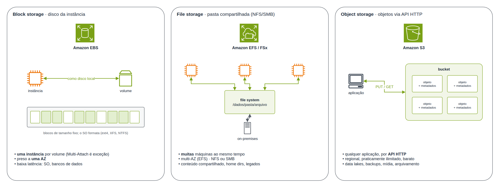
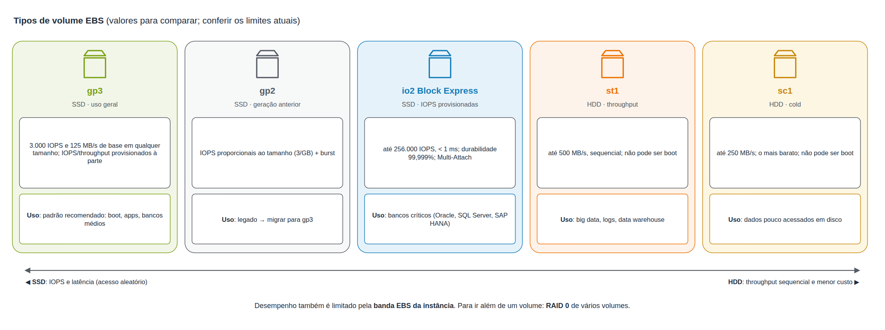

# Storage

> **Escopo:** _(em uma frase, o que este arquivo cobre)_
>
> **Por que cai na prova:** _(o ângulo que a SAP-C02 costuma explorar)_

## Índice

- **Block storage:** [Amazon EBS](#amazon-elastic-block-store-ebs)
- **Revisão:** [Qual serviço usar](#revisão-qual-serviço-usar)

## Amazon Elastic Block Store (EBS)

### Contexto: block, file e object storage

Na AWS, há três formas de guardar dados, e cada uma resolve um problema diferente:

- **Block storage (armazenamento em bloco):** o disco é dividido em **blocos** de tamanho fixo, e o **sistema operacional** da máquina decide o que gravar em cada bloco, formatando-o com um sistema de arquivos (ext4, XFS, NTFS). É o equivalente a um **disco rígido ou SSD** ligado a um computador. Só **uma máquina** usa o disco de cada vez, salvo exceções. Na AWS: **EBS** e o instance store.
- **File storage (armazenamento de arquivos):** um **sistema de arquivos compartilhado**, com pastas e arquivos, acessado pela rede por **várias máquinas ao mesmo tempo** (protocolos NFS ou SMB). É o equivalente a uma "pasta de rede" corporativa. Na AWS: **EFS** e a família **FSx**.
- **Object storage (armazenamento de objetos):** cada dado é um **objeto** inteiro (um arquivo + metadados), guardado e lido por **APIs HTTP** (`PUT`, `GET`), sem hierarquia real de pastas nem edição parcial. É praticamente ilimitado e barato. Na AWS: **S3**.

| | **Block (EBS)** | **File (EFS / FSx)** | **Object (S3)** |
|---|---|---|---|
| Como é acessado | Como um **disco local** da instância | Pela rede, como uma **pasta compartilhada** (NFS/SMB) | Por **API HTTP** |
| Quem acessa | **Uma instância** (Multi-Attach é exceção) | **Muitas** instâncias, containers e servidores | Qualquer aplicação, de qualquer lugar |
| Escopo | **Uma AZ** | Região (EFS) ou AZs configuradas | Região |
| Uso típico | Sistema operacional, bancos de dados, aplicações que precisam de disco de baixa latência | Conteúdo compartilhado, home dirs, aplicações legadas que usam arquivos | Data lakes, backups, mídia, sites estáticos, arquivamento |

[↑ Índice](#índice)

### O que é o EBS

O **Amazon Elastic Block Store** oferece **volumes de bloco** para instâncias EC2: discos virtuais que a instância enxerga como se fossem locais, mas que ficam **na rede** da AZ, separados do servidor físico. Os pontos que definem o serviço são:

- **Persistente:** o volume **existe independentemente da instância**. Ele sobrevive a stop/start e pode ser **desanexado** de uma instância e **anexado** a outra, como um HD externo. Ver a diferença para o instance store em [Armazenamento](compute-and-load-balancing.md#armazenamento).
- **Preso a uma AZ:** um volume só pode ser anexado a instâncias **da mesma AZ**. Para levá-lo a outra AZ ou região, o caminho é o **snapshot**.
- **Replicado dentro da AZ:** cada volume é replicado automaticamente em vários servidores **da mesma AZ**, o que protege contra falhas de hardware, mas **não** contra a falha da AZ inteira.
- **Durabilidade:** de 99,8% a 99,9% ao ano na maioria dos tipos, e **99,999%** no **io2**.
- **Cobrança pelo provisionado:** paga-se o **tamanho alocado** (GB/mês), usado ou não, mais IOPS e throughput extras nos tipos que permitem provisioná-los. Volumes **não anexados** continuam cobrando.
- **Desempenho depende também da instância:** cada tipo de instância tem um **limite de banda para EBS** (*EBS-optimized*). Um volume rápido em uma instância pequena fica limitado pela instância.

**Duas medidas de desempenho** aparecem em todas as questões:

- **IOPS:** quantas **operações** de leitura/escrita por segundo. Importa para acessos **pequenos e aleatórios**, como bancos de dados transacionais.
- **Throughput:** quantos **MB/s** são transferidos. Importa para leituras e escritas **grandes e sequenciais**, como big data, logs e processamento de vídeo.

[↑ Índice](#índice)

### Tipos de volume

| Tipo | Mídia | Desempenho | Características | Uso típico |
|---|---|---|---|---|
| **gp3** (General Purpose SSD) | SSD | Base de **3.000 IOPS** e **125 MB/s** em qualquer tamanho; IOPS e throughput **provisionados à parte**, sem aumentar o tamanho | **Padrão recomendado**; mais barato que o gp2 | A maioria das cargas: boot, aplicações, bancos de pequeno e médio porte |
| **gp2** (General Purpose SSD) | SSD | IOPS **proporcionais ao tamanho** (3 IOPS/GB), com *burst* por créditos em volumes pequenos | Geração anterior: para ganhar IOPS, era preciso aumentar o disco | Legado. **Migrar para gp3** reduz custo |
| **io2 Block Express** (Provisioned IOPS SSD) | SSD | Até **256.000 IOPS** e 4.000 MB/s por volume, latência abaixo de 1 ms | Durabilidade **99,999%**; **Multi-Attach** | Bancos de dados **críticos** e de alto desempenho (Oracle, SQL Server, SAP HANA) |
| **io1** (Provisioned IOPS SSD) | SSD | Até 64.000 IOPS | Geração anterior do io2; Multi-Attach | Legado |
| **st1** (Throughput Optimized HDD) | HDD | Até **500 MB/s**, baseado em throughput | **Não pode ser volume de boot** | Big data, data warehouses, processamento de logs: leitura **sequencial** grande e frequente |
| **sc1** (Cold HDD) | HDD | Até 250 MB/s | **O mais barato**; não pode ser boot | Dados **pouco acessados** que precisam ficar em disco |

**Como escolher:**
- precisa de **muitas IOPS** com **latência mínima** e alta durabilidade → **io2**;
- uso geral → **gp3**;
- grandes volumes **sequenciais** com muito throughput e baixo custo → **st1**;
- dados frios em disco → **sc1**.

> **Obs:** Os limites máximos dos tipos (principalmente do gp3 e do io2) têm sido **ampliados** nos últimos anos. Os valores acima servem para comparar os tipos, mas vale conferir os números atuais na documentação.

**Ir além de um volume:** se um único volume não basta, é possível combinar vários em **RAID 0** (*striping*) no sistema operacional, somando IOPS e throughput. Isso respeita o limite de banda EBS da instância. **RAID 1** (espelhamento) não é recomendado, porque o EBS já é replicado e o espelho dobra o tráfego de rede.

[↑ Índice](#índice)

### Elastic Volumes e Multi-Attach

- **Elastic Volumes:** é possível **aumentar o tamanho**, **mudar o tipo** (ex: gp2 → gp3) e **ajustar IOPS/throughput** de um volume **em uso**, sem desanexá-lo nem parar a instância.
  - Depois de aumentar o tamanho, é preciso **expandir o sistema de arquivos** no sistema operacional.
  - **Não é possível diminuir** o tamanho. Para isso, é preciso criar um volume menor e copiar os dados.
  - Há um intervalo mínimo entre duas modificações no mesmo volume, de algumas horas.
- **Multi-Attach** (io1/io2): o **mesmo volume** é anexado a **várias instâncias Nitro** (até 16) **na mesma AZ**, todas com leitura e escrita. A aplicação precisa de um **sistema de arquivos com suporte a cluster** (*cluster-aware*), que coordene as escritas. Sistemas comuns como ext4 e XFS **corrompem** os dados se duas máquinas escreverem ao mesmo tempo. É usado em clusters de alta disponibilidade de aplicações e bancos que gerenciam o acesso concorrente. Para arquivos compartilhados em geral, o serviço certo é o **EFS** ou o **FSx**.

[↑ Índice](#índice)

### Snapshots

Um **snapshot** é uma **cópia de um volume em um momento** (*point-in-time*), guardada no **S3** de forma gerenciada (você não vê o bucket). É a base de backup, recuperação e migração no EBS:

- **Incrementais:** o primeiro snapshot copia todos os blocos usados. Os seguintes copiam **só os blocos que mudaram**. Mesmo assim, cada snapshot pode ser restaurado sozinho, porque os blocos compartilhados são mantidos enquanto algum snapshot depender deles.
- **Regionais:** um snapshot pode ser restaurado em um volume em **qualquer AZ da região**. É assim que se "move" um volume entre AZs.
- **Cópia entre regiões e contas:** `copy-snapshot` para **DR** em outra região ou para **outra conta** (ex: uma conta de backup isolada).
- **Compartilhamento:** com contas específicas, ou público. Snapshots **criptografados** só podem ser compartilhados se usarem uma **chave KMS gerenciada pelo cliente** (*customer managed key*), com acesso concedido à conta de destino.
- **Consistência:** o snapshot captura o que **já foi gravado** no volume. Para bancos de dados, use snapshots **consistentes com a aplicação**: pause as escritas, use o *flush* do banco ou os **snapshots multi-volume** (*crash-consistent* entre vários volumes da mesma instância), ou deixe o **AWS Backup** coordenar com o VSS no Windows.

**Restauração e desempenho:**

- Um volume criado a partir de um snapshot fica disponível **na hora**, mas os blocos são carregados do S3 **sob demanda** (*lazy loading*). O **primeiro acesso** a cada bloco é **lento**.
- Para evitar isso:
  - **Fast Snapshot Restore (FSR):** habilitado por snapshot e por AZ, faz os volumes criados já virem com **desempenho total** desde o primeiro acesso. É **cobrado por hora**. É usado em DR com RTO baixo e em escalas rápidas a partir de AMIs.
  - **Inicialização manual:** ler todos os blocos do volume (ex: com `fio` ou `dd`) antes de colocá-lo em produção.

**Gestão de custo e retenção:**

- **Snapshot Archive:** move snapshots raramente acessados para um nível de arquivamento **até 75% mais barato**, com **retenção mínima de 90 dias** e **restauração de 24 a 72 horas**. É usado para retenção de longo prazo por compliance.
- **Recycle Bin:** snapshots (e AMIs) apagados vão para uma **lixeira** por um período definido em **regras de retenção**, e podem ser recuperados. Protege contra exclusão acidental ou maliciosa.
- **Data Lifecycle Manager (DLM):** **políticas** que criam, retêm e apagam snapshots automaticamente por tags, com cópia entre regiões e contas. É a automação **nativa e gratuita** do EBS.
- **AWS Backup:** backup **centralizado** de vários serviços (EBS, EC2, RDS, EFS, DynamoDB...), com planos, cópia entre regiões e **entre contas** via Organizations, e **Vault Lock**, que torna os backups **imutáveis** (WORM). É a resposta quando o cenário fala em **governança e compliance multi-conta**.

[↑ Índice](#índice)

### Criptografia

- **Criptografia com KMS** (AES-256): protege os **dados em repouso** no volume, os **snapshots** e os volumes criados a partir deles, e os dados **em trânsito** entre a instância e o volume. O impacto no desempenho é mínimo.
- **Encryption by default:** uma configuração **por região e por conta** que faz **todo volume novo** ser criptografado automaticamente. É a resposta para "garantir que nenhum volume seja criado sem criptografia". Ela pode ser reforçada com SCPs e AWS Config.
- **Não é possível criptografar um volume existente diretamente.** O caminho é:
  1. criar um **snapshot** do volume não criptografado;
  2. **copiar** o snapshot com a opção de criptografia, escolhendo a chave KMS;
  3. criar um **novo volume** a partir da cópia criptografada;
  4. trocar o volume da instância.

  O mesmo caminho serve para **trocar a chave KMS** de um volume.
- **Compartilhar entre contas:** use uma **customer managed key**, conceda acesso à conta de destino na **key policy**, e a conta de destino normalmente **copia** o snapshot e o recriptografa com **a própria chave**. Chaves **gerenciadas pela AWS** (`aws/ebs`) **não** podem ser compartilhadas.

[↑ Índice](#índice)

### Alta disponibilidade e recuperação

Como o EBS fica **em uma AZ**, a disponibilidade além da AZ é responsabilidade da arquitetura:

- **Falha da AZ:** o volume fica indisponível. Para continuar, é preciso **restaurar snapshots em outra AZ** (RTO de minutos, RPO = intervalo entre snapshots), ou ter **replicação no nível da aplicação** (ex: réplica do banco em outra AZ).
- **DR entre regiões:** **cópia de snapshots** para a região de DR (com DLM ou AWS Backup). Para RPO e RTO de segundos ou minutos em servidores inteiros, o **AWS Elastic Disaster Recovery** replica os volumes continuamente.
- **Bancos de dados gerenciados** (RDS, Aurora) cuidam da replicação entre AZs e regiões. Por isso, em muitas questões, "banco em EC2 com EBS" perde para um banco gerenciado quando o requisito é alta disponibilidade com o menor esforço operacional.
- **Dados compartilhados entre AZs:** EBS não serve, porque é preso a uma AZ. A resposta é **EFS** ou **FSx**.

[↑ Índice](#índice)

### Monitoramento e custo

- **CloudWatch:** `VolumeReadOps`/`VolumeWriteOps` (IOPS), `VolumeReadBytes`/`VolumeWriteBytes` (throughput), **`VolumeQueueLength`**, em que fila alta indica que o volume está no limite, e **`BurstBalance`** (gp2, st1, sc1), cujo esgotamento derruba o desempenho.
- **Status checks do volume:** indicam problemas de I/O.
- **Otimização de custo:**
  - migrar **gp2 → gp3**: mais barato e com IOPS independentes do tamanho;
  - apagar **volumes não anexados** e **snapshots antigos** (DLM, Recycle Bin com retenção curta);
  - usar o **Snapshot Archive** para retenção longa;
  - fazer o **rightsizing** de tipo, tamanho e IOPS com o **Compute Optimizer** e o **Trusted Advisor**.

[↑ Índice](#índice)

### Dicas para a prova

- "Banco de dados crítico com **IOPS muito altas** e latência abaixo de 1 ms" → **io2 Block Express**.
- "Uso geral com **menor custo**", ou "precisa de mais IOPS **sem aumentar** o disco" → **gp3**. "Reduzir custo dos volumes gp2" → migrar para **gp3** (Elastic Volumes, sem parada).
- "Processamento sequencial de grandes volumes (big data, logs) com **baixo custo**" → **st1**. "Dados frios em disco ao menor custo" → **sc1**. Nenhum dos dois serve como **boot**.
- "Mesmo volume em várias instâncias na mesma AZ, com aplicação que gerencia o acesso concorrente" → **Multi-Attach** (io1/io2). "Arquivos compartilhados entre instâncias/AZs" → **EFS/FSx**, não EBS.
- "Mover um volume para outra AZ ou região" → **snapshot** → restaurar na outra AZ / **copiar** para a outra região.
- "Volumes restaurados de snapshot estão **lentos** no início" → **Fast Snapshot Restore** (ou inicializar os blocos).
- "Automatizar snapshots com retenção e cópia entre regiões" → **Data Lifecycle Manager**. "Backup **centralizado** de vários serviços e contas, com backups **imutáveis**" → **AWS Backup** (+ Vault Lock).
- "Retenção de snapshots por anos ao menor custo" → **Snapshot Archive**. "Proteger contra exclusão acidental de snapshots" → **Recycle Bin**.
- "Garantir que todo volume novo seja criptografado" → **EBS encryption by default** (por região).
- "Criptografar um volume existente" ou "trocar a chave KMS" → snapshot → **copy-snapshot com criptografia** → novo volume.
- "Compartilhar snapshot criptografado com outra conta" → **customer managed KMS key** + key policy liberando a conta (não a chave `aws/ebs`).
- "Aumentar o volume sem parar a aplicação" → **Elastic Volumes** + expandir o sistema de arquivos. "Diminuir o volume" → criar um volume menor e copiar os dados.
- "Um volume não entrega o desempenho necessário" → **RAID 0** de vários volumes (respeitando a banda EBS da instância), ou uma instância com **mais banda EBS**.
- "Volume io2 rápido em instância pequena não atinge as IOPS provisionadas" → limite de **banda EBS da instância**.
- "Disco de altíssimo IOPS para dados temporários, sem custo extra" → **instance store**, não EBS.

[↑ Índice](#índice)

## Revisão: qual serviço usar

Resumo das comparações que mais aparecem nas questões. Os detalhes estão nas seções de cada serviço.

### Block storage (EBS)

| Pergunta do cenário | Solução |
|---|---|
| Uso geral, menor custo, IOPS sem aumentar o disco | [gp3](#tipos-de-volume) |
| IOPS extremas e latência mínima | [io2 Block Express](#tipos-de-volume) |
| Sequencial grande e barato / dados frios | [st1 / sc1](#tipos-de-volume) |
| Mesmo volume em várias instâncias da AZ | [Multi-Attach](#elastic-volumes-e-multi-attach) |
| Mover volume entre AZs ou regiões | [Snapshot e copy-snapshot](#snapshots) |
| Volume restaurado lento no início | [Fast Snapshot Restore](#snapshots) |
| Snapshots automáticos vs. backup centralizado multi-conta | [DLM vs. AWS Backup](#snapshots) |
| Criptografar volume existente / todo volume novo | [Snapshot + cópia / encryption by default](#criptografia) |
| Snapshot criptografado para outra conta | [Customer managed key](#criptografia) |

[↑ Índice](#índice)
